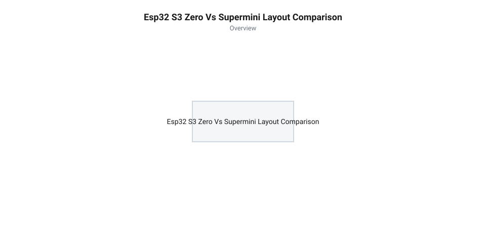
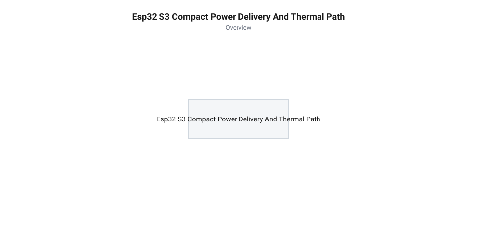
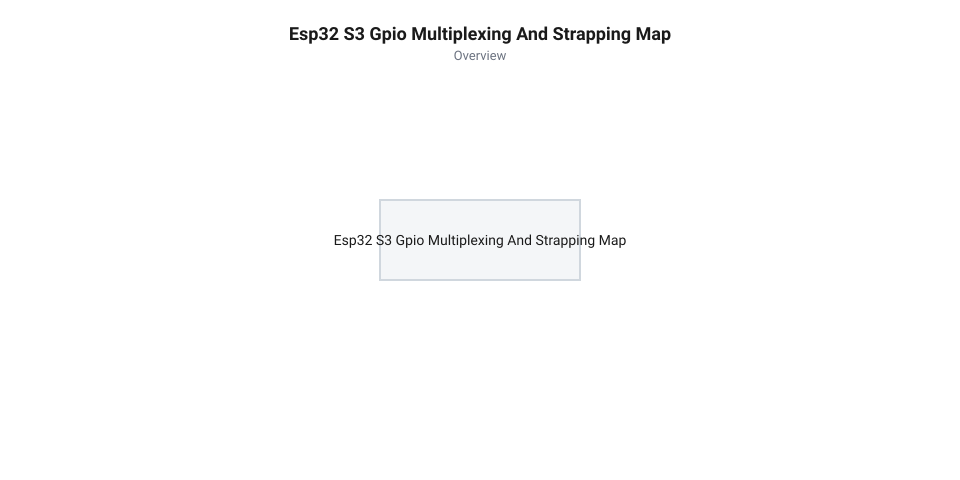
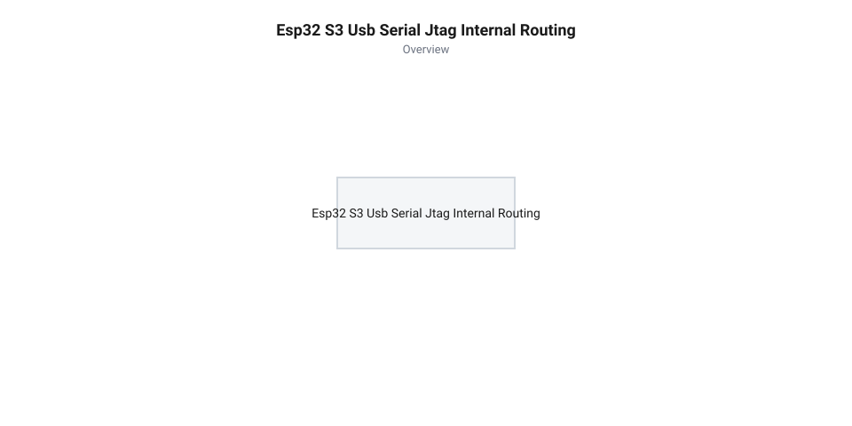

# esp32-s3-zero-supermini-boards

<preknowlist>
- [Мікроконтролер ESP32-S3](root:cat-hw-boards/esp32s3-microcontroller) — базову архітектуру ядра Xtensa LX7, структуру пам'яті та наявність вбудованого периферійного вузла USB OTG.
- [Родина плат і модулів на ESP32-S3](root:cat-hw-boards/esp32-s3-boards-family-overview) — загальний розподіл форм-факторів плат та відмінності між стандартними та компактними моделями.
- [Схемотехніка та розпіновка шин Octal SPI Flash та PSRAM в ESP32-S3](root:cat-hw-boards/esp32-s3-octal-spi-bus-layout) — перелік виводів GPIO, виділених для шини High-Speed SPI Flash та PSRAM.
- [Конфігурація eFuse та апаратне завантаження ESP32-S3](root:cat-hw-boards/esp32-s3-efuse-and-boot-configuration) — функціонал страпових контактів та логіку ініціалізації первинного завантажувача.
</preknowlist>

## Проблема компонування периферії в ультракомпактних пристроях

Розробка автономних носимих пристроїв, компактних сенсорних вузлів для розумного будинку, портативних апаратних токенів безпеки та недорогих @@en|USB@@-донглів неминуче висуває суворі вимоги до об'єму та маси друкованої плати. Прагнення розробника зменшити підсумкові габарити пристрою швидко наражається на конструктивний глухий кут при спробі використати стандартні відлагоджувальні плати. Традиційні модулі розробки мають масивні дворядні вивідні штирові гребінки з кроком 2.54 мм, громіздкі зовнішні мікросхеми мостів @@en|USB-UART@@ (такі як @@en|CP2102@@ чи @@en|CH340@@), лінійні регулятори живлення у великих корпусах та класичні роз'єми @@en|Micro-USB@@. Ці компоненти займають понад 70% корисної площі плати, унеможливлюючи її розміщення у герметичних корпусних виробах із внутрішнім об'ємом у кілька кубічних сантиметрів.

Спроба розв'язати проблему "в лоб" — шляхом зрізання мікросхеми мосту @@en|USB-UART@@ та використання безкорпусних мікроплат — часто призводить до нестабільної поведінки пристрою та випадкових зависань під час запуску. На стандартних відлагоджувальних платах зовнішній міст @@en|USB-UART@@ виконує важливу приховану функцію: його службові лінії @@en|DTR@@ та @@en|RTS@@ через транзисторну пару автоматичного скидання керують виводами @@en|EN@@ (апаратний скид) та @@en|GPIO0@@ (вибір режиму завантаження). У компактних платах без окремого мосту вивід @@en|GPIO0@@ часто підключають до зовнішніх периферійних давачів або користувацьких кнопок. Якщо під час подачі живлення зовнішня схема утримує напругу на виводі @@en|GPIO0@@ на низькому логічному рівні, мікроконтролер замкнеться у внутрішньому режимі первинного завантажувача @@en|ROM@@-коду (від @@en|Read-Only Memory@@, де корінь @@en|memory@@ означає енергонезалежне сховище, далі — режим @@en|download mode@@), і виконання прошивки користувача не розпочнеться.

Подібні пастки супроводжують і використання ліній @@en|GPIO45@@ та @@en|GPIO46@@. Лінія @@en|GPIO45@@ під час скиду вимірює стан зовнішнього логічного рівня для вибору напруги живлення внутрішнього LDO-регулятора флеш-пам'яті @@en|VDD_SPI@@ (1.8 В або 3.3 В). Помилкове зчитування високого рівня через підключену периферію перемикає живлення флеш-пам'яті на 1.8 В, що унеможливлює зчитування коду із мікросхеми 3.3 В @@en|SPI Flash@@ і призводить до повного апаратного блокування запусків. Своєю чергою, вивід @@en|GPIO46@@ контролює активацію виводу службових повідомлень @@en|ROM@@-завантажувача та вибір джерела завантажувального коду. Детальний аналіз логіки функціонування цих [страпових контактів](root:hw-arch/esp32-strapping-pins-and-boot-modes) є обов'язковою умовою при спроєктуванні схем підключення периферії на обмеженій кількості виводів.

Другим критичним обмеженням щільного монтажу є підсистема живлення та її тепловий режим. Вбудований радіопередавач @@en|Wi-Fi@@ мікроконтролера @@en|ESP32-S3@@ під час активного випромінювання пакетів підсилювачем потужності (від @@en|Power Amplifier@@, далі — @@en|PA@@) споживає короткочасні імпульсні струми з піковими значеннями від 350 мА до 500 мА тривалістю у сотні мікросекунд. У мікрогабаритних пристроях для зниження собівартості та збереження площі плати встановлюють компактні лінійні регулятори напруги з малим падінням напруги (від @@en|Low Dropout@@, де @@en|dropout@@ походить від англійського виразу @@en|drop out@@ — випадати з робочого діапазону при мінімальній різниці напруг, далі — @@en|LDO@@).

Потужність теплового розсіювання, що виділяється на корпусі @@en|LDO@@, розраховується за формулою:

P_diss = (V_in - V_out) · I_avg
[розрахунок розсіюваної потужності LDO]

де V_in — вхідна напруга живлення (наприклад, 5 В від роз'єму @@en|USB@@), V_out — регульована вихідна напруга 3.3 В, а I_avg — середній струм споживання пристрою з урахуванням піків @@en|Wi-Fi@@.

При живленні пристрою від стандартизованої шини @@en|USB@@ напругою 5 В та середньому струмі споживання 200 мА потужність втрат на регуляторі становить:

P_diss = (5.0 - 3.3) · 0.200 = 0.34 Вт
[обчислення втрат потужності на LDO]

Перевищення температури кристала регулятора понад температуру навколишнього середовища залежить від еквівалентного теплового опору друкованої плати:

ΔT = P_diss · R_θJA
[температурне зростання кристала]

У двошарових мікроплатах без великих суцільних мідних полігонів та без перехідних отворів для відведення тепла (від @@en|thermal vias@@, далі — @@en|теплові перехідні отвори@@) тепловий опір між кристалом та навколишнім середовищем R_θJA досягає 100–140 °C/W. Це викликає нагрів регулятора @@en|LDO@@ на 35–48 °C понад температуру середовища. У герметичному корпусі температура кристала @@en|LDO@@ швидко перетинає межу спрацьовування апаратного теплового захисту, що призводить до обмеження вихідного струму та глибокого просідання напруги 3.3 В нижче порогу 2.8 В (подія @@en|brownout reset@@). Мікроконтролер реагує на це падіння напруги раптовим апаратним перезавантаженням саме в момент встановлення @@en|Wi-Fi@@-з'єднання. Крім того, відсутність достатньої фільтраційної ємності з низьким еквівалентним послідовним опором (від @@en|Equivalent Series Resistance@@, далі — @@en|ESR@@) підсилює падіння напруги, спричиняючи збої у роботі внутрішніх системної пам'яті.

Історично еволюція ультракомпактних плат @@en|ESP32@@ проходила крізь декілька послідовних етапів розробки. Початком масової мініатюризації стали модулі @@en|ESP-01@@ на базі чипа @@en|ESP8266@@, які пропонували надзвичайно малі габарити, проте вимагали обов'язкового зовнішнього програматора та надавали лише 2 вільні лінії @@en|GPIO@@. Наступним кроком стала поява популярних плат [серії ESP32-CAM](root:cat-hw-boards/esp32-cam), де виробники змогли розмістити роз'єм камери та слот пам'яті, проте прошивка пристрою все ще вимагала зовнішнього перетворювача @@en|USB-UART@@, а спрощена схемотехніка живлення викликала збої під час роботи радіомодуля.

Справжній архітектурний прорив відбувся із виходом систем на кристалі @@en|ESP32-S3@@, у яких повноцінні можливості [архітектури мікроконтролера ESP32-S3](root:cat-hw-boards/esp32s3-microcontroller) поєднали з обчислювальними ядрами @@en|Xtensa LX7@@ та вбудованим периферійним вузлом @@en|USB OTG@@ (від @@en|On-The-Go@@, де корінь @@en|go@@ вказує на портативність та автономність роботи) і відлагоджувальним контролером @@en|USB Serial/JTAG@@. Інтеграція нативного контролера @@en|USB@@ дозволила повністю усунути з друкованої плати зовнішній мікросхемний міст та створити сучасні ультракомпактні форм-фактори @@en|ESP32-S3 Zero@@ та @@en|SuperMini@@. Узагальнену концепцію розподілу компактних форм-факторів детально розкрито у [огляді родини плат ESP32-S3](root:cat-hw-boards/esp32-s3-boards-family-overview). Для детальнішого ознайомлення з двоядерним процесором Tensilica LX7 та векторними інструкціями прискорення ШІ дивіться [архітектуру та можливості систем на кристалі ESP32-S3](root:hw-arch/esp32-s3-soc-architecture).

## Конструктивні особливості плат Zero та SuperMini

Усвідомлення вимог до мініатюризації дозволяє перейти до порівняльного аналізу конструкції двох наиболее поширених форм-факторів: плат @@en|Waveshare ESP32-S3 Zero@@ та @@en|ESP32-S3 SuperMini@@. Обидва варіанти побудовані на надкомпактних друкованих платах (від @@en|Printed Circuit Board@@, де корінь @@en|board@@ означає жорстку пластинчасту основу, далі — @@en|PCB@@) із зовнішніми габаритами приблизно 18 × 23.5 мм для @@en|Zero@@ та 18 × 22.5 мм для @@en|SuperMini@@, що лише трохи перевищує розміри самого мікроконтролера у корпусі @@en|QFN56@@ (від @@en|Quad Flat No-leads@@, де корінь @@en|flat@@ вказує на плоский корпус без виступаючих ніжок).

Головною конструктивною особливістю обох форм-факторів є застосування крайових зубчастих отворів (від @@en|castellated holes@@, де корінь @@en|castle@@ походить від латинського @@la|castellum@@ — фортеця з зубчастими мурами). Ці металізовані напів-отвори утворюються шляхом свердління стандартних наскрізних отворів із подальшою фрезерувальною обрізкою плати вздовж їхнього центрального осьового розрізу. Розташовані вздовж країв плати зі стандартним кроком 2.54 мм, вони надають модулю дуальне призначення. Розробник може впаяти класичні вивідні штирові гребінки для розміщення на безпайковій макетній платі або припаяти модуль безпосередньо поверх площадок материнської плати проєкту методом поверхневого монтажу (від @@en|Surface Mount Device@@, де корінь @@en|mount@@ означає прикріплення компонента до поверхні, далі — @@en|SMD@@). При паянні оплавленням (від @@en|reflow soldering@@) розплавлений припій утворює надійну бічну галтель (від @@en|solder fillet@@), що ліквідує потребу в міжплатних роз'ємах та зменшує підсумкову висоту модуля на материнській платі до 3.2 мм.

На поверхні плати розміщено мініатюрні тактові @@en|SMD@@-кнопки @@en|Boot@@ (підключену до службової лінії @@en|GPIO0@@) та @@en|Reset@@ (підключену до лінії апаратного скиду @@en|EN@@). Торцеву частину обох плат займає міцно закріплений роз'єм @@en|USB Type-C@@, корпусні металеві вушка якого мають наскрізне або розширене @@en|SMD@@-паяння для запобігання механічному відриву від @@en|PCB@@ при багаторазовому висмикуванні кабелю.

Для організації бездротового радіозв'язку застосовується компактна керамічна чип-антена (від @@en|ceramic chip antenna@@) або витравлена безпосередньо на мідному шарі @@en|PCB@@ компактна 3D-антена, що виключає потребу в зовнішніх антенних кабелях та коаксіальних роз'ємах @@en|U.FL/IPEX@@. При розведенні материнської плати під модуль із чип-антеною обов'язково витримується зона відчуження міді (від @@en|keep-out zone@@), оскільки наявність мідних полігонів або трас під антеною розналагоджує резонансну частоту 2.4 ГГц і суттєво зменшує радіус дії @@en|Wi-Fi@@ та @@en|Bluetooth@@.

Схемотехнічні відмінності між оригінальною платою [Waveshare ESP32-S3-Zero](root:cat-hw-boards/esp32-s3-zero) та платою [форм-фактора ESP32-S3 SuperMini](root:cat-hw-boards/esp32-s3-supermini) полягають у способі корпусування системної пам'яті та оптимізації розведення ліній @@en|GPIO@@:

1. **Waveshare ESP32-S3 Zero**: Побудована на чипі у виконанні "система в пакеті" (від @@en|System-in-Package@@, де корінь @@en|package@@ означає монолітне корпусування декількох кристалів у єдиній мікросхемі, далі — @@en|SiP@@), зокрема модифікації @@en|ESP32-S3FH4R2@@. Всередині єдиного мікросхемного корпусу розміром 7 × 7 мм інтегровано кристали обчислювального ядра, 4 МБ флеш-пам'яті @@en|Quad SPI Flash@@ та 2 МБ оперативної пам'яті @@en|PSRAM@@. Відсутність окремих зовнішніх корпусів пам'яті на @@en|PCB@@ усуває паразитичні ємності трас та дозволяє платі @@en|Zero@@ вивести на крайові castellated-контакти максимальну кількість ліній @@en|GPIO@@ (зокрема @@en|GPIO1@@–@@en|GPIO14@@, @@en|GPIO21@@, @@en|GPIO35@@–@@en|GPIO42@@). Крім того, мінімальна довжина внутрішніх трас у корпусі @@en|SiP@@ знижує рівень електромагнітних завад (від @@en|Electromagnetic Interference@@, далі — @@en|EMI@@). Особливості побудови таких інтегрованих рішень описано у матеріалі про [компактні SiP-модулі](root:cat-hw-boards/esp32-s3-mini-sip-modules).

2. **ESP32-S3 SuperMini**: Зазвичай використовує чип @@en|ESP32-S3@@ без внутрішньої пам'яті @@en|PSRAM@@ або зі спрощеною схемотехнікою зовнішнього корпусу флеш-пам'яті. Внаслідок цього частина внутрішніх виводів зарезервована під підключення кристала флеш-пам'яті, що обмежує набір зовнішніх контактів. Загальні деталі розведення високошвидкісних [шин Octal SPI Flash](root:cat-hw-boards/esp32-s3-octal-spi-bus-layout) та доступу до [зовнішньої пам'яті PSRAM](root:hw-arch/esp32-s3-psram-spi-flash-bus) пояснюють, чому на платі @@en|SuperMini@@ користувачеві доступні лише 13 виводів @@en|GPIO@@ (зокрема @@en|GPIO1@@–@@en|GPIO9@@, @@en|GPIO10@@–@@en|GPIO13@@, а також апаратні виводи @@en|USB D+@@/@@en|D-@@ @@en|GPIO19@@ та @@en|GPIO20@@).

Наочне співвідношення геометричного компонуваня, розташування кнопок та castellated-виводів обох форм-факторів демонструє наступна фігура:


*Конструктивне порівняння компонування плат форм-факторів ESP32-S3 Zero та SuperMini.*

Таким чином, розробник отримує чіткі критерії вибору: якщо проєкт вимагає обробки потокового відео, складних графічних інтерфейсів чи об'ємних мережевих буферів, необхідна плата @@en|Waveshare Zero@@ з @@en|SiP@@-пам'яттю @@en|PSRAM@@. Якщо ж задача полягає в опитуванні автономних давачів з мінімальною собівартістю, оптимальним вибором стане плата @@en|SuperMini@@.

## Схемотехніка живлення та тепловий режим LDO

Забезпечення надійної роботи мікроконтролерного вузла в герметичному або малогабаритному корпусі розпочинається з проєктування підсистеми живлення. На відміну від громіздких відлагоджувальних плат, де встановлено потужні імпульсні перетворювачі напруги або масивні лінійні регулятори у металізованих корпусах @@en|SOT-223@@, ультракомпактні плати @@en|Waveshare ESP32-S3 Zero@@ та @@en|ESP32-S3 SuperMini@@ оснащені мікродеталями у корпусах @@en|SOT-23-5@@ чи @@en|DFN-6@@. Головне завдання цього вузла — пониження зовнішньої вхідної напруги живлення `V_in` (рівня 5 В від роз'єму @@en|USB Type-C@@ або 3.7–4.2 В від літій-полімерного акумулятора, від @@en|Lithium-Polymer@@, далі — @@en|LiPo@@) до стабілізованого рівня `V_out = 3.3 В`, необхідного для внутрішніх структур мікроконтролера @@en|ESP32-S3@@. Для цього на платах використовують мікросхеми лінійних регуляторів напруги з малим падінням напруги @@en|LDO@@.

Основний схемотехнічний виклик полягає у характерному профілі струму споживання системи на кристалі @@en|ESP32-S3@@. У стані спокою або при виконанні обчислювальних задач ядрами @@en|Xtensa LX7@@ споживання чипа становить від 30 мА до 70 мА. Проте під час увімкнення підсилювача потужності вбудованого радіопередавача @@en|Wi-Fi@@ (від @@en|Power Amplifier@@, далі — @@en|PA@@) струм споживання зростає серією гострих імпульсних кидків із амплітудою від 350 мА до 500 мА тривалістю в кілька сотень мікросекунд. Якщо підсистема живлення не здатна миттєво віддати такий струм, напруга на лінії 3.3 В просідає нижче критичного порогу 2.8 В. Це викликає активацію внутрішнього схематичного детектора зниження напруги й призводить до апаратного перезавантаження мікроконтролера (події @@en|brownout reset@@) безпосередньо під час спроби підключення до бездротової мережі.

Повний фізико-математичний аналіз втрат потужності та імпульсних навантажень описує [розрахунок балансу живлення](root:cat-hw-boards/esp32-s3-zero-supermini-boards/math-compact-pcb-power-thermal-calc.md) у герметичних конструкціях. Теплова потужність `P_diss`, яка безпосередньо розсіюється на кремнієвому кристалі регулятора @@en|LDO@@ у вигляді тепла, дорівнює добутку різниці напруг між входом і виходом на середній струм споживання `I_avg`:

P_diss = (V_in - V_out) · I_avg
[розрахунок розсіюваної потужності LDO]

де V_in — значення вхідної напруги на виводі живлення, V_out — регульована вихідна напруга 3.3 В, а I_avg — усереднений струм споживання пристрою з урахуванням періодичності випромінювання @@en|Wi-Fi@@ пакетів.

Результуюче підвищення температури кристала регулятора `ΔT` понад температуру навколишнього середовища всередині корпусу обчислюється через еквівалентний тепловий опір "кристал — навколишнє середовище" (від англійського виразу @@en|Junction-to-Ambient Thermal Resistance@@, далі — `R_θJA`):

ΔT = P_diss · R_θJA
[температурне зростання кристала]

На ультракомпактних друкованих платах площею менше 4 см² через відсутність великих мідних полігонів та обмежену кількість теплопровідних міжшарових перехідних отворів значення `R_θJA` досягає 130–160 °C/W.

**Розрахунок теплового режиму при живленні від шини 5 В USB.**

Розглянемо роботу плати в герметичному пластиковому корпусі при вхідній напрузі живлення `V_in = 5.0 В` та середньому струмі споживання `I_avg = 0.200 А` (200 мА) під час активного обміну даними через @@en|Wi-Fi@@.

Обчислюємо потужність втрат на регуляторі @@en|LDO@@:

P_diss = (5.0 - 3.3) · 0.200
= 1.7 · 0.200            [обчислення різниці вхідної та вихідної напруг]
= 0.34 Вт                [множення падіння напруги на середній струм]

Визначаємо зростання температури кристала `ΔT` при тепловому опорі `R_θJA = 140 °C/W`:

ΔT = 0.34 · 140
= 47.6 °C                [множення втрат потужності на тепловий опір]

Якщо температура всередині закритого корпусу пристрою становить 35 °C, температура кристала @@en|LDO@@ досягне 82.6 °C. У разі спроби заживити пристрій від зовнішнього джерела напругою 9 В розсіювана потужність зросте до `(9.0 - 3.3) · 0.200 = 1.14 Вт`, що спричинить стрибок температури `ΔT = 1.14 · 140 = 159.6 °C`. Це миттєво активує внутрішній термозахист регулятора (що спрацьовує при 150 °C) та примусово вимкне вихідну напругу 3.3 В, знеструмивши мікроконтролер.

Для запобігання просіданню напруги під час імпульсних піків струму @@en|Wi-Fi@@ паралельно виходу регулятора @@en|LDO@@ обов'язково встановлюють накопичувальну групу керамічних конденсаторів загальною ємністю від 10 мкФ до 22 мкФ. Вирішальною характеристикою цих конденсаторів є еквівалентний послідовний опір (від @@en|Equivalent Series Resistance@@, далі — @@en|ESR@@). Використання багатошарових керамічних конденсаторів типу @@en|X5R/X7R@@ із значенням @@en|ESR@@ не більше 10–20 мОм забезпечує швидку віддачу накопиченого заряду в перші мікросекунди імпульсу, коли контур зворотного зв'язку регулятора @@en|LDO@@ ще не встиг зреагувати на зміну навантаження.

При проєктуванні портативних пристроїв з живленням від акумулятора @@en|LiPo@@ напруга джерела змінюється від 4.2 В (повністю заряджений стан) до 3.0 В (розряджений стан). При вхідній напрузі `V_in = 3.7 В` розсіювана потужність на регуляторі знижується до `P_diss = (3.7 - 3.3) · 0.200 = 0.08 Вт`, що майже повністю усуває проблему нагріву. Для захисту від зворотного протікання струму при одночасному підключенні кабелю @@en|USB Type-C@@ та акумулятора в коло живлення вбудовують бар'єрний діод з низьким прямим падінням напруги (від прізвища німецького фізика Вальтера Шотткі, далі — @@en|діод Шотткі@@ або @@en|Schottky diode@@) чи P-канальний польовий транзистор (від @@en|Metal-Oxide-Semiconductor Field-Effect Transistor@@, далі — @@en|MOSFET@@).

Практичну реалізацію автономної підсистеми живлення зі схематичним захистом та акумулятором розкрито у [проєкті бездротового сенсорного вузла](root:cat-hw-boards/esp32-s3-zero-supermini-boards/proj-miniature-wireless-sensor-node.md).

Взаємозв'язок між джерелом живлення, керамічними фільтрами та шляхами розсіювання тепла показано на наступній схемі:


*Схема кола живлення та теплового розсіювання LDO-регулятора на компактній друкованій платі.*

## Розподіл GPIO та уникнення службових пасток

Після організації стабільного живлення розробник стикається з обмеженим набором зовнішніх контактів загального призначення (від @@en|General Purpose Input/Output@@, далі — @@en|GPIO@@). Мікроконтролер @@en|ESP32-S3@@ у корпусі @@en|QFN56@@ містить 45 цифрових ліній, однак у компактних форм-факторах більша частина з них недоступна на крайових контактах плати. Причина полягає у внутрішньому трасуванні високошвидкісних шин системної пам'яті. У конфігураціях з 8-бітною пам'яттю @@en|Octal SPI Flash@@ або @@en|PSRAM@@ лінії `GPIO26`–`GPIO32` та `GPIO33`–`GPIO37` жорстко зарезервовані для обміну даними між кристалом SoC та пам'яттю. Детальний розподіл цих трас висвітлено у довіднику щодо [шин Octal SPI Flash](root:cat-hw-boards/esp32-s3-octal-spi-bus-layout).

На платі @@en|Waveshare ESP32-S3 Zero@@ завдяки монолітному корпусу "система в пакеті" (від @@en|System-in-Package@@, далі — @@en|SiP@@) розробникам вдалося вивести 21 контакт @@en|GPIO@@ (`GPIO1`–`GPIO14`, `GPIO21`, `GPIO35`–`GPIO42`). Натомість на платі @@en|ESP32-S3 SuperMini@@ користувачеві доступні лише 13 зовнішніх виводів (`GPIO1`–`GPIO9`, `GPIO10`–`GPIO13`, а також лінії `GPIO19` і `GPIO20`, які за замовчуванням суміщені з апаратним виводом @@en|USB D+/D-@@). Повну апаратну специфікацію виводів обох плат згруповано у [специфікації залізного інтерфейсу](root:cat-hw-boards/esp32-s3-zero-supermini-boards/api-esp32-s3-zero-supermini-hardware-pinout.md).

Головна небезпека при розведенні периферії на такій обмеженій кількості контактів полягає в наявності службових конфігураційних ліній (від англійського дієслова @@en|strap@@, що походить від давньоанглійського @@en|stropp@@ — зв'язувати або фіксувати стан, далі — @@en|страпові контакти@@ або @@en|strapping pins@@). Стан цих виводів опитується апаратною схемою завантаження мікроконтролера в коротке вікно часу, коли напруга на лінії апаратного скиду `EN` піднімається від 0 В до 3.3 В.

До критичних страпових контактів @@en|ESP32-S3@@ належать три виводи:

1. **GPIO0**: Контролює режим завантаження первинного @@en|ROM@@-коду. Якщо під час зняття сигналу скиду на `GPIO0` утримується високий логічний рівень 3.3 В, мікроконтролер розпочинає виконання програми з флеш-пам'яті (режим @@en|SPI Flash Boot@@). Якщо ж на `GPIO0` присутній низький рівень 0 В, чип переходить у режим завантаження через внутрішній перетворювач (далі — @@en|download mode@@). Якщо розробник підключає до `GPIO0` зовнішній давач із низькоомним резистором підтяжки до землі або кнопку беззахисного опитування, пристрій при увімкненні зависає у завантажувачі й не виконує основний код. 2. **GPIO45**: Визначає робочу напругу внутрішнього регулятора живлення флеш-пам'яті `VDD_SPI`. Низький рівень 0 В при скиді встановлює напругу `VDD_SPI = 3.3 В`, а високий рівень 3.3 В перемикає її на `1.8 В`. Помилкова зовнішня підтяжка `GPIO45` до 3.3 В призводить до зниження живлення 3.3 В мікросхеми флеш-пам'яті до 1.8 В, що повністю блокує зчитування коду та перетворює плату на непрацездатний пристрій. 3. **GPIO46**: Разом із `GPIO0` вибирає джерело завантажувального коду та режим виводу відлагоджувальних повідомлень @@en|ROM@@-завантажувача. Під час скиду вивід `GPIO46` повинен утримувати низький логічний рівень 0 В.

Принцип функціонування конфігураційних елементів детально пояснює [аналіз апаратного завантаження](root:cat-hw-boards/esp32-s3-efuse-and-boot-configuration), а практичні правила роботи з ними розкрито у матеріалі про [страпові контакти мікроконтролерів](root:hw-arch/esp32-strapping-pins-and-boot-modes).

Завдяки внутрішній матриці комутації периферії (від латинського @@la|multiplex@@ — багатократний, далі — @@en|мультиплексування@@ та @@en|GPIO Matrix@@) розробник має можливість перепризначати будь-які цифрові шини на безпечні фізичні виводи. Для побудови надійної системи слід дотримуватися наступної картографії розподілу:

- **Шина I2C (для давачів)**: Рекомендовано призначати на лінії `GPIO1` (сигнал тактування `SCL`) та `GPIO2` (сигнал даних `SDA`). Ці виводи є повністю безпечними при запуску та належать до першого блоку аналого-цифрового перетворювача (від @@en|Analog-to-Digital Converter@@, далі — @@en|ADC1@@). - **Шина SPI (для дисплеїв та карт пам'яті)**: На платі @@en|SuperMini@@ безпечно використовувати групу `GPIO4` (`SCK`), `GPIO5` (`MISO`), `GPIO6` (`MOSI`) та `GPIO7` (`CS`). - **Послідовний порт UART**: Для підключення зовнішніх модулів зв'язку найкраще використовувати апаратні лінії `GPIO43` (`TX0`) та `GPIO44` (`RX0`). - **Аналогові виводи ADC**: Слід обирати виключно з блоку `ADC1` (`GPIO1`–`GPIO10`), оскільки лінії блоку `ADC2` (`GPIO11`–`GPIO20`) апаратно блокуються внутрішнім арбітром під час активної роботи радіомодуля @@en|Wi-Fi@@.

Розподіл доступних ліній та службових зон наочно ілюструє наступна діаграма:


*Діаграма розподілу ліній GPIO та критичних службових контактів ESP32-S3.*

Приклад програмного налаштування шин @@en|I2C@@ та @@en|UART@@ на безпечних контактах без задіювання страпових ліній у середовищах @@en|ESP-IDF@@ та @@en|Arduino@@ демонструють наступні фрагменти коду:

:::tabs
@tab ESP-IDF
:::code esp32-s3-zero-supermini-boards-d/c/esp-idf/init-safe-peripherals.c
@tab Arduino
:::code esp32-s3-zero-supermini-boards-d/cpp/arduino/setup.cpp
:::

Завдяки чіткому розділенню функцій контактів розробник повністю захищає пристрій від спонтанних блокувань завантаження та створює надійну основу для налаштування апаратного відлагодження.

## Апаратне відлагодження через USB Serial JTAG

Традиційна розробка мікроконтролерних пристроїв спирається на виведення текстових повідомлень через послідовний порт @@en|UART@@ (від @@en|Universal Asynchronous Receiver-Transmitter@@, далі — @@en|UART@@). Проте у разі виникнення складних апаратних збоїв — таких як переповнення стеку, помилки доступу до пам'яті (події @@en|Guru Meditation Error@@) чи непередбачувані перегони сигналів — звичайного текстового логування виявляється недостатньо. Розробник змушений вручну додавати десятки налагоджувальних інструкцій виводу та раз у раз повторно перекомпілювати прошивку. На стандартних платах розробки розв'язанням цієї проблеми є підключення зовнішнього апаратного програматора-відлагоджувача (такого як @@en|ESP-Prog@@ на базі мікросхеми @@en|FT2232@@). Однак на ультракомпактних платах форм-факторів @@en|Waveshare ESP32-S3 Zero@@ та @@en|ESP32-S3 SuperMini@@ для таких масивних роз'ємів і додаткових виводів просто немає місця на друкованій платі.

Усунути потребу в зовнішніх перетворювачах дозволяє вбудований у систему на кристалі @@en|ESP32-S3@@ периферійний вузол @@en|USB Serial/JTAG@@. На відміну від мікроконтролерів попереднього покоління, де диференційні лінії даних @@en|USB D+@@ (`GPIO20`) та @@en|USB D-@@ (`GPIO19`) вимагали зовнішніх мостів, у @@en|ESP32-S3@@ кремнієві лінії контролера розведені безпосередньо на фізичні контакти роз'єму @@en|USB Type-C@@. Внутрішній апаратний модуль @@en|PHY@@ (від @@en|Physical Layer@@, далі — @@en|PHY@@) мультиплексує дві незалежні логічні функції поверх єдиної фізичної диференційної пари:

1. **Канал USB Serial CDC**: Забезпечує віртуальний послідовний порт для миттєвого виводу системних логів первинного @@en|ROM@@-завантажувача та повідомлень макросів `ESP_LOGI`/`printf` без використання зовнішніх чипів @@en|CP2102@@ чи @@en|CH340@@. У меню налаштувань прошивки `menuconfig` розробник вибирає орієнтацію виводу консолі `Component config -> ESP System Settings -> Channel for console output -> USB Serial/JTAG Controller`. 2. **Апаратний адаптер JTAG TAP**: Надає прямий доступ до внутрішнього контролера відлагодження двох ядер @@en|Xtensa LX7@@ (від @@en|Joint Test Action Group@@, далі — @@en|JTAG@@, та @@en|Test Access Port@@, далі — @@en|TAP@@).

Завдяки цьому розробник отримує можливість одночасно виводити текстові логи та проводити покрокове відлагодження коду через один стандартний кабель @@en|USB Type-C@@. Повний внутрішній устрій цього вузла висвітлює [нативний USB-інтерфейс](root:hw-arch/esp32-s3-native-usb-cdc-jtag).

Взаємозв'язок між зовнішнім роз'ємом, апаратним мультиплексором та внутрішніми відлагоджувальними модулями чипа показано на наступній схематичній діаграмі:


*Схема внутрішнього підключення апаратного вузла USB Serial/JTAG до ліній USB D+/D-.*

Для організації живого відлагодження у середовищі розробки @@en|ESP-IDF@@ використовується утиліта @@en|OpenOCD@@ (від @@en|Open On-Chip Debugger@@, де корінь @@en|debugger@@ означає засіб усунення помилок у коді, далі — @@en|OpenOCD@@). При запускi команди `idf.py openocd` сервер підключається до вбудованого контролера @@en|USB Serial/JTAG@@ за його апаратними ідентифікаторами `VID:PID = 0x303a:0x1001`. Відлагоджувач @@en|GDB@@ (від @@en|GNU Debugger@@, далі — @@en|GDB@@) під'єднується до локального мережевого сокета `localhost:3333` і надає повний спектр можливостей апаратного контролю:

- **Встановлення апаратних точок зупинки**: Використовуються внутрішні регістри процесора `IBREAK0` та `IBREAK1` (від англійського виразу @@en|break point@@ — точка зупинки виконання коду, далі — @@en|апаратна точка зупинки@@ або @@en|breakpoint@@), що дозволяє зупиняти виконання коду в пам'яті Flash без модифікації байтів інструкцій. - **Точки спостереження за пам'яттю**: Внутрішні регістри `DBREAK0` та `DBREAK1` (від @@en|watchpoint@@, далі — @@en|точка спостереження@@) дозволяють перехоплювати моменти читання або запису за конкретною адресою в оперативній пам'яті @@en|SRAM@@. - **Покрокове виконання**: Команди `step` та `next` дозволяють проходити виконання програми по окремих рядках C/C++. - **Аналіз аварійних дампів**: При виникненні фатальної помилки команда `backtrace` (або `bt`) показує точний стек викликів функцій та значення регістрів процесора на момент аварії (події @@en|coredump@@, від англійських слів @@en|core@@ та @@en|dump@@ — дамп стану оперативної пам'яті, далі — @@en|дамп пам'яті@@ або @@en|coredump@@).

При роботі з апаратним відлагоджувальним вузлом слід враховувати важливі схемотехнічні та програмні обмеження. Якщо у конфігурації захисту чипа перепалено одноразові електронні запобіжники (від @@en|electronic fuse@@, далі — @@en|eFuse@@) `DIS_USB_JTAG` або `DIS_USB_SERIAL_JTAG`, апаратний модуль відлагодження вимикається на рівні кремнію. Крім того, якщо у користувацькій програмі лінії `GPIO19` та `GPIO20` перепризначити як звичайні цифрові входи чи виходи, зв'язок з @@en|OpenOCD@@ миттєво обривається. Картографію безпечного використання виводів містить [специфікація залізного інтерфейсу](root:cat-hw-boards/esp32-s3-zero-supermini-boards/api-esp32-s3-zero-supermini-hardware-pinout.md).

Приклад ініціалізації консольного виводу через нативний вузол @@en|USB Serial/JTAG@@ та робочий сценарій взаємодії з @@en|OpenOCD@@ і @@en|GDB@@ наведено у наступних вкладках:

:::tabs
@tab ESP-IDF
:::code esp32-s3-zero-supermini-boards-d/c/esp-idf/app-main.c
@tab Сесія GDB
```cpp|arduino
// Запуск сервера OpenOCD у терміналі:
// idf.py openocd

// Запуск та підключення відлагоджувача GDB:
// xtensa-esp32s3-elf-gdb -ex "target remote localhost:3333" build/app-name.elf

// Приклади основних команд GDB:
// (gdb) break app_main       // Встановлення точки зупинки на початку функції
// (gdb) continue             // Продовження виконання програми
// (gdb) print counter        // Вивід значення змінної counter
// (gdb) backtrace            // Вивід стека викликів функцій при збої
```
:::

## Програмний стек TinyUSB та емуляція пристроїв

Використання вузла @@en|USB Serial/JTAG@@ вирішує задачі логування та відлагодження, однак створення автономних периферійних пристроїв — таких як апаратні клавіатури, миші, зовнішні накопичувачі або специфічні контролери — вимагає гнучкого управління USB-протоколом. Для цього мікроконтролер @@en|ESP32-S3@@ оснащено другим, повністю програмованим апаратним контролером — периферійним вузлом @@en|USB OTG@@ (від @@en|On-The-Go@@, далі — @@en|USB OTG@@).

На відміну від фіксованого вузла відлагодження, контролер @@en|USB OTG@@ підтримує повний специфікований стек протоколу @@en|Full-Speed USB 2.0@@ зі швидкістю передачі даних до 12 Мбіт/с та частотою кадрів маркерів SOF (від @@en|Start of Frame@@, далі — @@en|SOF@@) у 1 кГц. Для керування цим апаратним блоком без низькорівневої маніпуляції регістрами в середовищах @@en|ESP-IDF@@ та @@en|Arduino@@ інтегровано відкритий програмний стек @@en|TinyUSB@@.

Програмна архітектура @@en|TinyUSB@@ спирається на формування структурованих описів пристрою — дескрипторів (від латинського @@la|descriptor@@ — описувач даних, далі — @@en|дескриптор@@ або @@en|USB descriptor@@). Основними типами дескрипторів є:

1. **Дескриптор пристрою** (`tusb_desc_device_t`): Задає ідентифікатор виробника (від @@en|Vendor ID@@, далі — @@en|VID@@), ідентифікатор продукту (від @@en|Product ID@@, далі — @@en|PID@@), клас пристрою та розмір буфера нулевої кінцевої точки (64 байти). 2. **Дескриптор конфігурації** (`tusb_desc_configuration_t`): Визначає параметри живлення, режими сну та перелік активних інтерфейсів. 3. **Дескриптори інтерфейсів та конечних точок**: Описують канали передачі даних (від англійських слів @@en|end@@ та @@en|point@@ — кінцева точка передачі даних, далі — @@en|конечна точка@@ або @@en|endpoint@@). Конечні точки бувають вхідними (від @@en|IN endpoint@@, передача від пристрою до хоста) та вихідними (від @@en|OUT endpoint@@, передача від хоста до пристрою).

Стек @@en|TinyUSB@@ працює за подійною моделлю: при отриманні або відправці пакета викликаються функції зворотного виклику, такі як `tud_mount_cb()`, `tud_umount_cb()` чи `tud_hid_report_complete_cb()`. Детальний опис функцій містить [довідник програмного інтерфейсу](root:cat-hw-boards/esp32-s3-zero-supermini-boards/api-tinyusb-esp32s3-cdc-hid-msc.md) для налаштування стека.

На платах форм-факторів @@en|ESP32-S3 Zero@@ та @@en|SuperMini@@ стек @@en|TinyUSB@@ дозволяє реалізувати три основні класи пристроїв:

- **USB CDC (Communication Device Class)**: Створює віртуальний послідовний COM-порт з високою пропускною здатністю для обміну користувацькими бінарними даними. - **USB HID (Human Interface Device)**: Перетворює плату на пристрій введення — клавіатуру, мишу чи ігровий контролер. Структура звітів (від @@en|HID report descriptor@@) описує формат передачі 8-байтних масивів для клавіатури, де передаються модифікатори (Control, Shift, Alt) та скан-коди клавіш згідно з таблицею @@en|USB HID Usage Tables@@. На операційних системах @@en|Windows@@, @@en|Linux@@ та @@en|macOS@@ пристрій працює без встановлення додаткових драйверів. Це є основою для побудови макропадів та токенів аутентифікації, що описано у матеріалі про [проєкт USB-аутентифікатора](root:cat-hw-boards/esp32-s3-zero-supermini-boards/proj-usb-dongle-hid-authenticator.md). - **USB MSC (Mass Storage Class)**: Надає операційній системі комп'ютера доступ до внутрішньої флеш-пам'яті чи карт пам'яті у вигляді звичайного флеш-накопичувача. У середовищі @@en|ESP-IDF@@ це реалізується через шар вирівнювання зносу флеш-пам'яті (від @@en|Wear Leveling@@, далі — @@en|WL@@) та файлову систему @@en|FATFS@@, дозволяючи комп'ютеру зчитувати та записувати файли конфігурації напряму у блочному режимі.

При проєктуванні пристроїв на @@en|TinyUSB@@ слід зважати на пастки компонування та живлення. Для створення складних композитних пристроїв (від латинського @@la|compositus@@ — складений, далі — @@en|композитний пристрій@@), що одночасно суміщають профілі @@en|CDC@@ та @@en|HID@@, у дескрипторах обов'язково використовуються дескриптори асоціації інтерфейсів (від @@en|Interface Association Descriptor@@, далі — @@en|IAD@@). На компактних платах @@en|SuperMini@@, де лінію виявлення вхідної напруги шини (від @@en|VBUS sensing@@) не розведено на окремий вивід @@en|GPIO@@, у програмі необхідно апаратно або програмно примусово вмикати режим виявлення підключення хоста (`board_vbus_sense_init()`). Логіку функціонування апаратного перемикання між контролерами пояснює [апаратний модуль USB](root:hw-arch/esp32-s3-native-usb-cdc-jtag).

Приклад реалізації емуляції пристрою введення @@en|USB HID@@ (автоматичне відправлення комбінації клавіш) на мовах C та C++ у середовищах @@en|ESP-IDF@@ та @@en|Arduino@@ наведено нижче:

:::tabs
@tab ESP-IDF
:::code esp32-s3-zero-supermini-boards-d/c/esp-idf/send-hid-key-a.c
@tab Arduino
:::code esp32-s3-zero-supermini-boards-d/cpp/arduino/setup-2.cpp
:::