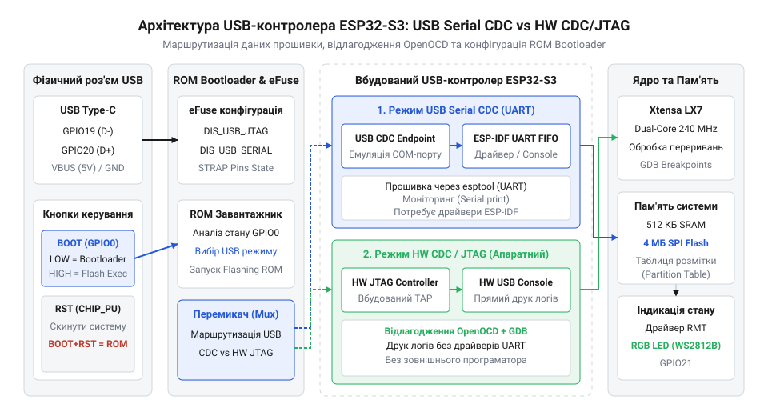
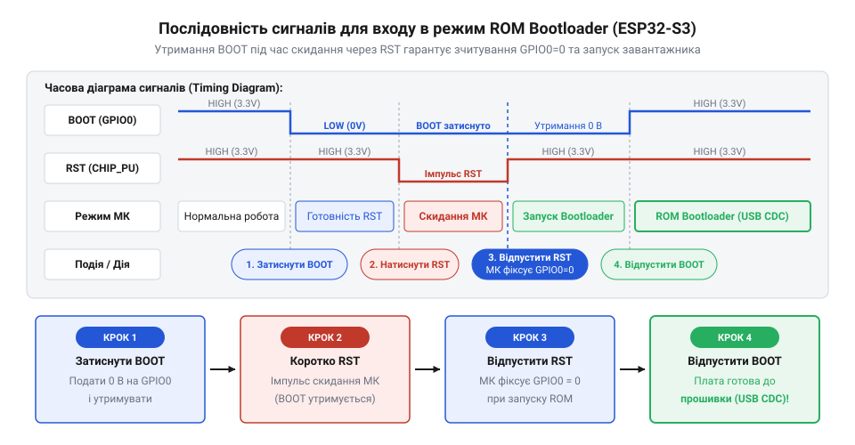

# Програмний інтерфейс прошивки, USB CDC/JTAG та конфігурації ESP32-S3-Zero

<preknowlist>
- [Мікроконтролер ESP32-S3](root:cat-hw-boards/esp32s3-microcontroller) — базову архітектуру периферії USB та структуру оперативної й флеш-пам'яті чипа
</preknowlist>

## Проблема прошивки через вбудований USB

Підключення плати @@en|ESP32-S3-Zero@@ до комп'ютера через кабель @@en|USB Type-C@@ здається найпростішим шляхом для прошивки та відлагодження. Проте розробники часто зіштовхуються з неприємною ситуацією: після завантаження нового коду віртуальний послідовний порт пристрою раптово зникає з системи, а повторна спроба записати програму завершується помилкою тайм-ауту. На відміну від класичних налагоджувальних плат, де між контролером і ПК встановлено окрему мікросхему мосту (наприклад, @@en|CH340@@ або @@en|CP2102@@), на платі @@en|ESP32-S3-Zero@@ виводи роз'єму @@en|USB@@ підключені безпосередньо до апаратного периферійного блоку всередині [чипа серії ESP32-S3](root:cat-hw-boards/esp32s3-microcontroller).

Коли обмін даними покладається на внутрішню периферію, надійність з'єднання повністю залежить від стану та конфігурації прошивки. Виводи @@en|GPIO19@@ та @@en|GPIO20@@ фізично призначені для передачі диференційних сигналів @@en|D-@@ та @@en|D+@@ шини @@en|USB@@, тому їхня робота напряму пов'язана з внутрішнім трансивером. Якщо завантажена програма містить помилку — наприклад, звернення за некоректною адресою в пам'яті, нескінченний цикл із вимкненими перериваннями або переконфігурацію виводів @@en|GPIO19@@ та @@en|GPIO20@@ у режим звичайного цифрового вводу-виводу — системний стек @@en|USB@@ негайно припиняє роботу. При спотворенні сигналів на диференційній парі або зупинці програмного драйвера операційна система комп'ютера втрачає відповіді на опитування хост-контролера і скасовує енумерацію пристрою (з англ. @@en|enumeration@@, від лат. *enumeratio* — перелічення, процес розпізнавання та конфігурації пристрою на шині). У результаті комп'ютер втрачає фізичний зв'язок із пристроєм, і звичайне перезавантаження за допомогою кнопки скидання лише повторно запускає аварійний код. Без розуміння того, як влаштовано внутрішній контролер @@en|USB PHY@@ (з англ. @@en|Physical Layer@@, фізичний рівень), розробник ризикує втратити можливість керування пристроєм через стандартний кабель.

Такий збій зумовлений подвійною природою внутрішнього периферійного контролера. При початковому запуску мікроконтролера апаратний @@en|ROM Bootloader@@ (з англ. @@en|Read-Only Memory Bootloader@@, завантажник із постійного запам'ятовувального пристрою) підтримує з'єднання незалежно від стану флеш-пам'яті. Після старту користувацького коду керування портом переходить до програмного драйвера, який зупиняється разом із заблокованою програмою. Через це для стабільної прошивки та відлагодження необхідно чітко розрізняти апаратні та програмні режими роботи внутрішнього інтерфейсу @@en|USB@@.

## Режими USB Serial CDC та JTAG

Вбудований інтерфейс мікроконтролера @@en|ESP32-S3@@ може працювати у двох принципово різних режимах: програмному @@en|USB Serial CDC@@ (з англ. @@en|Communications Device Class@@, клас пристроїв зв'язку) та апаратному @@en|HW CDC/JTAG@@. Вибір між ними визначає, який саме блок відповідає за обробку пакетів шини та чи збережеться зв'язок при зависанні основного коду.


*Архітектурне розмежування апаратного блоку HW CDC/JTAG та системного стека USB Serial CDC у мікроконтролері ESP32-S3.*

У режимі @@en|USB Serial CDC@@ трансляцію даних виконує програмний драйвер у складі операційної системи @@en|FreeRTOS@@. Це дає гнучкість: пристрій може емулювати клавіатуру, мишу або складні @@en|USB Composite@@ пристрої. Але ціною цієї гнучкості є повна залежність від виконання системного коду. Якщо прошивка заблокує виклик переривань або впаде у @@en|Panic Handler@@, обробка @@en|USB@@ зупиниться, а послідовний порт зникне з операційної системи.

Натомість режим @@en|HW CDC/JTAG@@ реалізовано повністю апаратно в силіконі [мікроконтролера ESP32-S3](root:cat-hw-boards/esp32s3-microcontroller). Вибір фізичного тракту зв'язку визначають прапорці @@en|eFuse@@ (з англ. @@en|electronic fuse@@ — електронний запобіжник), які під час старту чипа напряму комутують внутрішній трансивер фізичного рівня @@en|USB PHY@@ (з англ. @@en|Physical Layer@@ — фізичний рівень). Після увімкнення апаратний модуль презентує шині суміщені ендпоінти (з англ. @@en|Endpoint@@ — кінцева точка) — окремі незалежні кінцеві точки для консолі @@en|CDC@@ та відлагоджувача @@en|JTAG@@. Завдяки цьому контролер обробляє USB-пакети незалежно від процесорних ядер Xtensa. Навіть якщо програма користувача зависне або припинить обслуговувати периферію, апаратний вузол підтримуватиме віртуальний @@en|COM-порт@@ для завантаження коду та повноцінний інтерфейс @@en|JTAG@@ для внутрішньосхемного відлагодження через @@en|GDB@@. Для плати @@en|ESP32-S3-Zero@@ це робить @@en|HW CDC/JTAG@@ найнадійнішим вибором під час розробки.

## Налаштування середовищ ESP-IDF та Arduino

Щоб забезпечити коректну прошивку та вивід текстових логів через прямий роз'єм @@en|USB Type-C@@, необхідно правильно зконфігурувати середовище розробки перед компіляцією. Невірно виставлені параметри призведуть до того, що виклики `printf` або `Serial.println` спрямовуватимуться у непідключений апаратний @@en|UART0@@ замість шини @@en|USB@@.

В середовищі @@en|Arduino IDE@@ у меню **Tools** для плати @@en|ESP32-S3-Zero@@ потрібно встановити такі базові опції:
- **USB CDC On Boot**: *Enabled* (активує ініціалізацію консолі @@en|CDC@@ одразу при старті завантажника @@en|Bootloader@@).
- **Upload Mode**: *UART0 / Hardware CDC* (визначає канал завантаження через апаратний модуль).
- **USB Firmware MSC On Boot**: *Disabled* (вимикає емуляцію накопичувача, якщо вона не потрібна).

У фреймворку @@en|ESP-IDF@@ конфігурація виконується у файлі `sdkconfig` через утиліту `menuconfig`. Для перенаправлення системного виводу в апаратний модуль встановлюються прапорці:

```ini
CONFIG_ESP_CONSOLE_USB_SERIAL_JTAG=y
CONFIG_ESP_CONSOLE_SECONDARY_NONE=y
```

Ці налаштування вказують системній бібліотеці `stdout` відправляти символи у внутрішній апаратний реєстратор @@en|HW CDC/JTAG@@, що гарантує отримання повідомлень у терміналі комп'ютера одразу після скидання чипа.

У разі використання середовища @@en|PlatformIO@@ аналогічні параметри задаються декларативно у файлі `platformio.ini` через макроси компілятора, оскільки графічні меню налаштування тут відсутні. Для активації консолі та прямої роботи з периферією [мікроконтролера ESP32-S3](root:cat-hw-boards/esp32s3-microcontroller) до директиви `build_flags` додають прапорці `-D ARDUINO_USB_CDC_ON_BOOT=1` та `-D ARDUINO_USB_MODE=1`. Якщо ж прошивка виконується напряму через консольну утиліту @@en|esptool@@, розробник має вказати шлях до віртуального послідовного порту, який утворює внутрішній контролер @@en|HW CDC/JTAG@@, та задати параметри автоскидання. Типовий виклик `esptool.py --port COMx --baud 460800 --before default_reset --after hard_reset write_flash 0x0 firmware.bin` передає комбінацію сигналів @@en|DTR/RTS@@ по шині @@en|USB@@, що змушує завантажник примусово прийняти новий бінарний код без використання зовнішніх апаратних програматорів.

## Конфігурація Flash-пам'яті та таблиці розділів

Компактна плата @@en|ESP32-S3-Zero@@ оснащена зовнішньою мікросхемою @@en|SPI Flash@@ обсягом 4 МБ, у той час як додаткова пам'ять @@en|PSRAM@@ на цьому модулі становить 2 МБ (на відміну від більших плат [родини Waveshare ESP32-S3R2](root:cat-hw-boards/esp32-s3r2-waveshare)). Це вимагає раціонального розподілу наявного простору Flash між кодом програми, системними даними та енергонезалежним сховищем @@en|NVS@@ (з англ. @@en|Non-Volatile Storage@@).

Для максимальної продуктивності обміну даними з пам'яттю у параметрах компіляції обирають режим @@en|QIO@@ (з англ. @@en|Quad I/O SPI@@) на частоті 80 МГц. Структура розміщення даних задається спеціальною таблицею розділів (з англ. @@en|partition table@@). Стандартна конфігурація на 4 МБ ділить пам'ять наступним чином:

```csv
# Name,   Type, SubType, Offset,  Size, Flags
nvs,      data, nvs,     0x9000,  0x5000,
otadata,  data, ota,     0xe000,  0x2000,
app0,     app,  ota_0,   0x10000, 0x140000,
app1,     app,  ota_1,   0x150000,0x140000,
spiffs,   data, spiffs,  0x290000,0x170000,
```

Якщо оновлення по повітрю @@en|OTA@@ (з англ. @@en|Over-The-Air@@) не використовуються, розділ `app1` можна вилучити, об'єднавши простір у єдиний блок `app0` розміром до 3 МБ. Це дозволяє розмістити об'ємні бібліотеки машинного навчання або ресурси веб-сервера без ризику виходу за межі фізичного накопичувача.

## Керування RGB-світлодіодом через драйвер RMT

Для візуальної індикації стану пристрою на платі @@en|ESP32-S3-Zero@@ встановлено мініатюрний адресований @@en|RGB@@-світлодіод @@en|WS2812B@@, підключений до лінії @@en|GPIO21@@. Протокол обміну @@en|WS2812B@@ вимагає суворого дотримання часових інтервалів (імпульси тривалістю від 300 нс до 900 нс), тому звичайне програмне перемикання виводу через затримки не забезпечує стабільності.

Для формування точних часових послідовностей застосовують апаратний периферійний модуль @@en|RMT@@ (з англ. @@en|Remote Control Peripheral@@, периферійний модуль дистанційного керування). Він генерує потрібні хвильові форми у фоновому режимі без залучення процесора.

:::tabs
:::code api-esp32-s3-zero-flashing-and-usb/c/esp-idf/init-rgb-led.c
:::code api-esp32-s3-zero-flashing-and-usb/cpp/arduino/setup.cpp
:::

Апаратний модуль здатний індикувати поточний стан системи: зелений колір означає успішну ініціалізацію @@en|USB@@, синій — режим прошивки, а червоний спалах сигналізує про помилку в роботі програми.

## Аварійне відновлення в режимі ROM Bootloader

При помилковій конфігурації стека @@en|USB Serial CDC@@ або пошкодженні завантажника плата може перестати реагувати на команди середовища розробки. Для виходу з цього стану в мікроконтролері @@en|ESP32-S3@@ передбачено апаратний режим @@en|ROM Bootloader@@, записаний у маскове ПЗ чипа на заводі.


*Часова послідовність керуючих сигналів ліній BOOT та RST під час ініціалізації апаратного ROM Bootloader.*

Для примусового переведення плати @@en|ESP32-S3-Zero@@ у режим відновлення виконують таку послідовність дій з кнопками @@en|BOOT@@ (GPIO0) та @@en|RST@@ (Reset):

1. Натиснути та утримувати кнопку @@en|BOOT@@.
2. Натиснути та відпустити кнопку @@en|RST@@ (при цьому вивід Reset замикається на землю, скидаючи кристал).
3. Зачекати близько 0.5 секунди та відпустити кнопку @@en|BOOT@@.

Під час старт-апу первинний завантажник @@en|ROM@@ зчитує стан виводу @@en|GPIO0@@. Якщо в момент зняття сигналу скидання на @@en|GPIO0@@ присутній низький логічний рівень, чип зупиняє виконання коду з Flash-пам'яті й активує вбудований апаратний @@en|USB PHY@@ у режимі завантаження. У системі з'являється стабільний пристрій `ESP32-S3 ROM Bootloader`, після чого утиліта `esptool.py` може безперешкодно очистити пам'ять та записати справну прошивку.
