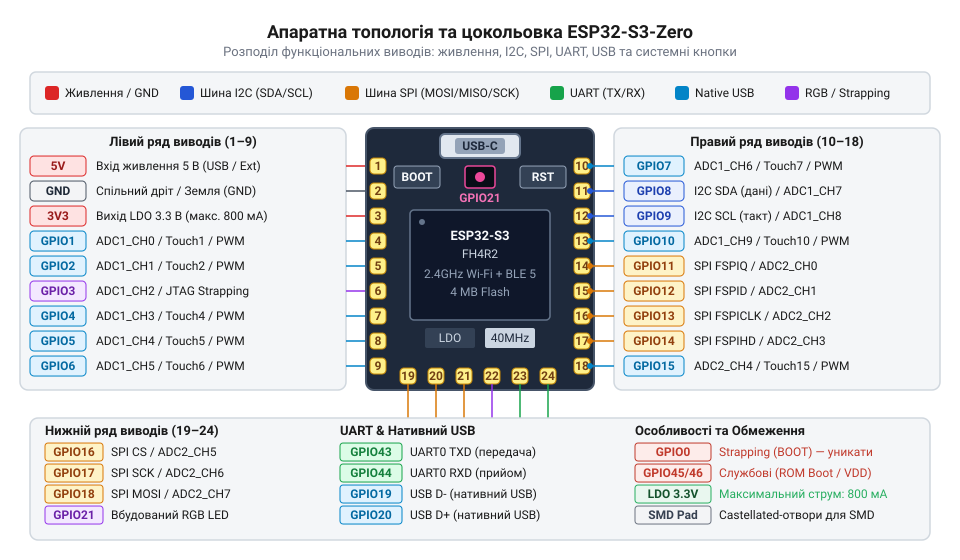
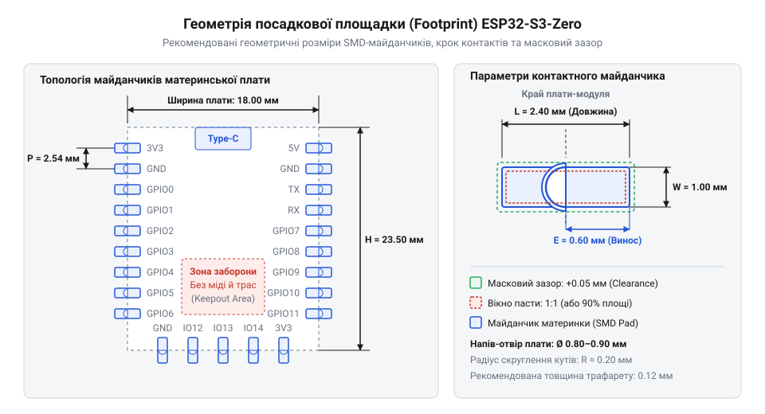

# Залізний інтерфейс ESP32-S3-Zero: цокольовка, схема живлення та castellated-монтаж

<preknowlist>
- [Мікроконтролер ESP32-S3](root:cat-hw-boards/esp32s3-microcontroller) — Базова апаратна архітектура ESP32-S3, матриця сигналів GPIO, функції системних strapping-виводів та робота з нативним USB JTAG/Serial контролером.
</preknowlist>

## Ризики помилкового підключення ESP32-S3-Zero

Спроба спрощено сприймати мініатюрну плату ESP32-S3-Zero як звичайну налагоджувальну плату із вільними контактами швидко призводить до апаратних збоїв та термічного пошкодження її компонентів. На відміну від більших розробницьких плат, де силові стабілізатори мають значний запас за струмом та тепловідводом, ультракомпактний модуль оснащено вхідним LDO-стабілізатором (англ. @@en|Low Dropout Regulator@@, від лат. *stabilis* — стійкий) з обмеженою потужністю розсіювання. Спроба заживити від лінії `3.3V` зовнішні реле, підсвічування чи графічні дисплеї викликає перегрів стабілізатора та просідання напруги живлення під час пікових імпульсів споживання бездротового передавача @@en|Wi-Fi@@. Через малі габарити плати ємність її вбудованих фільтруючих конденсаторів (англ. @@en|decoupling capacitor@@, від лат. *condensare* — згущувати) є недостатньою для згладжування цих мікросекундних сплесків струму. Коли накопичений у ємностях заряд виснажується швидше, ніж стабілізатор відпрацьовує стрибок навантаження, напруга живлення падає нижче порогу, на який налаштовано вбудований у [мікроконтролер ESP32-S3](root:cat-hw-boards/esp32s3-microcontroller) модуль @@en|Brownout Detector@@. Спрацьовування цього детектора зниження напруги негайно перезапускає систему, перетворюючи роботу пристрою на циклічну серію відмов.

Друга поширена помилка пов'язана з призначенням периферійних пристроїв на системні виводи (англ. @@en|strapping pin@@, від англ. @@en|strap@@ — фіксувати). При увімкненні живлення мікроконтролер опитує логічні рівні на цих виводах для вибору режиму завантаження. Якщо зовнішній датчик чи підтягувальний резистор примусово зафіксує вивід `GPIO0` у низькому стані під час скидання, модуль не розпочне виконання внутрішньої прошивки, а перейде в режим завантажувача @@en|ROM Download Mode@@. Подібним чином некоректне підключення зовнішніх кіл до контактів нативного інтерфейсу (англ. @@en|Universal Serial Bus@@, скорочено @@en|USB@@) `GPIO19` та `GPIO20` блокує прошивку пристрою та діагностичне введення-виведення. Як і у випадку з іншими рішеннями на базі [потужних плат ESP32-S3](root:cat-hw-boards/esp32s3-microcontroller), проектування схемотехніки для ESP32-S3-Zero вимагає чіткого розмежування системних, службових та вільних виводів (англ. @@en|General Purpose Input/Output@@, від англ. @@en|general@@ — загальний та @@en|purpose@@ — призначення, скорочено @@en|GPIO@@).

## Апаратна топологія та розподіл виводів

Компактні габарити плати ESP32-S3-Zero визначають щільну апаратну топологію, де кожен контактний майданчик виведено на крайові напів-отвори. Попри те, що внутрішня матриця сигналів мікроконтролера дозволяє перепризначати цифрові функції на будь-які фізичні піни, безпечна та стабільна розводка вимагає дотримання апаратної цокольовки. Для підключення зовнішніх датчиків та цифрових периферійних шин виділяють універсальні лінії @@en|GPIO@@, вільні від системних функцій завантаження.


*На схемі показано контактні виводи плати з колірним кодуванням шин I2C, SPI, UART, нативного USB та вбудованого RGB-світлодіода.*

При організації послідовних інтерфейсів та аналогових входів рекомендовано дотримуватися апаратних прив'язок, що мінімізують навантаження на внутрішній комутатор сигналів:
- **Шина I2C** (англ. @@en|Inter-Integrated Circuit@@, від лат. *inter* — між та *integrum* — цілісний): лінії `GPIO1` (SDA) та `GPIO2` (SCL) або `GPIO8`/`GPIO9` підключаються з зовнішніми підтягувальними резисторами до лінії `3.3V`.
- **Шина SPI** (англ. @@en|Serial Peripheral Interface@@, від лат. *series* — ряд): виводи `GPIO10` (CS), `GPIO11` (MOSI), `GPIO12` (SCK) та `GPIO13` (MISO) забезпечують високошвидкісний обмін із накопичувачами та зовнішньою пам'яттю.
- **Шина UART** (англ. @@en|Universal Asynchronous Receiver-Transmitter@@): лінії `GPIO43` (TX) та `GPIO44` (RX) слугують для зв'язку з додатковими мікроконтролерами або зовнішніми радіомодемами.
- **Канали ADC** (англ. @@en|Analog-to-Digital Converter@@, від лат. *analogus* — відповідний та *digitus* — палець): виводи `GPIO1`–`GPIO10` належать до першого блоку ADC1, а лінії `GPIO11`–`GPIO13` підключено до другого блоку ADC2. Під час активного обміну даними через @@en|Wi-Fi@@ внутрішній радіотракт монопольно захоплює модуль ADC2 для підтримання зв'язку. Через цей апаратний конфлікт спроби зчитати аналоговий сигнал із виводів `GPIO11`–`GPIO13` під час роботи мережі повертають викривлені значення або викликають помилки. Для підключення аналогових датчиків слід обирати виключно лінії ADC1.

Окрему групу утворюють апаратно зафіксовані лінії. Виводи `GPIO19` (USB_D-) та `GPIO20` (USB_D+) виведені безпосередньо на роз'єм @@en|USB Type-C@@ для роботи вбудованого контролера @@en|USB Serial/JTAG@@. Вивід `GPIO21` жорстко розведено на вхід вбудованого адресного триколірного світлодіода (англ. @@en|Red-Green-Blue@@, скорочено @@en|RGB@@) WS2812. На відміну від [компактних платах SuperMini](root:cat-hw-boards/esp32-s3-supermini), де світлодіод може керуватися звичайним виводом загального призначення, тут використано послідовний протокол керування.

## Схема живлення та розрахунок навантаження

Схема живлення ESP32-S3-Zero побудована за двоконтурним принципом. Первинна напруга `5V` надходить від роз'єму @@en|USB Type-C@@ (лінія VBUS) або від одного з контактних виводів `5V`. Вбудований стабілізатор @@en|LDO@@ понижує цю напругу до робочого рівня `3.3V`, від якого живиться сам чип процесора та зовнішня периферія. При цьому теплова потужність, що розсіюється на корпус стабілізатора, обчислюється як добуток спаду напруги `(5V - 3.3V = 1.7V)` на загальний струм споживання.

Під час активації бездротового передавача Wi-Fi струм споживання процесорного ядра має виражений імпульсний характер із піками до `350 mA`. Якщо номінальний граничний струм LDO-стабілізатора становить `500 mA`, реальний енергетичний бюджет для зовнішніх модулів суттєво обмежується. Для визначення граничного струму зовнішньої периферії `I_ext_max` обчислимо різницю між максимально допустимим струмом @@en|LDO@@ та піковим споживанням процесорного ядра з урахуванням бездротового передавача:

```
I_ext_max = I_LDO_max - I_MCU_peak
= 500 mA - 350 mA      [віднімання пікового струму чипа від номіналу LDO]
= 150 mA               [допустимий тривалий струм периферії]
```

Отримане значення `150 mA` показує, що підключення кількох енергоємних модулів (наприклад, графічного дисплея на `90 mA` та силового реле на `80 mA`) перевищує номінал стабілізатора й спричиняє падіння напруги нижче порогу в `2.8 V` із перезавантаженням плати за сигналом @@en|Brownout Detector@@. На відміну від [модулів формату Pico](root:cat-hw-boards/esp32-s3-pico) з потужними імпульсними перетворювачами, ESP32-S3-Zero вимагає підключення зовнішніх силових навантажень виключно до лінії `5V` через додаткові автономні стабілізатори. Також слід пам'ятати, що подача напруги понад `3.6V` безпосередньо на лінію `3.3V` виводить мікроконтролер із ладу без можливості відновлення.

## Обмеження системних та службових виводів

Правильна конфігурація службових виводів гарантує передбачуване завантаження системи та стабільну роботу комунікацій. Головну увагу при проектуванні приділяють виводам конфігурації режиму завантаження — @@en|strapping pin@@. Вивід `GPIO0` оснащено внутрішнім підтягувальним резистором до лінії `3.3V`. Стан високого логічного рівня під час внутрішнього скидання спрямовує процесор до виконання коду з внутрішньої пам'яті @@en|Flash@@. Якщо підключена периферія підтягує `GPIO0` до землі через низький імпеданс, пристрій безумовно блокується у режимі @@en|ROM Download Mode@@.

Інші службові виводи також мають фіксовані системні обмеження:
- **`GPIO45` та `GPIO46`**: Вивід `GPIO46` має внутрішній стягувальний резистор до землі. Подача високого логічного рівня на `GPIO46` під час скидання змінює конфігурацію виведення системних логів @@en|ROM@@ та може порушити нормальний старт.
- **`GPIO19` та `GPIO20`**: Працюють як дифпара `USB_D-` / `USB_D+`. Приєднані до них зовнішні підтягувальні резистори чи ємності порушують хвильовий опір лінії, унаслідок чого комп'ютер втрачає пристрій @@en|USB Serial/JTAG@@.
- **`GPIO21`**: Опитується вбудованою матрицею світлодіода @@en|WS2812@@. Для зміни кольору свічення використовують послідовний однопровідний код із тактовою частотою `800 kHz` (протокол @@en|NeoPixel@@). Використання `GPIO21` як звичайного цифрового входу призводить до хаотичного мерехтіння світлодіода або виникнення паразитних струмів через вхідний шар виводу.

На відміну від [варіантів із PSRAM](root:cat-hw-boards/esp32-s3r2-waveshare) чи [плат серії C6-Zero](root:cat-hw-boards/esp32-c6-zero), де системна топологія може відрізнятися, на ESP32-S3-Zero службові лінії рекомендовано залишати за їхнім прямим призначенням або використовувати з обережністю лише після завершення стадії завантаження.

## Технологія castellated-монтажу на власну плату

Модуль ESP32-S3-Zero розроблено з урахуванням технології поверхневого монтажу завдяки використанню напів-отворів (англ. @@en|Castellated Hole@@, від лат. *castellum* — замковий виступ). Це дозволяє встановлювати плату безпосередньо на материнську друковану плату (англ. @@en|Printed Circuit Board@@, скорочено @@en|PCB@@) як стандартний компонент поверхневого монтажу (англ. @@en|Surface Mount Device@@, від англ. @@en|surface@@ — поверхня, скорочено @@en|SMD@@) без використання проміжних штирових роз'ємів.


*Зображено креслення контактних майданчиків материнської плати з розмірами та зазорами під напів-отвори ESP32-S3-Zero.*

Для створення надійного паяного з'єднання під час проектування посадкового місця (англ. @@en|footprint@@) материнської плати необхідно дотримуватися специфічних технологічних вимог:
1. **Вилет контактних майданчиків**: Паяльні контактні майданчики на материнській платі повинні виходити за зовнішній контур модуля на `0.5–0.8 mm`. Це забезпечує формування якісного галтеля паяного шва (англ. @@en|solder fillet@@), що дозволяє візуально контролювати пропаювання кожного виводу.
2. **Паяльна маска та трафарет**: Розширення вікна паяльної маски має становити `0.05–0.1 mm` на бік щодо майданчика. Апертура трафарету (англ. @@en|stencil@@) для нанесення паяльної пасти проектується у співвідношенні 1:1, щоб запобігти утворенню припайних містків між сусідніми виводами із кроком `1.27 mm`.
3. **Зона відчуження антени**: У зоні розташування вбудованої друкованої антени на материнській платі обов'язково передбачають зону відчуження (англ. @@en|keep-out@@). На всіх шарах материнської плати безпосередньо під антеною та на відстані щонайменше `5 mm` навколо неї заборонено заливати мідні полігони заземлення, проводити сигнальні доріжки чи розміщувати металеві елементи.

На відміну від [модулів типу ESP32-CAM](root:cat-hw-boards/esp32-cam), які потребують додаткових роз'ємів для підключення периферії, суцільний castellated-монтаж ESP32-S3-Zero забезпечує мінімальну висоту профілю готового пристрою та високу механічну стійкість до вібраційних навантажень.
