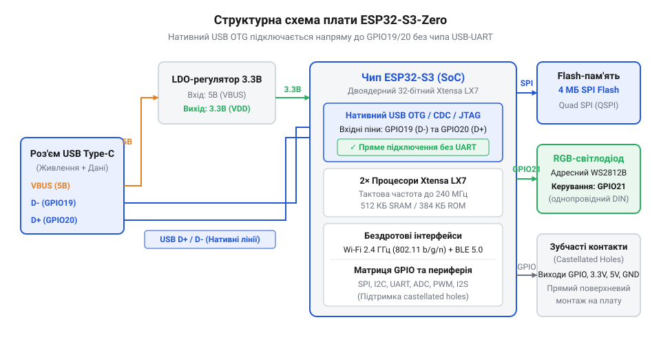
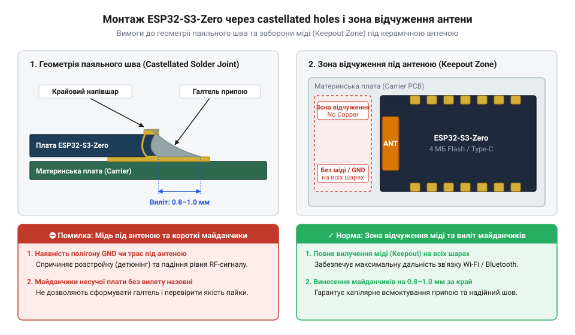
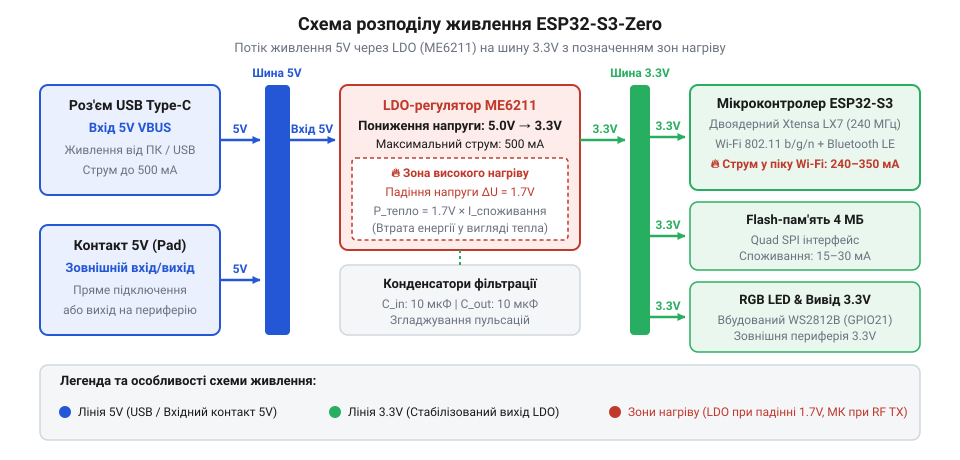

# ESP32-S3-Zero (Type-C, 4 МБ)

<preknowlist>
- [Мікроконтролер ESP32-S3](root:cat-hw-boards/esp32s3-microcontroller) — архітектура ядра Xtensa LX7, система пам'яті та бездротові периферійні модулі Wi-Fi і Bluetooth LE
</preknowlist>

## Обмеження габаритів та вибір ESP32-S3-Zero

Спроба вмістити повноцінний мікроконтролерний вузол у компактний корпус роутера, USB-флешки чи натільного датчика швидко впирається у фізичні габарити стандартних макетних плат. Класичні розробницькі модулі мають довжину понад п'ять сантиметрів і масивні штиреві роз'єми, які унеможливлюють щільне компонування. Створення власної друкованої плати з "голим" чипом вимагає складного проєктування високочастотного тракту антени та сертифікації радіомодуля. У таких умовах оптимальним розв'язком стає плата @@en|ESP32-S3-Zero@@, яка збирає обчислювальне ядро, антенний тракт та інтерфейсний роз'єм на друкованій платі розміром лише 23.5×18 мм.

*Структурна організація апаратних блоків плати ESP32-S3-Zero.*

Головна конструктивна особливість плати — @@en|крайові зубчасті отвори@@ (англ. @@en|castellated holes@@, від лат. @@latin|castellum@@ — вежа з зубцями), які є металізованими напівнаскрізними пазами по периметру плати. Вони дозволяють використовувати @@en|ESP32-S3-Zero@@ двома шляхами: впаювати стандартні штиреві з'єднувачі для прототипування на безпайковій макетній платі або припаювати модулик безпосередньо на материнську плату пристрою через @@en|SMT-монтаж@@ (англ. @@en|Surface Mount Technology@@, від @@en|surface@@ — поверхня та @@en|mount@@ — монтувати) без застосування додаткових роз'ємів.

*Геометрія контактних майданчиків та зона відчуження під антеною при поверхневому монтажі.*

При проєктуванні материнської плати під поверхневий монтаж критично важливо дотримуватися @@en|зони відчуження@@ (англ. @@en|keepout zone@@) під вбудованою керамічною антеною. Метал підложки чи трасування сигнальних ліній безпосередньо під антенним блоком викликають розлаштування високочастотного тракту й суттєво зменшують радіус дії @@en|Wi-Fi@@ та @@en|Bluetooth LE@@.

Схема живлення плати розрахована на подачу напруги 5V через сучасний роз'єм @@en|Type-C@@ або через крайовий контакт `5V`. Вбудований @@en|LDO-регулятор@@ (англ. @@en|Low Drop-Out regulator@@, від @@en|low dropout@@ — мале падіння напруги) знижує вхідну напругу до системних 3.3V, забезпечуючи струм до 800 mA для живлення процесора й бездротового передавача. При підключенні зовнішнього живлення до контакту `5V` критично не перевищувати максимальну припустиму вхідну напругу 6V. Компактний корпус регулятора перетворює весь надлишок напруги на тепло, тому подача вищої напруги викликає швидкий перегрів і незворотне пошкодження плати.

*Шляхи розподілу живлення та зниження напруги до системного рівня 3.3V.*

Основою плати виступає [мікроконтролер ESP32-S3](root:cat-hw-boards/esp32s3-microcontroller), який забезпечує апаратну підтримку бездротових протоколів та високу продуктивність. У порівнянні з повнорозмірними рішеннями [родини плат ESP32-S3](root:cat-hw-boards/esp32-s3-boards-family-overview), де виведено понад 30 ліній, модифікація Zero поступається кількістю контактів: із 45 фізичних ліній чипа на її плашки виведено лише 24 @@en|GPIO-контакти@@. Вільний ресурс додатково скорочується апаратними обмеженнями: лінії GPIO19 та GPIO20 використано для нативного роз'єму @@en|USB@@, контакт GPIO21 керує вбудованим адресованим @@en|RGB-світлодіодом@@ WS2812B, а GPIO0 виступає @@en|стропувальним контактом@@ (англ. @@en|strapping pin@@, від @@en|strap@@ — стягувати), чий логічний рівень при запуску визначає режим завантаження. Розподіл периферійних шин між рештою виводів вимагає чіткого планування: хоча цифрові інтерфейси @@en|SPI@@, @@en|I2C@@ та @@en|UART@@ можна перепризначати на довільні вільні лінії завдяки внутрішній матриці чипа, розгортання повноцінної шини @@en|SPI@@ споживає одразу чотири контакти, а @@en|I2C@@ та @@en|UART@@ забирають ще по два. На відміну від цифрових шин, канали аналогово-цифрового перетворення @@en|АЦП@@ (англ. @@en|ADC@@, від @@en|analog@@ — аналоговий, @@en|digital@@ — цифровий та @@en|convert@@ — перетворювати) жорстко прив'язані до конкретних фізичних виводів, тому одночасне підключення аналогових датчиків та кількох швидкісних периферійних модулів швидко вичерпує залишок вільних ліній. На відміну від плати [ESP32-S3 SuperMini](root:cat-hw-boards/esp32-s3-supermini), версія Zero містить вбудований світлодіод для багатоколірної індикації стану без зовнішніх компонентів, але через брак вільних виводів унеможливлює підключення паралельних шин дисплеїв або кількох периферійних модулів одночасно. Якщо проєкт вимагає обробки великих масивів даних або підтримки дисплея високої роздільності, доцільніше обрати [Waveshare ESP32-S3R2](root:cat-hw-boards/esp32-s3r2-waveshare) з додатковою оперативною пам'яттю. Для енергоефективних сенсорів без потреби у двоядерних обчисленнях альтернативою слугує [модуль Waveshare ESP32-C6-Zero](root:cat-hw-boards/esp32-c6-zero) на архітектурі RISC-V.

Детальні параметри [цокольовки та схеми живлення](root:cat-hw-boards/esp32-s3-zero/api-esp32-s3-zero-pinout-and-power.md) зібрані в окремому залізничному довіднику. Практична збірка [компактного бездротового донгла](root:cat-hw-boards/esp32-s3-zero/proj-esp32-s3-zero-compact-dongle.md) демонструє кроки створення завершеного пристрою в захисному корпусі.

## Архітектурні ресурси та нативний USB

Компактний розмір плати не обмежує її обчислювальні можливості. Серцем модуля виступає двоядерний 32-розрядний процесор @@en|Xtensa LX7@@, який працює на тактовій частоті до 240 MHz. Для прискорення задач штучного інтелекту та обробки сигналів архітектура чипа містить @@en|векторні інструкції@@ (від лат. @@latin|vector@@ — той, що несе), які дозволяють виконувати операції помноження з накопиченням за один такт.

Плата оснащена 512 KB внутрішньої оперативної пам'яті @@en|SRAM@@ та 4 MB вбудованої QSPI @@en|Flash-пам'яті@@ (англ. @@en|Flash memory@@). При розробці програмного забезпечення слід враховувати відсутність зовнішньої @@en|PSRAM@@ (англ. @@en|Pseudo Static RAM@@). Це означає, що пристрій не призначений для буферизації потокового відео високої роздільності чи зберігання великих нейромережевих моделей у пам'яті. Розподіл ресурсів має бути оптимізований під наявний обсяг @@en|SRAM@@.

Практичне використання фіксованого обсягу 4 MB @@en|Flash-пам'яті@@ вимагає точного конфігурування середовища розробки @@en|ESP-IDF@@ (англ. @@en|ESP IoT Development Framework@@, від @@en|framework@@ — каркас) або @@en|Arduino IDE@@ (англ. @@en|Integrated Development Environment@@, від @@en|integrate@@ — об'єднувати). Якщо під час компіляції залишити типові налаштування для повнорозмірних плат з 8 MB чи 16 MB пам'яті, створена таблиця розділів спрямує адресацію за межі фізичного чипа. При запуску пристрою або оновленні коду це викликає критичну помилку звернення до пам'яті та перезавантаження. Поряд із розміром накопичувача критичним є налаштування @@en|схеми розділів@@ (англ. @@en|partition scheme@@, від @@en|partition@@ — розділ) прошивки. Оскільки нативний USB передає дані безпосередньо у внутрішню пам'ять без апаратного стримування зовнішнім чипом, занадто великий розмір порції переповнює @@en|SRAM@@. Це призводить до втрати пакетів та обриву сесії запису в середовищі розробки.

Головна функціональна перевага @@en|ESP32-S3-Zero@@ у порівнянні з попередніми поколіннями мікроконтролерів — наявність вбудованого USB-контролера. Виділеними виводами D+ та D- чип підключений безпосередньо до роз'єму @@en|Type-C@@, реалізуючи @@en|нативний USB@@ (від лат. @@latin|nativus@@ — вроджений, природний) без використання зовнішніх конвертерів інтерфейсу.

Вбудований периферійний модуль підтримки USB працює у трьох основних режимах:
1. @@en|USB CDC@@ (англ. @@en|Communication Device Class@@) — створює віртуальний послідовний порт для обміну даними з комп'ютером та виведення логів відлагодження.
2. @@en|USB JTAG@@ (англ. @@en|Joint Test Action Group@@) — надає апаратний налагоджувальник для покрокового виконання коду та читання регістрів без купівлі зовнішнього програматора.
3. @@en|USB OTG@@ (англ. @@en|On-The-Go@@) — дозволяє платі виступати як @@en|USB-хост@@ (англ. @@en|USB host@@) для підключення клавіатур, мишок чи накопичувачів. Докладніше про принципи функціонування та налаштування цих режимів дізнайтеся у статті про [нативний USB-контролер ESP32-S3](root:hw-arch/esp32-s3-native-usb-cdc-jtag).

Завдяки вбудованому апаратному контролеру прошивка пристрою здійснюється безпосередньо через роз'єм @@en|Type-C@@. Схемотехнічно кнопка `BOOT` підключена між виводом @@en|GPIO0@@ та лінією заземлення @@en|GND@@. При її натисканні на виводі @@en|GPIO0@@ формується низький логічний рівень. Під час подачі живлення або скидання через кнопку `RESET` первинний завантажувач чипа (англ. @@en|ROM bootloader@@) зчитує стан цього конфігураційного виводу (англ. @@en|strapping pin@@, від англ. @@en|strap@@ — обв'язувати). Низький рівень на @@en|GPIO0@@ блокує запуск коду з @@en|Flash-пам'яті@@ і переводить мікроконтролер у режим прийому нової прошивки. Для автоматизації цього входу програмне забезпечення надсилає керуючі сигнали @@en|DTR@@ (англ. @@en|Data Terminal Ready@@) та @@en|RTS@@ (англ. @@en|Request to Send@@) через нативний USB-контролер. Вбудована логіка [мікроконтролера ESP32-S3](root:cat-hw-boards/esp32s3-microcontroller) перехоплює зміну цих сигналів, самостійно скидає процесор і утримує @@en|GPIO0@@ у низькому стані, що дозволяє завантажувати код без ручного натискання кнопок. Проте автоматичне перемикання ламається, якщо у власному коді перевизначено фізичні лінії @@en|USB@@ (виводи @@en|GPIO19@@ та @@en|GPIO20@@) під іншу периферію або вимкнено стек @@en|USB CDC@@. У такому разі мікроконтролер втрачає зв'язок із віртуальним послідовним портом і перестає реагувати на керуючі сигнали. Для відновлення контролю над платою у разі такого блокування чи циклічного перезавантаження (англ. @@en|boot loop@@, від англ. @@en|boot@@ — завантажувати та @@en|loop@@ — петля) виконують покрокове ручне переведення в режим @@en|ROM bootloader@@ комбінацією кнопок. Спочатку затискають і утримують кнопку `BOOT`, примусово з'єднуючи @@en|GPIO0@@ із заземленням @@en|GND@@. Утримуючи її, коротко натискають кнопку `RESET` для апаратного скидання процесора. Під час перезапуску @@en|ROM bootloader@@ фіксує низький рівень на @@en|GPIO0@@ і блокує запуск користувацької прошивки. Після цього кнопку `BOOT` відпускають, і плата залишається в режимі очікування завантаження нового коду через роз'єм @@en|Type-C@@.

Повний опис [програмного інтерфейсу прошивки](root:cat-hw-boards/esp32-s3-zero/api-esp32-s3-zero-flashing-and-usb.md) та налаштування режимів USB наведено в іншому довіднику. Для детального вивчення [архітектури ядра Xtensa](root:hw-arch/esp32-s3-soc-architecture) варто звернутися до відповідного системного опису.

## Живлення, тепловий режим і периферія

Живлення плати @@en|ESP32-S3-Zero@@ подається через роз'єм @@en|Type-C@@ або через контакт 5V, проте внутрішні компоненти чипа працюють від напруги 3.3 В. Для зниження та стабілізації напруги на платі встановлено компактний лінійний @@en|LDO-регулятор@@. Його завдання — неперервно підтримувати 3.3 В на внутрішній шині живлення незалежно від коливань вхідного струму. Лінійний принцип регулювання працює шляхом розсіювання надлишкової напруги у вигляді тепла: вся різниця між вхідними 5 В і вихідними 3.3 В перетворюється на теплову енергію безпосередньо на корпусі регулятора.

Коли [базовий мікроконтролер ESP32-S3](root:cat-hw-boards/esp32s3-microcontroller) працює на максимальній частоті й активно передає дані через @@en|Wi-Fi@@, споживання струму короткими сплесками зростає до 350–500 мА. У цей момент при різниці напруг 1.7 В на лінійному регуляторі розсіюється потужність близько 0.85 Вт. На друкованій платі площею менше за 4 см² це створює помітне термічне навантаження, оскільки малий корпус регулятора має обмежену площу відведення тепла. Якщо вхідна напруга зростає вище 5 В або плата знаходиться в закритому корпусі без вентиляції, спрацьовує тепловий захист регулятора, що викликає просідання напруги та перезавантаження мікроконтролера через спрацювання системи @@en|Brownout Detector@@ (від англ. @@en|brownout@@, зниження напруги живлення нижче норми) при зниженні напруги шини нижче порогового значення 2.8 В. Щоб компенсувати ці швидкі імпульсні піки та запобігти аварійному вимкненню, необхідна сумарна ємність фільтруючих конденсаторів на лінії 3.3 В має становити не менше 10–22 мкФ. Докладніше [електричні характеристики LDO](root:cat-hw-boards/esp32-s3-zero/api-esp32-s3-zero-pinout-and-power.md) окремий довідник розкриває в усіх деталях.

Для візуальної індикації стану на плату запаяно адресний @@en|RGB-світлодіод@@ @@en|WS2812B@@, підключений до лінії @@en|GPIO21@@. На відміну від звичайних світлодіодів, де яскравість регулюється шириною аналогового чи широтно-імпульсного сигналу, @@en|WS2812B@@ вимагає цифрової серії часових імпульсів із високою точністю (тривалість високого рівня для логічної одиниці становить 0.8 мкс, а для нуля — 0.4 мкс). Щоб не завантажувати процесорні ядра формуванням цих затримок, використовується апаратний модуль @@en|RMT@@ (від англ. @@en|Remote Control Peripheral@@, модуль віддаленого керування імпульсами). Він самостійно формує часову послідовність у фоновому режимі з пам'яті прямого доступу. При розрахунку бюджету живлення важливо враховувати, що на повній яскравості білого кольору крихітний світлодіод споживає додатково близько 30 мА, які проходять через той самий LDO-регулятор. Детальніше про принцип генерації високоточних часових імпульсів висвітлено в описі [периферійного модуля RMT в ESP32](root:hw-arch/rmt-peripheral).

При підключенні зовнішніх датчиків та периферії слід пам'ятати про обмеження виводів @@en|GPIO@@, які працюють лише з рівнем 3.3 В і не мають захисту від напруги 5 В. Сумарний струм, який можна безпечно відбирати від виводу 3.3V плати для живлення зовнішніх компонентів, не повинен перевищувати 150 мА, інакше сукупний нагрів регулятора при одночасній роботі бездротових приймачів призведе до нестабільності системи. Для складніших сценаріїв використання, де потрібна індикація та передача даних без зовнішнього живлення, показана [практична реалізація USB-донгла](root:cat-hw-boards/esp32-s3-zero/proj-esp32-s3-zero-compact-dongle.md) з власною індикацією.

## Монтаж castellated holes та інтеграція

Класичні мікроконтролерні плати підключають до материнських плат за допомогою штирових роз'ємів, що збільшує підсумкову товщину пристрою на 8–10 мм і вимагає наскрізного свердління отворів. Плата @@en|ESP32-S3-Zero@@ створена для компактних пристроїв, тому по її периметру виконано @@en|castellated holes@@ — напівкруглі зрізані отвори з металізацією стінок. Вони дозволяють монтувати плату безпосередньо на поверхню основної друкованої плати технологією @@en|SMT-монтажу@@ як готовий мезонінний модуль.

Успішна пайка @@en|castellated holes@@ вимагає правильного проєктування посадкового місця (@@en|footprint@@, від англ. @@en|footprint@@, відбиток або контактна площадка компонента) на материнській платі. Контактні майданчики на материнській платі мають виступати за зовнішній контур @@en|ESP32-S3-Zero@@ на 0.6–0.8 мм. Цей виступ потрібен для утворення рідкого меніска припою при нагріванні гарячим повітрям або під час паяння оплавленням (@@en|reflow soldering@@, від англ. @@en|reflow soldering@@, паяння оплавленням пасти). Доріжки живлення 5V та GND, що підводяться до відповідних крайових зубців, повинні мати ширину не менше 0.5 мм для мінімізації паразитного опору при імпульсних струмах. castellated holes@@ вимагає | Повний перелік правил розведення та норм зазорів наведено в керівництві з [проєктування друкованих плат із зубчастими отворами](root:hw-pcb/castellated-holes-pcb-design).

Найкритичнішою зоною при розробці материнської плати є ділянка під керамічною антеною @@en|ESP32-S3-Zero@@. Металеві площини заземлення або сигнали на будь-якому шарі материнської плати під антеною створюють паразитну ємність, яка змінює резонансну частоту антени 2.4 ГГц і суттєво зменшує радіус дії @@en|Wi-Fi@@ та @@en|Bluetooth LE@@. Тому під керамічним випромінювачем обов'язково формують зону відчуження (@@en|keepout zone@@), у якій повністю видаляється мідне покриття, доріжки та металізовані отвори на всіх шарах материнської плати. За геометричними вимогами ця область має повністю перекривати проєкцію антени та виходити за її межі щонайменше на 5 мм з усіх боків. Крім того, від керамічного випромінювача до будь-яких зовнішніх металевих деталей — елементів корпусу, акумуляторів чи кріпильних гвинтів — необхідно витримувати відступ не менше 15 мм, оскільки близькість провідників розлаштовує високочастотний контур і спричиняє стрімке падіння якості зв'язку.

Завдяки прямому поверхневому монтажу @@en|ESP32-S3-Zero@@ перетворюється на інтегрований вузол керування, зберігаючи доступ до порту @@en|Type-C@@ для прошивки та налагодження. Перед остаточним монтажем важливо перевірити [режими конфігурації нативного USB](root:cat-hw-boards/esp32-s3-zero/api-esp32-s3-zero-flashing-and-usb.md) під час завантаження. Для проєктів із відмінними габаритами чи іншим розташуванням виводів можна також розглянути [компактні альтернативи ESP32-S3](root:cat-hw-boards/esp32-s3-supermini) схожого розміру.
