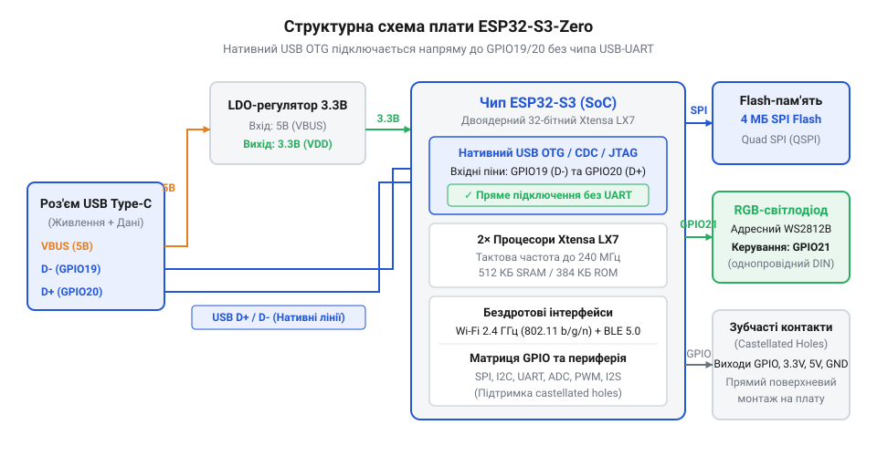
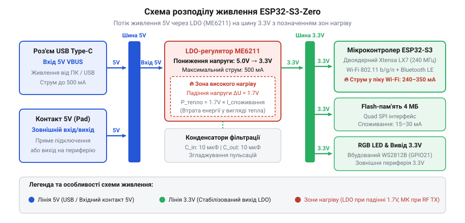
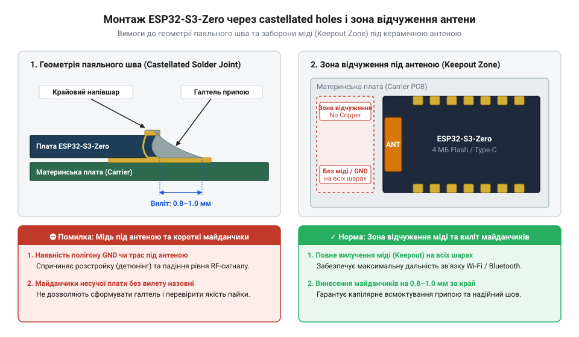

# ESP32-S3-Zero (Type-C, 4 МБ)

<preknowlist>
- [Мікроконтролер ESP32-S3](root:cat-hw-boards/esp32s3-microcontroller) — архітектуру ядра Xtensa LX7, систему пам'яті та бездротові периферійні модулі Wi-Fi і Bluetooth LE
</preknowlist>

## Компактний формфактор та подвійний монтаж

Спроба вмістити мікроконтролер у компактний корпус оминає складність трасування радіочастотних кіл завдяки платі @@en|ESP32-S3-Zero@@. Вона об'єднує [мікроконтролер ESP32-S3](root:cat-hw-boards/esp32s3-microcontroller), керамічну антену та роз'єм @@en|Type-C@@ на друкованій платі розміром 23.5×18 мм.

*Структурна організація апаратних блоків плати ESP32-S3-Zero.*

Плата має @@en|крайові зубчасті отвори@@ (англ. @@en|castellated holes@@) для вибору між встановленням штиревих роз'ємів і прямим @@en|SMT-монтажем@@ (англ. @@en|Surface Mount Technology@@). При запаюванні важливо дотримуватися @@en|зони відчуження@@ (англ. @@en|keepout zone@@) під керамічною антеною для захисту радіосигналу @@en|Wi-Fi@@ та @@en|Bluetooth LE@@.

## Обчислювальні ресурси та нативний USB

Основою плати виступає двоядерний процесор @@en|Xtensa LX7@@ із тактовою частотою до 240 MHz та підтримкою @@en|векторних інструкцій@@. Модуль містить 512 KB оперативної пам'яті @@en|SRAM@@ та 4 MB вбудованої QSPI @@en|Flash-пам'яті@@, але позбавлений зовнішньої @@en|PSRAM@@. У середовищі розробки @@en|ESP-IDF@@ або @@en|Arduino IDE@@ слід обирати @@en|схему розділів@@ суворо під 4 MB, аби уникнути помилок адресації та переповнення пам'яті.

Плата реалізує @@en|нативний USB@@ шляхом прямого підключення виводів D+ та D- до роз'єму @@en|Type-C@@. Контролер працює в режимах @@en|USB CDC@@ для посліводного порту, @@en|USB JTAG@@ для налагодження та @@en|USB OTG@@ для підключення периферії. Якщо через перевизначення ліній втрачено автоматичний зв'язок за сигналами @@en|DTR@@ та @@en|RTS@@, плату переводять у режим @@en|ROM bootloader@@ вручну: затискають кнопку `BOOT` (лінія @@en|GPIO0@@), коротко натискають `RESET` і відпускають `BOOT`. У порівнянні з вибором з [родини плат ESP32-S3](root:cat-hw-boards/esp32-s3-boards-family-overview) версія Zero орієнтована на пряме прошивання без зовнішніх конвертерів.

## Особливості живлення та обмеження периферії

Живлення 5V з роз'єму @@en|Type-C@@ або крайового контакту знижується до 3.3V лінійним @@en|LDO-регулятором@@ (англ. @@en|Low Drop-Out regulator@@, від @@en|low dropout@@ — мале падіння). Під час сплесків струму @@en|Wi-Fi@@-передавача до 500 mA регулятор розсіює надлишок тепла. Напруга понад 6V або брак тепловідведення спричиняють просідання лінії нижче 2.8V і спрацьовування @@en|Brownout Detector@@ (від англ. @@en|brownout@@ — просідання напруги) з перезавантаженням. Для стабілізації задіяно фільтрувальні конденсатори ємністю 10–22 мкФ.

*Шляхи розподілу живлення та зниження напруги до системного рівня 3.3V.*

З 45 ліній чипа виведено 24 @@en|GPIO-контакти@@. Виводи GPIO19 і GPIO20 задійно під USB, GPIO0 є @@en|стропувальним контактом@@ (англ. @@en|strapping pin@@, від @@en|strap@@ — стягувати), а GPIO21 керує @@en|RGB-світлодіодом@@ WS2812B через апаратний модуль @@en|RMT@@ (від англ. @@en|Remote Control Peripheral@@ — віддалене керування). Цифрові шини @@en|SPI@@, @@en|I2C@@ та @@en|UART@@ перепризначаються матрицею, а канали @@en|АЦП@@ (англ. @@en|ADC@@, від @@en|analog-digital converter@@ — аналогово-цифровий перетворювач) жорстко прив'язані до виводів. На відміну від [ESP32-S3 SuperMini](root:cat-hw-boards/esp32-s3-supermini), Zero містить колірний індикатор; для масивів даних доцільна [Waveshare ESP32-S3R2](root:cat-hw-boards/esp32-s3r2-waveshare), а для простих задач — [Waveshare ESP32-C6-Zero](root:cat-hw-boards/esp32-c6-zero).

## Правила поверхневого монтажу та інтеграції

Монтаж через @@en|castellated holes@@ інтегрує плату як мезонінний модуль. Для меніска припою під час @@en|reflow soldering@@ (від англ. @@en|reflow soldering@@ — паяння оплавленням) майданчики виводять за контур на 0.6–0.8 мм, а доріжки живлення роблять від 0.5 мм.

*Геометрія контактних майданчиків та зона відчуження під антеною при поверхневому монтажі.*

Під антеною видаляють мідь на всіх шарах із виступом від 5 мм, а до металу корпусу витримують відступ від 15 мм для збереження антенного контуру.
