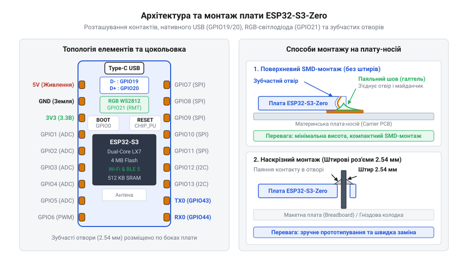
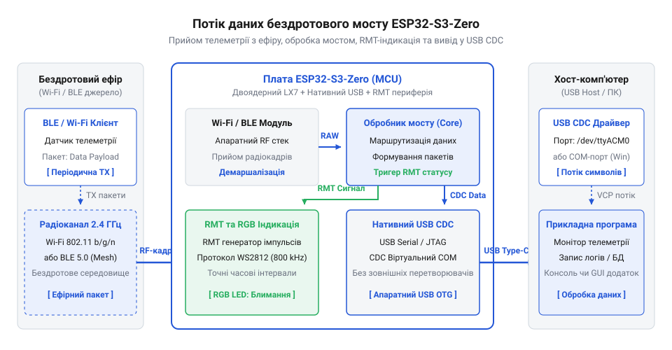
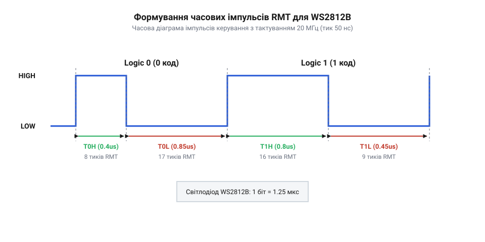

# Створення компактного бездротового USB-донгла з RGB-індикацією на ESP32-S3-Zero

<preknowlist>
- [Мікроконтролер ESP32-S3](root:cat-hw-boards/esp32s3-microcontroller) — Архітектура ядра Xtensa LX7, нативний USB OTG контролер та периферійні блоки Wi-Fi/Bluetooth LE.
- [ESP32-S3 SuperMini](root:cat-hw-boards/esp32-s3-supermini) — Конструктивні особливості мініатюрних форм-факторів плат на ESP32-S3 та специфіка використання їхніх контактних виводів.
</preknowlist>

## Потреба у компактному бездротовому адаптері

Розробка бездротових периферійних пристроїв та засобів телеметрії на базі класичних відлагоджувальних плат стикається із проблемами надлишкових габаритів та невиправданого енергоспоживання. Традиційні рішення потребують окремої мікросхеми перетворювача інтерфейсів (як-от CP2102 чи CH340) для зв'язку з персональним комп'ютером через послідовний порт. Цей додатковий мост не лише збільшує площу друкованої плати, але й обмежує швидкість передачі даними фіксованими значеннями стандартного моста, унеможливлюючи створення нативних USB-інтерфейсів.

Вирішенням цієї проблеми є використання роз'єму безпосереднього підключення у форматі @@en|донгла@@ (від англ. @@en|dongle@@ — компактний апаратний адаптер). Сучасний [мікроконтролер ESP32-S3](root:cat-hw-boards/esp32s3-microcontroller) інтегрує два окремі апаратні модулі — @@en|USB OTG@@ (від англ. @@en|On-The-Go@@ — специфікація прямої взаємодії пристроїв) та @@en|USB Serial/JTAG@@ (від англ. @@en|Joint Test Action Group@@ — стандарт апаратного налагодження). Це дозволяє повністю виключити зовнішні трансивери із ланцюга обміну. Модуль USB Serial/JTAG жорстко реалізовано на рівні кремнію, тому він працює автономно без залучення програмного стека процесора й надає фіксовані канали для прошивки та послідовного обміну. Натомість контролер USB OTG є гнучким системним блоком, який вимагає програмних драйверів у пам'яті, але дозволяє створювати довільні класи пристроїв або працювати у режимі @@en|хоста@@ (від англ. @@en|host@@ — ведучий вузол мережі чи шини). Порівняно з більшими модулями, як-от [плата ESP32-S3 SuperMini](root:cat-hw-boards/esp32-s3-supermini), надкомпактна плата ESP32-S3-Zero надає мінімально необхідну обв'язку та прямі виводи для прямого монтажу чи прямого вставлення у порт ПК.

Сформуємо ключові вимоги до бездротового адаптера:
1. Пряме живлення та зв'язок через нативний шинний USB-інтерфейс Type-C без проміжних перетворювачів.
2. Апаратна візуальна індикація поточного стану пристрою та трафіку за допомогою адресованого RGB-світлодіода.
3. Компактне конструктивне виконання з можливістю поверхневого монтажу безпосередньо на плату-носій.

## Апаратне компонування та castellated-монтаж плати

Для забезпечення компактності та надійності пристрою плата ESP32-S3-Zero має спеціальне розведення контактних майданчиків. Головною конструктивною особливістю платформи є @@en|зубчасті отвори@@ (від англ. @@en|castellated holes@@ — напівбокові отвори з контактами на краю плати, схожі на зубці вежі), які дають змогу монтувати плату на материнську плату-носій методом поверхневого SMD-монтажу без використання проміжних штирьових роз'ємів.

*Схема контактних майданчиків ESP32-S3-Zero із зубчастими отворами, розташуванням ліній USB D+/D- та піна індикації GPIO21.*

Апаратна топологія плати визначає такі ключові лінії зв'язку:
* **Лінії нативного USB**: вивід GPIO19 відповідає за сигнал D-, а GPIO20 — за D+. Оскільки ці лінії виведені на зовнішній роз'єм, під час гарячого підключення статичний розряд із рук або кабелю загрожує пробоєм вхідних кіл [мікроконтролера ESP32-S3](root:cat-hw-boards/esp32s3-microcontroller). Для захисту від імпульсних перенапруг паралельно лініям D+/D- підключають @@en|TVS-діоди@@ (від англ. @@en|transient voltage suppressor@@ — придушувач тимчасових перенапруг) або спеціалізовані збірки @@en|ESD-захисту@@ (від англ. @@en|electrostatic discharge@@ — електростатичний розряд), які скидають паразитний сплеск на землю. У розрив кожної лінії встановлюють демпфувальні узгоджувальні резистори номіналом 22 Ом, що гасять відбиття сигналу та згладжують круті фронти перемикання. При розведенні плати-носія @@en|диференційна пара@@ (від латин. @@en|differentia@@ — різниця) вимагає суворого трасування з однаковою довжиною провідників (розбіжність менше 0.15 мм запобігає фазовому зсуву) та дотримання хвильового опору 90 Ом без гострих кутів і зайвих перехідних отворів.
* **Адресований індикатор**: вбудований світлодіод @@en|WS2812B@@ підключено до цифрового виводу GPIO21, що вимагає точних часових інтервалів керування.
* **Шини живлення**: шина 5V отримує живлення безпосередньо від порту @@en|USB@@, а внутрішній @@en|LDO-регулятор@@ (від англ. @@en|low dropout@@ — мале падіння напруги) формує напругу 3.3V для живлення ядра мікроконтролера.

При паянні через castellated holes контактні майданчики носія мають виходити за габарити плати на 0.5–0.8 мм, що забезпечує формування якісного галтельного шва при оплавленні припаю.

## Конфігурування нативного USB CDC контролера

Апаратний модуль USB Serial/JTAG у складі ESP32-S3 дозволяє прошивці працювати безпосередньо із системним стеком хост-операційної системи. Вбудований контролер реалізує специфікацію @@en|USB CDC@@ (від англ. @@en|Communications Device Class@@ — клас пристроїв зв'язку), створюючи у системі @@en|віртуальний COM-порт@@ (від англ. @@en|Virtual COM Port@@) без додаткових драйверів.

*Структура ретрансляції пакетів між мережевим стеком, обробником мосту та нативним драйвером USB CDC.*

Під час підключення до ПК хост ініціалізує конфігураційні @@en|кінцеві точки@@ (від англ. @@en|endpoints@@ — апаратні буфери передачі даних в USB), забезпечуючи двосторонній асинхронний обмін даними. В середовищі ESP-IDF ініціалізація та обмін здійснюються за допомогою системного драйвера `usb_serial_jtag`.

Для створення потокового інтерфейсу обміну використаємо низькорівневий драйвер C та об'єктно-орієнтовану обгортку C++:

:::tabs
@tab C (ESP-IDF)
:::code proj-esp32-s3-zero-compact-dongle/c/main/usb_cdc.c 28-50
@tab C++ (ESP-IDF)
:::code proj-esp32-s3-zero-compact-dongle/cpp/main/UsbCdcStream.hpp 46-60
:::

Після успішного монтажу драйвера програма отримує можливість здійснювати читання та запис у неблокувальному режимі із заданими @@en|таймаутами@@ (від англ. @@en|timeout@@ — граничний час очікування) операційної системи @@en|FreeRTOS@@. При затримках зчитування з боку ПК вихідний @@en|кільцевий буфер@@ (від англ. @@en|ring buffer@@ — замкнена структура пам'яті) швидко заповнюється даними. Щоб запобігти блокуванню процесу виконання, драйвер утримує задачу лише впродовж вказаного часу. Коли ПК зупиняє прийом, шина задіює апаратне @@en|керування потоком@@ (від англ. @@en|flow control@@ — узгодження швидкості передачі): [апаратний мікроконтролер ESP32-S3](root:cat-hw-boards/esp32s3-microcontroller) відповідає хосту відповідями NAK (від англ. @@en|Negative Acknowledgment@@ — негативне підтвердження), примушуючи його тимчасово призупинити відправку нових пакетів. Якщо @@en|таймаут@@ вичерпується раніше, ніж ПК відновлює зчитування, виклик запису повертає помилку `ESP_ERR_TIMEOUT` або лише частково записаний обсяг байтів. Занадто короткий час очікування спричиняє втрату даних при найменших затримках операційної системи, тоді як надмірний — затримує роботу фонової задачі ретрансляції:

:::tabs
@tab C (ESP-IDF)
:::code proj-esp32-s3-zero-compact-dongle/c/main/usb_cdc.c 72-117
@tab C++ (ESP-IDF)
:::code proj-esp32-s3-zero-compact-dongle/cpp/main/UsbCdcStream.hpp 62-89
:::

Нативний контролер примусово очищає транзитний буфер передачі за допомогою функції очікування `wait_tx_done`, що забезпечує мінімальну затримку при ретрансляції пакетів бездротової мережі в USB-канал.

## RGB-індикація стану через модуль RMT

Безпосереднє підключення компактного [бездротового адаптера](root:cat-hw-boards/esp32-s3-supermini) до USB-порту без візуальних елементів перетворює пристрій на «чорну скриньку»: розробник не бачить, чи перебуває @@en|донгл@@ у стані ініціалізації, чи встановлено бездротове з'єднання і чи передаються пакети даного моменту. Для візуального контролю на платі ESP32-S3-Zero встановлено адресований RGB-світлодіод @@en|WS2812B@@, підключений до лінії @@en|GPIO21@@. Однак протокол @@en|WS2812B@@ вимагає жорстких часових інтервалів передачі послідовності бітів у наносекундному діапазоні (тривалість високого рівня `T0H` ~ 350 нс для логічного `0` та `T1H` ~ 800 нс для логічної `1`). Програмне формування таких затримок через процесорний цикл призводить до збоїв індикації та миготіння кольорів під час спрацьовування переривань оперативної системи.

Цю проблему розв'язує апаратний периферійний модуль @@en|RMT@@ (англ. @@en|Remote Control@@, від лат. @@la|remotus@@ — віддалений) [мікроконтролера ESP32-S3](root:cat-hw-boards/esp32s3-microcontroller). Модуль @@en|RMT@@ читає попередньо згенеровану в оперативній пам'яті таблицю часових інтервалів і самостійно видає імпульси заданої тривалості на вивід @@en|GPIO21@@ без залучення процесорних ядер. Для забезпечення потрібної точності тактову частоту модуля 80 МГц ділять на 4, отримуючи внутрішнє тактування 20 МГц, де один тик дорівнює точно 50 нс. За такої частоти логічний `0` описується 7 тиками високого рівня (`T0H` = 350 нс) та 16 тиками низького рівня (`T0L` = 800 нс), а логічна `1` — 16 тиками високого (`T1H` = 800 нс) та 9 тиками низького (`T1L` = 450 нс). Передача 24 бітів кольору відбувається у послідовності Green-Red-Blue (GRB).

*Часова діаграма імпульсів керування WS2812B з тактуванням RMT 20 МГц, де кожен тик дорівнює 50 нс.*

Для організації світлофорної сигналізації режимів пристрою розробляють драйвер, який перетворює системний стан у колір світлодіода. При завантаженні системи виставляється фіолетовий колір, у стані очікування підключення — зелений, при активній бездротовій сесії — синій, під час ретрансляції пакетів даних — жовтий спалах, а у разі помилки — червоний.

Реалізація драйвера світлодіода @@en|WS2812B@@ спирається на розбиття 24-бітного кольору на послідовність імпульсів у форматі @@en|GRB@@ (англ. @@en|Green-Red-Blue@@ — зелений, червоний, синій), де зчитування відбувається від старшого біта @@en|MSB@@ (англ. @@en|Most Significant Bit@@) до молодшого. У функції `build_ws2812_items` мовою @@en|C@@ або методі `transmitColor` мовою @@en|C++@@ три 8-бітні значення кольорів об'єднуються в один 32-бітний регістр `grb_color`, з якого у циклі побітово витягуються значення кожного з 24 бітів. Для кожного біта створюється відповідний часовий символ @@en|RMT@@: логічній `1` відповідає тривалий високий рівень `T1H` та короткий низький `T1L`, а логічному `0` — короткий високий `T0H` та тривалий низький `T0L`. Згенерований масив із 24 символів передається в апаратний буфер @@en|FIFO@@ (англ. @@en|First In, First Out@@ — першим зайшов, першим вийшов) модуля @@en|RMT@@, який автономно видає сигнал на лінію @@en|GPIO21@@ без затримок у виконанні процесорного коду. Управління логікою індикації організовано через автомат станів (англ. @@en|state machine@@), який виражено перерахуванням станів `ws2812_status_t` або `DongleStatus`. Функції `ws2812_set_status` та `setStatus` через оператор `switch` транслюють поточний статус пристрою у відповідну RGB-палітру, а асинхронний метод `update()` у мові @@en|C++@@ періодично звіряє таймер системного часу для створення ефектів блимання під час підключення чи ретрансляції даних без блокування виконання основних задач.

:::tabs
@tab C
:::code proj-esp32-s3-zero-compact-dongle/c/main/ws2812_rmt.c 51-72
:::code proj-esp32-s3-zero-compact-dongle/c/main/ws2812_rmt.c 136-163

@tab C++
:::code proj-esp32-s3-zero-compact-dongle/cpp/main/RmtLedController.hpp 121-157
:::

## Об'єднання Wi-Fi і BLE з USB-транспортом

Наявність автономних модулів @@en|нативного USB@@, бездротового стеку та індикації не забезпечує функціонування пристрою доти, доки між ними не побудовано прозорий маршрутизатор даних. Головна задача прошивки — приймати пакети з бездротового ефіру через @@en|Wi-Fi@@ або @@en|BLE@@ і миттєво транслювати їх у ПК через @@en|нативний USB@@ @@en|CDC-потік@@, синхронно сигналізуючи про передачу за допомогою модуля @@en|RMT@@.

Для реалізації бездротового мосту плата ESP32-S3-Zero ініціалізується в режимі точки доступу @@en|SoftAP@@ (англ. @@en|Software Access Point@@) із запуском сокет-сервера TCP на порту 8888, а паралельно конфігурується @@en|BLE-транспорт@@ у режимі @@en|GATT-сервера@@ (англ. @@en|Generic Attribute Profile@@, від лат. *genus* — рід, класифікація та *attribuere* — наділяти властивістю) з сервісом обміну та характеристиками прийому і передачі. Одночасно створюється фонова задача операційної системи @@en|FreeRTOS@@ з прив'язкою до окремого ядра ЦП, яка інтегрує обидва бездротові канали в єдиний маршрутизатор. У цій задачі виконується неблокувальне опитування мережевого сокета, буфера BLE та буфера @@en|USB CDC@@. Якщо з сокета або через BLE-характеристику надходить пакет, він негайно записується в кінець @@en|USB CDC@@ через `usb_cdc_write`, а при появі даних у буфері USB вони зчитуються через `usb_cdc_read` і відправляються назад у мережевий сокет чи у вигляді сповіщення GATT. Така гібридна архітектура дає змогу обирати між високою пропускною здатністю @@en|Wi-Fi@@ та легким підключенням @@en|BLE@@ без переключення мережі ПК. При цьому [мікроконтролер ESP32-S3](root:cat-hw-boards/esp32s3-microcontroller) ділить час спільного радіочастотного тракту між двома стеками, що коштує додаткових затримок під час одночасної передачі й вимагає оперативної пам'яті під буфери. При симетричному піковому трафіку з обох джерел буфер `usb_cdc_write` ризикує переповнитися, тому маршрутизатор вимагає чіткого арбітражу пріоритетів у фоновій задачі.

:::tabs
@tab C
:::code proj-esp32-s3-zero-compact-dongle/c/main/net_relay.c 176-209

@tab C++
:::code proj-esp32-s3-zero-compact-dongle/cpp/main/UsbDongle.hpp 50-61
:::code proj-esp32-s3-zero-compact-dongle/cpp/main/UsbDongle.hpp 80-113
:::

Кожен акт передачі байтів між інтерфейсами супроводжується миттєвим викликом функції оновлення статусу світлодіода `ws2812_set_status`. Це дозволяє візуально відстежувати сплески мережевого трафіку без будь-яких затримок у головному потоці обробки даних.

## Прошивка та налагодження через Type-C

Пряме підключення ліній `D+` та `D-` до виводів мікроконтролера через роз'єм @@en|Type-C@@ розширює можливості, але створює пастку під час первинної прошивки та налагодження. На відміну від плат із проміжними перетворювачами USB-UART, при фатальній помилці у прошивці або зависанні системи комп'ютер втрачає пристрої @@en|віртуального COM-порту@@. У результаті утиліти автоматичного завантаження на кшталт `esptool` не могут відправляти керуючі сигнали скидання `DTR`/`RTS` для автопереведення SoC у режим завантаження.

Щоб примусово прошити [компактний мікроконтролер](root:cat-hw-boards/esp32s3-microcontroller), використовують апаратну комбінацію кнопок керування. Для цього затискають кнопку `@@en|BOOT@@` (підключену до нуля `GPIO0`), після чого короткочасно натискають кнопку `@@en|RST@@` (Reset) і відпускають `@@en|BOOT@@`. Мікроконтролер завантажує первинний апаратний завантажувач @@en|ROM Bootloader@@ (від англ. @@en|Read-Only Memory@@ — постійний запам'ятовувальний пристрій), вбудований безпосередньо в кремній SoC, який ініціалізує режим USB Serial/JTAG на апаратному рівні незалежно від стану попередньої прошивки.

Для складання проєкту в середовищі ESP-IDF підключають необхідні периферійні компоненти у файлі `CMakeLists.txt`:

:::code proj-esp32-s3-zero-compact-dongle/c/main/CMakeLists.txt 4-23

Після успішного переведення плати у режим @@en|ROM Bootloader@@ прошивку та моніторинг налагоджувальних виводів `ESP_LOGI` виконують єдиною командою `idf.py -p COMx flash monitor`. Завдяки вбудованому USB-контролеру відлагоджувальні логи транслюються безпосередньо в консоль через роз'єм @@en|Type-C@@, формуючи повністю готовий автономний бездротовий @@en|донгл@@.
