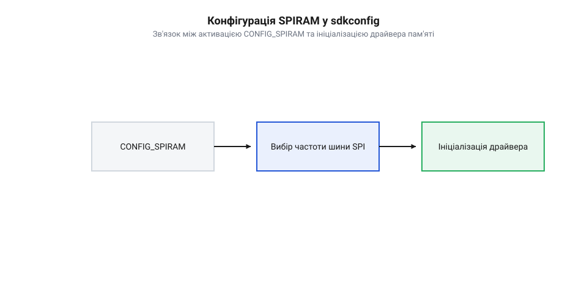
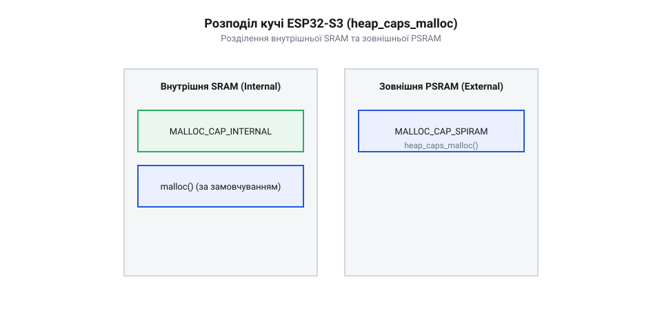

# Програмний API фреймворку ESP-IDF для конфігурації та управління PSRAM у чипі ESP32-S3R2

<preknowlist>
- [Мікроконтролер ESP32-S3](root:cat-hw-boards/esp32s3-microcontroller) — знання архітектури внутрішньої пам'яті SRAM та принципу функціонування шини SPI
- [Родина плат і модулів на ESP32-S3](root:cat-hw-boards/esp32-s3-boards-family-overview) — розуміння відмінностей модифікації ESP32-S3R2 із 2 МБ вбудованої PSRAM
</preknowlist>

## Дефіцит SRAM та призначення PSRAM

Спроба виділити в оперативній пам'яті суцільний буфер для збереження одного нестисненого кадру роздільністю @@en|VGA@@ (640×480 пікселів) у 16-бітному кодуванні колірного простору вимагає 614.4 КБ пам'яті. Внутрішня статична оперативна пам'ять @@en|SRAM@@ (від англ. @@en|Static Random Access Memory@@ — статична оперативна пам'ять з довільним доступом), якою оснащено [мікроконтролер ESP32-S3](root:cat-hw-boards/esp32s3-microcontroller), має загальний фізичний обсяг 512 КБ, з яких для динамічного розподілу кучі доступно лише близько 320 КБ. Виклик стандартної функції виділення пам'яті для подібного обчислювального завдання завершується поверненням нульового вказівника та аварійним перезавантаженням пристрою через вичерпання ресурсів. Для доступу до додаткового обсягу апаратний блок управління пам'яттю @@en|MMU@@ (від англ. @@en|Memory Management Unit@@ — блок управління пам'яттю) мапує фізичний кристал PSRAM чипа ESP32-S3R2 у виділений шинний діапазон віртуальних адрес шини даних від `0x3D000000` до `0x3D1FFFFF` (2 МБ). MMU транслює 64-кілобайтні сторінки адресації через апаратний кеш L1 шини SPI, дозволяючи ядрам процесора прозоро працювати із зовнішньою пам'яттю за звичайними покажчиками C-стандарту, хоча й із суттєвою відмінністю в затримках читання та запису порівняно з внутрішньою SRAM. Під час читання даних пропуски в кеші (від англ. @@en|cache miss@@) призводять до апаратного зупинення процесорного конвеєра: MMU змушений ініціювати транзакцію зчитування по шині SPI із затримкою на фіксовану кількість тактових імпульсів очікування (від англ. @@en|dummy cycles@@), необхідних кристалу PSRAM для вибірки комірки, що додає затримку вибірки `read latency` тривалістю в десятки процесорних тактів. Операції запису, навпаки, маскуються внутрішнім буфером скидання (від англ. @@en|write buffer@@): процесор миттєво фіксує дані в кеш-рядку та продовжує виконання коду без блокування, тоді як затримка запису `write latency` виникає лише в разі переповнення шинного буфера при масованому вивантаженні даних у зовнішній кристал PSRAM.

Для вирішення проблеми дефіциту оперативної пам'яті в графічних, аудіо- та нейромережевих завданнях розроблено модифікацію системи-на-кристалі [родин плат і модулів на ESP32-S3](root:cat-hw-boards/esp32-s3-boards-family-overview) — чип @@en|ESP32-S3R2@@. Цей мікроконтролер містить інтегровану в корпус псевдостатичну оперативну пам'ять @@en|PSRAM@@ (від англ. @@en|Pseudo Static Random Access Memory@@ — псевдостатична оперативна пам'ять) обсягом 2 МБ. Зовнішній кристал @@en|PSRAM@@ підключається до обчислювальних ядер через високошвидкісний шинний інтерфейс @@en|SPI@@ (від англ. @@en|Serial Peripheral Interface@@ — послідовний периферійний інтерфейс) та апаратний блок адресації @@en|MMU@@ (від англ. @@en|Memory Management Unit@@ — блок управління пам'яттю), що дозволяє прозоро відображати зовнішні адреси у загальний 32-бітний адресний простір процесора.

## Конфігурація SPIRAM у файлі sdkconfig

Апаратний контролер шини [чипа ESP32-S3](root:cat-hw-boards/esp32s3-microcontroller) не вмикає підтримку зовнішньої оперативної пам'яті за замовчуванням задля економії енергії та збереження виводів периферії. Активація псевдостатичної пам'яті виконується на етапі компіляції проекту фреймворку @@en|ESP-IDF@@ через системну конфігурацію @@en|sdkconfig@@ або графічний утилітарний меню-інтерфейс @@en|menuconfig@@.

Основою конфігурування є увімкнення прапорця `CONFIG_SPIRAM=y`, який вмикає драйвер підсистеми @@en|SPIRAM@@ під час початкового завантаження @@en|bootloader@@. Для чипа @@en|ESP32-S3R2@@ параметр режиму шини `CONFIG_SPIRAM_MODE_QUAD=y` налаштовує 4-бітну ширину лінії даних, а опція `CONFIG_SPIRAM_SPEED_80M=y` задає граничну тактову частоту шини в 80 МГц. Вибір частоти 80 МГц подвоює пропускну здатність шини (до 40 МБ/с) та скорочує час затримок зчитування (англ. *@@en|read latency@@*) при вибірці даних через кеш MMU, що принципово для безперервного стримінгу відео або трансляції аудіопотоку. Критичним фактором стабільності на цій частоті є узгодження напруги живлення шини пам'яті (3.3 В для вбудованої Quad PSRAM чипа @@en|ESP32-S3R2@@ проти 1.8 В у модифікаціях із Octal PSRAM): невідповідність рівня напруги в @@en|sdkconfig@@ призводить до виходу сигналів за межі допусків або апаратного пошкодження кристала. Крім того, робота на максимальній частоті 80 МГц звужує часові допуски зчитування бітів, що вимагає виконання автоматичного калібрування часових затримок (англ. *@@en|timing tuning@@*, від *@@en|tune@@* — налаштовувати) на етапі ініціалізації @@en|bootloader@@. Завдяки @@en|timing tuning@@ системний драйвер динамічно зсуває фазу тактового сигналу відносно вікна стабільності даних для компенсації температурного дрейфу та напруги, уникаючи випадкового псування пам'яті чи збоїв зчитування кешу, хоча така високочастотна робота збільшує енергоспоживання шинного контролера й виводів вводу-виводу та підвищує вимоги до стабільності живлення пристрою.


*Послідовність активації та конфігурування підсистеми PSRAM у конфігураційному дереві фреймворку ESP-IDF.*

Невідповідність налаштованої частоти шини або режиму адресації реальним характеристикам чипа @@en|ESP32-S3R2@@ призводить до збою перевірки цілісності пам'яті під час старт-апу та помилки @@en|panic handler@@ з повідомленням про невдалу ініціалізацію @@en|PSRAM@@.

## Явне виділення пам'яті через heap_caps

За замовчуванням стандартна функція мови C `malloc()` виділяє пам'ять виключно з внутрішньої швидкісної @@en|SRAM@@. Для явного розміщення масивів і буферів у зовнішній пам'яті фреймворк @@en|ESP-IDF@@ надає спеціалізований програмний інтерфейс атрибутивної кучі @@en|heap_caps@@.

Функція `heap_caps_malloc()` приймає необхідний розмір у байтах та бітову маску атрибутів пам'яті. Прапорець `MALLOC_CAP_SPIRAM` вказує системному менеджеру кучі шукати вільний блок саме всередині адресного простору @@en|PSRAM@@. Якщо додаток потребує побайтового доступу до даних, прапорець поєднують із `MALLOC_CAP_8BIT`. Якщо ж пам'ять виділяється виключно для слова під 32-бітний доступ чи вирівняних структур даних, застосовують прапорець `MALLOC_CAP_32BIT`. Натомість прапорець `MALLOC_CAP_INTERNAL` діє протилежно до `MALLOC_CAP_SPIRAM` — він категорично забороняє використання PSRAM і примушує менеджер кучі шукати блок виключно у внутрішній пам'яті SRAM, що критично для дескрипторів DMA та критичних до швидкодії обробників переривань.


*Розділення фізичних адресних просторів внутрішньої SRAM та зовнішньої PSRAM при атрибутивному розподілі пам'яті.*

Для виділення обнуленого буфера використовують виклик `heap_caps_calloc()`, а для динамічної зміни розміру — `heap_caps_realloc()`. Нижче наведено приклад створення буфера кадру в @@en|PSRAM@@:

:::code api-esp32-s3r2-esp-idf-psram-config/c/esp-idf/create-frame-buffer.c

Важливо враховувати, що хоча модуль @@en|GDMA@@ чипа @@en|ESP32-S3R2@@ підтримує прямий доступ до @@en|PSRAM@@, для забезпечення найвищої швидкодії та сумісності буфери прямого доступу до пам'яті @@en|DMA@@ (від англ. @@en|Direct Memory Access@@ — прямий доступ до пам'яті) найчастіше розміщують у внутрішній @@en|SRAM@@.

## Автоматична інтеграція PSRAM у кучу

Постійний виклик функцій `heap_caps_malloc()` з розширеними прапорцями ускладнює перенесення сторонніх бібліотек C/C++, які розраховують на стандартну функцію `malloc()`. Для автоматизації цього процесу фреймворк @@en|ESP-IDF@@ надає механізм автоматичної інтеграції зовнішньої пам'яті у загальний пул розподілу.

Включення опції `CONFIG_SPIRAM_USE_MALLOC=y` перехоплює стандартні виклики `malloc()` та `calloc()`. Якщо запитуваний розмір блоку перевищує порогове значення, задане параметром `CONFIG_SPIRAM_MALLOC_ALWAYSINTERNAL` (за замовчуванням 16384 байти), менеджер пам'яті автоматично перенаправляє запит до кучі @@en|PSRAM@@. Малі виділення лишаються у швидкій внутрішній @@en|SRAM@@ для мінімізації накладних витрат шини @@en|SPI@@. Проте під час початкового старт-апу системних задач і драйверів безпосередньо у внутрішній пам'яті потрібні гарантовані резерви під дескриптори переривань та буфери мережевого стека. Для захисту внутрішнього пулу від вичерпання параметр `CONFIG_SPIRAM_MALLOC_RESERVE_INTERNAL` налаштовує фіксований обсяг резерву внутрішньої @@en|SRAM@@ (зазвичай від 32 до 64 КБ), який повністю ізолюється від загального розподілу `malloc()` та виділяється виключно системному ядру й високопріоритетним драйверам під час ініціалізації.

Для захисту системних задач від вичерпання критичної внутрішньої пам'яті застосовують конфігурацію `CONFIG_SPIRAM_MALLOC_RESERVE_INTERNAL`. Вона резервує фіксований обсяг внутрішньої @@en|SRAM@@ виключно для системних потреб фреймворку та переривань.

## Моніторинг та усунення помилок OOM

Інтенсивне виділення та звільнення буферів різного розміру у псевдостатичній пам'яті призводить до виникнення фрагментації. Ситуація, коли сумарний обсяг вільної @@en|PSRAM@@ достатній для завдання, але немає жодного суцільного блоку потрібного розміру, викликає помилку вичерпання пам'яті @@en|OOM@@ (від англ. @@en|Out Of Memory@@ — вичерпання пам'яті).

Для контролю стану зовнішньої пам'яті фреймворк надає функції інспектування `heap_caps_get_free_size()` та `heap_caps_get_largest_free_block()` з бітовою маскою `MALLOC_CAP_SPIRAM`. Різниця між загальним вільним обсягом і найбільшим суцільним блоком прямо вказує на ступінь фрагментації кучі. Оскільки фреймворк @@en|ESP-IDF@@ не підтримує автоматичне фонове стискання чи переміщення покажчиків у пам’яті C/C++, усунення помилок @@en|OOM@@ (англ. @@en|Out Of Memory@@) покладається на прикладні алгоритми дефрагментації та повторних спроб виділення. При виявленні вичерпання суцільного блоку програма виконує примусове звільнення тимчасових клейових буферів або кешів нижчого пріоритету, після чого проводить повторну спробу виділення потрібного масиву. Якщо ж суцільного блоку недостатньо й після звільнення, алгоритм реалізує адаптивне зниження вимог: зменшує роздільну здатність кадрового буфера або переходить на блочний розподіл через виділені арена-розподільники, що упереджує подальшу фрагментацію адресного простору.

```c|esp-idf
#include "esp_heap_caps.h"
#include "esp_log.h"

static const char *TAG = "MONITOR";

void print_psram_status(void) {
    size_t free_psram = heap_caps_get_free_size(MALLOC_CAP_SPIRAM);
    size_t max_block = heap_caps_get_largest_free_block(MALLOC_CAP_SPIRAM);
    
    ESP_LOGI(TAG, "Вільна PSRAM: %d байтів, Найбільший суцільний блок: %d байтів", free_psram, max_block);
}
```

У разі повернення функцією виділення нульового вказівника `NULL` програма повинна коректно обробити виняткову ситуацію: звільнити тимчасові обчислювальні масиви, знизити роздільну здатність буфера або сповістити користувача замість звернення за нульовою адресою, що запобігає краху системи.
