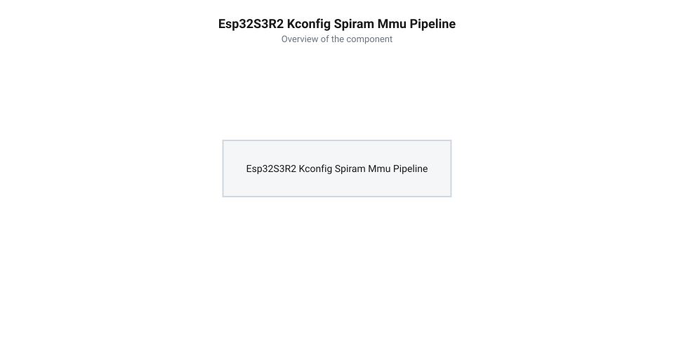
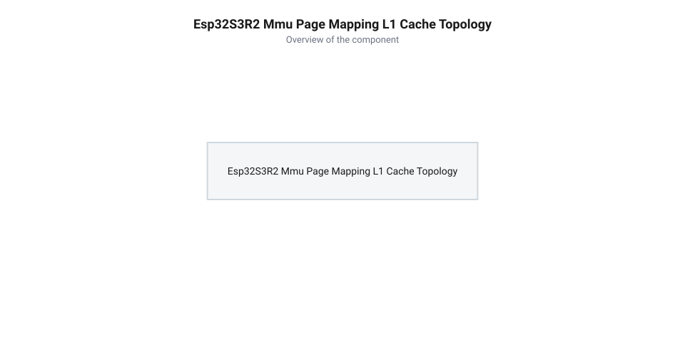
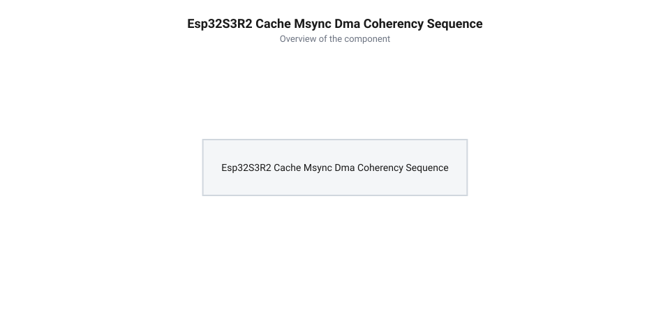

# Програмний API ESP-IDF для конфігурації PSRAM та сторінкової адресації MMU

<preknowlist>
- [Мікроконтролер ESP32-S3](root:cat-hw-boards/esp32s3-microcontroller) — апаратна організація підсистеми пам'яті, MMU та L1 Cache
- [Родина плат і модулів на ESP32-S3](root:cat-hw-boards/esp32-s3-boards-family-overview) — огляд конфігурацій Quad SPI та Octal SPI модулів ESP32-S3
- [ESP32-CAM (OV2640 + microSD)](root:cat-hw-boards/esp32-cam) — приклади використання буферів у зовнішній оперативній пам'яті
</preknowlist>

## Конфігурування PSRAM у Kconfig

При розробці складних вбудованих застосунків — таких як системи комп'ютерного зору, графічні термоінтерфейси чи локальні вебсервери — розробник швидко вичерпує доступну внутрішню оперативну пам'ять статичного типу (від англ. @@en|Static Random-Access Memory@@, @@en|SRAM@@). У [мікроконтролері ESP32-S3](root:cat-hw-boards/esp32s3-microcontroller) з 512 кБ системної SRAM під динамічну купу розробника залишається близько 328 кБ, що унеможливлює розміщення навіть одного кадрового буфера роздільності VGA. Для розширення обсягу пам'яті до кількох мегабайтів використовують зовнішні псевдостатичні мікросхеми (від англ. @@en|Pseudo-Static RAM@@, @@en|PSRAM@@), підключені через високошвидкісні послідовні шини. Проте ініціалізація зовнішнього кристала на етапі раннього старту ядра вимагає часу: вибір підвищеної тактової частоти шини `CONFIG_SPIRAM_SPEED` (наприклад, 80 чи 120 МГц замість базових 40 МГц) та активація автоматичного визначення типу мікросхеми PSRAM безпосередньо впливають на тривалість завантаження первинного завантажувача. Режим автовизначення змушує ядро виконувати послідовні тестові запити зчитування ідентифікаторів кристала через Quad або Octal SPI, а високі частоти вимагають проходження обов'язкових процедур калібрування ліній затримки тактового сигналу (від англ. @@en|delay line calibration@@) перед запуском основної операційної системи. На частотах 80 та 120 МГц тривалість тактового періоду скорочується до 12.5 та 8.33 нс відповідно, через що фазовий зсув між вихідним тактовим сигналом мікроконтролера та зворотними стробами даних від мікросхеми пам'яті стає критичним до довжини провідників друкованої плати, температури й напруги живлення. Щоб знайти безпечний центр вікна зчитування даних, апаратний контролер шини під час старту виконує послідовний перебір дискретних елементів затримки (від англ. @@en|delay taps@@): завантажувач записує в PSRAM еталонні бітові шаблони й вимірює межі стабільного стробування для кожного ступеня затримки. Цей апаратний пошуковий цикл додає кілька мілісекунд до загального часу ініціалізації ядра ради забезпечення високої пропускної здатності та надійності шинного обміну.

Активація та налаштування роботи зовнішньої пам'яті у середовищі @@en|ESP-IDF@@ відбувається на етапі збірки через текстовий чи графічний інтерфейс конфігуратора @@en|Kconfig@@. Головний прапорець `CONFIG_SPIRAM=y` (або `CONFIG_ESP32S3_SPIRAM_SUPPORT=y`) вмикає підтримку зовнішньої пам'яті в ядрі операційної системи та ініціалізує драйвер псевдостатичної пам'яті (від англ. @@en|Serial Peripheral Interface RAM@@, @@en|SPIRAM@@). Режим фізичного зв'язку обирається параметрами `CONFIG_SPIRAM_MODE_QUAD` (4-бітна шина Quad SPI) або `CONFIG_SPIRAM_MODE_OCTAL` (8-бітна шина Octal SPI). Для плат із високоефективними модулями, таких як ті, що описує [родина плат на ESP32-S3](root:cat-hw-boards/esp32-s3-boards-family-overview), використання шини Octal SPI подвоює пікову пропускну здатність та вимагає вибір 64-байтової кеш-лінії замість 32-байтової.

*Схема маршрутизації викликів пам'яті через Kconfig параметри CONFIG_SPIRAM_USE_MALLOC та MMU сторінки у зовнішню PSRAM.*

Окрім вибору фізичного режиму, конфігуратор @@en|Kconfig@@ визначає стратегію інтеграції @@en|PSRAM@@ у загальний простір кучі за допомогою параметра `CONFIG_SPIRAM_USE_MALLOC`. Якщо вибрано режим `CONFIG_SPIRAM_USE_MALLOC=y`, стандартна функція `malloc()` автоматично перенаправляє запити на виділення пам'яті у зовнішню PSRAM, якщо запитуваний розмір блоку перевищує поріг, заданий опцією `CONFIG_SPIRAM_MALLOC_ALWAYSINTERNAL` (за замовчуванням 16384 байти). Запити, менші за цей поріг, розміщуються у внутрішній швидкісній пам'яті SRAM. Це запобігає фрагментації зовнішньої пам'яті дрібними блоками та зберігає продуктивність виконання системних задач. У режимі `CONFIG_SPIRAM_USE_CAPS_ALLOC` автоматичне перенаправлення `malloc()` вимикається, і розробник мусить явно вказувати бажаний тип пам'яті через розширені системні виклики аллокатора.

## Виділення пам'яті через heap_caps_malloc

Автоматичне розміщення пам'яті через `malloc()` не завжди задовольняє вимоги периферійних модулів. Наприклад, під час захоплення відеокадрів у [модулі ESP32-CAM](root:cat-hw-boards/esp32-cam) контролери прямого доступу до пам'яті (від англ. @@en|Direct Memory Access@@, @@en|DMA@@) вимагають буферів із чітко визначеними характеристиками: розміщенням у зовнішній PSRAM, можливістю побайтового доступу та сумісністю з апаратною адресацією шини. Для точного контролю типів пам'яті в середовищі @@en|ESP-IDF@@ використовують виклики розширеного аллокатора `heap_caps_malloc()`, а при динамічній зміні розмірів буферів — функцію `heap_caps_realloc()`. Поведінка системного аллокатора при використанні прапорця `MALLOC_CAP_DMA` суттєво відрізняється залежно від домену пам'яті: для внутрішньої SRAM пам'ять виділяється виключно із задекларованого шинного домену DRAM із 32-бітовим вирівнюванням, тоді як для зони PSRAM контролер EDMA вимагає суворого вирівнювання початкової адреси та розміру буфера за межею кеш-лінії L1 (32 або 64 байти). Якщо обрана комбінація прапорців порушує апаратні обмеження домену або в PSRAM відсутній суміжний вирівняний блок, аллокатор відмовляє у виділенні. Особливість перевиділення пам'яті через `heap_caps_realloc()` полягає у тому, що за відсутності суміжного вільного блоку потрібного обсягу аллокатор змушений шукати нову ділянку з тими ж параметрами вирівнювання, копіювати туди вміст і звільняти стару пам'ять. Якщо зовнішня пам'ять фрагментована або вичерпана, виклик `heap_caps_realloc()` повертає вказівник `NULL`, залишаючи початковий блок незмінним. У разі прямого перезапису початкового вказівника значенням `NULL` розробник втрачає адресу старого буфера, що спричиняє виток пам'яті та каскадну відмову системного аллокатора через подальші некоректні спроби повторного виділення ресурсів.

Функція `heap_caps_malloc(size_t size, uint32_t caps)` приймає розмір блоку у байтах та бітову маску властивостей пам'яті (англ. @@en|capabilities@@). Основні прапорці маски `caps` та їхнє призначення зведено у таблицю:

| Прапорець | Опис властивості пам'яті | Область застосування |
| --- | --- | --- |
| `MALLOC_CAP_SPIRAM` | Явне виділення блоку у зовнішній PSRAM | Великі масиви даних, кадорові буфери |
| `MALLOC_CAP_INTERNAL` | Примусове виділення у внутрішній SRAM | Швидкісні буфери, стеки задач FreeRTOS |
| `MALLOC_CAP_DMA` | Пам'ять, доступна для периферії DMA | Передавання даних через SPI, I2S, LCD |
| `MALLOC_CAP_8BIT` | Підтримка побайтового читання й запису | Текстові рядки, структури, масиви байтів |

При виділенні великих буферів комбінація прапорців `MALLOC_CAP_SPIRAM | MALLOC_CAP_8BIT` гарантує розміщення масиву у псевдостатичній пам'яті зі збереженням нормальної побайтової адресації. Якщо ж буфер має оброблятися контролером DMA з PSRAM, додають прапорець `MALLOC_CAP_DMA`.

Окрему увагу варто приділити динамічній зміні розміру вже виділеного блоку за допомогою функції `heap_caps_realloc()`. Якщо в купі @@en|PSRAM@@ відсутній суцільний діляночний простір безпосередньо після поточного масиву, системний аллокатор змушений шукати нове місце в зовнішній пам'яті, повністю копіювати туди наявні дані та звільняти старий блок. У разі вичерпання ресурсів або сильної фрагментації пам'яті функція `heap_caps_realloc()` повертає `NULL`, однак початковий блок у @@en|PSRAM@@ залишається виділеним і недоторканим. Якщо розробник присвоює результат виконання безпосередньо в початкову змінну вказівника (`ptr = heap_caps_realloc(ptr, new_size, caps)`), повернення значення `NULL` безповоротно втрачає адресу дійсного буфера, що викликає виток пам'яті та унеможливлює подальше звільнення ресурсів через `heap_caps_free()`. Щоб запобігти цій аварійній ситуації в середовищі @@en|ESP-IDF@@, результат перевиділення обов'язково зберігають у тимчасовому вказівникові й лише після перевірки на нерівність `NULL` оновлюють основне посилання на буфер.

Нездійсненність виділення пам'яті через брак ресурсу повертає вказівник `NULL`, що вимагає обов'язкової перевірки перед зверненням до масиву. Нижче наведено практичні приклади виділення кадрового буфера в PSRAM:

:::tabs
@tab C (ESP-IDF)
:::code api-esp32-s3r2-espidf-psram-and-mmu-config/c/esp-idf/allocate-frame-buffer.c
@tab C++ (Arduino / ESP-IDF)
:::code api-esp32-s3r2-espidf-psram-and-mmu-config/cpp/arduino/allocateframebuffercpp.cpp
:::

Використання системної функції `heap_caps_free()` є єдиним безпечним способом повернення пам'яті у відповідну купу незалежно від того, де саме (у SRAM чи PSRAM) було виділено блок.

## Сторінкова адресація MMU та кеш

Фізичні мікросхеми зовнішньої пам'яті @@en|PSRAM@@ мають лінійний простір комірок, але процесорні ядра [мікроконтролера ESP32-S3](root:cat-hw-boards/esp32s3-microcontroller) працюють із пам'яттю виключно через систему віртуальної адресації. Трансляцію віртуальних адрес у фізичні адреси шини @@en|Quad SPI@@ або @@en|Octal SPI@@ здійснює апаратний блок @@en|MMU@@. Весь адресний простір зовнішньої оперативної пам'яті розбивається на фіксовані сторінки розміром 64 КБ. Апаратна таблиця відображення MMU пов'язує віртуальні сторінки в діапазоні адрес `0x3C000000`–`0x3DFFFFFF` з відповідними фізичними блоками зовнішньої мікросхеми, забезпечуючи прозорий доступ для програмного коду. Для гнучкого використання обсягів пам'яті у фреймворку @@en|ESP-IDF@@ передбачено системні виклики API динамічного перемаповування (зокрема `esp_mmu_map()`), які дозволяють програмно прив'язувати фізичні блоки PSRAM до вільних віртуальних слотів під час виконання програми. Якщо ж процесор або периферійний модуль звертається за адресою за межами відображених віртуальних сторінок або до незамапованої ділянки, апаратний контролер MMU миттєво перехоплює невалідний доступ і генерує фатальний виняток доступу до кешу (від англ. @@en|Cache Error Exception@@). На апаратному рівні контролер MMU активує сигнал виривання переривання невалідного доступу, заморожуючи стан підсистеми кешування для запобігання зворотного запису брудних рядків у пам'ять. Процесорне ядро @@en|Xtensa LX7@@ фіксує причину фатального збою в регістрі `EXCCAUSE` та цільову невалідну адресу в регістрі `EXCVADDR`, після чого керування передається низькорівневому вектору паніки фреймворку. Обробник даного винятку дампує стан усіх регістрів процесора у системний лог @@en|UART@@ (відомий як @@en|Guru Meditation Error@@ із повідомленням `Cache disabled but cached memory region accessed`), вимикає переривання та негайно ініціює перезавантаження мікроконтролера, що запобігає прихованому псуванню даних та неконтрольованому перезапису незахищених ділянок пам'яті.

Для компенсації високої затримки шинного обміну при зверненні до зовнішньої пам'яті між процесорними ядрами та блоком MMU розташовано двоядерну підсистему @@en|L1 Cache@@ (від англ. @@en|Level 1 Cache@@ — кеш-пам'ять першого рівня). Кожна операція зчитування або запису за віртуальною адресою спочатку проходить перевірку на наявність даних у рядках кешу (від англ. @@en|cache line@@ — рядок кешу). Залежно від налаштувань конфігуратора, розмір кеш-лінії становить 32 або 64 байти. При влучанні в кеш операція виконується за один такт процесора, тоді як при кеш-промаху апаратний арбітр призупиняє виконання інструкцій ядра та ініціює пакетне зчитування всього рядка з PSRAM.

*Схема сторінкової адресації MMU та трансляції віртуальних адрес у фізичні блоки пам'яті PSRAM.*

Спільне використання зовнішньої пам'яті двома ядрами процесора та периферійними контролерами створює ризик апаратних конфліктів арбітражу. Оскільки шина зв'язку з PSRAM є єдиним монополізованим ресурсом, одночасна спроба поповнення кеш-лінії процесором та передача даних контролером прямого доступу викликає вимушені затримки конвеєра. Для упередження системних зависань та збереження когерентності (від англ. @@en|cache coherency@@ — когерентність кешу) розробник має враховувати сторінкову структуру відображення MMU і виділяти робочі буфери без перетину меж 64-кілобайтних сторінок.

## Атомарне вирівнювання та esp_cache_msync

Виділення динамічних буферів у зовнішній пам'яті для периферійних модулів із підтримкою direct memory access створює проблему розузгодження даних між кешем L1 та фізичними комірками PSRAM. Якщо початкова адреса виділеного масиву не вирівняна за межою кеш-лінії (32 або 64 байти), сусідні змінні або елементи внутрішніх структур потрапляють у той самий рядок кешу. Під час виконання периферійної операції зчитування або запису процесорне ядро може виконати зворотний запис (від англ. @@en|write-back@@ — зворотний запис) брудного рядка кешу, безповоротно перезаписавши нові дані, збережені периферією у фізичній пам'яті. Особливо гостро ця проблема постає під час двостороннього одночасного обміну даними між камерою та дисплеєм через DMA на [платах ESP32-CAM](root:cat-hw-boards/esp32-cam). При виведенні зображення на дисплей процесор готує кадр у кеші L1, тому перед зчитуванням буфера дисплейним контролером необхідно застосувати прапорець скидання кешу `ESP_CACHE_MSYNC_FLAG_DIR_C2M` (від англ. @@en|Cpu to Memory@@ — від процесора до пам'яті) для витіснення брудних рядків у PSRAM. Натомість при захопленні кадру з камери контролер DMA пише дані напряму у PSRAM в обхід кешу, що вимагає використання прапорця `ESP_CACHE_MSYNC_FLAG_DIR_M2C` (від англ. @@en|Memory to Cpu@@ — від пам'яті до процесора) у поєднанні з `ESP_CACHE_MSYNC_FLAG_INVALIDATE` для примусового анулювання застарілих кеш-ліній ядра перед читанням масиву. Помилковий виклик інвалідації замість скидання на буфері дисплея призводить до втрати незбережених пікселів, оскільки модифіковані дані у L1 просто викидаються без запису у PSRAM, тоді як виклик скидання без інвалідації на буфері камери спричиняє безповоротний перезапис щойно захопленого відеокадру застарілими брудними даними процесорного ядра.

Для забезпечення безпечного обміну застосовують виклик атомарного вирівняного виділення пам'яті `heap_caps_aligned_alloc()`. Ця функція приймає першим параметром необхідне вирівнювання в байтах, яке має дорівнювати або бути кратним розміру кеш-лінії L1. Після завершення формування або оновлення даних процесором перед запуском периферійного передавання виконують примусову синхронізацію когерентності за допомогою системної функції `esp_cache_msync()`.

При практичній побудові конвеєра обробки зображення на [платах ESP32-CAM](root:cat-hw-boards/esp32-cam) вибір правильних прапорців `esp_cache_msync()` визначає цілісність відеоданих при паралельній роботі з вихідним буфером дисплея та вхідним буфером камери через контролери DMA. Для вихідного буфера дисплея використовують напрямок `ESP_CACHE_MSYNC_FLAG_DIR_C2M`, який примусово витісняє підготовлені ядрами модифіковані пікселі з кешу L1 у фізичні осередки PSRAM перед запуском передавання контролером дисплея. У разі вхідного буфера камери, де периферійне ядро пише нові кадрові відліки напряму в PSRAM усупереч кешу, застосовують прапорець `ESP_CACHE_MSYNC_FLAG_DIR_M2C` разом з `ESP_CACHE_MSYNC_FLAG_INVALIDATE`, анулюючи застарілі кеш-лінії центрального процесора. Випадкова заміна інвалідації на скидання при захопленні кадру призводить до перезапису щойно отриманого зображення брудними даними ядра, тоді як помилкова інвалідація буфера дисплея безповоротно знищує незбережені в PSRAM пікселі кадру.

*Послідовність операцій скидання та інвалідації кешу для підтримки когерентності даних при роботі контролера DMA.*

Функція `esp_cache_msync()` виконує витіснення модифікованих даних з кешу у фізичну пам'ять або інвалідацію (від англ. @@en|cache invalidation@@ — інвалідація кешу) застарілих кеш-ліній перед зчитанням результатів. Прапорець `ESP_CACHE_MSYNC_FLAG_DIR_C2M` вказує напрямок від процесора до пам'яті, примусово скидаючи брудні байти перед читанням периферією, а прапорець `ESP_CACHE_MSYNC_FLAG_DIR_M2C` змушує ядро скинути кеш-лінії перед читанням результатів, що були записані периферійним модулем безпосередньо в PSRAM.

:::tabs
:::code api-esp32-s3r2-espidf-psram-and-mmu-config/c/esp-idf/allocate-psram-dma-buffer.c
:::code api-esp32-s3r2-espidf-psram-and-mmu-config/cpp/esp-idf/psrambuffermanager.cpp
:::

## Діагностика витоків та помилок

У багатопотокових застосунках під управлінням @@en|FreeRTOS@@ тривала обробка кадрових масивів та мережевих потоків може викликати непомітне накопичення втрачених буферів. Якщо програма виділяє пам'ять у кучі @@en|PSRAM@@ без послідовного звільнення, ємність оперативної пам'яті вичерпується, що призводить до фатальних помилок виділення (англ. *@@en|Out-Of-Memory@@*, скорочено @@en|OOM@@ — вичерпання пам'яті) та аварійного перезавантаження мікроконтролера. Для упередження збоїв системний API фреймворку @@en|ESP-IDF@@ надає засоби інспекції кучі з урахуванням апаратних якостей пам'яті. Найпотужнішим інструментом точної локалізації витоків у PSRAM є системне трасування (від англ. @@en|heap trace@@ — трасування кучі), яке вимагає попередньої активації опції `CONFIG_HEAP_TRACING_STANDALONE=y` у конфігураторі Kconfig. Методика діагностики починається з виділення буфера під записи трасування та виклику `heap_trace_init_standalone()`. Потім перед запуском підозрілої ділянки коду розробник викликає `heap_trace_start(HEAP_TRACE_LEAKS)`: у режимі `HEAP_TRACE_LEAKS` реєстратор автоматично додає запис про кожний виділений у PSRAM блок, а при відповідному виклику `heap_caps_free()` видаляє його з масиву. Після завершення контрольованого алгоритму функція `heap_trace_stop()` зупиняє фіксацію, а завершальний виклик `heap_trace_dump()` аналізує залишки в буфері та друкує в системну консоль точний перелік незвільнених блоків PSRAM із зазначенням їхнього розміру, фізичних адрес та адрес повернення зі стека викликів, дозволяючи безпосередньо локалізувати витік у C/C++ коді.

Поточний обсяг вільної зовнішньої пам'яті запитують функцією `heap_caps_get_free_size(MALLOC_CAP_SPIRAM)`. Однак для виявлення пікових навантажень та прихованих витоків критично важливо контролювати не лише миттєвий залишок, а й мінімальний рівень вільного простору за увесь час роботи пристрою. Функція `heap_caps_get_minimum_free_size(MALLOC_CAP_SPIRAM)` повертає найнижчу позначку (англ. *@@en|watermark@@*, від @@en|water@@ — вода та @@en|mark@@ — позначка) вільної пам'яті, що дозволяє оцінити запас міцності системи під навантаженням. Окрім цього, функція `heap_caps_get_largest_free_block(MALLOC_CAP_SPIRAM)` визначає розмір найбільшого неперервного фрагмента пам'яті, допомагаючи вчасно виявити ситуації, коли загальний вільний обсяг достатній, але фрагментація заважає виділити суцільний масив для контролера @@en|DMA@@ на [мікроконтролері ESP32-S3](root:cat-hw-boards/esp32s3-microcontroller).

:::tabs
:::code api-esp32-s3r2-espidf-psram-and-mmu-config/c/esp-idf/monitor-psram-heap.c
:::code api-esp32-s3r2-espidf-psram-and-mmu-config/cpp/arduino/monitorpsram.cpp
:::

Регулярний моніторинг мінімального залишку пам'яті у поєднанні з перевіркою найбільшого суцільного блоку забезпечує повний контроль над динамічним розподілом ресурсів і дозволяє усувати витоки на етапі тестування.
