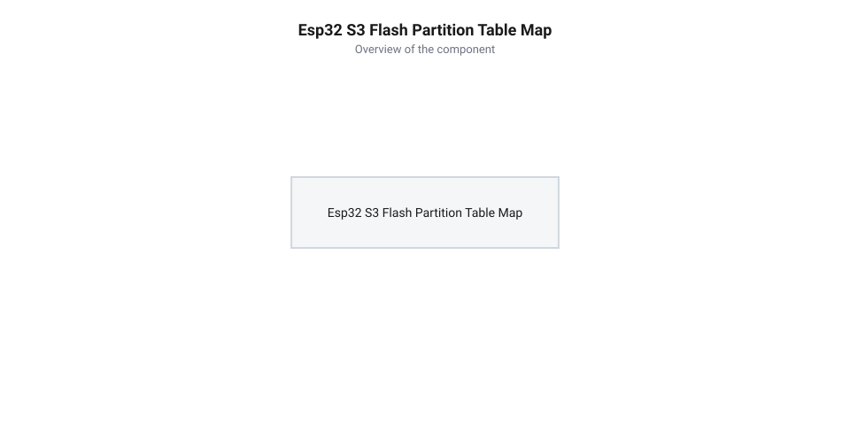
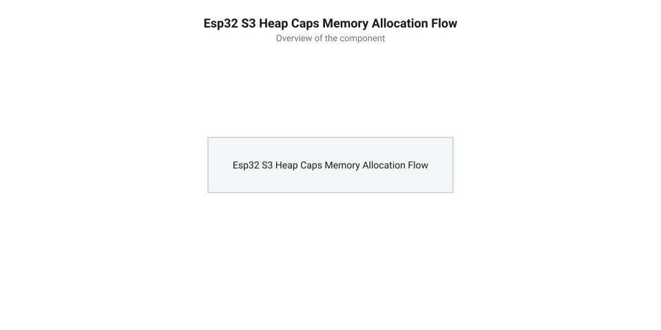

# Налаштування 16 МБ Flash, PSRAM та прошивання в ESP-IDF і Arduino IDE

<preknowlist>
- [Мікроконтролер ESP32-S3](root:cat-hw-boards/esp32s3-microcontroller) — Базова архітектура ядра XTensa LX7 та організація шини пам'яті ESP32-S3
- [Родина плат і модулів на ESP32-S3](root:cat-hw-boards/esp32-s3-boards-family-overview) — Відмінності між модулями ESP32-S3 та специфікація інтегрованої PSRAM
</preknowlist>

## Обмеження пам'яті та мета конфігурації

Використання базових стандартних конфігурацій прошивки при розробці на платі Waveshare ESP32-S3R2 призводить до суттєвого нелінійного обмеження її апаратного потенціалу. Стандартний завантажувач середовища розробки розрахований на 4 МБ накопичувача @@en|Flash@@ (від англ. @@en|flash memory@@ — миттєва спалахова пам'ять) та працює виключно із внутрішньою оперативною пам'яттю @@en|DRAM@@ обсягом близько 512 КБ. Принципова різниця полягає у фізичній адресації: внутрішня @@en|DRAM@@ розташована безпосередньо на кристалі та доступна процесорним ядрам через прямо змаплений шинний простір із мінімальною затримкою у 1–2 такти, тоді як зовнішня @@en|PSRAM@@ вимагає віртуалізації через блок управління пам'яттю @@en|MMU@@ (від англ. @@en|Memory Management Unit@@, де @@en|memory@@ — пам'ять, @@en|management@@ — управління та @@en|unit@@ — блок). Контролер @@en|MMU@@ транслює віртуальні адреси ядра сторінками по 64 КБ у фізичні шинні транзакції зовнішнього модуля та узгоджує їх із підсистемою кешування L1/L2. Коли дефолтна прошивка не ініціалізує таблиці сторінок @@en|MMU@@ для зовнішньої шини, функція стандартного виділення пам'яті керується виключно внутрішньою купою @@en|heap@@ (від англ. @@en|heap@@ — купа). Спроба виділити великий кадровий буфер або матрицю вагових коефіцієнтів миттєво вичерпує внутрішню @@en|DRAM@@, викликаючи аварійне переповнення чи фатальне збоєне перезавантаження ядра.

Головна причина полягає в тому, що інтегрована псевдостатична оперативна пам'ять @@en|PSRAM@@ (від англ. @@en|Pseudo Static Random Access Memory@@ — псевдостатична оперативна пам'ять із довільним доступом) обсягом 2 МБ на платі Waveshare ESP32-S3R2 вимагає обов'язкової програмної ініціалізації під час старту. За замовчуванням блоку контролера пам'яті MMU не передаються адреси зовнішньої шини, тому модуль залишається неактивним, а доступні 16 МБ Flash-накопичувача обмежуються першими 4 МБ через дефолтну таблицю розділів.

Щоб повністю розкрити можливості плати, необхідно сформулювати чіткі конфігураційні вимоги до середовищ збірки. Архітектурно [мікроконтролер ESP32-S3](root:cat-hw-boards/esp32s3-microcontroller) підтримує високоефективне підключення зовнішньої пам'яті через високошвидкісні шини. Порівнюючи з іншими рішеннями, які висвітлює [родина плат і модулів ESP32-S3](root:cat-hw-boards/esp32-s3-boards-family-overview), плата Waveshare ESP32-S3R2 потребує специфічного налаштування режиму шини Octal SPI на частоті 80 МГц, створення кастомної розмітки 16 МБ Flash та переходу на спеціальне API керування динамічною пам'яттю.

## Структура таблиці розділів 16 МБ Flash

Для ефективного використання всього обсягу в 16 МБ накопичувача плати Waveshare ESP32-S3R2 стандартна партиційна таблиця на 4 МБ не підходить. Системний @@en|partition table@@ (від англ. @@en|partition table@@ — таблиця розділів) визначає точні фізичні зміщення та розміри кожного блоку пам'яті: від первинного завантажувача до слотів оновлення по повітрю OTA та файлових систем.


*Структура адресації 16 МБ Flash-накопичувача зі зміщеннями партицій та виділенням місця під оновлення по повітрю й файлову систему.*

При створенні кастомної конфігурації для 16 МБ Flash створюється текстовий файл `partitions_16mb.csv`, у якому визначаються типи й підтипи партицій, їхні початкові адреси та обсяги. Для оптимізації операцій стирання й запису накопичувача початкове зміщення `Offset` та розмір `Size` кожного розділу обов'язково вирівнюють за межами блоків у 64 КБ (`0x10000`). Оскільки фізична @@en|Flash@@-пам'ять стирається блоками, вирівнювання за межею `0x10000` дозволяє контролеру застосовувати швидкодіюче блокове стирання по 64 КБ замість повільного посекторного очищення по 4 КБ і запобігає випадковому пошкодженню даних сусідніх розділів:

```csv|partitions
# Name,   Type, SubType, Offset,   Size,     Flags
nvs,      data, nvs,     0x9000,   0x5000,
phy_init, data, phy,     0xe000,   0x1000,
factory,  app,  factory, 0x10000,  0x300000,
ota_1,    app,  ota_1,   0x310000, 0x300000,
storage,  data, spiffs,  0x610000, 0x9F0000,
```

У цій розмітці по 3 МБ (0x300000) виділено під заводську прошивку `factory` та слот оновлення `ota_1`, що дає змогу розміщувати великі мультимедійні прошивки. Решта накопичувача обсягом близько 9.9 МБ (0x9F0000) віддається під файлову систему LittleFS або SPIFFS для збереження ресурсів та веб-інтерфейсів. На відміну від [компактної плати ESP32-S3-Zero](root:cat-hw-boards/esp32-s3-zero) зі 4 МБ Flash, така структура усуває ризик вичерпання місця при збірці складних проєктів.

Для підключення CSV-файлу в ESP-IDF у конфігураторі `sdkconfig` вказують параметри `CONFIG_PARTITION_TABLE_CUSTOM=y` та `CONFIG_PARTITION_TABLE_CUSTOM_FILENAME="partitions_16mb.csv"`. У середовищі PlatformIO у файлі `platformio.ini` додають директиви `board_build.partitions = partitions_16mb.csv` та `board_upload.flash_size = 16MB`.

## Конфігурація Octal SPI PSRAM 80 МГц

Внутрішньосхемний модуль @@en|PSRAM@@ на платі Waveshare ESP32-S3R2 з'єднаний із мікроконтролером через шину @@en|Quad SPI@@ (від лат. @@la|quattuor@@ — чотири та англ. @@en|Serial Peripheral Interface@@ — послідовний периферійний інтерфейс). На відміну від традиційного режиму Quad SPI, який використовує 4 лінії даних (D0–D3), режим Octal SPI використовує 8 паралельних ліній (D0–D7). Це подвоює пропускну здатність шини пам'яті при одинакових тактових частотах.

При роботі на тактовій частоті 80 МГц режим @@en|Octal SPI@@ у форматі @@en|SDR@@ (від англ. @@en|Single Data Rate@@ — одинарна швидкість передачі даних) з передачею байта за один тактовий фронт забезпечує швидкість обміну даними до 80 МБ/с. Перехід у режим @@en|DDR@@ (від англ. @@en|Double Data Rate@@ — подвійна швидкість передачі даних) дозволяє зчитувати та записувати дані за обома фронтами тактового імпульсу — наростаючим і спадаючим, що подвоює пікову пропускну здатність шини 8-бітного модуля @@en|PSRAM@@ до 160 МБ/с. Таке збільшення швидкодії є критично важливим для утримання великих кадрових буферів дисплеїв та цифрової обробки сигналів без апаратного заморожування конвеєра ядра. Для активації потрібного режиму та частоти шини в середовищі розробки необхідно правильно виставити прапорці компіляції та параметри ініціалізації системного контролера пам'яті.

У файлі конфігурації `platformio.ini` для PlatformIO та Arduino IDE налаштування реалізується через спецпрапорці та вказування типу пам'яті:

```ini|platformio
[env:esp32s3_16mb_psram]
platform = espressif32
board = esp32-s3-devkitc-1
framework = arduino
board_build.arduino.memory_type = qio_opi
board_build.partitions = partitions_16mb.csv
board_upload.flash_size = 16MB
build_flags = 
    -DBOARD_HAS_PSRAM
    -DARDUINO_USB_CDC_ON_BOOT=1
```

У середовищі ESP-IDF активація виконується через menuconfig встановленням опцій `CONFIG_SPIRAM=y`, `CONFIG_SPIRAM_MODE_OCT=y` та `CONFIG_SPIRAM_SPEED_80M=y`. Якщо режим Octal SPI виставлено невірно або обрано Quad SPI замість Octal, системний контролер пам'яті не зможе зчитати структуру @@en|PSRAM@@, що призведе до паніки ядра при завантаженні.

## Динамічна пам'ять та API heap caps

Після успішного включення @@en|PSRAM@@ системний розподільник пам'яті ESP-IDF розділяє внутрішній масив DRAM та зовнішню пам'ять. Стандартний виклик `malloc()` продовжує виділяти оперативну пам'ять із обмеженого внутрішнього блоку DRAM. Щоб гарантовано розмістити великий масив у зовнішній @@en|PSRAM@@, необхідно використовувати спеціалізоване API @@en|heap caps@@ (від англ. @@en|heap capabilities@@ — можливості купи).


*Потік виконання виклику heap_caps_malloc для надання пам'яті з масиву SPIRAM замість внутрішнього масиву DRAM.*

Головною функцією для роботи зі зовнішньою пам'яттю є `heap_caps_malloc()`, якій передається розмір буфера та прапорець `MALLOC_CAP_SPIRAM`. Моніторинг вільного обсягу здійснюється за допомогою `heap_caps_get_free_size(MALLOC_CAP_SPIRAM)`.

:::tabs
:::code api-esp32-s3r2-flashing-and-psram-config/c/esp-idf/allocate-psram-buffer.c
<!-- slide -->
:::code api-esp32-s3r2-flashing-and-psram-config/cpp/arduino/setup.cpp
:::

Важливо враховувати, що прямому доступу @@en|DMA@@ (від англ. @@en|Direct Memory Access@@ — прямий доступ до пам'яті) до пам'яті @@en|PSRAM@@ можуть заважати апаратні обмеження шини. Буфери у @@en|PSRAM@@ проходять через кеш-лінії @@en|MMU@@ (від англ. @@en|Memory Management Unit@@ — блок керування пам'яттю), тому перед передачею даних у периферію @@en|SPI@@ чи @@en|I2S@@ великі блоки даних іноді копіюють у тимчасовий внутрішній @@en|DRAM@@-буфер. Для прямої роботи периферійних контролерів виділяється пам'ять із прапорцем `MALLOC_CAP_DMA`, який примусово розміщує буфер у внутрішній @@en|DRAM@@, оскільки зовнішня @@en|PSRAM@@ не задовольняє вимогам апаратного адресування @@en|DMA@@. При такому копіюванні з @@en|PSRAM@@ критично дотримуватися суворого вирівнювання пам'яті: початкова адреса та розмір транзитного буфера мають бути вирівняні по 4-байтовій межі для 32-бітного слова або по 32-байтовій межі для кєш-ліній, інакше периферійний контролер згенерує помилку шини чи спотворить дані.

## Прошивання та налагодження через esptool py

Плата Waveshare ESP32-S3R2 оснащена апаратним контролером @@en|USB CDC@@ (від англ. @@en|USB Communication Device Class@@ — клас комунікаційних пристроїв USB) та JTAG, підключеним напряму до виводів GPIO19 (D-) та GPIO20 (D+). Це позбавляє потреби у зовнішніх мікросхемах конвертерів USB-UART (таких як CH340 або CP2102) і забезпечує прямий доступ до консолі та відлагоджувача.

Для автономного запису прошивки у 16 МБ Flash використовується утиліта `esptool.py`. При роботі через нативний USB-порт пристрій визначається у системі як посліводний порт `/dev/ttyACM0` або `COMx`. Стандартний виклик для прямого прошивання має такий вигляд:

```bash|esptool
esptool.py --chip esp32s3 --port /dev/ttyACM0 --baud 921600 write_flash -z \
  0x0 bootloader.bin \
  0x8000 partition-table.bin \
  0x10000 firmware.bin
```

При першому підключенні плати або при відновленні після збоїв пристрій переводять у режим завантаження @@en|manual boot@@: утримуючи кнопку BOOT, коротко натискають RESET, після чого відпускають BOOT. Завдяки нативному контролерові @@en|USB CDC@@ логування серійного порту ввімкнеться одразу після старту ядра, якщо у конфігурації прошивки активовано прапорець `CONFIG_ESP_CONSOLE_USB_CDC=y` або `ARDUINO_USB_CDC_ON_BOOT=1`. Пряме підключення через нативний USB дозволяє підвищити швидкість завантаження в утиліті `esptool.py` до 1.5 Мбіт/с (прапорець `--baud 1500000`), що суттєво перевершує можливості класичних адаптерів @@en|UART@@. Додатково скоротити час передачі 16 МБ прошивки дозволяє прапорець компресії `-z` (або `--compress`): він стискає бінарні дані за допомогою алгоритму @@en|zlib@@ безпосередньо перед відправкою, після чого первинний завантажувач у @@en|ROM@@-пам'яті розпаковує блоки на льоту прямо під час запису у сектори Flash.
