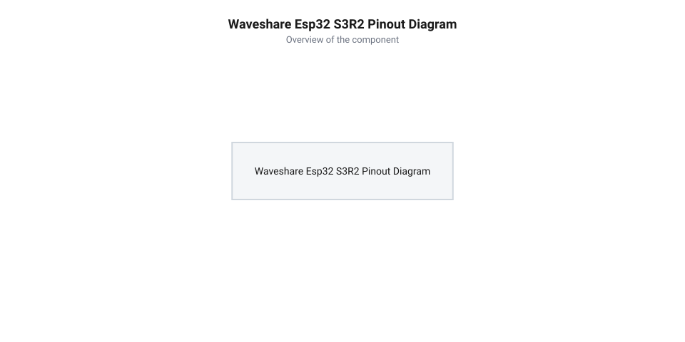
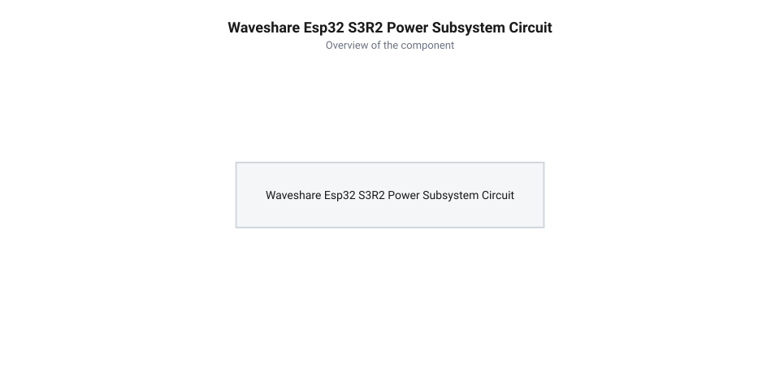

# Схемотехніка, розводка виводів та система живлення Waveshare ESP32-S3R2

<preknowlist>
- [Мікроконтролер ESP32-S3](root:cat-hw-boards/esp32s3-microcontroller) — базове призначення виводів, архітектуру периферії та організацію шин пам'яті чипа ESP32-S3
- [Родина плат і модулів на ESP32-S3](root:cat-hw-boards/esp32-s3-boards-family-overview) — загальні конструктивні відмінності плат ESP32-S3 та особливості підключення Octal SPI PSRAM
</preknowlist>

## Апаратна принципова схема та розпіновка

При розробці електронних пристроїв на основі компактних планок спроба підключити периферію без знання апаратної розпіновки часто призводить до коротких замикань або збоїв ініціалізації. Розробницька плата Waveshare ESP32-S3R2 має 28 контактних площадок, розташованих двома паралельними рядами, які виводять більшість сигнальних ліній мікроконтролера у компактному формувачі.

Для правильного проективання схем необхідно розуміти зв'язок між зовнішньою номенклатурою шпильок плати та виводами мікроконтролера в корпусі @@en|QFN@@ (від англ. @@en|Quad Flat No-leads package@@ — корпус із плоскими виводами без ніжок). З 28 контактів плати частина виділена під живлення (5V, 3.3V, GND), а інші — під фізичні виводи @@en|GPIO@@ (від англ. @@en|General Purpose Input/Output@@ — виводи вводу/виводу загального призначення). При цьому аналогові канали чітко рознесені між двома бортовими перетворювачами: канали першого контролера ADC1 (виводи GPIO1–GPIO10) виведені переважно на ліву контактну гребінку, тоді як канали другої групи ADC2 (виводи GPIO11–GPIO20) розташовані на правій гребінці поруч із нативним USB. Такий розподіл є критично важливим для схеми, оскільки блок ADC2 апаратно ділить ресурси з радіомодулем Wi-Fi, тому для точних вимірювань аналогових датчиків під час бездротової передачі слід використовувати виключно канали ADC1 з лівої гребінки. Усі цифрові лінії @@en|GPIO@@ розраховані виключно на логіку 3.3 В та не мають апаратної толерантності до 5 В: подача напруги понад 3.6 В чи нижче -0.3 В спричиняє пробій захисних @@en|ESD@@-діодів (від англ. @@en|Electrostatic Discharge@@ — електростатичний розряд) і незворотне руйнування вхідних каскадів. Для безпечного узгодження з 5-вольтовою периферією обов'язково застосовують конвертери логічних рівнів або дільники напруги, а струм окремої лінії суворо обмежують межею 40 мА (із рекомендованим значенням до 12 мА на вивід), оскільки перевищення цього порогу призводить до теплового перевантаження та падіння напруги на внутрішніх шинах мікроконтролера.


*Діаграма контактних виводів розробницької плати із зазначенням функцій GPIO, інтерфейсів ADC, SPI, I2C та ліній живлення.*

Кожен фізичний контакт @@en|GPIO@@ через матрицю периферійних сигналів підключається до внутрішніх цифрових блоків: апаратної шини I2C, послідовних портів UART, високошвидкісного SPI або аналого-цифрових перетворювачів ADC. На відміну від суцільновиведених рішень, що розглядає [родина плат і модулів ESP32-S3](root:cat-hw-boards/esp32-s3-boards-family-overview), плата Waveshare підключає внутрішні виводи чипа [мікроконтролера ESP32-S3](root:cat-hw-boards/esp32s3-microcontroller) із суворим дотриманням технологічних обмежень інтегрованої пам'яті.

Конструктивно плата виконана у компактному балунному форматі з напівкруглими зубчастими отворами (англ. @@en|castellated holes@@ — зубчасті крайові контакти) вздовж обох бокових граней із кроком 2.54 мм, що дозволяє як монтувати її прямо на материнську плату через поверхневий монтаж, так і використовувати звичайні штирьові гребінки. Усі 28 виводів мають подвійне службове позначення: первинну скрізну номенклатуру шпильок плати та апаратні індекси @@en|GPIO@@, що значно спрощує схемотехнічну компоновку в порівнянні з іншими компактними платами серії, такими як [ESP32-S3-Zero](root:cat-hw-boards/esp32-s3-zero) та [ESP32-S3 SuperMini](root:cat-hw-boards/esp32-s3-supermini). Окрім цифрових і аналогових ліній, виводи живлення `5V`, `3.3V` та кілька розподілених точок заземлення `GND` розведені з обох боків плати для рівномірного струморозподілу та зниження паразитних наведень при використанні високочастотних периферійних модулів.

## Конфігурація шини Octal SPI PSRAM

Найчастішою пасткою при розробці на Waveshare ESP32-S3R2 є використання виводів, які фізично зарезервовані під внутрішньосхемну псевдостатичну оперативну пам'ять @@en|PSRAM@@ (від англ. @@en|Pseudo Static Random Access Memory@@ — псевдостатична оперативна пам'ять із довільним доступом) обсягом 2 МБ. Оскільки кристал чипа виготовлено за технологією @@en|SIP@@ (від англ. @@en|System in Package@@ — система в корпусі), внутрішня пам'ять підключена безпосередньо до ядра мікроконтролера всередині корпусів QFN56 за допомогою 8-бітової шини @@en|Octal SPI@@ (від грец. @@el|okto@@ — вісім та англ. @@en|Serial Peripheral Interface@@ — послідовний периферійний інтерфейс).

Ця високошвидкісна шина займає лінії GPIO33, GPIO34, GPIO35, GPIO36 та GPIO37 для передачі 8 біт даних за такт разом із службовими стробами. Якщо розробник спробує підключити зовнішній датчик чи світлодіод до цих ліній на контактах плати, при першій же спробі ядра звернутися до @@en|PSRAM@@ на шині виникне електричний конфлікт. Це призводить до миттєвого пошкодження даних в оперативній пам'яті або до апаратного скидання чипа. Більше того, високоефективна робота шини на частоті 80 МГц накладає жорсткі вимоги на суміжні лінії вибору мікросхеми (CS) та тактування (CLK), які є спільними для @@en|PSRAM@@ і 16 МБ флеш-пам'яті. На такій високій частоті будь-яка зовнішня паразитна ємність або наведення на виводах тактування розмиває фронти сигналів і зменшує часові допуски (англ. @@en|timing margins@@), через що фазовий зсув між тактовим імпульсом і зчитуваними даними викликає збої адресації та викривлення інструкцій при каскадній передачі.

Порівняно з рішеннями без оперативної пам'яті, такими як [модуль ESP32-S3-Zero](root:cat-hw-boards/esp32-s3-zero), де лінії GPIO33–GPIO37 можна вільно використовувати під користувацькі потреби, на платі Waveshare ESP32-S3R2 ці виводи жорстко заблоковані. Для зовнішньої периферії слід вибирати незарезервовані виводи (наприклад, GPIO1–GPIO18), що гарантує цілісність шини пам'яті під час виконання застосунку.

## Система живлення та регулятор LDO

Живлення плати Waveshare ESP32-S3R2 здійснюється через вхідний роз'єм USB Type-C або через виділений контакт `5V` на крайовій гребінці. Вхідна напруга 5 В проходить через захисний діод Шотткі, який запобігає зворотному струму при одночасному підключенні кабелю USB та зовнішнього джерела. Далі напруга подається на лінійний стабілізатор @@en|LDO@@ (від англ. @@en|Low Dropout Regulator@@ — регулятор із малим падінням напруги), який знижує її до робочого рівня 3.3 В для живлення мікроконтролера та флеш-пам'яті.


*Схема вузла перетворення напруги живлення від USB Type-C та виводу 5V до робочого рівня 3.3 В із фільтруючими конденсаторами.*

Вбудований регулятор @@en|LDO@@ розрахований на максимальний вихідний струм до 500–800 мА. Зауважте, що під час активних сплесків передачі радіомодуля Wi-Fi чи Bluetooth споживання ядра чипа може стрибати до 350–500 мА. Для демпфування цих мікросекундних кидків струму та запобігання просіданню живлення на виході регулятора встановлюють додаткові керамічні фільтруючі конденсатори обсягом 10 мкФ типу @@en|Low-ESR@@ (від англ. *@@en|Low Equivalent Series Resistance@@* — низький еквівалентний послідовний опір). Завдяки високій швидкодії та мінімальному внутрішньому опору вони миттєво віддають накопичений заряд у лінію під час радіовипромінювання [мікроконтролера ESP32-S3](root:cat-hw-boards/esp32s3-microcontroller), згладжуючи високочастотні пульсації. Якщо ж до шини 3.3 В підключити додаткові потужні споживачі (наприклад, дисплей чи сервоприводи), загальний струм перевищить ліміт @@en|LDO@@. Падіння напруги на регуляторі перетворюється на теплову потужність за виразом:

```
P_heat = (V_in - V_out) × I_load
= (5.0 - 3.3) × 0.4      [підстановка напруги 5 В та струму 400 мА]
= 0.68 Вт                [теплова потужність стабілізатора]
```

При виділенні понад 0.5 Вт дрібний корпус стабілізатора швидко перегрівається, спричиняючи захисне відключення. Це викликає системний @@en|Brownout Reset@@ (від англ. @@en|brownout reset@@ — скидання при просіданні живлення) — апаратне скидання мікроконтролера при падінні напруги шини 3.3 В нижче межі 2.8 В. На відміну від потужної розробницької [плати ESP32-CAM](root:cat-hw-boards/esp32-cam), для живлення зовнішньої периферії із великим споживанням струму на Waveshare ESP32-S3R2 рекомендується використовувати окремий зовнішній перетворювач напруги.

## Інтерфейс USB OTG та кнопки керування

На відміну від попередніх поколінь мікроконтролерів ESP32, які вимагали окремої мікросхеми містка USB-UART, плата Waveshare ESP32-S3R2 має нативний контролер @@en|USB OTG@@ (від англ. @@en|USB On-The-Go@@ — розширення USB для прямого з'єднання пристроїв). Лінії даних D- та D+ роз'єму USB Type-C підключені напряму до виводів GPIO19 та GPIO20 мікроконтролера.

Це забезпечує прямоточне програмування прошивки та апаратне налагодження за допомогою вбудованого контролера @@en|JTAG@@ (від англ. *@@en|Joint Test Action Group@@* — стандарт апаратного налагодження й тестування). Для керування станами завантаження на платі встановлено дві фізичні кнопки: RESET (підключену до виводу EN/CHIP_PU) та BOOT (підключену до лінії GPIO0). Для надійного входу в режим завантажувача ROM Bootloader кнопку BOOT необхідно затиснути до подачі живлення або натискання RESET і утримувати у низькому стані щонайменше 100–300 мс після зростання напруги на лінії EN. Цей часовий інтервал гарантує, що апаратна логіка защеплення станів страпінг-виводів [мікроконтролера ESP32-S3](root:cat-hw-boards/esp32s3-microcontroller) гарантовано зчитає логічний нуль на GPIO0 після завершення переходних процесів у підсистемі живлення.

Коли вивід EN короткочасно замикається кнопкою RESET на землю GND, відбувається повне перезавантаження процесора. Якщо ж під час подачі живлення або скидання лінія GPIO0 утримується у низькому логічному рівні кнопкою BOOT, первинний завантажувач мікроконтролера переходить у режим запису прошивки ROM Bootloader. Аналогічно до [плати ESP32-S3 SuperMini](root:cat-hw-boards/esp32-s3-supermini), таке схемне рішення дає змогу легко відновлювати пристрій після збоїв прошивки без використання зовнішніх програматорів.
