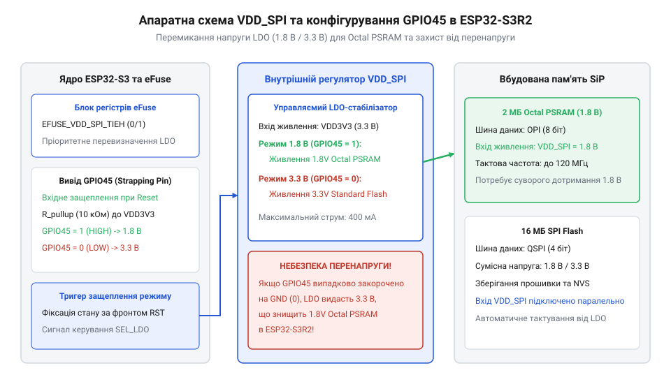
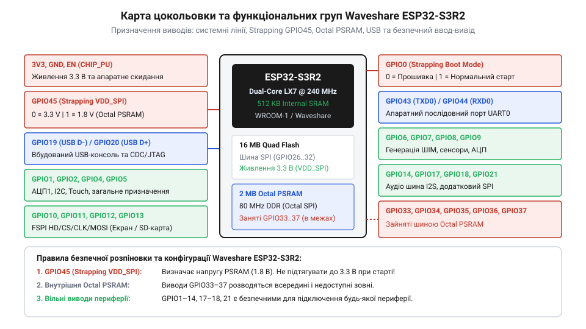

# Апаратна схема живлення, розпіновка та конфігурація GPIO45 на платі Waveshare ESP32-S3R2

<preknowlist>
- [Мікроконтролер ESP32-S3](root:cat-hw-boards/esp32s3-microcontroller) — Загальна архітектура чипа, організація пам'яті та периферійні блоки ESP32-S3.
- [Родина плат і модулів на ESP32-S3](root:cat-hw-boards/esp32-s3-boards-family-overview) — Класифікація модулів WROOM, MINI та SiP, відмінності шин Quad SPI та Octal SPI.
</preknowlist>

## Пастка згорання PSRAM при завантаженні

При проєктуванні пристроїв на базі компактної плати [Waveshare ESP32-S3R2](root:cat-hw-boards/esp32-s3r2-waveshare) схемотехніки часто стикаються з раптовим виходом з ладу оперативної пам'яті або циклічними перезавантаженнями системи. Причиною цього є невірне підключення зовнішньої периферії до виводу `GPIO45`. Цей контакт належить до категорії конфігураційних виводів завантаження (англ. *strapping pin*; @@en|конфігураційний вивід завантаження@@), стан яких зчитується апаратним блоком мікроконтролера в момент подачі живлення або скидання.

Для гарантованого утримання низького логічного рівня під час завантаження до виводу `GPIO45` підключають зовнішній притискний резистор (англ. *pull-down resistor*; @@en|притискний резистор pull-down@@) номіналом 10 кОм, з'єднаний із заземленням GND. Така принципова схема розв'язки компенсує можливі струми наведення й гарантує фіксацію напруги 1.8 В внутрішнім регулятором, зберігаючи можливість подальшого використання виводу в робочому режимі, як це реалізовано у [відлагоджувальних платах на ESP32-S3](root:cat-hw-boards/esp32-s3-boards-family-overview).

Плата містить мобільний чип у корпусі SiP (англ. *System-in-Package*; @@en|чип у корпусі SiP@@), всередині якого інтегровано [мікроконтролер ESP32-S3](root:cat-hw-boards/esp32s3-microcontroller) та кристали псевдостатичної оперативної пам'яті (англ. *Pseudo Static Random-Access Memory*; @@en|псевдостатична оперативна пам'ять PSRAM@@) обсягом 2 МБ. На відміну від стандартних модулів із чотирибітною шиною пам'яті, де застосовується напруга 3.3 В, вбудована восьмибітна пам'ять Octal PSRAM вимагає суворого дотримання напруги живлення 1.8 В.

Якщо розробник підключає до лінії `GPIO45` зовнішній резистор підтяжки до лінії 3.3 В або периферійне обладнання з активним високим рівнем під час старту, внутрішній регулятор VDD_SPI примусово перемикається в режим 3.3 В. Подача напруги 3.3 В замість номінальних 1.8 В становить перевищення норми майже на 83%, що викликає лавинний електричний пробій тонкого підзатворного діелектрика та некорельований витік струму крізь приховані p-n переходи субмікронних напівпровідникових структур Octal PSRAM. Висока густина локального струму призводить до лавиноподібного теплового розгону, мікророзплавлення внутрішніх кремнієвих провідників і незворотного фізичного руйнування кристала пам'яті протягом кількох секунд. У результаті пристрій втрачає можливість ініціалізувати розширену оперативну пам'ять, повертаючи системну помилку `ESP_ERR_PSRAM_NOT_INITIALIZED`, як це описано в [огляді плат на ESP32-S3](root:cat-hw-boards/esp32-s3-boards-family-overview).

Для локалізації цієї несправності розробнику слід проаналізувати логи первинного завантажувача (англ. *ROM Bootloader*; @@en|завантажувач ROM Bootloader@@), що виводяться через консоль UART при старті чипа. Алгоритм діагностики полягає в перевірці відповідей ідентифікатора пам'яті (англ. *PSRAM ID*; @@en|PSRAM ID@@): якщо завантажувач зчитує нульове значення `0x000000` або `0xFFFFFF` замість дійсних байтів виробника, це свідчить про повну відсутність зв'язку шини Octal SPI через фізичне руйнування кристала. Подальша зупинка системи з повідомленням про помилку `esp_psram_init failed` підтверджує незворотний апаратний збій підсистеми пам'яті, що вимагає заміни модуля на новий у [платах родини ESP32-S3](root:cat-hw-boards/esp32-s3-boards-family-overview).

## Арбітраж напруги VDD_SPI та роль GPIO45

Для забезпечення живлення внутрішніх і зовнішніх мікросхем Flash та PSRAM у чипі реалізовано окремий регулятор з низьким падінням напруги (англ. *Low Dropout*; @@en|регулятор LDO@@), який формує системну шину `VDD_SPI`. Внутрішня архітектура арбітражу напруги спирається на апаратний тригер-засувку, прив'язану до стану лінії `GPIO45` під час підйому сигналу скидання `CHIP_PU`.

У внутрішній структурній схемі корпусу SiP вихід регулятора `VDD_SPI LDO` розведений паралельною шиною живлення напряму до кристалів `SPI Flash` та `Octal PSRAM`. Оскільки обидві мікросхеми живляться від єдиного виходу регулятора, перемикання LDO у режим 1.8 В є обов'язковою умовою забезпечення низьковольтного живлення для обох структур внутрішньої пам'яті, що детальніше розкрито в [описі мікроконтролера ESP32-S3](root:cat-hw-boards/esp32s3-microcontroller).


*Схема внутрішнього регулятора VDD_SPI, засувки GPIO45 та підключення Octal PSRAM.*

У момент подачі живлення напрямок роботи регулятора `VDD_SPI` визначається за такою логікою: 1. Якщо на виводі `GPIO45` зафіксовано низький логічний рівень (0 В), внутрішній регулятор переходить у режим стабілізації напруги **1.8 В**. Це забезпечує безпечну роботу високошвидкісної пам'яті Octal PSRAM, як це реалізовано на платах [родини ESP32-S3](root:cat-hw-boards/esp32-s3-boards-family-overview). 2. Якщо на виводі `GPIO45` присутній високий рівень (3.3 В), регулятор видає **3.3 В**, що є стандартом для звичайних систем із Quad SPI, таких як [ESP32-S3-Zero](root:cat-hw-boards/esp32-s3-zero) або [ESP32-S3 SuperMini](root:cat-hw-boards/esp32-s3-supermini). Фіксація рівня відбувається в момент наростання фронту сигналу `CHIP_PU` з апаратною часовою затримкою фільтрації 1–3 мс. Для надійного збереження вибраного режиму стан лінії `GPIO45` повинен залишатися стабільним упродовж щонайменше 3 мс після зняття сигналу скидання.

Таким чином, для плати Waveshare ESP32-S3R2 лінія `GPIO45` під час старту повинна підтримуватися в стані підтяжки до землі або залишатися високоімпедансною без зовнішніх підтягувальних резисторів.

## Пропалювання eFuse та програмний обхід засувки

Щоб усунути ризик випадкового пошкодження PSRAM при використанні `GPIO45` у зовнішніх схемах, виробник надає можливість апаратного блокування напруги шини `VDD_SPI`. Це здійснюється за допомогою одноразово програмованих електронних запобіжників (англ. *electronic fuse*; @@en|електронні запобіжники eFuse@@).

Апаратне керування LDO базується на побітовому розкрії eFuse-блоку `EFUSE_VDD_SPI_FORCE`, де біт `VDD_SPI_FORCE` (значення `1`) блокує опитування засувки `GPIO45`, а біт `VDD_SPI_TIEH` (`0` для 1.8 В та `1` для 3.3 В) задає цільовий рівень напруги. У свою чергу, для програмного перевизначення в регістрі `RTC_CNTL_VDD_SPI_CONFIG_REG` біт `RTC_CNTL_VDD_SPI_FORCE` (31-й біт) активує керування через `RTC`, а біт `RTC_CNTL_VDD_SPI_TIEH` (30-й біт) встановлює режим стабілізації. Така двошляхова структура дозволяє жорстко зафіксувати напругу в eFuse ще на етапі виробництва, що запобігає апаратним збоям [системних модулів на ESP32-S3](root:cat-hw-boards/esp32-s3-boards-family-overview).

Регістр `EFUSE_VDD_SPI_FORCE` дає змогу повністю відключити зчитування логічного рівня з виводу `GPIO45` при завантаженні. Процедура апаратної фіксації передбачає запис відповідних бітів через утиліту `espefuse.py`:

```bash
espefuse.py --port /dev/ttyUSB0 set_flash_voltage 1.8V
```

Після виконання цієї команди внутрішній перемикач повертається у фіксований стан 1.8 В на апаратному рівні кристала. Будь-які зміни рівня на `GPIO45` під час подальших перезавантажень перестають впливати на вихідну напругу регулятора `VDD_SPI`.

Перевірити поточний стан конфігурації eFuse-регістрів та переконатися у блокуванні регулятора можна за допомогою команди `espefuse.py --port /dev/ttyUSB0 summary`. У зведеному звіті аналізують значення поля `VDD_SPI_FORCE`: прапор зі значенням `1` вказує на примусову фіксацію виходу LDO, а параметр `VDD_SPI_TIEH = 0` підтверджує жорстку прив'язку джерела живлення до рівня 1.8 В. Це забезпечує апаратний захист від випадкового подання 3.3 В на підсистему пам'яті незалежно від стану зовнішніх виводів, що є ключовою вимогою розробки надійних модулів на базі [мікроконтролера ESP32-S3](root:cat-hw-boards/esp32s3-microcontroller).

У середовищі розробки ESP-IDF існує також можливість програмного переналаштування параметрів `VDD_SPI` через регістр `RTC_CNTL_VDD_SPI_CONFIG_REG`. Проте програмна конфігурація виконується первинним завантажувачем (англ. *bootloader*; @@en|завантажувач bootloader@@) вже після того, як апаратна засувка виставила початкову напругу. Тому програмний метод не здатний захистити пам'ять від короткочасного сплеску напруги 3.3 В у перші мілісекунди після скидання чипа.

## Розпіновка та особливості периферії ESP32-S3R2

Апаратна розводка плати Waveshare ESP32-S3R2 вимагає чіткого врахування системних обмежень периферійних виводів для запобігання конфліктам із внутрішньою шиною пам'яті та модулями зв'язку.

Окрім функціонального призначення контактів, слід зважати на їхні електричні навантажувальні характеристики для запобігання перегріву й просіданню живлення. Навантажувальна здатність (англ. *drive strength*; @@en|drive strength@@) кожного виводу `GPIO` налаштовується програмно, де рекомендований тривалий струм на один контакт становить до 20 мА, а максимально допустимий піковий — 40 мА. Водночас сумарний струм усіх задіяних виводів обмежений рівнем 120 мА через можливості внутрішніх ліній `VDD33`, тому потужну периферію чи світлодіодні матриці рекомендується підключати через транзисторні ключі або буферні мікросхеми, як на [платах родини ESP32-S3](root:cat-hw-boards/esp32-s3-boards-family-overview).


*Розподіл виводів плати Waveshare ESP32-S3R2 та їхній системний функціонал.*

При розробці схем підключення до плати необхідно дотримуватися таких правил розподілу контактів:
- **Конфігураційні виводи**: Вивід `GPIO45` не повинен містити зовнішніх резисторів підтяжки до лінії 3.3 В. Вивід `GPIO0` використовується для входу в режим прошивання (англ. *Boot mode*; @@en|режим завантаження Boot mode@@) і при підйомі живлення має бути у високому стані.
- **Внутрішня шина Octal PSRAM**: Лінії `GPIO33`, `GPIO34`, `GPIO35`, `GPIO36` та `GPIO37` жорстко задіяні для зв'язку з 8-бітною пам'яттю. На відміну від плат без PSRAM або з Quad SPI, їх суворо заборонено використовувати як виводи загального призначення.
- **Нативний USB-інтерфейс**: Виводи `GPIO19` (USB D-) та `GPIO20` (USB D+) підключені до вбудованого контролера `USB Serial/JTAG`. Вони забезпечують завантаження прошивки та налагодження без застосування зовнішніх конвертерів `UART`.
- **Аналогові вимірювання**: Лінії `ADC2` (`GPIO11`–`GPIO20`) блокуються при включенні радіомодуля `Wi-Fi`. Для аналогових датчиків слід обирати виводи блоку `ADC1` (`GPIO1`–`GPIO10`).

Для підключення зовнішніх датчиків та інтерфейсних модулів за протоколами `@@en|I2C@@` та `@@en|SPI@@` рекомендується використовувати залишкові безпечні лінії з блоку `ADC1`. Зокрема, виводи `GPIO4` (SDA) та `GPIO5` (SCL) оптимально підходять для шини I2C завдяки відсутності системних підтяжок під час завантаження. Для високошвидкісної шини SPI доцільно призначати лінії `GPIO11` (CS), `GPIO12` (SCK), `GPIO13` (MISO) та `GPIO14` (MOSI), що забезпечує надійне функціонування периферії без ризику апаратних конфліктів із системною пам'яттю, як у [компактних одноплатниках ESP32-S3-Zero](root:cat-hw-boards/esp32-s3-zero).
