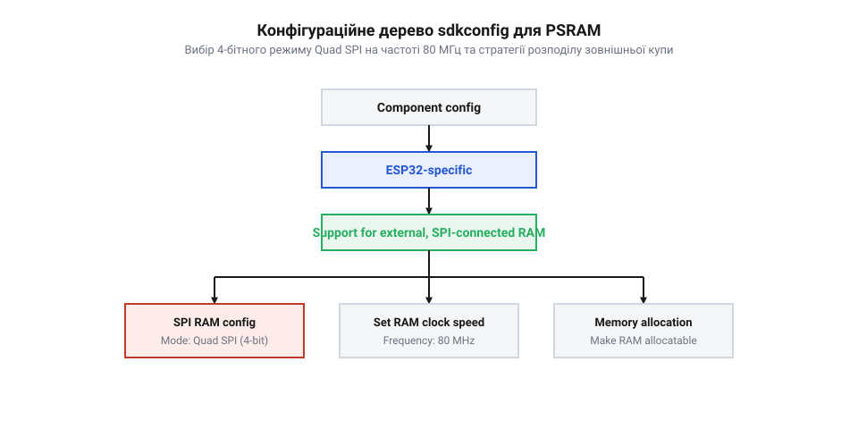
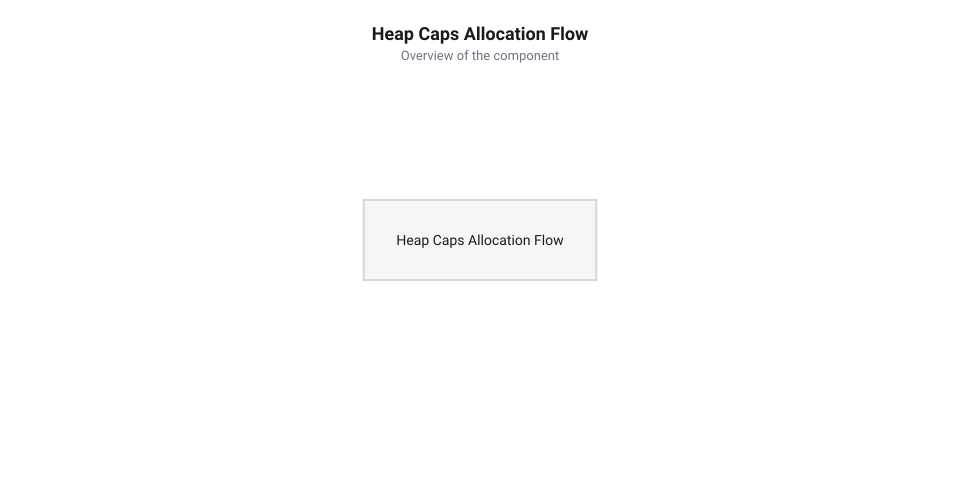

# Довідник конфігурації sdkconfig та програмного інтерфейсу алокатора пам'яті ESP-IDF

<preknowlist>
- [Мікроконтролер ESP32-S3](root:cat-hw-boards/esp32s3-microcontroller) — архітектура підсистеми пам'яті, шини зв'язку та керування кешем
- [Родина плат і модулів на ESP32-S3](root:cat-hw-boards/esp32-s3-boards-family-overview) — загальний огляд платформ ESP32-S3 з різними ревізіями пам'яті
- [Waveshare ESP32-S3-Zero (Type-C, 4 МБ)](root:cat-hw-boards/esp32-s3-zero) — особливості апаратної конфігурації плат Waveshare серії Zero
</preknowlist>

## Проблема обсягу SRAM та апаратний захист

Під час розробки складних вбудованих застосунків на базі [мікроконтролера ESP32-S3](root:cat-hw-boards/esp32s3-microcontroller) інженери швидко зіштовхуються з апаратним обмеженням внутрішньої оперативної пам'яті SRAM (від англ. @@en|Static Random Access Memory@@ — статична оперативна пам'ять). Фізичний обсяг внутрішньої SRAM розподілений на пам'ять інструкцій @@en|IRAM@@ (від англ. @@en|Instruction RAM@@ — оперативна пам'ять інструкцій для виконання коду), пам'ять даних @@en|DRAM@@ (від англ. @@en|Data RAM@@ — оперативна пам'ять даних під купу й глобальні змінні) та спільну область DRAM/IRAM, яку компонувальник динамічно ділить залежно від співвідношення розміру коду та даних у прошивці. Сумарний обсяг внутрішньої купи (від англ. @@en|internal heap@@) мікроконтролера становить близько 512 КБ, проте після завантаження операційної системи FreeRTOS, стека Wi-Fi та системних драйверів під прикладні потреби розробника залишається не більше 300 КБ в області DRAM. Спроба виділити в цій обмеженій області пам'яті великі кадрові буфери (від англ. @@en|frame buffer@@ — буфер кадру) для графічних дисплеїв чи масиви тензорів для нейромереж призводить до повернення вказівника `NULL` та зриву виконання програми.

За замовчуванням стандартна функція C-бібліотеки `malloc()` звертається виключно до внутрішньої SRAM. Навіть якщо на платі [Waveshare ESP32-S3-Zero](root:cat-hw-boards/esp32-s3-zero) встановлено SiP-кристал ESP32-S3R2 з 2 МБ вбудованої зовнішньої PSRAM (від англ. @@en|Pseudo Static Random Access Memory@@ — псевдостатична оперативна пам'ять), системний алокатор фреймворку ESP-IDF (від англ. @@en|Espressif IoT Development Framework@@ — фреймворк розробки від Espressif) не використовуватиме її без попередньої конфігурації. Такий захист є навмисним апаратним рішенням: доступ до зовнішньої пам'яті здійснюється через шину SPI, що вимагає проходження даних через шинний кеш та блок керування пам'яттю MMU (від англ. @@en|Memory Management Unit@@ — блок керування пам'яттю), через що затримка звернення стає вищою, ніж у внутрішньої SRAM.

Автоматичне перенесення довільних алокацій у PSRAM без контролю з боку розробника могло б призвести до фатального зниження швидкодії критичних за часом обробників переривань ISR (від англ. @@en|Interrupt Service Routine@@ — процедура обслуговування переривань). Апаратне блокування шини розширення обумовлене тим, що під час старту мікроконтролера первинний завантажувач (від англ. @@en|primary bootloader@@ — завантажувач першого рівня) утримує фізичні лінії контролера SPI у стані високого імпедансу, запобігаючи хаотичним зчитуванням до завершення базової ініціалізації. Фізичний доступ до зовнішньої пам'яті відкривається лише після виконання системної функції `esp_psram_init()`, яка налаштовує виводи Quad SPI, подає тактовий сигнал 80 МГц та заповнює таблицю сторінок блоку керування пам'яттю MMU (від англ. @@en|Memory Management Unit@@ — блок керування пам'яттю). До цього моменту будь-яке звернення за адресами зовнішньої купи викликає апаратне перезавантаження процесора. Для безпечного та ефективного використання 2 МБ додаткової пам'яті розробник мусить налаштувати параметри у системній конфігурації `sdkconfig` та перейти до застосування розширеного програмного інтерфейсу купи `heap_caps`.

## Конфігурування PSRAM у sdkconfig

Головним механізмом активації підтримки зовнішньої пам'яті у фреймворку @@en|ESP-IDF@@ є налаштування файлу конфігурації проєкту `sdkconfig`. Для платформи Waveshare ESP32-S3R2 з 4-бітною шиною Quad SPI (від англ. @@en|Quad Serial Peripheral Interface@@ — чотирибітовий послідовний периферійний інтерфейс) насамперед необхідно ввімкнути базову підсистему PSRAM, поставивши параметр `CONFIG_SPIRAM=y`. Це змушує первинний завантажувач (від англ. @@en|bootloader@@ — завантажувач) ініціалізувати фізичні лінії шини SPI та включити тактування пам'яті під час старту мікроконтролера.

*Конфігураційне дерево sdkconfig: вибір 4-бітного режиму Quad SPI на частоті 80 МГц та визначення стратегії розподілу зовнішньої купи.*

Наступним кроком є вибір режиму роботи шини та частоти обміну даними. Для ревізії кристала R2 параметр `CONFIG_SPIRAM_MODE_QUAD=y` встановлює 4-бітну ширину шини, а параметр `CONFIG_SPIRAM_SPEED_80M=y` переводить шину на максимальну робочу частоту 80 МГц. Для розподілу системної купи передбачено три альтернативні стратегії через параметр `CONFIG_SPIRAM_USE`:
- `CONFIG_SPIRAM_USE_CAPS_ALLOC` — зовнішня пам'ять додається до загальної купи, проте алокується лише за явного виклику `heap_caps_malloc()` з відповідним прапором;
- `CONFIG_SPIRAM_USE_MALLOC` — зовнішня пам'ять інтегрується в загальний пул, і виклики `malloc()` автоматично отримують пам'ять з PSRAM, якщо розмір блоку перевищує поріг `CONFIG_SPIRAM_MALLOC_ALWAYSINTERNAL`;
- `CONFIG_SPIRAM_USE_MEMMAP` — PSRAM відображається в адресний простір, але виключається з алокатора купи для ручного керування через таблицю сторінок MMU.

Вибір порогового значення `CONFIG_SPIRAM_MALLOC_ALWAYSINTERNAL` у режимі автоматичної інтеграції суттєво впливає на ступінь фрагментації купи та раціональне використання внутрішньої оперативної пам'яті:

| Пороговий розмір `CONFIG_SPIRAM_MALLOC_ALWAYSINTERNAL` | Розподіл дрібних алокацій | Навантаження на внутрішню SRAM | Ступінь фрагментації купи |
| :--- | :--- | :--- | :--- |
| `512` байтів (занижений) | Переважно у PSRAM | Мінімальне (заощаджує внутрішню SRAM) | Високий у PSRAM через велику кількість дрібних блоків |
| `4096` байтів (оптимальний) | Дрібні в SRAM, великі буфери в PSRAM | Збалансоване | Мінімальний (великі кадрові буфери винесені в PSRAM) |
| `16384` байти (завищений) | Переважно у внутрішній SRAM | Критичне (загроза виснаження купи SRAM) | Високий в SRAM через розміщення великих системних буферів |

Для [родини плат на ESP32-S3](root:cat-hw-boards/esp32-s3-boards-family-overview) з ревізією R2 найідеальнішою є конфігурація `CONFIG_SPIRAM_USE_CAPS_ALLOC`. Вона гарантує, що внутрішня швидка SRAM залишається для критичних задач, а об'ємна PSRAM задіюється свідомо під буфери даних.

## Програмний інтерфейс алокації та маски

Після вмикання PSRAM у `sdkconfig` основним інструментом керування пам'яттю стає функціональне сімейство `heap_caps`. Базова функція `heap_caps_malloc()` приймає два аргументи: необхідний розмір у байтах та бітову маску можливостей (від англ. @@en|capability mask@@ — маска властивостей), яка визначає апаратні вимоги до виділюваного блоку.

*Порядок обробки запиту алокації: аналіз прапорів маски можливостей, пошук вільного блоку в відповідному регіоні купи та обробка відмови.*

Ключовими прапорцями для роботи з зовнішньою пам'яттю на платах Waveshare ESP32-S3R2 є:
- `MALLOC_CAP_SPIRAM` — вимагає виділення блоку пам'яті обов'язково у зовнішній PSRAM (від англ. @@en|Pseudo Static Random Access Memory@@ — псевдостатична оперативна пам'ять). Якщо у PSRAM немає неперервної ділянки потрібного розміру, функція поверне `NULL`;
- `MALLOC_CAP_INTERNAL` — вимагає виділення блоку виключно у внутрішній швидкій SRAM (від англ. @@en|Static Random Access Memory@@ — статична оперативна пам'ять);
- `MALLOC_CAP_8BIT` — гарантує, що виділений блок підтримує побайтове зчитування та запис (8-бітний доступ);
- `MALLOC_CAP_DMA` — вимагає пам'яті, що підтримує прямий доступ до пам'яті DMA (від англ. @@en|Direct Memory Access@@ — прямий доступ до пам'яті). Зверніть увагу: для ESP32-S3 зовнішня PSRAM не підтримує стандартний DMA-обмін периферії, тому одночасна вказівка `MALLOC_CAP_SPIRAM | MALLOC_CAP_DMA` завжди поверне `NULL`;
- `MALLOC_CAP_EXEC` — вимагає виділення пам'яті, придатної для виконання машинних інструкцій (наприклад, виконуваного коду в IRAM, від англ. @@en|Instruction Random Access Memory@@ — оперативна пам'ять інструкцій). Для архітектури ESP32-S3 виконання коду безпосередньо з шини PSRAM через MMU (від англ. @@en|Memory Management Unit@@ — вузол керування пам'яттю) обмежено, тому поєднання `MALLOC_CAP_SPIRAM | MALLOC_CAP_EXEC` відхиляється алокатором і повертає `NULL`;
- `MALLOC_CAP_32BIT` — вимагає пам'яті з можливістю 32-бітного вирівняного доступу по словах. Поєднання `MALLOC_CAP_SPIRAM | MALLOC_CAP_32BIT` є припустимим і дозволяє виділити пам'ять у PSRAM, однак без додавання прапора `MALLOC_CAP_8BIT` ця ділянка не гарантує побайтового читання чи запису, що під час спроби 8-бітного або 16-бітного звернення призведе до апаратного винятку вирівнювання `LoadStoreError`.

:::tabs
:::code api-esp32-s3r2-psram-sdk-config-and-heap-allocator/c/esp-idf/allocate-psram-buffer.c
:::code api-esp32-s3r2-psram-sdk-config-and-heap-allocator/cpp/esp-idf/psrambuffer.cpp
:::

Виклики `heap_caps_calloc()` додатково ініціалізують виділену ділянку нульовими значеннями, що виключає читання сміття після виділення великих буферів кадру.

## Вирівнювання адрес та помилки кешу

Застосування зовнішньої PSRAM вимагає від розробника суворого дотримання правил вирівнювання адрес (від англ. @@en|address alignment@@ — вирівнювання адрес). Процесор Xtensa LX7 у мікроконтролері ESP32-S3 працює з PSRAM через двокаскадний L1-кеш із розміром рядка (від англ. @@en|cache line size@@ — розмір рядка кешу) 32 або 64 байти залежно від налаштувань контролера MMU. Невирівняний доступ або спроба зчитування даних некратними блоками викликає апаратний виняток недопустимого доступу `LoadStoreError` чи фатальний розсинхрон вмісту кешу.

При використанні спеціалізованих викликів `heap_caps_aligned_alloc()` вирівнювання адреси блоку обов'язково має бути кратним розміру рядка кешу (щонайменше 32 байти, а для 64-байтних ліній кешу ESP32-S3 — 64 байти, що вимагає вказівки степені двійки). Функція отримує бажане вирівнювання, необхідний обсяг та маску можливостей, після чого внутрішній алокатор замовляє додатковий запас пам'яті за формою `size + alignment + sizeof(void*)`. Під час виділення обчислюється сирий вказівник на блок, після чого адреса зміщується вперед до найближчої фізичної межі, кратної 64 байтам. Безпосередньо перед зсунутим вирівняним вказівником записано оффсет або вихідну адресу початку сирого блоку, що дозволяє стандартній `heap_caps_free()` визначити початкову точку алокації під час звільнення ресурсів. Спроба виділити пам'ять із вирівнюванням у 4 або 8 байтів для буферів, що передаються у високошвидкісні обробники, може призводити до прихованої втрати продуктивності через постійні скидання рядків кешу (від англ. @@en|cache line eviction@@ — витіснення рядка кешу) та некоректну синхронізацію між L1-кешем і зовнішньою PSRAM.

Головні пастки безпеки під час роботи з PSRAM:
- **DMA-обмін з периферією**: периферійні модулі SPI, I2S та SDMMC в ESP32-S3 не можуть читати або писати безпосередньо в PSRAM через шину DMA. Буфери DMA повинні розміщуватися виключно у внутрішній SRAM з прапором `MALLOC_CAP_DMA`. Перенесення даних між PSRAM та DMA-буфером має здійснюватися промежуточним копіюванням процесором чи через спеціальний інструкційний транзит;
- **Виконання коду з PSRAM**: за замовчуванням виконання функцій (підпрограм) із зовнішньої пам'яті заборонено з міркувань швидкодії. Спроба розмістити функцію у PSRAM призводить до апаратного перезавантаження за винятком `InstrFetchError`;
- **Захист від вичерпання ресурсів**: завжди перевіряйте повернутий вказівник на `NULL` та використовуйте функцію `heap_caps_get_free_size(MALLOC_CAP_SPIRAM)` для моніторингу залишку пам'яті перед масовою алокацією на компактних платах на кшталт [ESP32-S3 SuperMini](root:cat-hw-boards/esp32-s3-supermini).

Дотримання цих правил гарантує стабільну роботу вбудованої системи та упереджує фатальні помилки керування пам'яттю під час інтенсивного обміну даними.
