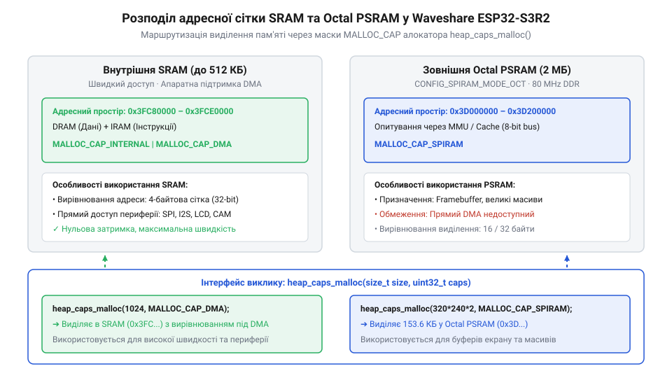

# Програмний довідник ESP-IDF: конфігурація sdkconfig та алокація купи PSRAM для Waveshare ESP32-S3R2

<preknowlist>
- [Мікроконтролер ESP32-S3](root:cat-hw-boards/esp32s3-microcontroller) — Архітектура ядра ESP32-S3, контролер GDMA та система адресації зони SPIRAM
- [Родина плат і модулів на ESP32-S3](root:cat-hw-boards/esp32-s3-boards-family-overview) — Відмінності між платами з Quad SPI та Octal SPI PSRAM
</preknowlist>

## Проблема конфігурації Octal PSRAM та консолі

Під час розробки пристроїв на базі компактних плат, таких як Waveshare ESP32-S3R2, розробники часто стикаються з раптовими збоями на етапі ініціалізації системи. Типова ситуація виникає під час спроби виділити великий масив пам'яті під кадрові буфери або мережеві пакети: виклик стандартної функції `malloc()` повертає пустий вказівник `NULL`, або процесорне ядро переходить у стан аварійного перезавантаження `@@en|kernel panic@@` через збій адресації. Поведінка системної функції `malloc()` у середовищі `@@en|ESP-IDF@@` визначається пороговим параметром `CONFIG_SPIRAM_MALLOC_ALWAYSINTERNAL` (за замовчуванням 16 КіБ): для блоків, розмір яких менший за цей поріг, алокатор шукає простір виключно у внутрішній оперативній пам'яті `@@en|SRAM@@`, а для більших масивів автоматично перенаправляє запит у зовнішню `@@en|PSRAM@@`. Якщо ж шина зовнішньої пам'яті не була ініціалізована через невідповідність опцій конфігурації, системна спроба автоматичної алокації великого масиву у `@@en|PSRAM@@` завершується помилковим поверненням `NULL`, що призводить до падіння додатка при спробі розіменування вказівника. При цьому спроба з'ясувати причину відмови за допомогою системних логів у терміналі завершується невдачею, оскільки підключений через роз'єм `USB Type-C` кабель не виводить жодного символу в консоль.

Причина цієї проблеми криється у невідповідності заводських налаштувань за замовчуванням у середовищі розробки `@@en|ESP-IDF@@` (від англ. @@en|Software Development Kit@@ — набір засобів розробки програмного забезпечення; `@@en|ESP-IDF@@`) апаратній будові конкретної плати. Базовий конфігураційний файл `@@en|sdkconfig@@` (від англ. @@en|software development kit configuration@@ — конфігурація набору засобів розробки; `@@en|sdkconfig@@`) за замовчуванням розрахований на використання 4-бітної послідовної пам'яті `@@en|Quad SPI@@` та виведення логів через фізичний трансивер `UART0`. Проте на платі Waveshare ESP32-S3R2 встановлено 8-бітну псевдостатичну оперативну пам'ять `@@en|Octal SPI@@` (від грец. @@el|ὀκτώ@@ — вісім та англ. @@en|Serial Peripheral Interface@@ — 8-бітовий послідовний периферичний інтерфейс; `@@en|Octal SPI@@`) обсягом 2 МБ, яка вимагає відмінного тактування та 8 паралельних ліній даних. Запуск прошивки з 4-бітовими налаштуваннями залишає половину сигнальних ліній шини `@@en|PSRAM@@` (від англ. @@en|Pseudo-Static Random-Access Memory@@ — псевдостатична оперативна пам'ять; `@@en|PSRAM@@`) неактивними, що викликає помилку перевірки пам'яті на старті. Одночасно з цим консольний потік `stdout` залишається прив'язаним до непідключених виводів `UART0` замість нативного контролера `USB SERIAL JTAG`, позбавляючи розробника зворотного зв'язку.

Некоректне розпізнавання типу шини зовнішньої пам'яті обмежує роботу [родини плат і модулів на ESP32-S3](root:cat-hw-boards/esp32-s3-boards-family-overview) лише внутрішньою статичною пам'яттю `@@en|SRAM@@` (від англ. @@en|Static Random-Access Memory@@ — статична оперативна пам'ять; `@@en|SRAM@@`), обсяг якої не перевищує 512 КіБ. Будь-яка спроба звернення завантажувача чи системного коду до неініціалізованого адресного вікна зовнішньої оперативної пам'яті, що починається з адреси `0x3D000000`, спричиняє неможливість трансляції віртуальних адрес апаратним блоком `MMU`. Це негайно викликає системний виняток помилки шини або кешу `@@en|kernel panic@@` у первинному завантажувачі `@@en|bootloader@@` (від англ. @@en|boot loader@@ — первинний завантажувач прошивки; `@@en|завантажувач bootloader@@`), приводячи процесор до безкінечного циклу перезавантажень `@@en|bootloop@@`. Для відновлення повноцінного функціонування розробник мусить явно перевизначити параметри конфігурації у файлі `@@en|sdkconfig@@`.

## Опції sdkconfig для Octal SPI та USB CDC

Усунення шинних конфліктів та активація 8-бітного режиму обміну даними досягається шляхом внесення точних інструкцій до конфігураційного файла `@@en|sdkconfig@@` або його початкового шаблону `sdkconfig.defaults`. Ключові прапорці керують підсистемою пам'яті `SPIRAM` та маршрутизацією текстових потоків у середовищі `@@en|ESP-IDF@@`.

Для включення підтримки зовнішньої оперативної пам'яті `@@en|PSRAM@@` та її переведення в 8-бітний режим `@@en|Octal SPI@@` з подвійною передачею даних `@@en|DDR@@` (від англ. @@en|Double Data Rate@@ — подвійна швидкість передачі даних) використовуються такі параметри:

```ini
CONFIG_SPIRAM=y
CONFIG_SPIRAM_TYPE_AUTO=y
CONFIG_SPIRAM_MODE_OCT=y
CONFIG_SPIRAM_SPEED_80M=y
CONFIG_SPIRAM_BOOT_INIT=y
CONFIG_SPIRAM_USE_MALLOC=y
```

Опція `CONFIG_SPIRAM_MODE_OCT=y` активує використання 8 ліній даних, а `CONFIG_SPIRAM_SPEED_80M=y` встановлює граничну тактову частоту шини 80 МГц. Прапор `CONFIG_SPIRAM_USE_MALLOC=y` інтегрує зовнішню пам'ять у загальний системний алокатор динамічної купи (англ. @@en|heap@@ — купа, динамічна пам'ять; `@@en|купа heap@@`), дозволяючи підсистемі автоматично виділяти блоки у `@@en|PSRAM@@`, якщо розмір запиту перевищує встановлений поріг `CONFIG_SPIRAM_MALLOC_ALWAYSINTERNAL`.

Для перенаправлення системного виведення `ESP_LOGI` та стандартних потоків `stdout`/`stdin` на апаратний інтерфейс `@@en|USB CDC@@` (від англ. @@en|Communications Device Class@@ — клас комунікаційних пристроїв шини USB; `@@en|USB CDC@@`) без використання зовнішніх мікросхем-конвертерів додають такі налаштування. Важливим елементом конфігурації є прапорець `CONFIG_ESP_CONSOLE_SECONDARY_NONE=y`: за замовчуванням підсистема `@@en|ESP-IDF@@` намагається дублювати текстові логи у вторинний канал `@@en|UART0@@`. На платах без підключеного зовнішнього конвертера `UART` спроба трансляції логів у неактивні виводи спричиняє затримки виконання через очікування звільнення `@@en|FIFO@@`-буфера передавача. Опція `CONFIG_ESP_CONSOLE_SECONDARY_NONE=y` повністю вимикає вторинне дублювання, запобігаючи блокуванню процесорного часу та вивільняючи фізичні лінії для периферії:

```ini
CONFIG_ESP_CONSOLE_USB_SERIAL_JTAG=y
CONFIG_ESP_CONSOLE_SECONDARY_NONE=y
```

Включення цієї опції зв'язує нативний USB-контролер [мікроконтролера ESP32-S3](root:cat-hw-boards/esp32s3-microcontroller) з драйвером віртуальної файлової системи `VFS`, забезпечуючи миттєву трансляцію логів у термінал при підключенні кабелю до порту `USB Type-C`.

Варто відрізняти апаратну консоль `CONFIG_ESP_CONSOLE_USB_SERIAL_JTAG` від гнучко регульованого програмного стек-драйвера `TinyUSB` `@@en|CDC@@`. Опція `CONFIG_ESP_CONSOLE_USB_SERIAL_JTAG` задіює вбудований безпосередньо у кремнієвий кристал периферійний блок `USB Serial/JTAG`, який функціонує на апаратному рівні без залучення процесорних ядер і додаткових бібліотек. Він доступний вже на етапі роботи завантажувача `@@en|bootloader@@` (від англ. @@en|boot loader@@ — первинний завантажувач прошивки; `@@en|завантажувач bootloader@@`), споживає нульовий обсяг оперативної пам'яті та не вимагає ініціалізації програмного стека `USB`. Натомість повноцінний програмний драйвер `TinyUSB` дозволяє створювати складні складені пристрої `@@en|composite device@@` (з підтримкою класичного `USB CDC`, пристроїв введення `@@en|HID@@` або накопичувачів `@@en|MSC@@`), проте потребує виділення ресурсів `@@en|SRAM@@` та ініціалізується лише у прикладному коді після старту операційної системи `@@en|FreeRTOS@@`.

## Функції алокатора heap_caps та маски пам'яті

Після успішної конфігурації шини `@@en|Octal SPI@@` середовище `@@en|ESP-IDF@@` надає розширений програмний інтерфейс для адресного виділення пам'яті з урахуванням апаратних специфік фізичних областей. Оскільки внутрішня статична пам'ять `@@en|SRAM@@` працює на частоті ядра процесора та підтримує прямий доступ для обробників переривань, а зовнішня `@@en|PSRAM@@` має більшу ємність, але високу затримку, звичайний виклик `malloc()` замінюється на функціональний алокатор `heap_caps_malloc()`.

Системні функції виділення й звільнення пам'яті оперують бітовими масками можливостей (англ. @@en|capabilities@@):

```c
void* heap_caps_malloc(size_t size, uint32_t caps);
void* heap_caps_calloc(size_t n, size_t size, uint32_t caps);
void* heap_caps_realloc(void* ptr, size_t size, uint32_t caps);
void heap_caps_free(void* ptr);
```


*_Схема розподілу адресної сітки SRAM та Octal PSRAM з позначенням масок MALLOC_CAP для алокатора heap_caps._*

Вибір цільової області пам'яті задається поєднанням прапорців масок:

Для гарантованого виділення пам'яті у швидкій внутрішній оперативній пам'яті з підтримкою довільного побайтового доступу застосовують комбінацію прапорців `MALLOC_CAP_INTERNAL | MALLOC_CAP_8BIT`. Деякі секції внутрішньої пам'яті мікроконтролера призначені для виконання інструкцій і допускають лише вирівняні 32-бітні шинні транзакції, тому виділення блоку без маски `MALLOC_CAP_8BIT` ризикує надати адресу, спроба читання або запису окремих байтів за якою викликає апаратний збій адресування `@@en|LoadStoreError@@`. Прапорець `MALLOC_CAP_8BIT` гарантує підтримку 8-бітних і 16-бітних операцій читання та запису для символьних рядків і байтових буферів, а його поєднання з `MALLOC_CAP_INTERNAL` обмежує алокатор виключно секціями внутрішньої `@@en|SRAM@@`.

- `MALLOC_CAP_SPIRAM` — примусово виділяє блок пам'яті у зовнішній псевдостатичній оперативній пам'яті `@@en|PSRAM@@`.
- `MALLOC_CAP_INTERNAL` — виділяє блок виключно у внутрішній швидкій оперативній пам'яті `@@en|SRAM@@`.
- `MALLOC_CAP_DMA` — гарантує розміщення бувера в області пам'яті, що підтримує прямий доступ контролера `@@en|DMA@@` (від англ. @@en|Direct Memory Access@@ — прямий доступ до пам'яті; `@@en|DMA@@`).

Використання прапорця `MALLOC_CAP_SPIRAM` є обов'язковим під час створення об'ємних кадрових масивів для камер у проєктах на кшталт [ESP32-CAM з камерою OV3640 (2 МП)](root:cat-hw-boards/esp32-cam-ov3640), оскільки розмір кадру перевищує доступний залишок внутрішньої купи. У разі, якщо вільний обсяг `@@en|PSRAM@@` вичерпаний або сильно фрагментований і підсистема не може знайти суцільний блок потрібного розміру, виклик `heap_caps_malloc(size, MALLOC_CAP_SPIRAM)` повертає вказівник `NULL`. На відміну від стандартного макросу `MALLOC_CAP_DEFAULT`, який за наявності порогу `CONFIG_SPIRAM_MALLOC_ALWAYSINTERNAL` може автоматично перенаправляти виділення між типами пам'яті, явна маска `MALLOC_CAP_SPIRAM` суворо забороняє резервувати простір у внутрішній швидкій оперативній пам'яті `@@en|SRAM@@`. Це гарантує захист критичних внутрішніх областей пам'яті, необхідних для роботи обробників переривань `@@en|ISR@@` (від англ. @@en|Interrupt Service Routine@@ — процедура обробки переривань; `@@en|процедура обробки переривань ISR@@`) та системних завдань `@@en|FreeRTOS@@`, вимагаючи від прикладного коду обов'язкової перевірки результату на `NULL`.

## Вирівнювання адресної сітки та діагностика купи

Особливістю роботи периферийних контролерів `GDMA` у мікроконтролері ESP32-S3 є суворі вимоги до адресної сітки буферів. Якщо програма виділяє пам'ять у `@@en|PSRAM@@` для подальшої трансляції через периферийні модулі, початкова адреса масиву та його довжина мусять бути вирівняні по межі кеш-лінії процесора (32 або 64 байти). Звичайне виділення через `heap_caps_malloc()` не гарантує специфічного вирівнювання, що може призводити до апаратного збою вирівнювання `@@en|alignment fault@@`.

Для створення вирівняних буферів застосовують спеціалізовану функцію:

```c
void* heap_caps_aligned_alloc(size_t alignment, size_t size, uint32_t caps);
```

Параметр `alignment` задає кратність адреси у байтах (наприклад, 32 або 64). Тільки вирівняний буфер з прапорами `MALLOC_CAP_SPIRAM | MALLOC_CAP_DMA` забезпечує стабільне вивантаження даних без пошкодження сусідніх кеш-ліній.

Інтенсивне виділення та звільнення блоків пам'яті різного розміру спричиняє фрагментацію купи (англ. @@en|heap fragmentation@@ — фрагментація купи). Для контролю стану пам'яті та виявлення витоків середовище `@@en|ESP-IDF@@` надає функції діагностики:

```c
size_t free_psram = heap_caps_get_free_size(MALLOC_CAP_SPIRAM);
size_t max_block = heap_caps_get_largest_free_block(MALLOC_CAP_SPIRAM);
bool is_healthy = heap_caps_check_integrity(MALLOC_CAP_SPIRAM, true);
```

Значення `heap_caps_get_largest_free_block()` показує розмір найбільшого суцільного фрагмента. Якщо загальний обсяг `free_psram` становить 1.5 МБ, але `max_block` не перевищує 50 КіБ, це свідчить про високу фрагментацію купи, яка унеможливлює виділення нових великих буферів і вимагає оптимізації алгоритмів розподілу пам'яті.

Ефективним практичним методом боротьби з фрагментацією купи у `@@en|PSRAM@@` є застосування концепції сталого пул-резервування пам'яті (англ. @@en|memory pool@@ — пул пам'яті; `@@en|пул пам'яті memory pool@@`). Замість циклічного виділення та звільнення буферів довільного розміру під час роботи програми, системний код на етапі ініціалізації одноразово виділяє у зовнішній пам'яті великий суцільний масив заданого обсягу через `heap_caps_malloc(POOL_SIZE, MALLOC_CAP_SPIRAM)`. Надалі прикладні модулі оперують заздалегідь розбитими статичними блоками всередині цього пулу без звернення к системному алокатору купи. Це усуває явище розщеплення адресної сітки на дрібні фрагменти, гарантує миттєвий доступ до кадрових масивів та виключає відмови виділення пам'яті під час виконання критичних за часом обчислень.
