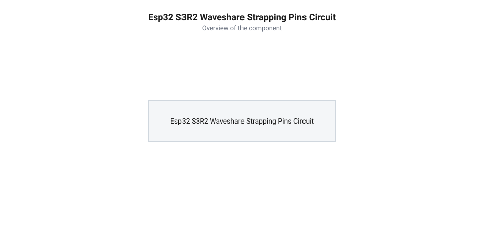
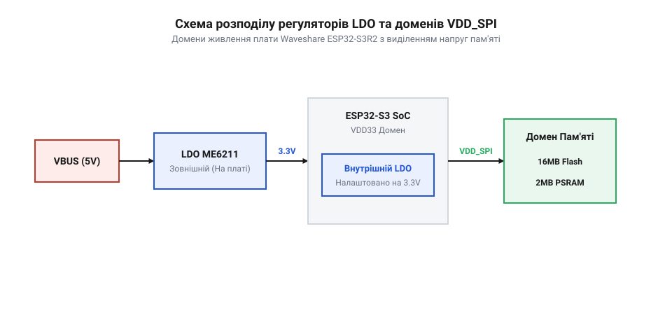
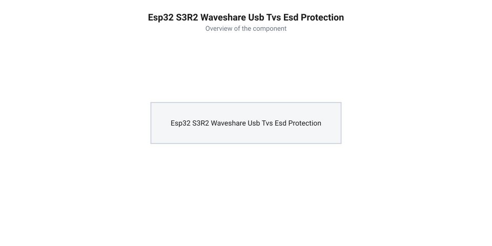
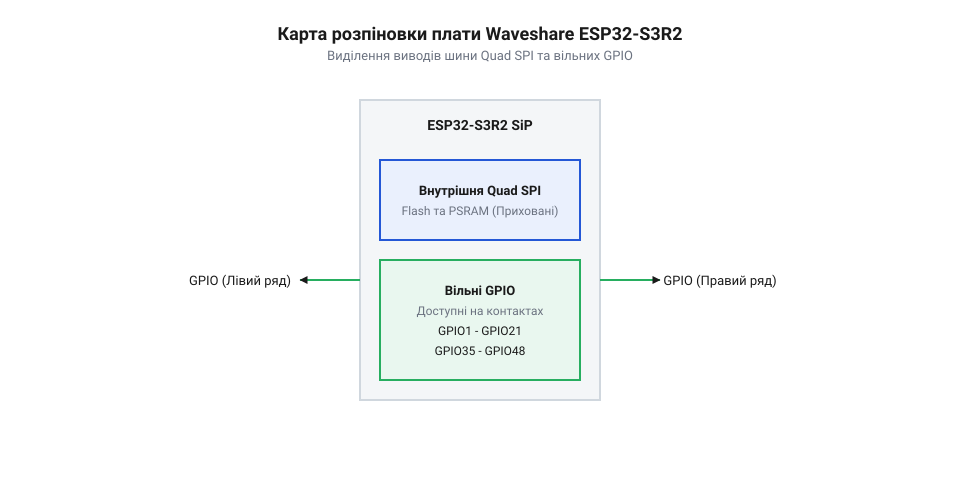
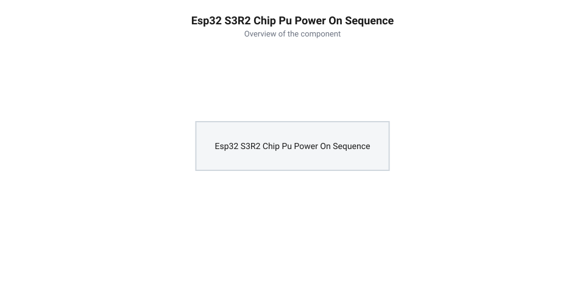

# Апаратна специфікація, розпіновка, strapping-виводи та схема живлення Waveshare ESP32-S3R2

<preknowlist>
- [Родина плат і модулів на ESP32-S3](root:cat-hw-boards/esp32-s3-boards-family-overview) — загальна архітектура чипа ESP32-S3, особливості модулів та підсистеми пам'яті
- [Мікроконтролер ESP32-S3](root:cat-hw-boards/esp32s3-microcontroller) — апаратна організація периферії, доменів живлення та шини Quad SPI
</preknowlist>

## Непередбачувані збої живлення та завантаження плати

При проектуванні власних пристроїв на базі [плати Waveshare ESP32-S3R2](root:cat-hw-boards/esp32-s3r2-waveshare) розробники нерідко стикаються з непередбачуваними відмовами: мікроконтролер відмовляється стартувати, зависає на етапі ініціалізації первинного завантажувача або демонструє спотворення даних у пам'яті. Ззовні така поведінка здається випадковим апаратним браком, проте її першопричина полягає у конфлікті зовнішніх периферійних кіл із системними доменними виводами та лініями конфігурації. При підключенні датчиків чи дисплеїв без урахування апаратної специфікації плати зовнішні схеми можуть ненавмисно зсувати потенціали на критичних виводах під час подачі живлення.

Головним джерелом збоїв завантаження є невірна інтерпретація стану виводів апаратної конфігурації завантаження (англ. @@en|strapping pins@@), до яких належать `GPIO0`, `GPIO45` та `GPIO46`. У момент зняття сигналу скидання (англ. @@en|reset line@@) внутрішня логіка [мікроконтролера ESP32-S3](root:cat-hw-boards/esp32s3-microcontroller) зчитує логічні рівні на цих контактах для вибору джерела прошивки та напруги системної пам'яті. Наприклад, підтягування `GPIO0` до заземлення переводить чип у режим прошивки через послідовний порт замість нормального виконання коду з флеш-пам'яті (англ. @@en|Flash memory@@). Водночас виводи `GPIO45` та `GPIO46` визначають потенціал живлення флеш-пам'яті та псевдостатичної оперативної пам'яті (англ. @@en|Pseudo Static Random Access Memory@@, @@en|PSRAM@@); примусове зміщення їхнього стану зовнішніми резисторами призводить до подачі некоректної напруги на внутрішні мікросхеми й повного блокування шини обміну.


*Схемотехніка зовнішніх підтяжок конфігураційних виводів GPIO0, GPIO45 та GPIO46.*

Окрім конфігураційних ліній, критичною є поведінка інтегрованого лінійного регулятора з малим падінням напруги (від англ. @@en|low drop-out@@, @@en|LDO@@). Під час увімкнення та запуску підсистеми @@en|Wi-Fi@@ споживання струму ядра здійснює імпульсні стрибки до 500 мА тривалістю в кілька мікросекунд. Якщо лінія живлення 3.3 В має значний опір провідників чи підключена до виснаженого джерела, напруга VDD падає нижче критичного порогу 2.43 В, викликаючи спрацьовування апаратного детектора просідання напруги (від англ. @@en|Brownout Detector@@, @@en|BOD@@). Внутрішній контролер RTC виявляє небезпечне зниження потенціалу й негайно ґенерує апаратне скидання (від англ. @@en|brownout reset@@), перериваючи виконання коду та вводячи [мікроконтролер ESP32-S3](root:cat-hw-boards/esp32s3-microcontroller) у нескінченний зациклений цикл аварійних перезавантажень (від англ. @@en|boot loop@@). З цієї причини проектування схеми починають із детального аналізу доменів живлення, розрахунку ємності розв'язувальних конденсаторів та перевірки специфікації виводів роз'єму.

Для запобігання апаратним збоям живлення та нестабільності старту схемотехніка підключення повинна дотримуватися трьох апаратних правил. По-перше, безпосередньо біля виводів живлення кристала необхідно встановлювати комбінацію розв'язувальних конденсаторів: керамічний конденсатор ємністю 0.1 мкФ для пригнічення високочастотних завад та накопичувальний конденсатор ємністю 10 мкФ з малим еквівалентним послідовним опором для згладжування пікових струмів підсистеми @@en|Wi-Fi@@. По-друге, провідники лінії 3.3 В на друкованій платі розводять максимально широкими трасами для мінімізації їхнього омічного опору. Нарешті, усі конфігураційні виводи ізолюють від високоелементних зовнішніх навантажень за допомогою буферних ключів або підтягувальних резисторів відповідного номіналу. Такий комплексний підхід гарантує стійке завантаження [плати Waveshare ESP32-S3R2](root:cat-hw-boards/esp32-s3r2-waveshare) та усуває ризик пошкодження даних у системній пам'яті.

Діагностика первинного запуску платформи вимагає осцилографічного аналізу профілю споживання струму під час ініціалізації апаратного ПЗУ-завантажувача (англ. @@en|ROM Bootloader@@). У момент зняття скидання базове споживання процесорних ядер становить близько 35–45 мА, але при виконанні коду вибірки конфігураційних виводів та перемиканні частоти тактування споживання зростає до 80–120 мА. Найбільш критичним фазовим інтервалом є первинне калібрування радіочастотного тракту підсистеми @@en|Wi-Fi@@, під час якого короткочасний сплеск струму досягає 350–500 мА тривалістю 2–5 мс. Вимірювання цього динамічного профілю за допомогою шунтуючого резистора дає змогу виявити неявні просідання напруги джерела на ранньому етапі старту [мікроконтролера ESP32-S3](root:cat-hw-boards/esp32s3-microcontroller) ще до завантаження основними системними завданнями користувача.

## Схемотехніка живлення та лінійні регулятори LDO

Джерело живлення плати Waveshare ESP32-S3R2 побудоване за двоступеневою схемою розподілу напруги для розділення силових та цифрових кіл. Вхідна напруга 5 В надходить від роз'єму USB Type-C або від виводу `VBUS` і подається на вхід основного лінійного регулятора напруги @@en|LDO@@, який знижує її до стабілізованого рівня 3.3 В для живлення процесорних ядер, модуля радіочастот та більшості виводів загального призначення (англ. @@en|General Purpose Input/Output@@, @@en|GPIO@@). Для стійкої роботи системи вхідна напруга на виводі `VIN` повинна знаходитися в межах від 4.5 В до 5.5 В, а регулятор повинен забезпечувати тривалий струм навантаження не менше 800 мА для перекриття пікових транзієнтів бездротового передавача.


*Схема розподілу лінійних регуляторів LDO та доменів VDD_SPI живлення плати Waveshare ESP32-S3R2.*

Окрему увагу в схемотехніці приділено внутрішньому домену живлення `VDD_SPI`, який живить інтегровану в корпус SiP (англ. @@en|System-in-Package@@, @@en|SiP@@) оперативну пам'ять @@en|PSRAM@@ обсягом 2 МБ. У платі Waveshare ESP32-S3R2 цей домен отримує напругу 3.3 В безпосередньо від внутрішнього перемикача чипа або окремого малого регулятора @@en|LDO@@, залежно від версії кристала. Конфігурація напруги домену `VDD_SPI` програмно встановлюється через одноразово програмовані електронні запобіжники (англ. @@en|electronic fuses@@, @@en|eFuse@@) або апаратно закріплюється станом `GPIO45`. Помилкова подача 3.3 В у домен, розрахований на 1.8 В високошвидкісні версії пам'яті, призводить до термічного пробою комірок @@en|PSRAM@@, тому лінія `VDD_SPI` на платі виведена безпосередньо на фільтруючі керамічні конденсатори без можливості зовнішнього комутування коригуючих напруг. Задля пригнічення високочастотних імпульсних завад ці конденсатори мають мінімальний еквівалентний послідовний опір (англ. @@en|Equivalent Series Resistance@@, @@en|ESR@@) менше `10 мОм`, що запобігає динамічним просіданням напруги під час швидкісних переключень шини @@en|Quad SPI@@ та запобігає спотворенню даних у пам'яті. Разом із цим головний лінійний регулятор @@en|LDO@@ зазнає суттєвого теплового навантаження під час пониження вхідної напруги `V_in = 5.0` В до робочого рівня `V_out = 3.3` В [мікроконтролера ESP32-S3](root:cat-hw-boards/esp32s3-microcontroller). Максимальна потужність втрат `P_loss` на регуляторі обчислюється через падіння напруги `ΔV = V_in - V_out = 1.7` В та середній струм споживання `I_out = 0.5` А при активній роботі бездротового передавача:

```
P_loss
= (V_in - V_out) × I_out                  [розрахунок потужності втрат на LDO]
= (5.0 - 3.3) × 0.5                      [підстановка напруг та середнього струму 500 мА]
= 1.7 × 0.5                              [падіння напруги на регуляторі 1.7 В]
= 0.85 W                                 [теплова потужність розсіювання 850 мВт]
```

При піковому струмі `I_out = 0.8` А потужність розсіювання зростає до `P_loss = 1.7 × 0.8 = 1.36` Вт, що вимагає ефективного відведення тепла через мідний полігон заземлення друкованої плати для запобігання спрацьовуванню апаратного захисту від перегріву (англ. @@en|thermal shutdown@@).

## Захист від статичної електрики та USB Type-C

Інтерфейс USB Type-C на платі Waveshare ESP32-S3R2 використовується як для подачі живлення, так і для прямих цифрових обчислень через вбудований USB-послідовний контролер (англ. @@en|USB Serial/JTAG Controller@@). Оскільки контакти зовнішнього роз'єму постійно піддаються ризику контакту з руками користувача та статично зарядженими предметами, виводи диференціальної пари `D+` і `D-` є найбільш вразливими елементами до виходу з ладу через імпульсні розряди статичної електрики (англ. @@en|electrostatic discharge@@, @@en|ESD@@). Високовольтний імпульс амплітудою в кілька кіловольт здатен миттєво пробити тонку ізоляцію затворів заглиблених транзисторів у мікроконтролері.


*Схема підключення супресорних TVS-діодів до ліній D+ та D- роз'єму USB Type-C.*

Для нейтралізації імпульсних завад схемотехніка роз'єму USB Type-C плати Waveshare ESP32-S3R2 містить низькоємкісні супресорні діоди придушення тимчасових напруг (англ. @@en|transient voltage suppressor@@, @@en|TVS@@). Діодні збірки підключені паралельно між лініями `D+`, `D-` та системним заземленням. У нормальному режимі роботи TVS-діоди мають високий опір і мізерну власну ємність (менше 1 пФ), що не спотворює високочастотну форму сигналів передачі даних. При виникненні сплеску напруги TVS-діод лавинно відкривається за пікосекунди, шунтуючи високовольтний струм розряду на заземлювальний полігон друкованої плати. Окрім паралельних діодів, у кола ліній `D+` та `D-` послідовно включено захисні резистори номіналом 22 Ом для узгодження імпедансу (від англ. @@en|series impedance matching@@). Вони доводять внутрішній вихідний опір трансивера до стандартних 45 Ом на лінію (90 Ом диференційного опору), пригнічуючи перевідбиття високочастотного сигналу в лінії зв'язку, а також обмежують піковий струм залишкового вихідного сплеску, що проходить крізь TVS-діоди до виводів мікроконтролера. Ключовими характеристиками TVS-компонентів є граничний піковий струм розряду `I_pp` (англ. @@en|peak pulse current@@), який досягає значення 4–5 А для імпульсу 8/20 мкс, та напруга затискання `V_clamp` (англ. @@en|clamping voltage@@). Завдяки швидкодії напівпровідникової структури та обмеженню струму резисторами напруга затискання втримується на безпечному рівні `V_clamp` до 5–7 В у нормальному режимі розряду і не перевищує 9–12 В при максимальному струмі `I_pp`, надійно захищаючи затвори підкладки мікроконтролера від електростатичного пробою.

## Конфігураційні виводи strapping pins та boot

Для вибору режиму первинного завантаження після скидання апаратний завантажувальний ПЗУ-код (англ. @@en|Read-Only Memory Bootloader@@, @@en|ROM Bootloader@@) фіксує стан на трьох ключових конфігураційних виводах (англ. @@en|strapping pins@@): `GPIO0`, `GPIO45` та `GPIO46`. Сигнал засувки логічних рівнів спрацьовує на наростаючому фронті лінії `CHIP_PU` (вхід увімкнення чипа). Якщо в цей момент на виводі `GPIO0` виявлено логічний нуль (0 В), [мікроконтролер ESP32-S3](root:cat-hw-boards/esp32s3-microcontroller) зупиняє виконання коду з флеш-пам'яті й активує режим завантаження через послідовний порт (англ. @@en|ROM Download Mode@@). Якщо ж `GPIO0` знаходиться під високим потенціалом 3.3 В (логічна 1), починається стандартне завантаження коду з зовнішньої пам'яті (англ. @@en|SPI Boot Mode@@).

Пара виводів `GPIO45` та `GPIO46` у поєднанні розрахована на вибір джерела тактування та напруги внутрішнього домену пам'яті `VDD_SPI`. Логічний рівень на `GPIO45` встановлює напругу домену: високий рівень (1) обирає 1.8 В, тоді як низький рівень (0) налаштовує регулятор на 3.3 В. Вивід `GPIO46` контролює друковану логіку виводу завантажувальних повідомлень у послідовний порт UART. Апаратна засувка логічних рівнів усіх конфігураційних виводів має суворий часовий розклад зчитування відносно наростаючого фронту сигналу на лінії `CHIP_PU`. Коли напруга живлення досягає порогового значення апаратного скидання, внутрішня логіка [мікроконтролера ESP32-S3](root:cat-hw-boards/esp32s3-microcontroller) відкриває вікно вибірки за кілька мікросекунд до моменту, коли потенціал `CHIP_PU` перетинає поріг логічної одиниці (близько 0.75 від напруги живлення). Фіксація стану виводів здійснюється протягом інтервалу утримання тривалістю 3–5 мкс після переходу `CHIP_PU` у високий стан. Щоб периферійні пристрої не створювали хибних сигналів у цьому часовому вікні під час зняття скидання, підтягувальні резистори розраховують із урахуванням вхідного опору периферії: номінал підтяжки до 3.3 В має становити від 4.7 кОм до 10 кОм. Використання надто слабких підтяжок (понад 47 кОм) у поєднанні з паразитними ємностями периферії розмиває наростаючий фронт, спотворює часовий розклад засувки у момент опитування і може випадково перевести [плату Waveshare ESP32-S3R2](root:cat-hw-boards/esp32-s3r2-waveshare) в нештатний режим завантаження.

Окрім розрахунку зовнішніх резисторів, на рівні схемотехніки самої платформи передбачено кнопковий вузол BOOT на лінії `GPIO0`, який заземлює вивід через захист від брязкоту контактів і дозволяє ручний перехід у режим прошивання. Для захисту від критичних помилок живлення пам'яті в системі [мікроконтролера ESP32-S3](root:cat-hw-boards/esp32s3-microcontroller) вивід `GPIO45` можна програмно відключити від вибору напруги домену `VDD_SPI` за допомогою блокування в енергонезалежній одноразово програмованій пам'яті (англ. @@en|One-Time Programmable memory@@, @@en|eFuse OTP@@). Пропалювання здійснюється утилітою `espefuse.py` шляхом виконання команди `espefuse.py -p <PORT> burn_efuse VDD_SPI_TIEH 1` для примусової фіксації напруги 3.3 В (або прапорця `VDD_SPI_FORCE_KEY`). Фіксація відповідного біта в комірках @@en|eFuse@@ є незворотною апаратною операцією, яка жорстко встановлює вихідну напругу внутрішнього лінійного регулятора (англ. @@en|Low Dropout Regulator@@, @@en|LDO@@) на потрібному рівні незалежно від логічного стану `GPIO45` під час старт-апу, що повністю нейтралізує ризик пошкодження псевдостатичної пам'яті (англ. @@en|Pseudo Static RAM@@, @@en|PSRAM@@) при випадковій зовнішній підтяжці цього виводу периферійними модулями.

## Розпіновка GPIO та шини Quad SPI

На відміну від стандартних планок мікроконтролерів, [родина плат на ESP32-S3](root:cat-hw-boards/esp32-s3-boards-family-overview) з внутрішньою пам'яттю SiP задіює частину фізичних контактів під високошвидкісну шину @@en|Quad SPI@@. У платі Waveshare ESP32-S3R2 виводи `GPIO26`, `GPIO27`, `GPIO28`, `GPIO29`, `GPIO30`, `GPIO31` та `GPIO32` підключені безпосередньо до кристалів флеш-пам'яті та псевдостатичної пам'яті @@en|PSRAM@@ усередині корпуса чипа. Спроба використання цих виводів у якості зовнішніх входів-виходів @@en|GPIO@@ призводить до конфлікту на шині даних, негайного збою читання коду інструкцій та постійного перезавантаження мікроконтролера через помилку промаху кешу.


*Карта розпіновки плати Waveshare ESP32-S3R2 з виділенням виводів шини Quad SPI та вільних GPIO.*

Для розробника залишаються повністю доступними 36 контактів загального призначення, розділених на два фізичні ряди плати. Виводи `GPIO1`–`GPIO21` підтримують альтернативні функції аналогово-цифрових перетворювачів (англ. @@en|Analog-to-Digital Converter@@, @@en|ADC@@), послідовних інтерфейсів @@en|SPI@@, @@en|I2C@@ та @@en|UART@@. Довільне гнучке перепризначення цих цифрових сигналів на будь-які фізичні ніжки забезпечує внутрішня матриця комутації (від англ. @@en|GPIO Matrix@@) — повнозв'язний апаратний кросбар-мультиплексор, який зв'язує внутрішні периферійні контролери чипа із зовнішньою розпіновкою. Втім, високошвидкісні шини пам'яті Quad SPI та нативний USB трасуються напряму через швидкісний блок @@en|IO MUX@@ вхідних-вихідних мультиплексорів без участі GPIO Matrix ради мінімізації апаратної затримки сигналу. Виводи `GPIO19` і `GPIO20` додатково є диференціальною парою `D-` / `D+` вбудованого апаратного контролера USB. При одночасному задіянні нативного USB-інтерфейсу для налагодження чи прошивки та зовнішніх периферійних схем на виводах `GPIO19` та `GPIO20` виникає апаратний конфлікт: внутрішній мультиплексор жорстко комутує ці лінії на фізичний трансивер USB, тому будь-яке зовнішнє електричне навантаження чи підключення цифрових датчиків спотворює амплітуду диференційного сигналу і призводить до втрати USB-з'єднання. Перепризначення цих ліній у програмі під звичайний цифровий вхід-вихід або шину @@en|I2C@@ автоматично відключає нативний кабель USB, через що відновлення зв'язку з комп'ютером стає можливим лише після ручного переведення чипа в режим завантажувача. При плануванні схемотехніки слід враховувати, що виводи `GPIO33`–`GPIO37` також зарезервовані за другою зовнішньою шиною пам'яті в модифікаціях Octal SPI. Безпечне проектування передбачає призначення цифрових периферійних модулів першочергово на вільні лінії з `GPIO1` по `GPIO18` та `GPIO38` по `GPIO42`, лишаючи `GPIO19` та `GPIO20` виключно для потреб USB-кабелю.

## Часові діаграми подачі живлення та скидання

Надійний запуск системи на платі [Waveshare ESP32-S3R2](root:cat-hw-boards/esp32-s3r2-waveshare) критично залежить від дотримання часових співвідношень між наростанням напруги живлення `VDD33` та початковим станом виводу керування скиданням @@en|CHIP_PU@@ (від англ. @@en|Chip Power-Up@@). Для коректного спрацювання внутрішніх блоків початкового скидання (від англ. @@en|Power-On Reset@@, @@en|POR@@) та прочитання зашитих апаратних конфігурацій напруга `VDD33` мусить повністю стабілізуватися й досягти робочого порогу `2.8 В` раніше, ніж рівень на виводі `CHIP_PU` перевищить поріг логічної одиниці `0.7 × VDD33`. Мінімальна тривалість утримання лінії `CHIP_PU` у логічному нулю для гарантованого скидання регістрів становить `50 мкс`.


*Часова діаграма наростання напруги VDD33 та затримки CHIP_PU для гарантованого початкового скидання мікроконтролера.*

Для реалізації цієї затримки на платах застосовують апаратний ланцюг із підтягувального резистора номіналом `10 кОм` до лінії `3.3 В` та заземлювального конденсатора ємністю `1 мкФ`, що створює сталу часу заряджання `τ = R · C = 10 мс`. Ця затримка розрахована так, щоб потенціал на виводі `CHIP_PU` зростав повільніше за фронт живлення джерела. У разі швидкого вимкнення та повторного ввімкнення пристрою (короткочасного просідання напруги) накопичений заряд у конденсаторі `1 мкФ` не встигає повністю стікти через резистор `10 кОм`. У результаті при відновленні живлення `VDD33` лінія `CHIP_PU` залишається у високому стані, що пропускає фазу скидання [мікроконтролера ESP32-S3](root:cat-hw-boards/esp32s3-microcontroller) та призводить до зависання процесорних ядер у невизначеному стані. Для розв'язання цієї проблеми паралельно резистору підтяжки вмикають прискорювальний діод Шотткі (від англ. @@en|Schottky diode@@ — діод Шотткі, названий на честь фізика Вальтера Шотткі) анодом до `CHIP_PU` та катодом до шини `3.3 В`. При спаді напруги живлення діод відкривається при прямій напрузі `V_F ≈ 0.2 В` і створює низькоомний шлях із динамічним опором `R_D ≈ 10 Ом`, що зменшує сталу часу розряджання до `τ_dis = R_D · C = 10 мкс` і скидає 99% заряду менше ніж за `50 мкс`, гарантуючи чистий перезапуск чипа.
