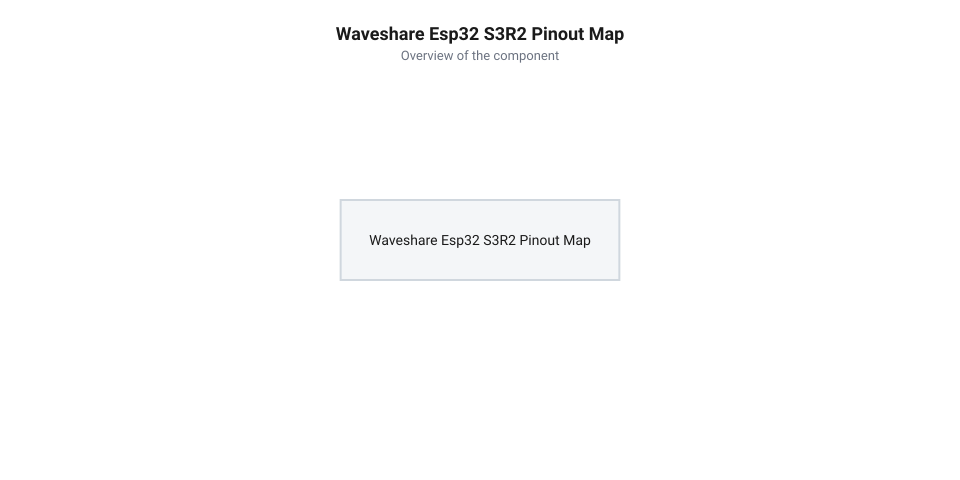
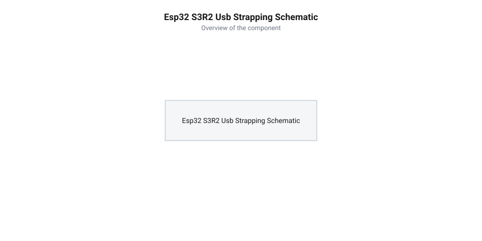

# Апаратний залізний інтерфейс Waveshare ESP32-S3R2: цокольовка, strapping-виводи, USB та схема живлення

<preknowlist>
- [Waveshare ESP32-S3R2 (16 МБ Flash, 2 МБ PSRAM)](root:cat-hw-boards/esp32-s3r2-waveshare) — Конструктивні особливості та апаратна топологія плат форми Waveshare.
- [Мікроконтролер ESP32-S3](root:cat-hw-boards/esp32s3-microcontroller) — Периферійна матриця GPIO та загальні призначення конфігураційних виводів strapping pins.
- [Родина плат і модулів на ESP32-S3](root:cat-hw-boards/esp32-s3-boards-family-overview) — Схемотехніка підключення шин пам'яті Quad/Octal SPI.
</preknowlist>

## Топологія плати та схемотехніка Waveshare

При проєктуванні пристроїв на компактних платах розробки хибне підключення зовнішніх датчиків до виводів, які внутрішньо задіяні шинами пам'яті, призводить до фатальних збоїв завантаження прошивки або пошкодження даних. Плата розробки [Waveshare ESP32-S3R2](root:cat-hw-boards/esp32-s3-boards-family-overview) побудована на основі системи-на-кристалі [мікроконтролер ESP32-S3](root:cat-hw-boards/esp32s3-microcontroller), де топологія друкованої плати розведена з урахуванням прямого монтажу чипів пам'яті поруч із процесорним ядром. При цьому високочастотна 4-бітна шина @@en|Quad SPI Flash@@, що працює на тактових частотах до 80–120 МГц, вимагає прецизійного схемотехнічного розведення сигнальних трас: тактова лінія `SPICLK` та шини даних `SD0`–`SD3` розводяться сигнальними парами з суворим вирівнюванням довжини трас на внутрішніх шарах друкованої плати з дотриманням хвильового опору 50 Ом. Для збереження цілісності сигналів (англ. @@en|signal integrity@@ — цілісність сигналу) та пригнічення високочастотних перехресних наводок (англ. @@en|crosstalk@@ — перехресні наводки) лінія тактування прокладається паралельно з опорним суцільним шаром заземлення `GND`, що унеможливлює фазовий зсув під час вибірки команд і гарантує високу стабільність зчитування прошивки у режимі високої пропускної здатності. Ще суворіші вимоги висуваються при топологічному розведенні 8-бітної підсистеми @@en|Octal PSRAM@@, де передача даних відбувається по обох фронтах прямого та інверсного тактового сигналу `CLK`/`CLKN`. Підключення @@en|Octal SPI@@ вимагає прокладання одиночних ліній із контрольованим хвильовим імпедансом (від англ. @@en|characteristic impedance@@ — хвильовий імпеданс) 50 Ом та розведенням допоміжної лінії стробування даних `DQS` (від англ. @@en|Data Strobe@@ — строб даних). Найтільніше вирівнювання довжин трас між шиною даних `D0`–`D7` та лінією `DQS` з точністю до 0.1 мм є критичним: найменша часова розсинхронізація (від англ. @@en|skew@@ — часова розсинхронізація) спричиняє зсув фази стробування відносно центру інформаційного вікна даних. За відсутності симетричного екранування або при порушенні імпедансу гранична тактова частота шини підсистеми @@en|Octal SPI@@ вимушено знижується з 80/120 МГц до 40 МГц через виникнення помилок вибірки в кеші, що удвічі скорочує реальну пропускну здатність оперативного обміну.

Внутрішня схемотехніка плати інтегрує 16 МБ енергонезалежної NOR-пам'яті @@en|Flash@@ та 2 МБ зовнішньої псевдостатичної пам'яті (@@en|PSRAM@@, від англ. *Pseudo Static Random Access Memory* — псевдостатичний оперативний запам'ятовувальний пристрій). Пам'ять Flash підключена за 4-бітною шиною @@en|Quad SPI@@, тоді як розведення PSRAM задіює спеціалізовані внутрішні лінії. У конфігураціях з 8-бітною пам'яттю @@en|Octal SPI@@ виводи `GPIO33–GPIO37` жорстко зарезервовані внутрішньою топологією кристала і не виводяться на зовнішні контакти плати. Знання меж між зарезервованими та вільними лініями запобігає апаратним конфліктам периферії.

## Цокольовка та карта виводів GPIO

Для зручності макетування всі доступні виводи загального призначення (@@en|GPIO@@, від англ. *General Purpose Input/Output* — виводи загального призначення) виведено на дворядні крайові контакти з кроком 2.54 мм. Крім цифрового вводу-виводу, кожен контакт підтримує мультиплексування периферійних функцій через внутрішню матрицю виводів. При використанні аналогово-цифрових перетворювачів важливим апаратним обмеженням є розділення периферії на блоки @@en|ADC1@@ та @@en|ADC2@@: канали @@en|ADC1@@ (виводи `GPIO1`–`GPIO10`) дозволяють функціонувати безперервно у будь-яких режимах, тоді як підсистема @@en|ADC2@@ апаратно блокується драйвером радіомодуля під час активної роботи @@en|Wi-Fi@@ через спільне використання кіл калібрування високочастотного тракту, тому аналогове зчитування сигналів під час бездротової передачі даних слід проєктувати виключно на контактах @@en|ADC1@@. Одночасно сенсорні контакти (англ. @@en|touch sensor@@, від *touch* — дотик, *sensor* — датчик) `Touch1`–`Touch8` розділяють фізичні виводи з `ADC1_CH1`–`ADC1_CH7`, що вимагає підвищеної завадозахищеності: при одночасному генеруванні широтно-імпульсної модуляції (@@en|PWM@@) імпульсні наводки від перемикання високочастотних сигналів можуть спотворювати вимірювання ємності та знижувати точність АЦП, тому для стабільної роботи рекомендується фільтрація аналогових входів керамічними конденсаторами ємністю 100 нФ та розведення силових ліній ШІМ окремо від чутливих кіл.

*Повна принципова схема цокольовки плати Waveshare ESP32-S3R2 з позначенням GPIO, живильних шин та периферійних функцій.*

Нижче наведено функціональну карту зовнішніх контактів розробницької плати Waveshare ESP32-S3R2:

| Назва контакту | Номер GPIO | Первинна периферійна функція | Додаткові функції та обмеження |
| :--- | :--- | :--- | :--- |
| `GPIO0` | GPIO0 | Strapping Pin (Boot Mode) | Вхід у режим прошивання (LOW при скиданні), АЦП ADC1_CH0 |
| `GPIO1` | GPIO1 | ADC1_CH1, Touch1 | Аналоговий вхід, сенсорний контакт, шина I2C SDA |
| `GPIO2` | GPIO2 | ADC1_CH2, Touch2 | Аналоговий вхід, сенсорний контакт, шина I2C SCL |
| `GPIO4` | GPIO4 | ADC1_CH3, Touch4 | Шина SPI FSPIQ, аналоговий вхід |
| `GPIO5` | GPIO5 | ADC1_CH4, Touch5 | Шина SPI FSPICLK, аналоговий вхід |
| `GPIO6` | GPIO6 | ADC1_CH5, Touch6 | Шина SPI FSPID, аналоговий вхід |
| `GPIO7` | GPIO7 | ADC1_CH6, Touch7 | Шина SPI FSPIHD, аналоговий вхід |
| `GPIO8` | GPIO8 | ADC1_CH7, Touch8 | Генератор ШІМ (PWM), аналоговий вхід |
| `GPIO19` | GPIO19 | USB D- | Нативний порт USB OTG / CDC / JTAG (D-) |
| `GPIO20` | GPIO20 | USB D+ | Нативний порт USB OTG / CDC / JTAG (D+) |
| `GPIO43` | GPIO43 | U0TXD | Послідовний порт UART0 (передача TX) |
| `GPIO44` | GPIO44 | U0RXD | Послідовний порт UART0 (прийом RX) |
| `GPIO45` | GPIO45 | Strapping Pin (VDD_SPI) | Конфігурація напруги шини SPI Flash (1.8 В / 3.3 В) |
| `GPIO46` | GPIO46 | Strapping Pin (ROM Log) | Контроль виводу системного логу під час старту |

Для порівняння зі складнішими мультимедійними модулями можна переглянути [огляд платформи ESP32-CAM](root:cat-hw-boards/esp32-cam-camera-module-family).

## Конфігураційні виводи завантаження та USB

На відміну від попередніх поколінь мікроконтролерів, які вимагали зовнішніх конвертерів інтерфейсів, розробницька плата Waveshare ESP32-S3R2 оснащена прямим підключенням роз'єму USB Type-C до системних виводів кристала, де вибір режимів роботи визначається станом конфігураційних виводів. Під час підйому сигналу скидання `EN` кристал активує коротке вікно защепкування (англ. @@en|latch window@@, від *latch* — фіксувати, *window* — вікно), протягом якого зчитуються виводи завантаження. Слід враховувати апаратну затримку спрацьовування внутрішніх спадних резисторів (англ. @@en|pull-down resistor@@): через високий опір внутрішніх підтяжок (близько 45 кОм) та паразитну ємність ліній формування стабільного логічного нуля вимагає часу. Якщо зовнішня периферія підключає додаткові ємності чи неузгоджені підтягувальні резистори, внутрішній спадний резистор не встигає встановити чіткий рівень логічного нуля до моменту фіксації сигналу `EN`, що призводить до збою вибору режиму завантаження прошивки.

*Схема підключення роз'єму USB Type-C до виводів GPIO19/GPIO20 та розводка підтягувальних резисторів на strapping pins.*

Сигнали роз'єму USB `D-` та `D+` підключені безпосередньо до виводів `GPIO19` та `GPIO20`. Це забезпечує функціонування вбудованого периферійного модуля @@en|USB CDC/JTAG@@ (англ. *USB Communications Device Class / Joint Test Action Group*), який одночасно реалізує віртуальний послідовний COM-порт для прошивання та апаратний відлагоджувач JTAG без використання зовнішніх мікросхем на кшталт `CH340` або `CP2102`.

Старт мікроконтролера визначається станом конфігураційних виводів завантаження (@@en|strapping pins@@, від англ. *strapping pins* — конфігураційні виводи завантаження) у момент зняття сигналу скидання `EN` (Reset):

1. **`GPIO0` (Boot Mode):** Якщо під час подачі живлення або скидання `GPIO0` підтягнуто до `GND` (LOW), мікроконтролер переходить у режим завантажувача прошивки через USB/UART. Якщо `GPIO0` залишається у високому стані (HIGH), починається виконання коду з Flash-пам'яті.
2. **`GPIO45` (VDD_SPI Voltage):** Визначає робочу напругу внутрішнього стабілізатора живлення Flash-пам'яті. Низький уровень (LOW) задає 3.3 В, високий (HIGH) — 1.8 В. Хибне зовнішнє підтягування `GPIO45` до HIGH під час стартапу викличе блокування зчитування Flash.
3. **`GPIO46` (ROM Log Print):** Впливає на виведення первинних діагностичних повідомлень завантажувача ROM у послідовний порт під час увімкнення.

## Підсистема живлення та електричні обмеження

Підсистема живлення плати Waveshare ESP32-S3R2 розрахована на забезпечення стабільної напруги в умовах пікових імпульсів споживання струму бездротовим радіомодулем Wi-Fi/Bluetooth. Проте під час вибору джерела живлення важливо враховувати розрахований тепловий режим бортового лінійного регулятора (від англ. @@en|LDO@@). При зниженні напруги з вхідних 5 В до системних 3.3 В падіння напруги на регуляторі становить 1.7 В. Якщо навантаження тривалий час споживає граничний струм 800 мА, розсіювана теплова потужність регулятора досягає 1.36 Вт (розрахована як добуток 1.7 В на 0.8 А). За типового теплового опору кристала до навколишнього середовища близько 100 °C/Вт для мініатюрного корпусу на друкованій платі це викликає перегрів кристала понаднормово ніж на 135 °C вище за кімнатну температуру. Такий температурний стрибок неминуче активує внутрішній термозахист регулятора (від англ. @@en|thermal shutdown@@) або призводить до його теплового руйнування. Через це значення 800 мА є виключно короткочасним піковим запасом, тоді як для довготривалої безперебійної роботи середня сила струму підключеного навантаження не повинна перевищувати 250–300 мА.

Основне живлення подається через роз'єм USB Type-C (напруга 5 В) або через зовнішній контакт `5V`. На платі встановлено лінійний регулятор з малим падінням напруги (@@en|LDO@@, від англ. *Low Dropout* — з малим падінням напруги), який знижує вхідні 5 В до системних 3.3 В. Стабілізатор розрахований на максимальний вихідний струм до 800 мА, що перекриває пікові сплески споживання Wi-Fi передавача (до 500 мА) та залишає запас для зовнішніх датчиків.

Електричні параметри та обмеження підсистеми живлення:

- **Діапазон вхідної напруги шини `5V`:** від 4.5 В до 5.5 В.
- **Номінальна робоча напруга шини `3.3V`:** 3.3 В ± 2%.
- **Максимальний вихідний струм одного виводу GPIO:** не більше 40 мА (рекомендований робочий струм — 6–12 мА).
- **Схема блокування завад:** лінія `3.3V` зашунтована керамічними конденсаторами ємністю 10 мкФ та 0.1 мкФ для приглушення високочастотних імпульсних завад.

При підключенні потужних індуктивних навантажень або реле необхідно використовувати зовнішнє джерело живлення, оскільки перевищення граничного струму LDO викликає спрацьовування захисту від просідання напруги (`Brownout Reset`) та перезавантаження мікроконтролера.
