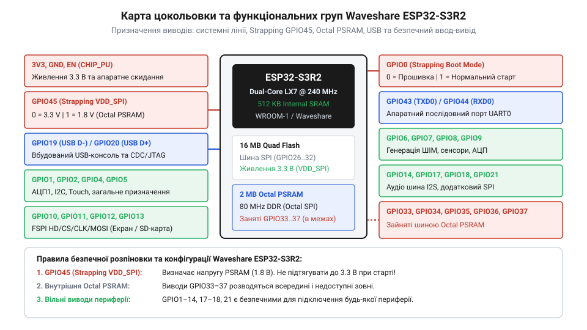
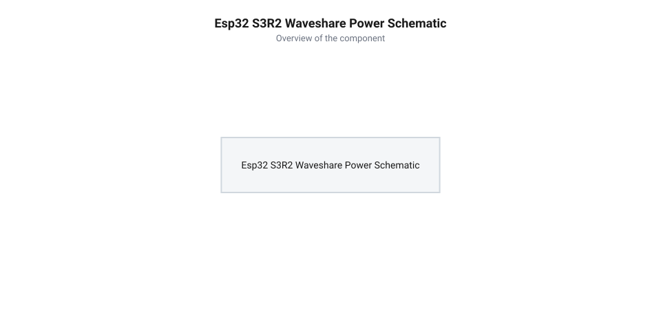

# Специфікація розпіновки, схеми живлення та залізних інтерфейсів Waveshare ESP32-S3R2

<preknowlist>
- [Waveshare ESP32-S3R2 (16 МБ Flash, 2 МБ PSRAM)](root:cat-hw-boards/esp32-s3r2-waveshare) — призначення та апаратні особливості модифікації плати з внутрішнім монтажем пам'яті
- [Мікроконтролер ESP32-S3](root:cat-hw-boards/esp32s3-microcontroller) — базові архітектурні можливості SoC Xtensa LX7 та матриця периферійного комутатора GPIO
- [Родина плат і модулів на ESP32-S3](root:cat-hw-boards/esp32-s3-boards-family-overview) — загальне позиціонування плат Waveshare у контексті екосистеми ESP32-S3
</preknowlist>

## Архітектура контактних гребінок та живлення

Розробка проектів на базі компактної плати [модифікації Waveshare ESP32-S3R2](root:cat-hw-boards/esp32-s3-boards-family-overview) починається з грамотного підключення джерел живлення та розуміння фізичної топології контактних штирьових гребінок. Плата отримує первинне живлення напругою 5 В через роз'єм @@en|USB-C@@ (із граничним струмом стандарту до 1.5 А) або безпосередньо через dedicated контакт `5V`. Для захисту шини @@en|VBUS@@ (від англ. @@en|VBUS@@ — шина живлення USB) портів комп'ютера від зворотної напруги при підключенні зовнішніх джерел вивід `5V` розведено через захисний діод Шотткі з низьким прямим спадом напруги `V_f = 0.35 В`. Вхідний потік подається на лінійний регулятор напруги з малою різницею вхід-вихід @@en|LDO@@ (від англ. *@@en|Low Dropout Regulator@@* — регулятор напруги з малою різницею вхід-вихід), який знижує напругу до робочого рівня 3.3 В, необхідного для живлення кристала [мікроконтролера ESP32-S3](root:cat-hw-boards/esp32s3-microcontroller) та периферійних ліній. Електричний розрахунок вхідної напруги на регуляторі та теплової потужності розсіювання LDO при піковому струмі споживання 500 мА (під час радіопередачі Wi-Fi) виглядає так:

    V_in = V_USB - V_f
    = 5.00 В - 0.35 В             [спад напруги на діоді Шотткі]
    = 4.65 В                      [дійсне значення на вході LDO]

    P_LDO = (V_in - V_out) × I_max
    = (4.65 В - 3.30 В) × 0.50 А  [різниця потенціалів помножена на струм]
    = 1.35 В × 0.50 А             [падіння напруги на регулювальному елементі]
    = 0.675 Вт ≈ 0.68 Вт          [теплова потужність розсіювання]

При тепловому опорі кристала регулятора в корпусі SOT-223 (від англ. @@en|Small Outline Transistor@@ — малогабаритний транзисторний корпус) до довкілля `R_th = 50 °C/Вт` (за умови наявності мідного полігону заземлення площею не менше `1.5 см²`) підйом температури кристала `ΔT` становить:

    ΔT = P_LDO × R_th
    = 0.68 Вт × 50 °C/Вт          [температурний перегрів]
    = 34 °C                       [перевищення над довкіллям]

За кімнатної температури `25 °C` робоча температура кристала сягає `T_j = 59 °C`, що забезпечує стабільну роботу системи без спрацьовування апаратного термозахисту LDO.

Схемотехніка плати передбачає паралельну подачу живлення: вивід `5V` з'єднаний із шиною VBUS роз'єму USB-C через захисний діод Шотткі, що запобігає зворотному протіканню струму в порт комп'ютера при підключенні зовнішнього джерела. Вивід `3.3V` є виходом вбудованого регулятора LDO і призначений для живлення зовнішніх низькопотужних давачів із сумарним струмом споживання до 300–500 мА. Подача зовнішньої регульованої напруги 3.3 В безпосередньо на цей вивід допускається лише за умови відключеного порту USB-C, оскільки зворотне живлення регулятора LDO може призвести до його перегріву або деградації.

*Розпіновка дворядних контактних гребінок Waveshare ESP32-S3R2 з позначенням кіл живлення 5V, 3.3V та GND.*

## Зарезервована шина пам'яті та обмеження GPIO

При проектуванні схем з'єднання принципово важливо розрізняти вільні виводи загального призначення @@en|GPIO@@ (від англ. *@@en|General-Purpose Input/Output@@* — входи-виходи загального призначення) від зарезервованих залізничних шин. Модифікація [Waveshare ESP32-S3R2](root:cat-hw-boards/esp32-s3r2-waveshare) виконана на базі SiP-архітектури (від англ. *@@en|System-in-Package@@* — система у корпусі), де всередині єдиного захисного корпусу мікросхеми розварено кристал [мікроконтролера ESP32-S3](root:cat-hw-boards/esp32s3-microcontroller), 2 МБ псевдостатичної оперативної пам'яті @@en|PSRAM@@ (від англ. *@@en|Pseudo-Static RAM@@* — псевдостатична оперативна пам'ять) та зовнішню мікросхему @@en|Flash@@-пам'яті обсягом 16 МБ. На відміну від чотирилінійної шини @@en|Quad SPI@@, яка використовує чотири сигнальні лінії даних (D0–D3) для послідовної передачі напівбайтами і має затримки поширення сигналу близько 5–8 нс через однополярний тактовий фронт, восьмилінійна шина @@en|Octal SPI@@ задіює паралельно вісім ліній даних (D0–D7) у режимі @@en|Double Data Rate@@ (DDR) з використанням додаткового стробу даних DQS та диференційного тактування. Сигнал DQS формується мікросхемою PSRAM синхронно з вихідними даними, що нівелює перекіс фаз сигналів і скорочує критичне вікно установлення й утримання (від англ. @@en|setup and hold time@@ — час установлення та утримання) до sub-наносекундного діапазону (0.5–1.2 нс), знижуючи затримки доступу під час промахів кешу та подвоюючи питому пропускну здатність шини. Оскільки внутрішній безкорпусний монтаж SiP з'єднує кристали пам'яті безпосередньо ультратонкими золотими провідниками з мікроконтактними майданчиками чипа, відповідні сигнальні лінії виведені на внутрішню шину пам'яті й жорстко зарезервовані за периферією обміну з пам'яттю, що робить їх недоступними для користувацької периферії.

Зв'язок між процесорними ядрами Xtensa LX7 та цією пам'яттю забезпечує високошвидкісна восьмибітна шина @@en|Octal SPI@@. Для її функціонування жорстко задіяно групу виводів `GPIO33`, `GPIO34`, `GPIO35`, `GPIO36` та `GPIO37`. Спроба використати будь-який із цих виводів для підключення зовнішньої периферії чи встановлення на них логічних рівнів призводить до негайного розриву обміну даними з PSRAM, зависання шини вибірки інструкцій та циклічного перезавантаження процесора. Решта виводів гребінки залишаються повністю доступними для користувача під керуванням гнучкого матричного комутатора периферії.

## Конфігураційні strapping-піни та USB-інтерфейс

Під час подачі живлення або апаратного скидання [мікроконтролер ESP32-S3](root:cat-hw-boards/esp32s3-microcontroller) виконує зчитування логічних рівнів на спеціалізованих конфігураційних виводах @@en|strapping@@ (від англ. *@@en|strapping pins@@* — конфігураційні виводи режиму завантаження). В платі [Waveshare ESP32-S3R2](root:cat-hw-boards/esp32-s3r2-waveshare) критичну роль відіграють виводи `GPIO0`, `GPIO45` та `GPIO46`. Вивід `GPIO0` визначає режим завантаження @@en|Boot Mode@@: якщо під час скидання він утримується у низькому логічному рівні `0`, системний контролер переходить у режим апаратного прошивання через USB-завантажувач. Для стабільної роботи приєднана зовнішня кнопка скидання або прошивання повинна підтягувати `GPIO0` до шини `3.3V` через зовнішній резистор номіналом 10 кОм із паралельним керамічним конденсатором на 100 нФ для придушення брязкоту контактів, оскільки будь-яка зовнішня периферія, що випадково притягне `GPIO0` до нуля при старті, заблокує запуск програми з Flash. Вивід `GPIO46` працює виключно як вхідний strapping-пін і під час скидання повинен залишатися у низькому стані `0`: якщо на `GPIO46` потрапляє високий рівень `1`, чип вибирає зарезервовані налагоджувальні режими ROM, блокуючи нормальне виконання коду. Вивід `GPIO45` керує вихідною напругою вбудованого регулятора `VDD_SPI` (1.8 В або 3.3 В), який живить кристали PSRAM. Випадкове притягнення `GPIO45` до високого рівня при старті перемикає напругу `VDD_SPI` на 1.8 В, що унеможливлює зчитування 3.3-вольтової PSRAM і блокує старт системи.

*Схемотехнічне розведення лінії живлення VBUS від порту USB-C через регулятор LDO до мікроконтролера.*

Для програмування та налагодження плата використовує нативний апаратний інтерфейс @@en|USB Serial/JTAG@@, який розведено безпосередньо на виводи `GPIO19` (лінія `USB_D-`) та `GPIO20` (лінія `USB_D+`). На відміну від ультракомпактних плат на зразок [мініатюрної модифікації ESP32-S3-Zero](root:cat-hw-boards/esp32-s3-zero), ця плата не потребує зовнішніх конвертерів USB-UART. Виводи `GPIO19` та `GPIO20` з'єднані з роз'ємом USB-C через захисні резистори та ТВС-діоди. Якщо ці виводи задіюються в прикладному коді як звичайні GPIO, внутрішній контролер USB вимикається, що унеможливлює подальше прошивання без переведення плати в режим завантаження через `GPIO0`.

## Електричні параметри та підключення периферії

Логічні рівні всіх виводів вводу-виводу плати Waveshare ESP32-S3R2 відповідають стандарту 3.3 В @@en|CMOS@@. Максимальна напруга високого логічного рівня `1` становить 3.3 В, а низького `0` — 0 В. Підключення ліній із сигнальними рівнями 5 В безпосередньо до GPIO спричиняє пробій захисних діодів кристала та вихід мікроконтролера з ладу, що вимагає обов'язкового застосування двонаправлених конвертерів логічних рівнів. Для захисту від електростатичних розрядів @@en|ESD@@ (від англ. *@@en|Electrostatic Discharge@@* — електростатичний розряд) виводи плати оснащені захисними кремнієвими діодними збірками. При підключенні 5-вольтової периферії через двонаправлені шини на зразок @@en|I2C@@ схемотехніка транслятора використовує польові N-канальні транзистори з підтягувальними резисторами до шин 3.3 В і 5 В: коли лінія утримується в режимі відкритого стоку, транзистор закривається і відокремлює 5-вольтовий потенціал від чутливих вхідних кіл ESP32-S3, що запобігає апаратному пошкодженню портів.

Навантажувальна спроможність окремого виводу GPIO налаштовується програмно і становить від 10 мА до 40 мА (типове максимальне значення — 40 мА), проте сумарний струм, що протікає через усі виводи вводу-виводу одного домену живлення, не повинен перевищувати 120 мА. Усі вільні GPIO підтримують довільне програмне перепризначення апаратних периферійних блоків: інтерфейсів @@en|I2C@@ (від англ. *@@en|Inter-Integrated Circuit@@* — міжмікросхемна шина; лінії `SDA`, `SCL`), @@en|SPI@@ (від англ. *@@en|Serial Peripheral Interface@@* — послідовний периферичний інтерфейс; лінії `MOSI`, `MISO`, `SCLK`, `CS`), @@en|UART@@ (від англ. *@@en|Universal Asynchronous Receiver-Transmitter@@* — універсальний асинхронний приймач-передавач; `TX`, `RX`), а також блоків широтно-імпульсної модуляції @@en|PWM@@ та багатьох каналів аналого-цифрового перетворення @@en|ADC@@. Порівняно з рішеннями формату [плакети ESP32-S3-Pico](root:cat-hw-boards/esp32-s3-pico), це забезпечує максимальну гнучкість при розведенні друкованих плат розширення.
