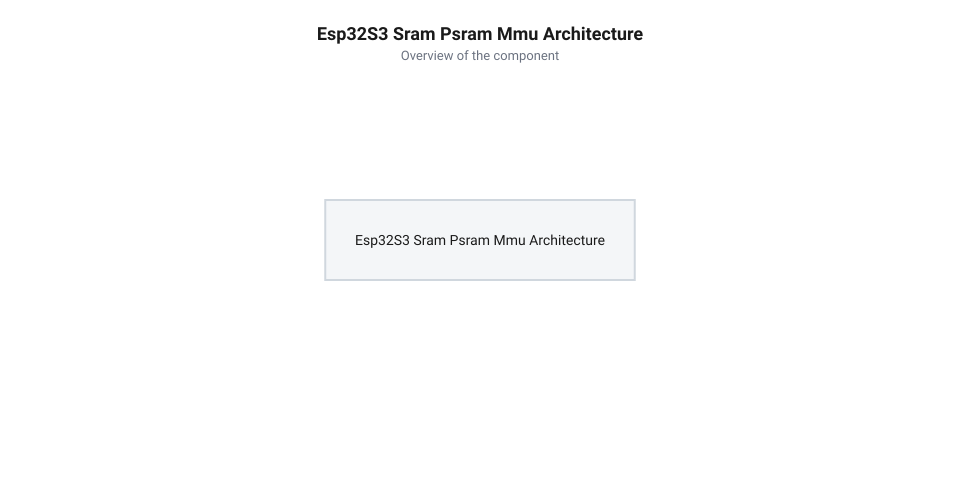
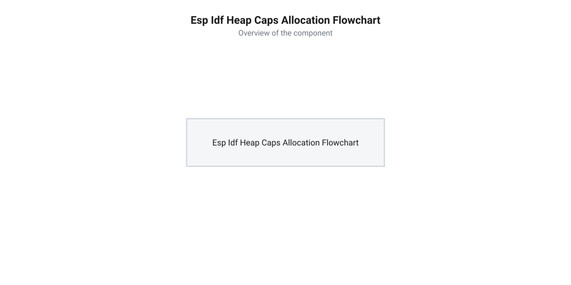
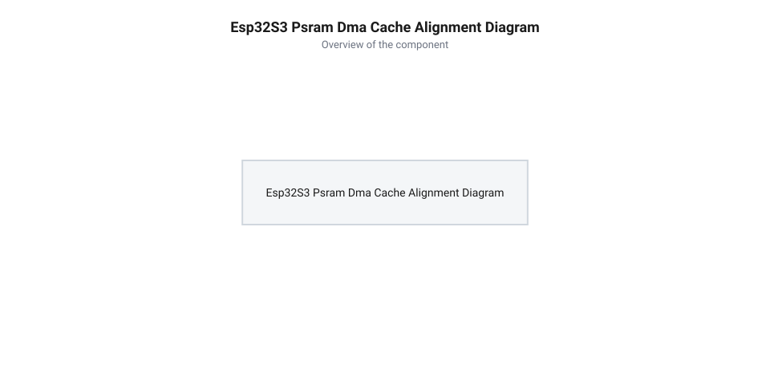
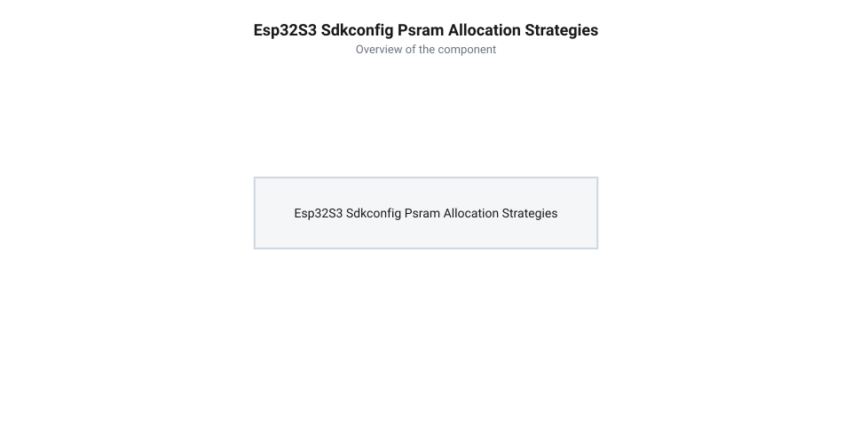

# Програмний API ESP-IDF для роботи з PSRAM: heap_caps, MMU та налаштування sdkconfig

<preknowlist>
- [Мікроконтролер ESP32-S3](root:cat-hw-boards/esp32s3-microcontroller) — знання загальної архітектури мікроконтролера ESP32-S3, структури внутрішньої пам'яті SRAM та принципу роботи шини SPI
- [Waveshare ESP32-S3-Pico](root:cat-hw-boards/esp32-s3-pico) — розуміння схемотехнічних особливостей плати з вбудованим чипом PSRAM та налаштування шини Quad/Octal SPI
</preknowlist>

## Проблема обсягу SRAM та призначення PSRAM

Під час розробки складних ембеддед-систем обробки зображень, комп'ютерного зору або бездротового стримінгу аудіо на [мікроконтролерах ESP32-S3](root:cat-hw-boards/esp32s3-microcontroller) розробники миттєво зіштовхуються з апаратним бар'єром обсягу оперативної пам'яті. Внутрішня статична оперативна пам'ять @@en|SRAM@@ (англ. *static RAM*, від *static* — статичний, *RAM* — пам'ять з довільним доступом) мікроконтролера має фізичний обсяг 512 кілобайтів, з яких для динамічної кучі застосунків залишається лише 300–400 кілобайтів після ініціалізації стека системних задач та операційної системи FreeRTOS. Ситуація ускладнюється двоядерною симетричною архітектурою Xtensa LX7, де обидва ядра ділять між собою єдиний апаратний вузол @@en|MMU@@ та спільний контролер шини: при одночасному зверненні обох ядер до зовнішньої пам'яті промахи кешу на одному ядрі примусово серіалізують транзакції шини, викликаючи міжядерні затримки очікування. Через це спроба розмістити у внутрішній пам'яті лише один кадровій буфер роздільності SVGA (800×600 пікселів) у кодуванні RGB565 вимагає близько 937.5 кБ, що призводить до негайного переповнення кучі, помилок виділення пам'яті та фатального перезавантаження пристрою.


*Схема архітектури адресації ESP32-S3, що показує зв'язок між ядрами CPU, шиною кешу, підсистемою MMU та розподілом адресного простору між внутрішньою SRAM та зовнішньою PSRAM.*

Для подолання цього бар'єра схемотехніка плат застосовує зовнішню псевдостатичну оперативну пам'ять @@en|PSRAM@@ (англ. *pseudo-static RAM*, від *pseudo* — удаваний, *static* — статичний). Фізично чип PSRAM випускається у вигляді окремого кристала, підключеного до мікроконтролера через високошвидкісну 4-бітну або 8-бітну послідовну шину SPI. Прозору взаємодію процесорних ядер із зовнішньою пам'яттю забезпечує апаратний вузол управління пам'яттю @@en|MMU@@ (англ. *Memory Management Unit*, від *memory* — пам'ять, *management* — управління, *unit* — вузол). Контролер MMU транслює віртуальні адреси з піддіапазону RAM у фізичні транзакції шини SPI, автоперезавантажуючи кеш-рядки. 

Головний інженерний компроміс полягає у відмінності характеристик обох типів пам'яті:
- Внутрішня @@en|SRAM@@ працює на повній частоті ядра процесора (до `240 МГц`) через 32-бітну внутрішню шину з нульовою затримкою доступу, досягаючи пропускної здатності до `960 МБ/с` (240 МГц × 4 байти), що є критично важливим для виконуваного коду @@en|IRAM@@ (англ. *instruction RAM*, від *instruction* — інструкція, *RAM* — пам'ять з довільним доступом), системного стека та прямих буферів периферії @@en|DMA@@ (англ. *Direct Memory Access*, від *direct* — прямий, *memory* — пам'ять, *access* — доступ).
- Зовнішня @@en|PSRAM@@ забезпечує значний обсяг (`2 МБ`, `8 МБ` чи `16 МБ`) на [платах родини ESP32-S3](root:cat-hw-boards/esp32-s3-boards-family-overview), але звернення до неї відбуваються через шину @@en|SPI@@ на частоті `80 МГц` і залежать від промахів у кеш-пам'яті, що створює затримку у 12–20 тактів шини або 30–100 процесорних тактів ядра на перезавантаження кеш-лінії розміром `32` або `64` байти. При роботі 4-бітної шини @@en|Quad SPI@@ на частоті `80 МГц` теоретична пропускна здатність становить `40 МБ/с` (80 МГц × 4 біти ÷ 8), а передача одного кеш-рядка триває близько `0.4 мкс`, тоді як перехід на 8-бітну шину `80 МГц` @@en|Octal SPI@@ у режимі @@en|DDR@@ (англ. *Double Data Rate*, від *double* — подвійний, *data* — дані, *rate* — швидкість) підвищує швидкодію до `160 МБ/с` і скорочує фізичну затримку вибірки до `0.2 мкс`. Якщо ж частоту шини знижено до `40 МГц` задля енергозбереження, пропускна здатність Quad SPI падає до `20 МБ/с` (падіння у 48 разів порівняно зі SRAM), а затримка промаху кешу подвоюється, викликаючи тривалі паузи процесорного конвеєра при випадковому доступі до масивів.

Стандартний алокатор мови C `malloc()` за замовчуванням виділяє пам'ять із внутрішньої @@en|SRAM@@ для забезпечення максимальної швидкодії. Щоб ефективно розпоряджатися зовнішнім обсягом без ризику вичерпання внутрішніх ресурсів, фреймворк @@en|ESP-IDF@@ надає спеціалізований програмний інтерфейс управління кучею на основі масок можливостей.

## Динамічний розподіл пам'яті через heap_caps

Для гнучкого управління різнорідними регіонами оперативної пам'яті операційна система @@en|ESP-IDF@@ використовує концепцію кучі з прапорцями можливостей @@en|heap caps@@ (англ. *heap capabilities*, від *heap* — купа, *capability* — можливість). Оскільки стандартна функція `malloc()` не дає змоги вказати фізичне розташування масиву, розробники застосовують функціональний API `heap_caps_malloc()`, який шукає вільний блок у регіоні пам'яті, що відповідає заданій масці атрибутів.


*Блок-схема роботи функції heap_caps_malloc із маскою MALLOC_CAP_SPIRAM, яка ілюструє пошук вільного блоку в кучі PSRAM та повернення вказівника.*

Основними функціями даного програмного інтерфейсу є:
- `heap_caps_malloc(size_t size, uint32_t caps)` — виділяє блок розміром `size` байтів у пам'яті, яка задовольняє всі вимоги бітової маски `caps`.
- `heap_caps_calloc(size_t n, size_t size, uint32_t caps)` — виділяє масив із `n` елементів розміром `size` та гарантовано обнуляє всі його байти.
- `heap_caps_realloc(void *ptr, size_t size, uint32_t caps)` — змінює розмір раніше виділеного блоку `ptr` з дотриманням обраних можливостей.
- `heap_caps_free(void *ptr)` — звільняє блок пам'яті (функція `free()` у фреймворці ESP-IDF є її повним аналогом і автоматично визначає належність адреси до відповідного регіону кучі).

Особливої уваги вимагає поведінка функції `heap_caps_realloc()` при роботі з @@en|PSRAM@@. При зміні розміру існуючого блоку алокатор спочатку намагається розширити поточний безперервний фрагмент на місці. Якщо ж суміжного вільного простору немає через фрагментацію кучі, функція змушена виділити новий суцільний блок потрібного обсягу в іншому місці зовнішньої пам'яті, виконати побайтове копіювання даних зі старого буфера в новий через відносно повільну шину @@en|SPI@@, а потім звільнити попередню ділянку. Для великих буферів розміром у сотні кілобайтів таке копіювання викликає тривалі затримки процесорного конвеєра й додаткове навантаження на шину кешу, тому для критичних до часу систем рекомендується одразу резервувати буфери максимального обсягу замість їх часної реалокації. Крім того, у разі невдачі `heap_caps_realloc()` повертає `NULL`, зберігаючи початковий блок недоторканим, що вимагає використання тимчасового вказівника для запобігання витокам пам'яті.

При роботі з розширеними бітовими масками фреймворк @@en|ESP-IDF@@ надає додаткові спеціалізовані прапорці `MALLOC_CAP_TCM` та `MALLOC_CAP_RETENTION`. Прапорець `MALLOC_CAP_TCM` вимагає розміщення блоку в тісно пов'язаній пам'яті процесора @@en|TCM@@ (англ. *Tightly-Coupled Memory*, від *tightly* — тісно, *coupled* — пов'язаний, *memory* — пам'ять), яка підключена напряму до конвеєра ядра минаючи кеш-контролери та апаратний вузол @@en|MMU@@, через що спроба поєднати його з `MALLOC_CAP_SPIRAM` викликає відмову алокатора. Натомість прапорець `MALLOC_CAP_RETENTION` призначений для виділення внутрішньої оперативної пам'яті в банках зі збереженням живлення під час глибокого сну пристрою (англ. @@en|deep sleep retention@@), що дає змогу утримувати критичні контексти системи чи буфери пробудження без втрати даних при відключенні основного ядра.

Для адресації зовнішньої псевдостатичної пам'яті та налаштування доступу використовуються такі ключові прапорці:
- `MALLOC_CAP_SPIRAM` — вимагає розміщення блоку виключно у зовнішній пам'яті @@en|PSRAM@@. Якщо у зовнішній кучі немає суцільного блоку потрібного розміру, функція повертає `NULL`.
- `MALLOC_CAP_INTERNAL` — примусово розміщує блок у швидкій внутрішній @@en|SRAM@@, що необхідно для критичних до швидкодії даних або стека високорівневих переривань.
- `MALLOC_CAP_8BIT` — гарантує, що виділена пам'ять підтримує побайтовий доступ (8-бітні читання та записи). Оскільки деякі регіони пам'яті ESP32 підтримують лише 32-бітні вирівняні операції, додавання цього прапорця через побітове «АБО» (`MALLOC_CAP_SPIRAM | MALLOC_CAP_8BIT`) є обов'язковою практикою для стандартних масивів і рядків.
- `MALLOC_CAP_DMA` — виділяє пам'ять, доступну контролеру прямого доступу. У чипах ESP32-S3 контролер DMA може працювати з @@en|PSRAM@@, проте вимагає вирівнювання буферів за межою кеш-ліній.
- `MALLOC_CAP_EXEC` — вимагає виділення блоку з правами виконання інструкцій у швидкій внутрішній пам'яті @@en|IRAM@@ (англ. *instruction RAM*, від *instruction* — інструкція, *RAM* — пам'ять з довільним доступом), що застосовується для динамічно завантажуваних плагінів чи @@en|JIT@@-компіляторів (англ. *just-in-time*, від *just* — якраз, *in* — в, *time* — час); спроба поєднати його з `MALLOC_CAP_SPIRAM` поверне `NULL` через апаратну заборону виконання коду безпосередньо із шини SPI.
- `MALLOC_CAP_32BIT` — виділяє буфери в регіонах, призначених виключно для 32-бітного вирівняного доступом цілими словами, що оптимізує математичні обчислення над векторними масивами й прискорює шинні транзакції периферії.

Нижче наведено практичний приклад виділення кадрового буфера в @@en|PSRAM@@ із перевіркою успішності операції та безпечним звільненням ресурсів.

:::tabs
:::code api-esp32s3-psram-esp-idf-heap-allocator/c/esp-idf/allocate-framebuffer.c
:::code api-esp32s3-psram-esp-idf-heap-allocator/cpp/esp-idf/framebuffer.cpp
:::

Використання функції `heap_caps_calloc()` додатково гарантує очищення пам'яті нулями при виділенні, запобігаючи використанню залишкового сміття з попередніх сесій у зовнішній пам'яті.

## Статичне виділення та макрос EXT_RAM_ATTR

Окрім динамічного виділення пам'яті через функції купи, фреймворк @@en|ESP-IDF@@ дозволяє розміщувати глобальні змінні та статичні буфери у зовнішній оперативній пам'яті на етапі компіляції. Для цього застосовують спеціальний макрос-атрибут `@@en|EXT_RAM_ATTR@@`, який вказує компонувальнику (англ. @@en|linker@@) розмістити відповідний символ у секції `.ext_ram.bss`. Такий підхід усуває потребу виконання динамічних викликів під час роботи програми та гарантує наявність виділеного буфера фіксованого розміру для обробки відеокадрів чи аудіопотоків.

Схемотехнічний порядок завантаження пристрою на базі чипа, який має [мікроконтролер ESP32-S3](root:cat-hw-boards/esp32s3-microcontroller), вимагає чіткої послідовності ініціалізації пам'яті. Під час старту завантажувач прошивки (англ. @@en|bootloader@@) спочатку конфігурує контролер шини, ініціалізує таблиці переадресації блоку @@en|MMU@@ та вмикає тактування @@en|PSRAM@@, а також налаштовує первинні вектори переривань переповнення та помилок доступу до зовнішньої пам'яті. Це гарантує, що апаратний збій або спроба невірівняного звернення до @@en|PSRAM@@ під час ініціалізації периферії буде перехоплена системним обробником аварійних ситуацій (англ. @@en|panic handler@@) без зависання шини. Компонувальник (англ. @@en|linker@@) за допомогою скрипта компонування (англ. @@en|linker script@@) формує в таблиці сегментів окрему секцію `.ext_ram.bss`, обмежуючи її створеними символами `_ext_ram_bss_start` та `_ext_ram_bss_end`. Лише після конфігурації векторів, увімкнення MMU та перевірки цілісності фізичного інтерфейсу завантажувач використовує ці граничні символи для обнулення всього діапазону адресної секції `.ext_ram.bss`. Через це змінні з макросом `@@en|EXT_RAM_ATTR@@` не можуть мати явних початкових значень в оголошенні: спроба ініціалізувати таку змінну константою викликає помилку компіляції, оскільки початкові дані неможливо записати в зовнішню пам'ять до її фізичної активації.

Критичним аспектом роботи зі статичними масивами в @@en|PSRAM@@ є апаратне вирівнювання за межами кеш-ліній. Оскільки обмін даними між процесором та зовнішньою пам'яттю здійснюється через апаратний кеш за допомогою блоку @@en|MMU@@, будь-які транзакції прямого доступу до пам'яті (англ. @@en|Direct Memory Access@@, @@en|DMA@@) вимагають відповідності адреси й розміру буфера межі кеш-лінії (32 або 64 байти).


*Схема вирівнювання кадрових буферів у PSRAM за межею кеш-ліній 32/64 байти під час передачі даних контролером DMA з інвалідацією кешу.*

При недотриманні вирівнювання операція скидання або інвалідації кешу для периферійного контролера передачі даних призводить до пошкодження сусідніх змінних, що потрапили в ту саму кеш-лінійку. Оголошення статичного буфера із застосуванням вирівнювання зображено в коді нижче.

:::tabs
```c|esp-idf
#include "esp_attr.h"
#include <stdint.h>

// Оголошення кадрового буфера в PSRAM з вирівнюванням по межі 32 байти
EXT_RAM_ATTR static uint8_t s_frame_buffer[640 * 480] __attribute__((aligned(32)));

void init_static_buffer(void) {
    // Внутрішня PSRAM вже ініціалізована завантажувачем
    s_frame_buffer[0] = 0xFF;
}
```
```cpp|esp-idf
#include "esp_attr.h"
#include <cstdint>

// Оголошення кадрового буфера в PSRAM для C++ з вирівнюванням alignas
EXT_RAM_ATTR alignas(32) static uint8_t s_frame_buffer[640 * 480];

extern "C" void init_static_buffer(void) {
    s_frame_buffer[0] = 0xFF;
}
```
:::

## Конфігурування PSRAM у файлі sdkconfig

Гнучке управління поведінкою підсистеми зовнішньої пам'яті в @@en|ESP-IDF@@ здійснюється через меню конфігурації `@@en|sdkconfig@@`. Головним конфігураційним параметром є вибір стратегії розподілу оперативної пам'яті між внутрішньою швидкісною @@en|SRAM@@ та об'ємною зовнішньою @@en|PSRAM@@.

Параметр `CONFIG_SPIRAM_USE_MALLOC` визначає режим роботи стандартної функції `malloc`. У режимі `CONFIG_SPIRAM_USE_CAPS_ONLY` стандартний `malloc` виділяє пам'ять виключно з внутрішньої @@en|SRAM@@, а виклики зовнішньої пам'яті потребують явного використання функцій `heap_caps_malloc` з прапорцем `MALLOC_CAP_SPIRAM`. У режимі автоматичного перенаправлення `CONFIG_SPIRAM_USE_MALLOC` виклики `malloc`, розмір яких перевищує встановлений поріг `CONFIG_SPIRAM_MALLOC_ALWAYSINTERNAL`, автоматично задовольняються із кучі зовнішньої пам'яті. Режим `CONFIG_SPIRAM_USE_MEMMAP` дозволяє використовувати зовнішню пам'ять лише для відображення в адресний простір без включення її в загальну купу.

Визначальне значення для продуктивності системи в режимі `CONFIG_SPIRAM_USE_MALLOC` має точне налаштування числового порогу `CONFIG_SPIRAM_MALLOC_ALWAYSINTERNAL` (за замовчуванням `16384` байти). Виклики `malloc()` для масивів, розмір яких менший за цей поріг, виділяють пам'ять із швидкої внутрішньої @@en|SRAM@@, що є критично важливим для малих структур даних, короткоживучих рядків та стеків системних задач FreeRTOS, оскільки запобігає частим промахам кешу та затримкам процесорного конвеєра. Натомість великі виділення, що дорівнюють або перевищують поріг, автоматично спрямовуються у зовнішню @@en|PSRAM@@, де великий обсяг компенсує повільніший доступ через шину @@en|SPI@@. Невірно обраний поріг створює ризики: занадто мале значення засмічує зовнішню пам'ять дрібними блоками й збільшує фрагментацію, а занадто велике — швидко вичерпує обсяг внутрішньої SRAM великими буферами.

Вибір відповідного режиму в `sdkconfig` безпосередньо впливає на струмове навантаження та енергоефективність автономного пристрою. Нижче наведено порівняльний аналіз енергоспоживання для різних стратегій виділення пам'яті під час активної роботи та в режимах очікування:

| Стратегія у `sdkconfig` | Середнє додаткове споживання струму (активний режим) | Споживання струму у режимі очікування (збереження стану) | Вплив на швидкодію та шину SPI |
| :--- | :--- | :--- | :--- |
| `CONFIG_SPIRAM_USE_CAPS_ONLY` | `0.1–0.5 мА` (PSRAM спить до явного виклику) | `10–15 мкА` | Максимальна швидкодія `malloc`, шина SPI вимкнена |
| `CONFIG_SPIRAM_USE_MALLOC` | `25–40 мА` (постійні транзакції шини на `80 МГц`) | `140–200 мкА` | Часті затримки через промахи кешу при викликах `malloc` |
| `CONFIG_SPIRAM_USE_MEMMAP` | `1.5–5.0 мА` (лише під час адресації кеш-блоків) | `15–25 мкА` | Оптимальний баланс для періодичного зчитування даних |

Таким чином, використання `CONFIG_SPIRAM_USE_CAPS_ONLY` є найбільш енергоефективним рішенням для портативних пристроїв з акумуляторним живленням, оскільки відключає тактування шини SPI та переводить кристал PSRAM у глибоке енергозбереження до моменту явного запиту.


*Схема трьох стратегій конфігурування PSRAM у sdkconfig (CONFIG_SPIRAM_USE_MALLOC, USE_CAPS_ONLY, ALWAYSINTERNAL), що демонструє розподіл викликів malloc між SRAM та PSRAM.*

Вибір оптимальної стратегії залежить від апаратних особливостей платформи. На платах розробки, таких як [Waveshare ESP32-S3-Pico](root:cat-hw-boards/esp32-s3-pico), що входять у [родину плат на ESP32-S3](root:cat-hw-boards/esp32-s3-boards-family-overview), важливо узгоджувати тип шини в `sdkconfig`: для чотириканальної шини обирають режим `Quad SPI` на частоті 80 МГц, а для високошвидкісних модулів — режим `Octal SPI`. Окрім того, налаштування `CONFIG_SPIRAM_CACHE_LINE_SIZE` дає змогу задати розмір кеш-лінії 32 або 64 байти, що вирівнює апаратний доступ процесора з вимогами периферійних DMA-контролерів та мінімізує накладні витрати шини.

## Вирівнювання адрес, фрагментація та діагностика

Передавання великих масивів даних між псевдостатичною пам'яттю @@en|PSRAM@@ та периферійними модулями за допомогою контролера прямим доступом до пам'яті (англ. @@en|Direct Memory Access@@, @@en|DMA@@) вимагає суворого узгодження фізичних адрес. У [мікроконтролері ESP32-S3](root:cat-hw-boards/esp32s3-microcontroller) підсистема кешування процесора оперує суцільними блоками розміром 32 або 64 байти. Якщо початкова адреса буфера у зовнішній пам'яті або його довжина не кратні розміру кеш-лінії, спроба запустити операцію @@en|DMA@@ спричиняє апаратну помилку вирівнювання @@en|alignment fault@@ (англ. @@en|alignment@@ — вирівнювання, @@en|fault@@ — збій). Окрім зупинки ядра, невірівняний доступ до буфера під час прийому відеокадрів чи аудіопотоків призводить до пошкодження сусідніх змінних у пам'яті через випадкове перезаписування суміжних байтів у спільній кеш-лінії.

Використання об'ємної зони @@en|PSRAM@@ на платах на кшталт [Waveshare ESP32-S3-Pico](root:cat-hw-boards/esp32-s3-pico) супроводжується ризиком виникнення фрагментації купи @@en|heap fragmentation@@ (англ. @@en|heap@@ — купа, @@en|fragmentation@@ — поділ на фрагменти). Хаотичне виділення та звільнення блоків пам'яті різної довжини під час тривалої роботи пристрою розбиває вільний простір на безліч дрібних ізольованих ділянок. У такій ситуації спроба виділити один суцільний масив (наприклад для збереження кадру камери на [ESP32-CAM з камерою OV3640 (2 МП)](root:cat-hw-boards/esp32-cam-ov3640)) завершується помилкою через відсутність достатньо великого безперервного фрагмента, навіть якщо загальна сума вільних байтів у @@en|PSRAM@@ значно перевищує запитуваний обсяг. Запобігти фрагментації допомагає створення статичних пулів пам'яті або резервування буферів фіксованого розміру під час стартапу.

Для оперативного контролю стану пам'яті фреймворк @@en|ESP-IDF@@ надає спеціальні функції діагностики. Виклик `@@en|heap_caps_get_free_size@@(MALLOC_CAP_SPIRAM)` повертає загальний обсяг доступної зони @@en|PSRAM@@, тоді як `@@en|heap_caps_get_largest_free_block@@(MALLOC_CAP_SPIRAM)` дозволяє дізнатися розмір найбільшого суцільного блоку, оцінюючи рівень фрагментації. Перевірити цілісність метаданих алокатора та вчасно виявити вихід за межі буферів дозволяє функція `@@en|heap_caps_check_integrity@@(MALLOC_CAP_SPIRAM, true)`.

Коли стандартні показники вільного обсягу не дозволяють виявити прихований витік пам'яті, застосовують глибоке дамп-тестування за допомогою функції `@@en|heap_caps_dump_all@@()`. Під час її виконання інтерпретатор алокатора послідовно обходить усі зареєстровані регіони кучі й виводить у консольний порт @@en|UART@@ (від англ. universal asynchronous receiver-transmitter — універсальний асинхронний приймач-передавач) повний текстовий списовий реєстр кожної виділеної та вільної адресної ділянки. Для кожного блоку показується початкова віртуальна адреса, фізичний розмір у байтах, прапорці захисту та адресний підпис функції-запитувача (при включеному трасуванні в `sdkconfig`). Наприклад, рядок дампа вигляду `Block 0x3f801200: size 131072 bytes, allocated by PC 0x400d12a8` вказує на виділення `128 кБ` у зоні @@en|PSRAM@@, а зіставлення вказаної адреси повернення `0x400d12a8` із файлом символів прошивки (англ. @@en|ELF map file@@) дозволяє розробнику точно визначити код функції-запитувача, яка не звільнила свій кадровий буфер. Аналіз отриманої карти дозволяє розробнику наочно оцінити точну геометрію фрагментації зони @@en|PSRAM@@, ідентифікувати закинуті сирітькі блоки й перевірити відповідність межевим адресам вирівнювання кеш-ліній.

:::tabs
:::code api-esp32s3-psram-esp-idf-heap-allocator/c/esp-idf/monitor-psram-status.c
:::code api-esp32s3-psram-esp-idf-heap-allocator/cpp/esp-idf/monitor-psram-status.cpp
:::
