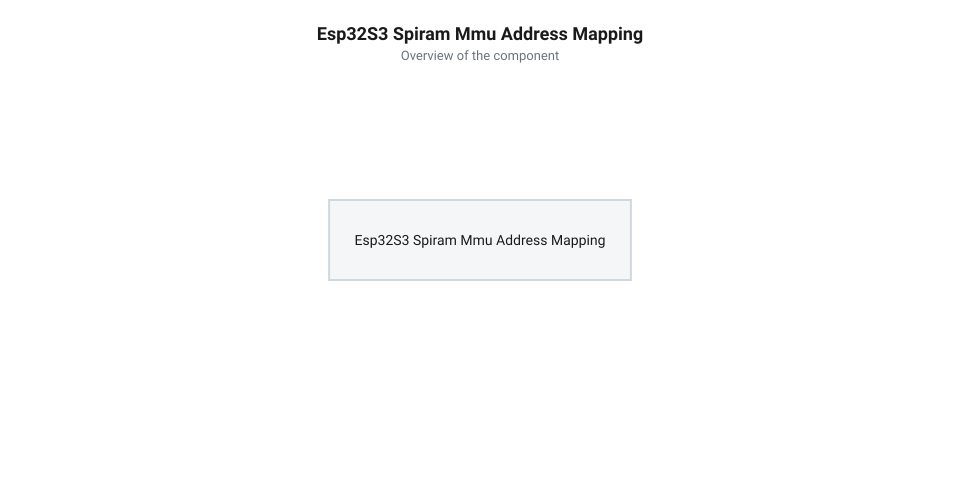
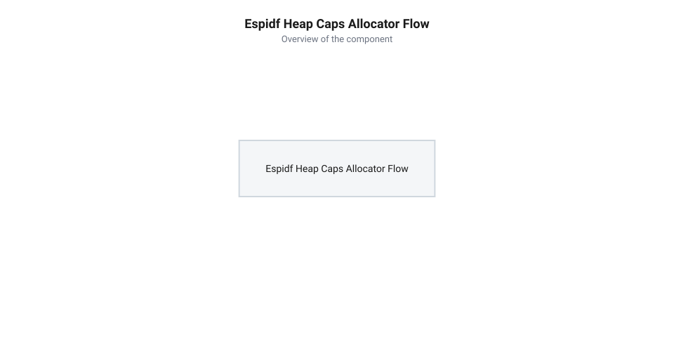

# Програмний інтерфейс управління PSRAM та пам'яттю в ESP-IDF

<preknowlist>
- [Мікроконтролер ESP32-S3](root:cat-hw-boards/esp32s3-microcontroller) — базові архітектурні особливості ядра Xtensa LX7, системна шина та підсистема пам'яті
- [Родина плат і модулів на ESP32-S3](root:cat-hw-boards/esp32-s3-boards-family-overview) — відмінності модифікацій плат із вбудованою та зовнішньою PSRAM (N8R2, N16R8)
</preknowlist>

## Обмеження внутрішньої пам'яті та архітектура PSRAM

Обробка аудіопотоків, графічних кадрів для дисплеїв, буферів сесій @@en|TLS@@ та моделей штучного інтелекту у мікроконтролерах швидко вичерпує внутрішню оперативну пам'ять. Стандартна внутрішня пам'ять @@en|SRAM@@ (з англ. @@en|Static Random Access Memory@@, статична оперативна пам'ять) напівпровідникового кристала має обмежений обсяг у кілька сотень кілобайт через високу вартість площі силіконової підкладки. Для подолання цього бар'єра застосовують зовнішню мікросхему @@en|PSRAM@@ (з англ. @@en|Pseudo Static Random Access Memory@@, від *pseudo* — несправжній, *static* — стаціонарний), яка поєднує високу щільність збереження даних динамічного ядра з простим інтерфейсом управління.


*Схема відображення фізичної PSRAM у віртуальний адресний простір ядра ESP32-S3 через MMU та кеш.*

У мікроконтролерних системах, таких як [мікроконтролер ESP32-S3](root:cat-hw-boards/esp32s3-microcontroller), зовнішня пам'ять @@en|PSRAM@@ підключається через послідовну шину @@en|SPI@@ (з англ. @@en|Serial Peripheral Interface@@), @@en|Quad SPI@@ або @@en|Octal SPI@@. Апаратний блок управління пам'яттю @@en|MMU@@ (з англ. @@en|Memory Management Unit@@, від *memory* — пам'ять, *management* — управління, *unit* — вузол) прозоро відображає фізичні сторінки зовнішньої пам'яті у загальний 32-розрядний віртуальний адресний простір процесора. Завдяки цьому процесор звертається до комірок @@en|PSRAM@@ за звичайними покажчиками в діапазоні адрес `0x3D000000`–`0x3E000000`. Тип фізичного інтерфейсу безпосередньо визначає тривалість простою ядра при промахах кешу: чотирилінійна шина @@en|Quad SPI@@ передає лише 4 біти за такт у режимі @@en|SDR@@ (від англ. *@@en|Single Data Rate@@* — одинарна швидкість даних), тоді як восьмилінійна шина @@en|Octal SPI@@ працює з 8 лініями в режимі @@en|DDR@@ (від англ. *@@en|Double Data Rate@@* — подвійна швидкість даних). Через це при вибірці або витісненні 32-байтового рядка кешу @@en|L1 cache@@ шина @@en|Octal SPI@@ передає цілий байт за кожен півтакт, скорочуючи затримку транзакції зчитування та запису майже вдвічі порівняно з @@en|Quad SPI@@ та мінімізуючи час блокування процесора.

Для компенсації затримок послідовної шини передачі даних між процесором та зовнішньою мікросхемою використовується двоканальний кеш першого рівня @@en|L1 cache@@. Проте доступ до @@en|PSRAM@@ має більші затримки та нижчу пропускну здатність порівняно з внутрішньою пам'яттю @@en|SRAM@@. Під час перемикання віртуальних сторінок у @@en|MMU@@ апаратний контролер кешу змушений виконувати синхронізацію: усі модифіковані («брудні») кеш-лінії витісняються й записуються назад у зовнішню пам'ять до того, як фізичний адресний простір буде переналаштовано. Оскільки запис брудних ліній через послідовну шину вимагає тривалого скидання даних, процесорні ядра блокуються на час завершення шинних операцій. Крім того, шина зовнішньої пам'яті може піддаватися криптографічному шифруванню на льоту, що додає додаткові такти затримки при вибірці та збереженні даних. Усі ці апаратні особливості враховуються у фреймворку @@en|ESP-IDF@@ (з англ. @@en|Espressif IoT Development Framework@@, середовище розробки Espressif) при розподілі системних ресурсів.

## Конфігурація PSRAM у середовищі menuconfig

Конфігуратор системних параметрів @@en|menuconfig@@ у середовищі @@en|ESP-IDF@@ надає гнучкі інструменти для визначення поведінки підсистеми пам'яті. Управління зовнішньою оперативною пам'яттю здійснюється через групу параметрів @@en|Component config@@ -> @@en|ESP PSRAM@@. Головний прапор `CONFIG_SPIRAM` вмикає підтримку зовнішньої мікросхеми та визначає режим її зв'язку з центральним процесором у різних модифікаціях плат, що входять до [родини плат ESP32-S3](root:cat-hw-boards/esp32-s3-boards-family-overview).

Фреймворк підтримує кілька основних способів інтеграції @@en|PSRAM@@ у динамічну купу @@en|heap@@ (з англ. @@en|heap@@, купа):

1. **Виділення за запитом** (`CONFIG_SPIRAM_USE_MALLOC`): Зовнішня пам'ять ініціалізується, але не додається до стандартного пулу пам'яті. Виклики стандартної функції `malloc()` виділяють блоки виключно з внутрішньої пам'яті @@en|SRAM@@, тоді як @@en|PSRAM@@ доступна лише через спеціальні виклики @@en|heap_caps API@@.
2. **Інтеграція у загальний пул** (`CONFIG_SPIRAM_USE_CAPS_ALLOC`): Зовнішня пам'ять реєструється у загальному менеджері купи. Якщо внутрішня пам'ять @@en|SRAM@@ вичерпується, розподілювач автоматично виділяє пам'ять із @@en|PSRAM@@ для звичайних запитів.
3. **Автоматичне перенаправлення великих блоків**: Параметр `CONFIG_SPIRAM_MALLOC_ALWAYSINTERNAL` задає пороговий розмір у байтах. Буфери, розмір яких перевищує цей поріг, автоматично розміщуються у @@en|PSRAM@@, розвантажуючи внутрішню пам'ять.

Для захисту операційної системи від вичерпання швидкої оперативної пам'яті застосовують опцію `CONFIG_SPIRAM_MALLOC_RESERVE_INTERNAL`. Вона резервує фіксований обсяг внутрішньої пам'яті @@en|SRAM@@ виключно для критичних завдань ядра та переривань. Також у @@en|menuconfig@@ налаштовується тактова частота шини (наприклад, 40 МГц або 80 МГц) та режим роботи ліній даних (4-бітовий @@en|Quad SPI@@ або 8-бітовий @@en|Octal SPI@@).

Додатковий контроль при розподілі ресурсів забезпечує параметр `CONFIG_SPIRAM_TRY_ALLOCATE_MEM_WITH_CAPS`. Він дозволяє менеджеру пам'яті @@en|ESP-IDF@@ при вичерпанні внутрішньої @@en|SRAM@@ автоматично шукати вільний блок у @@en|PSRAM@@ для запитів із відповідними прапорами властивостей, якщо виділити внутрішню пам'ять не вдалося. Це запобігає аварійному завершенню фонових завдань із низьким пріоритетом через нестачу оперативної пам'яті, залишаючи прямий доступ до швидкої внутрішньої пам'яті виключно для високопріоритетних обробників переривань та критичних системних служб.

## Адресне виділення буферів через heap_caps API

Для точного управління розміщенням даних у різних областях оперативної пам'яті середовище @@en|ESP-IDF@@ надає розширений інтерфейс @@en|heap_caps API@@. Замість стандартних функцій мови C розробники використовують `heap_caps_malloc()`, `heap_caps_calloc()` та `heap_caps_realloc()`, які приймають маску бітових прапорів властивостей пам'яті.


*Потік виклику heap_caps_malloc з вибором прапорів MALLOC_CAP_SPIRAM та MALLOC_CAP_INTERNAL.*

Найважливіші прапори властивостей пам'яті охоплюють такі специфікатори:
* `MALLOC_CAP_SPIRAM` — вимагає виділення пам'яті виключно у зовнішній мікросхемі @@en|PSRAM@@;
* `MALLOC_CAP_INTERNAL` — гарантує виділення блоку у швидкій внутрішній пам'яті @@en|SRAM@@;
* `MALLOC_CAP_8BIT` — підтверджує підтримку побайтового читання та запису (необхідно для масивів типів `char`, `uint8_t` та C-рядків);
* `MALLOC_CAP_32BIT` — дозволяє виділення у регіонах, що підтримують читання та запис лише вирівняними 32-розрядними словами по 4-байтових межах. Специфіка вибірки 32-бітових слів через шину підсистеми @@en|PSRAM@@ полягає у забезпеченні максимальної швидкості витягування даних для процесорного ядра, тоді як спроба побайтового читання чи невирівняного запису за адресами з цим прапором може викликати виняток шини або апаратну помилку адресації;
* `MALLOC_CAP_DMA` — виділяє пам'ять у регіоні, доступному для апаратних контролерів прямого доступу.

Організація виділення пам'яті для великих буферів у проєктах на C та C++ реалізується через ідіоматичні виклики системного інтерфейсу:

:::tabs
:::code api-esp32s3-spiram-espidf/c/esp-idf/allocate-framebuffer.c
:::code api-esp32s3-spiram-espidf/cpp/esp-idf/psrambuffer.cpp
:::

Усі блоки пам'яті, виділені за допомогою `heap_caps_malloc()`, необхідно обов'язково повертати системі викликом `heap_caps_free()` або `free()`, запобігаючи витокам ресурсів.

## Вирівнювання даних, обмеження DMA та обробка помилок

Використання зовнішньої пам'яті @@en|PSRAM@@ накладає суворі апаратні обмеження на вирівнювання адрес та прямий доступ до пам'яті периферійних модулів. Блок кешування працює з лініями розміром 16 або 32 байти. Спроба виконання атомарних інструкцій процесора або невирівняного читання за межами меж кеш-ліній у @@en|PSRAM@@ може призвести до системного винятку процесора або суттєвого падіння продуктивності.

Головне обмеження багатьох ревізій мікроконтролерів стосується прямого доступу до пам'яті @@en|DMA@@ (з англ. @@en|DMA@@, від *direct* — прямий, *memory* — пам'ять, *access* — доступ). Периферійні контролери @@en|SPI@@, @@en|I2S@@, @@en|Wi-Fi@@ та @@en|SDMMC@@ не можуть зчитувати або записувати дані безпосередньо за адресами @@en|PSRAM@@, оскільки шина @@en|DMA@@ підключена лише до внутрішньої пам'яті @@en|SRAM@@.

Для вирішення цієї проблеми застосовують паттерн проміжного буфера @@en|bounce buffer@@ (з англ. @@en|bounce buffer@@, від *bounce* — відскок, *buffer* — буфер). Дані зчитуються з @@en|PSRAM@@ блоками, копіюються у невеликий транзитний буфер у внутрішній пам'яті @@en|SRAM@@ з прапором `MALLOC_CAP_DMA`, після чого передаються на апаратну периферію. Проте однобуферна організація призводить до зупинок конвеєра: доки контролер прокачує транзитну ділянку, процес вибірки наступного блоку чекає завершення передачі. Для підтримки безперервного потоку даних застосовують двобуферну схему @@en|ping-pong buffer@@ (від англ. @@en|ping-pong buffer@@ — двобуферна схема, де корінь *ping-pong* від звуконаслідувальної назви настільного тенісу). У цьому разі у внутрішній пам'яті @@en|SRAM@@ з прапором `MALLOC_CAP_DMA` створюють два однакові буфери A та B. Поки апаратний модуль каналу за допомогою переривань @@en|DMA interrupt@@ зчитує вміст першого буфера A й транслює його на периферію, процесор паралельно наповнює другий буфер B новими порціями даних із зовнішньої пам'яті @@en|PSRAM@@. По завершенні транзакції переривання миттєво перемикає покажчик апаратного каналу на готову ділянку B, а ядро повертається до перезаповнення блоку A, що повністю усуває паузи при вибірці та забезпечує стабільне потокове перекачування без розривів сигналу.

Обов'язковим елементом надійної архітектури є перевірка результату виділення пам'яті на рівність покажчику `NULL`. Для контролю стану пам'яті використовують функції діагностики:

```c|esp-idf
#include "esp_heap_caps.h"
#include "esp_log.h"

void check_memory_status(void) {
    size_t free_psram = heap_caps_get_free_size(MALLOC_CAP_SPIRAM);
    size_t min_psram = heap_caps_get_minimum_free_size(MALLOC_CAP_SPIRAM);

    ESP_LOGI("MEM", "Вільна PSRAM: %zu байт, мінімальний залишок: %zu байт", 
             free_psram, min_psram);
}
```

Систематичний моніторинг залишкового обсягу купи дозволяє виявляти фрагментацію пам'яті та запобігати аварійним перезавантаженням пристрою під час пікових навантажень.
