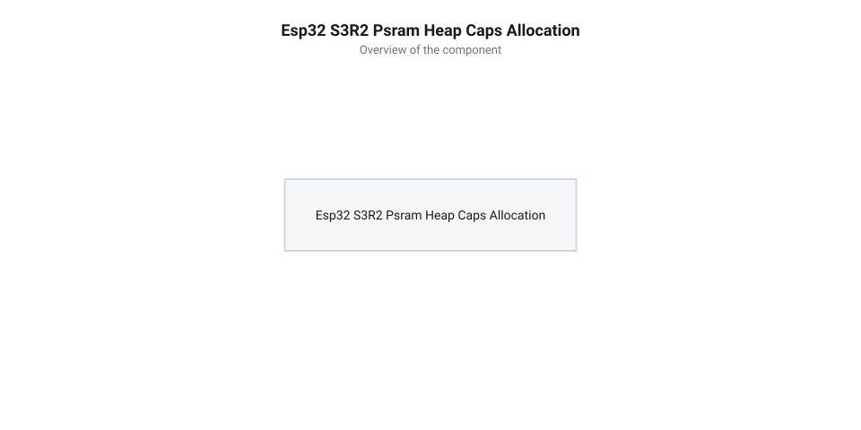

# Програмний інтерфейс ESP-IDF: конфігурація QSPI PSRAM, menuconfig та аллокація heap_caps

<preknowlist>
- [Мікроконтролер ESP32-S3](root:cat-hw-boards/esp32s3-microcontroller) — Базові поняття про внутрішню пам'ять SRAM, архітектуру двоядерного процесора Xtensa LX7 та організацію системних шин
- [Родина плат і модулів на ESP32-S3](root:cat-hw-boards/esp32-s3-boards-family-overview) — Огляд схемотехніки плат на базі ESP32-S3 та варіанти комплектації зовнішньою флеш-пам'яттю і PSRAM
</preknowlist>

## Проблема доступності PSRAM у ESP-IDF

Під час розробки програмного забезпечення для [мікроконтролера ESP32-S3](root:cat-hw-boards/esp32s3-microcontroller) у офіційному фреймворку @@en|ESP-IDF@@ (від англ. @@en|Espressif IoT Development Framework@@ — фреймворк розробки Espressif) розробники часто стикаються з вичерпанням внутрішньої оперативності. Внутрішня пам'ять @@en|SRAM@@ (від англ. @@en|Static RAM@@ — статична оперативна пам'ять) обсягом 512 кБ ділиться між ядрами процесора, стеками системних задач FreeRTOS та периферійними буферами. Спроба виділити суцільні масиви для кадрових буферів дисплеїв або нейромережевих тензорів стандартною функцією `malloc()` швидко призводить до повернення вказівника `NULL` або до системного краху. На [родині плат і модулів на ESP32-S3](root:cat-hw-boards/esp32-s3-boards-family-overview) (зокрема на платах Waveshare ESP32-S3R2) встановлено 2 МБ зовнішньої псевдостатичної оперативної пам'яті @@en|PSRAM@@ (від англ. @@en|Pseudo Static RAM@@ — псевдостатична оперативна пам'ять), проте за замовчуванням ця пам'ять залишається апаратно вимкненою.

За замовчуванням завантажувач фреймворку не ініціалізує шину підключення зовнішнього ОЗП та не включає його адреси у загальний системний адресний простір. Якщо прошивка звертається за фізичними адресами діапазону PSRAM без попереднього налаштування підсистеми SPI RAM, системний контролер генерує критичний виняток @@en|Guru Meditation Error@@ (Panic / LoadProhibited / StoreProhibited). Крім того, розробнику необхідно враховувати істотну різницю у швидкодії підсистем пам'яті: внутрішня SRAM підключена до двоядерного процесора @@en|Xtensa LX7@@ через високошвидкісні шини і забезпечує доступ за один такт процесора (близько 4.16 нс при частоті 240 МГц), тоді як зовнішня псевдостатична пам'ять обмінюється даними через 4-бітну шину Quad SPI на частоті 80 МГц. Звернення до PSRAM проходить через системний кеш L1, тому при промаху кешу (від англ. @@en|cache miss@@ — промах кешу) затримка вибірки даних збільшується до 100–300 тактів процесора, що відчутно знижує пропускну здатність при випадковому доступі. Для того щоб зовнішня пам'ять стала доступною для менеджерів пам'яті та системних задач, необхідне явне препроцесорне конфігурування параметрів збірки та використання спеціалізованого системного API для розподілу динамічних блоків.

Фізично ця інтеграція здійснюється через апаратний модуль @@en|MMU@@ (від англ. @@en|Memory Management Unit@@ — блок керування пам'яттю), який транслює віртуальний 32-бітний адресний простір ядра процесора у фізичні блоки зовнішньої шини. При старті системи завантажувач розбиває фізичну ємність PSRAM на сторінки розміром 64 кБ і заповнює спеціальні таблиці сторінок @@en|page tables@@ (від англ. @@en|page table@@ — таблиця сторінок пам'яті), прив'язуючи їх до віртуального діапазону адрес `0x3C000000`–`0x3DFFFFFF`. Завдяки апаратному відображенню MMU процесор [мікроконтролера ESP32-S3](root:cat-hw-boards/esp32s3-microcontroller) звертається до зовнішньої пам'яті за звичайними покажчиками C/C++, тоді як трансляція віртуальних адрес у послідовність шинних команд Quad SPI та керування кеш-рядками L1 відбувається непомітно для виконуваного коду.

## Конфігурування QSPI PSRAM у sdkconfig

Управління підключенням зовнішнього ОЗП у @@en|ESP-IDF@@ виконується на етапі компіляції через конфігураційний файл `sdkconfig`, який генерується утилітою @@en|menuconfig@@ (від англ. @@en|menu configuration@@ — утиліта текстової конфігурації). Для кристала Waveshare ESP32-S3R2 з 2 МБ вбудованої PSRAM критично важливо правильно вказати тип шини та тактову частоту, оскільки мікросхема пам'яті підключена за чотирипровідним інтерфейсом @@en|Quad SPI@@ (від англ. @@en|Quad Serial Peripheral Interface@@ — чотирипровідний послідовний периферійний інтерфейс).

У меню `Component config` -> `ESP PSRAM / SPI RAM support` активуються наступні основні параметри збірки:

| Параметр sdkconfig | Значення | Призначення та фізичний вплив |
|---|---|---|
| `CONFIG_SPIRAM` | `y` | Увімкнення апаратної підтримки зовнішньої пам'яті SPI RAM у системному завантажувачі |
| `CONFIG_SPIRAM_MODE_QUAD` | `y` | Вибір 4-бітного режиму шини Quad SPI (лінії даних D0-D3) для мікросхем PSRAM |
| `CONFIG_SPIRAM_SPEED_80M` | `y` | Встановлення частоти шини SPI RAM на рівні 80 МГц для досягнення максимальної пропускної здатності |
| `CONFIG_SPIRAM_USE_MALLOC` | `y` | Автоматичне виділення блоків у PSRAM через `malloc()` для масивів, що перевищують пороговий розмір |

Помилка у виборі режиму шини є найпоширенішою причиною апаратних збоїв. Якщо для плати Waveshare ESP32-S3R2 помилково вказати прапорець восьмипровідного режиму Octal SPI (`CONFIG_SPIRAM_MODE_OCT`), контролер шини формує некоректні тактові імпульси CLK та фазові зсуви ліній даних. Це призводить до фазових колізій, викривлення даних при зчитанні та безперервного циклу перезавантаження контролера з помилкою ініціалізації PSRAM під час старту.

Окрім базового налаштування шини, препроцесорні прапорці `CONFIG_SPIRAM_FETCH_INSTRUCTIONS` та `CONFIG_SPIRAM_RODATA` розширюють використання зовнішнього ОЗП для зберігання системних даних та виконуваного коду. Ввімкнення `CONFIG_SPIRAM_FETCH_INSTRUCTIONS` дозволяє процесору виконувати машинні інструкції безпосередньо з адресного простору PSRAM через системний кеш L1, вивільняючи дефіцитну внутрішню SRAM для стеків задач FreeRTOS та DMA-буферів. Прапорець `CONFIG_SPIRAM_RODATA` перенаправляє розміщення незмінних таблиць та констант прошивки (від англ. @@en|read-only data@@ — дані лише для зчитання) у зовнішню пам'ять. Проте таке винесення потребує обережності: через додаткові затримки шини Quad SPI критичні до часу обробники переривань @@en|ISR@@ (від англ. @@en|Interrupt Service Routine@@ — служба обробки переривань) необхідно залишати у внутрішній SRAM за допомогою атрибута `IRAM_ATTR`.

Ще одним спеціалізованим параметрoм є прапорець `CONFIG_SPIRAM_ALLOW_STACK_EXTERNAL_MEMORY`, який дозволяє виділяти стеки задач операційної системи @@en|FreeRTOS@@ безпосередньо у зовнішній PSRAM. Це розширює можливості для систем із десятками фонових задач або ресурсомісткими обробниками текстових протоколів, що вимагають стеків розміром понад 10–20 кБ. Однак розміщення стеку в PSRAM створює суттєві апаратні ризики: будь-яке виливання стеку (англ. @@en|stack overflow@@ — переповнення стеку) в зовнішньому ОЗП не перехоплюється апаратним захистом MPU, руйнуючи сусідні блоки пам'яті. Крім того, якщо обробник переривання спробує звернутися до локальних змінних стеку задачі під час тимчасового блокування шини SPI (наприклад, при записі у Flash-пам'ять), виникає вимушена інвалідація кешу (англ. @@en|cache invalidation@@) та фатальний крах процесора, через що стеки критичних системних задач слід обов'язково утримувати у внутрішній SRAM.

## Розподіл пам'яті через heap_caps API

*Архітектура адресації оперативної пам'яті ESP32-S3R2 та розподіл блоків через heap_caps із мапінгом прапорців MALLOC_CAP_SPIRAM і MALLOC_CAP_DMA.*

Після успішного увімкнення підтримки PSRAM у `sdkconfig` керування динамічною пам'яттю здійснюється за допомогою системного API @@en|heap_caps@@ (від англ. @@en|heap capabilities@@ — властивості динамічної купи). Оскільки різні ділянки ОЗП мають відмінні апаратні властивості, виклики `heap_caps_malloc()` дозволяють точково вказувати, де саме має бути розташований блок.

Основними функціями та прапорцями апаратних властивостей є:

* `heap_caps_malloc(size_t size, uint32_t caps)` — виділяє блок розміром `size` із вказаними властивостями `caps`.
* `heap_caps_free(void *ptr)` — звільняє виділений блок пам'яті.
* `heap_caps_get_free_size(uint32_t caps)` — повертає загальний обсяг вільної пам'яті для вказаної властивості.
* `MALLOC_CAP_SPIRAM` — вимога виділення пам'яті strictly у зовнішньому ОЗП @@en|PSRAM@@.
* `MALLOC_CAP_INTERNAL` — вимога виділення у швидкій внутрішній пам'яті @@en|SRAM@@.
* `MALLOC_CAP_DMA` — вимога виділення у пам'яті, що підтримує прямий доступ @@en|DMA@@ (від англ. @@en|Direct Memory Access@@ — прямий доступ до пам'яті).

Критичним інваріантом схемотехніки [мікроконтролера ESP32-S3](root:cat-hw-boards/esp32s3-microcontroller) є те, що зовнішня PSRAM не підтримується контролерами DMA периферійних модулів (наприклад, SPI чи I2S) напряму через її розташування за контролером кешу та MMU. Спроба викликати `heap_caps_malloc(size, MALLOC_CAP_SPIRAM | MALLOC_CAP_DMA)` поверне `NULL`. Кадрові буфери та великі масиви обробки слід виділяти в PSRAM, а для передачі через DMA застосовувати проміжні транзитні буфери @@en|bounce buffer@@ (від англ. @@en|bounce buffer@@ — проміжний транзитний буфер) у внутрішній SRAM, виділені з прапорцем `MALLOC_CAP_DMA`. У цій схемі периферійний контролер @@en|EDMA@@ (від англ. @@en|Enhanced Direct Memory Access@@ — розширений прямий доступ до пам'яті) здійснює високошвидкісну передачу даних фрагментами між периферійним модулем і транзитним SRAM-буфером, після чого процесор або фоновий потік перекачує ці фрагменти в основний буфер у PSRAM із застосуванням двобуферного перемикання @@en|ping-pong buffer@@. Такий транзитний обмін вимагає додаткових накладних витрат процесорного часу на копіювання пам'яті, проте дозволяє безпечно опрацьовувати великі обсяги даних у зовнішньому ОЗП без виклику аварійних колізій на внутрішніх системних шинах.

:::tabs
@tab C (ESP-IDF)
:::code api-waveshare-esp32-s3r2-espidf-config-and-psram-heap-api/c/esp-idf/allocate-buffers.c
@tab C++ (ESP-IDF)
:::code api-waveshare-esp32-s3r2-espidf-config-and-psram-heap-api/cpp/esp-idf/memorymanager.cpp
:::

## Налаштування USB CDC та обробка помилок

Для зручного відлагодження програмного забезпечення на платах без зовнішнього перетворювача USB-UART (зокрема на [платах ESP32-S3 SuperMini](root:cat-hw-boards/esp32-s3-supermini) та модулях Waveshare ESP32-S3R2) використовується нативний контролер @@en|USB CDC/JTAG@@ (від англ. @@en|USB Communication Device Class / Joint Test Action Group@@ — класи пристроїв зв'язку та моніторингу USB).

У конфігурації `sdkconfig` виведення системної консолі перенаправляється на нативний USB-порт шляхом активації параметра `CONFIG_ESP_CONSOLE_USB_CDC=y`. Це дозволяє отримувати логи `ESP_LOGI()` та відстежувати стан пам'яті через стандартний порт Type-C без додаткових апаратних адаптерів.

При роботі із системними викликами @@en|ESP-IDF@@ усі функції повертають статус коду помилки типу `esp_err_t`. Для перевірки успішності операцій та аналізу вільного обсягу купи застосовують макрос `ESP_ERROR_CHECK()` та аудит через `heap_caps_get_free_size()`:

:::tabs
@tab C (ESP-IDF)
:::code api-waveshare-esp32-s3r2-espidf-config-and-psram-heap-api/c/esp-idf/audit-memory-and-system.c
@tab C++ (ESP-IDF)
:::code api-waveshare-esp32-s3r2-espidf-config-and-psram-heap-api/cpp/esp-idf/memorystatus.cpp
:::

Регулярний моніторинг залишкового обсягу вільної пам'яті дозволяє запобігати прихованій фрагментації купи та гарантує стабільну роботу ресурсомістких застосунків обробки сигналів і комп'ютерного зору.

Для обробки непередбачуваних критичних відмов та коректного збереження стану системи перед перезавантаженням використовують механізм перехоплення через виклик `esp_register_shutdown_handler()` (від англ. @@en|shutdown handler@@ — реєстратор обробника аварійного завершення). Ця функція дозволяє зареєструвати користувацький зворотний виклик, який системна функція завантаження або обробник фатальних помилок виконує безпосередньо перед перезапуском процесора [мікроконтролера ESP32-S3](root:cat-hw-boards/esp32s3-microcontroller). Усередині зареєстрованого обробника розробник може скинути незбережені буфери нативного інтерфейсу @@en|USB CDC/JTAG@@, зафіксувати останні дані про стан вільної купи в енергонезалежній пам'яті та перевести периферійні модулі в безпечний стан, що запобігає пошкодженню даних при виникненні аварійного збою @@en|Guru Meditation Error@@.
