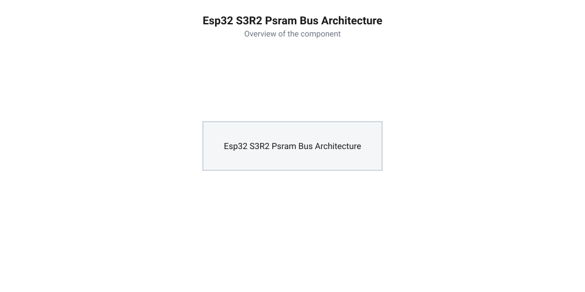
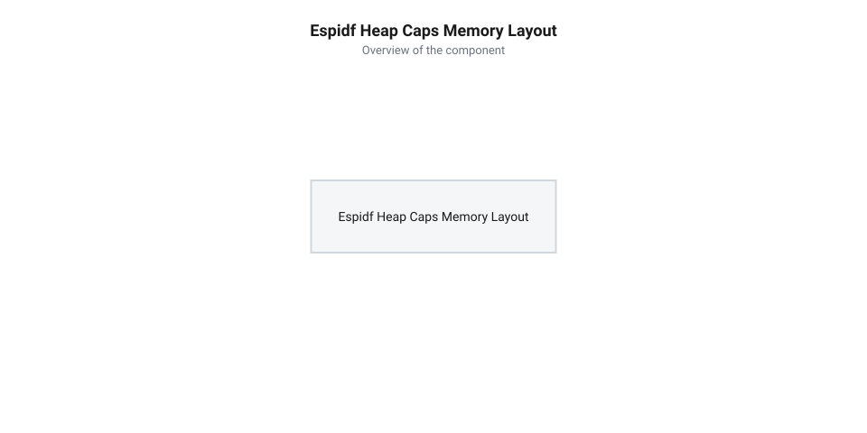

# Програмний API ESP-IDF для конфігурації PSRAM, Flash та аллокатора heap_caps на Waveshare ESP32-S3R2

<preknowlist>
- [Waveshare ESP32-S3R2 (16 МБ Flash, 2 МБ PSRAM)](root:cat-hw-boards/esp32-s3r2-waveshare) — Апаратна організація SiP-корпусу чипа ESP32-S3R2 та розпіновка плати.
- [Мікроконтролер ESP32-S3](root:cat-hw-boards/esp32s3-microcontroller) — Архітектура підсистеми пам'яті MMU та контролера шини SPI.
- [Родина плат і модулів на ESP32-S3](root:cat-hw-boards/esp32-s3-boards-family-overview) — Огляд конфігурацій Flash та PSRAM у платах серії ESP32-S3.
</preknowlist>

## Архітектура SiP-пам'яті та меню конфігурації

Під час розробки складних прикладних систем на [мікроконтролері ESP32-S3](root:cat-hw-boards/esp32s3-microcontroller) розробники швидко стикаються з апаратним обмеженням обсягу внутрішньої оперативної пам'яті. Вбудований масив статичної оперативної пам'яті (англ. @@en|Static RAM@@, @@en|SRAM@@) обсягом близько 512 КБ ділиться між потребами ядра, операційної системи @@en|FreeRTOS@@ та драйверами периферії, залишаючи для динамічної кучі застосунку не більше 300 КБ. При спробі виділити пам'ять під кадрові буфери дисплея, масиви аудіоданих чи структури комп'ютерного зору системний аллокатор повертає нульовий покажчик, що призводить до аварійного перезавантаження пристрою.

Для розширення операндного простору модуль [Waveshare ESP32-S3R2](root:cat-hw-boards/esp32-s3-boards-family-overview) оснащено вбудованою псевдостатичною оперативною пам'яттю (англ. @@en|Pseudo-Static RAM@@, @@en|PSRAM@@, від грецького @@el|pseudes@@ — несправжній та англійського @@en|static@@ — статичний) обсягом 2 МБ. На відміну від зовнішніх модулів у окремих корпусах, у цій платі кристал пам'яті інтегровано безпосередньо в єдину структуру типу «система в корпусі» (англ. @@en|System-in-Package@@, @@en|SiP@@, від @@en|system@@ — система та @@en|package@@ — корпус). Взаємодія між обчислювальним ядром та монокристалом пам'яті відбувається через чотирилінійний послідовний інтерфейс (англ. @@en|Quad Serial Peripheral Interface@@, @@en|Quad SPI@@, від лат. @@la|quattuor@@ — чотири) та вузол керування пам'яттю (англ. @@en|Memory Management Unit@@, @@en|MMU@@), який прозоро транслює адреси зовнішнього простору в загальний адресний простір процесора. Для забезпечення такої прозорості апаратний бекенд @@en|MMU@@ ділить 2 МБ простору чипа на фіксовані сторінки розміром 64 КБ і будує в оперативній пам'яті таблицю відображення сторінок (англ. @@en|page table@@). Кожен запис цієї таблиці мапує віртуальний 64-кілобайтний сегмент шини ядра на відповідний фізичний блок @@en|PSRAM@@. Під час читання чи запису бекенд @@en|MMU@@ транслирує адреси в реальному часі, а кєш-контролер підвантажує 32-байтові рядки через шину @@en|Quad SPI@@, причому неініціалізовані записи в таблиці сторінок при спробі доступу миттєво генерують фатальну помилку шини @@en|LoadProhibited@@ або @@en|StoreProhibited@@ та викликають перезавантаження процесора.

*Схема сполучення ядра ESP32-S3 із вбудованим SiP-чипом Quad SPI PSRAM 2 МБ через шину SPI та бекенд MMU.*

Щоб фреймворк @@en|ESP-IDF@@ коректно ініціалізував шину пам'яті під час початкового завантаження, необхідно правильно налаштувати конфігураційні параметри утиліти `menuconfig`. Помилкові налаштування режиму шини є найпоширенішою причиною критичних збоїв: якщо для чипа серії R2 з чотирилінійною шиною помилково обрати восьмиканальний режим @@en|Octal SPI@@, завантажувач не зможе вистановити зв'язок із чипом пам'яті та заблокує старт системи.

Основні конфігураційні прапорці в меню `Component config -> ESP PSRAM config` задаються так:
- `CONFIG_SPIRAM=y` — глобально вмикає підтримку зовнішньої оперативної пам'яті у складі фреймворку.
- `CONFIG_SPIRAM_MODE_QUAD=y` — встановлює режим роботи шини Quad SPI, що відповідає апаратній специфікації SiP-чипа ESP32-S3R2.
- `CONFIG_SPIRAM_SPEED_80M=y` — задає тактову частоту шини 80 МГц, забезпечуючи максимальну пропускну здатність обміну даними.
- `CONFIG_SPIRAM_BOOT_INIT=y` — примушує первинний завантажувач ініціалізувати PSRAM та додати її до загальної системи кучі до старту головної функції `app_main()`.

## Виділення пам'яті через API heap_caps

Після успішної ініціалізації PSRAM у фреймворці @@en|ESP-IDF@@ з'являється дві кардинально відмінні області оперативної пам'яті: надшвидка внутрішня @@en|SRAM@@ та об'ємна, але повільніша зовнішня @@en|PSRAM@@. Внутрішня пам'ять працює на частоті процесора без тактів очікування і єдиною підтримує прямий доступ периферії @@en|DMA@@ (англ. @@en|Direct Memory Access@@, прямий доступ до пам'яті), тоді як доступ до @@en|PSRAM@@ здійснюється через кєш-контролер шини @@en|SPI@@ із затримкою доступу (англ. @@en|latency@@, від лат. @@la|latens@@ — прихований), вищою в 3–5 разів.

Для точного адресного розподілу ресурсів замість стандартної функції `malloc()` застосовують спеціалізований аллокатор з урахуванням властивостей пам'яті (англ. @@en|capabilities allocator@@, @@en|heap caps@@). Він дозволяє явно вказувати вимоги до адресованого блоку за допомогою бітових прапорців призначення.

*Схема розділення областей пам'яті у кучі heap_caps між внутрішньою SRAM та зовнішньою PSRAM з прапорцями MALLOC_CAP.*

Ключовими прапорцями викликів `heap_caps_malloc()` та `heap_caps_calloc()` є:
- `MALLOC_CAP_SPIRAM` — гарантує виділення блоку виключно із зовнішньої пам'яті PSRAM. Ідеально підходить для великих масивів, кадрових буферів дисплея та кешу даних.
- `MALLOC_CAP_INTERNAL` — примусово виділяє пам'ять із внутрішньої SRAM. Використовується для стеків завдань FreeRTOS та критичних за часом обробки структур.
- `MALLOC_CAP_DMA` — виділяє внутрішню пам'ять, фізично з'єднану з шиною DMA. Запит цього прапорця для PSRAM поверне помилку, оскільки апаратні контролери DMA в ESP32-S3 не можуть напряму адресувати зовнішню SPI-пам'ять.

Виділяючи великі масиви в @@en|PSRAM@@ під нелінійну обробку даних (наприклад, для матричних перетворень, обходу графів або вертикального зчитування кадрових буферів), слід ураховувати апаратну будову підсистеми кешування. Звернення до @@en|PSRAM@@ виконується не побайтово, а блоками через апаратний контролер кешу, який завантажує дані у внутрішні буфери фіксованими кеш-рядками (англ. @@en|cache line@@, від франц. @@fr|cacher@@ — ховати та англ. @@en|line@@ — рядок) розміром по 32 байти. Якщо алгоритм зчитує елементи з великим кроком адресації (англ. @@en|stride@@, від давн.-англ. @@ang|strīdan@@ — крокувати), кожне наступне звернення виходить за межі поточного рядка й спричиняє промах кешу (англ. @@en|cache miss@@). Контролер змушений виштовхувати попередній кеш-рядок і завантажувати новий через 4-бітову шину @@en|Quad SPI@@, через що затримка @@en|latency@@ зростає від 1–2 тактів процесора до десятків тактів на кожну операцію. При частій зміні рядків процесор більшість часу простоює в очікуванні перезавантаження кешу, тому для нелінійних алгоритмів критично групувати дані у підмасиви або попередньо копіювати активні робочі блоки у швидку внутрішню @@en|SRAM@@.

:::tabs
:::code api-waveshare-esp32-s3r2-espidf-psram-config-and-heap/c/esp-idf/allocate-example.c
<!-- slide -->
:::code api-waveshare-esp32-s3r2-espidf-psram-config-and-heap/cpp/esp-idf/heapcapsdeleter.cpp
:::

## Автоматична адресація великих кадрових буферів

Прямий виклик `heap_caps_malloc()` вимагає модифікації вихідного коду застосунку. Проте у реальних проєктах часто використовуються сторонні C/C++ бібліотеки обробки зображень чи звуку, які викликають стандартну функцію `malloc()`. Для автоматичного задіяння 2 МБ запасу пам'яті без переписання стороннього коду фреймворк ESP-IDF надає механізм автоматичного перенаправлення динамічних запитів.

Конфігурація `CONFIG_SPIRAM_USE_MALLOC=y` активує режим, у якому стандартний `malloc(size)` аналізує розмір запитуваного блоку відносно заданого порогу `CONFIG_SPIRAM_MALLOC_ALWAYSINTERNAL`: якщо розмір перевищує межу, пам'ять виділяється у зовнішній @@en|PSRAM@@ замість внутрішньої @@en|SRAM@@. Проте стандартний виклик `malloc()` позбавлений семантики прапорців призначень і не знає, чи призначений буфер для периферійного прямого доступу пам'яті @@en|DMA@@. Якщо сторонній код виділяє великий буфер обміну (понад поріг) через `malloc()`, аллокатор успішно повертає адресу з @@en|PSRAM@@. Оскільки шина @@en|DMA@@ в ESP32-S3 фізично не може зчитувати зовнішню SPI-пам'ять, спроба передати цей буфер драйверу периферії (наприклад, @@en|SPI@@ або @@en|I2S@@) призводить до прихованої помилки: драйвер виконує апаратну перевірку вказівника функцією `esp_ptr_dma_capable()`, повертає код помилки `ESP_ERR_INVALID_ARG` або зазнає паніки ядра під час транзакції.

- Якщо розмір блоку менший за поріг (наприклад, менше 16384 байтів), аллокатор задовольняє запит із швидкісної внутрішньої SRAM.
- Якщо розмір блоку дорівнює або перевищує поріг (наприклад, `size >= 16 КБ`), запит автоматично перенаправляється у зовнішню PSRAM.

Такий підхід захищає внутрішню оперативну пам'ять від швидкого вичерпання великими масивами, зберігаючи її для дрібних системних об'єктів та структур FreeRTOS.

:::tabs
:::code api-waveshare-esp32-s3r2-espidf-psram-config-and-heap/c/esp-idf/auto-allocation-demo.c
<!-- slide -->
:::code api-waveshare-esp32-s3r2-espidf-psram-config-and-heap/cpp/esp-idf/auto-allocation-cpp-demo.cpp
:::

Під час використання автоматичного перенаправлення слід пам'ятати про пастку з буферами DMA: якщо сторонній модуль намагається створити буфер для зчитування даних через `malloc()` розміром понад 16 КБ, автоматика розмістить його в PSRAM, що призведе до помилки ініціалізації периферії. У таких випадках буфери передачі даних необхідно виділяти виключно через явні виклики `heap_caps_malloc(..., MALLOC_CAP_DMA)`.

## Моніторинг кучі та безаварійна обробка

Інтенсивне виділення та звільнення блоків різного розміру у процесі тривалої роботи пристрою призводить до фрагментації кучі (англ. @@en|fragmentation@@, від лат. @@la|fragmentum@@ — уломок). При високому рівні фрагментації загальний обсяг вільної пам'яті може залишатися достатнім, але виділення одного суцільного великого кадрового буфера завершиться помилкою через відсутність неперервного сегмента потрібного розміру.

Для діагностики та безаварійного управління ресурсами ESP-IDF надає функціонал інформаційного знімання зрізів кучі за допомогою API `heap_caps`:

- `heap_caps_get_free_size(MALLOC_CAP_SPIRAM)` — повертає сумарний обсяг вільної пам'яті в PSRAM у байтах.
- `heap_caps_get_largest_free_block(MALLOC_CAP_SPIRAM)` — повертає розмір найбільшого неперервного вільного блоку у PSRAM. Саме це значення визначає максимально допустимий розмір одного суцільного масиву.
- `heap_caps_get_minimum_free_size(MALLOC_CAP_SPIRAM)` — показує мінімальний історичний рівень (англ. @@en|watermark@@) вільної пам'яті з моменту старту пристрою.

:::tabs
:::code api-waveshare-esp32-s3r2-espidf-psram-config-and-heap/c/esp-idf/check-memory-status.c
<!-- slide -->
:::code api-waveshare-esp32-s3r2-espidf-psram-config-and-heap/cpp/esp-idf/memorychecker.cpp
:::

Захисне проєктування на базі попередньої перевірки розміру найбільшого неперервного блоку запобігає виникненню критичних помилок виділення пам'яті та дозволяє застосунку коректно зменшувати роздільну здатність оброблюваного кадру або скидати внутрішні кеші без перезавантаження мікроконтролера.
