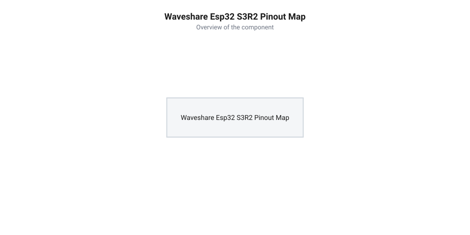
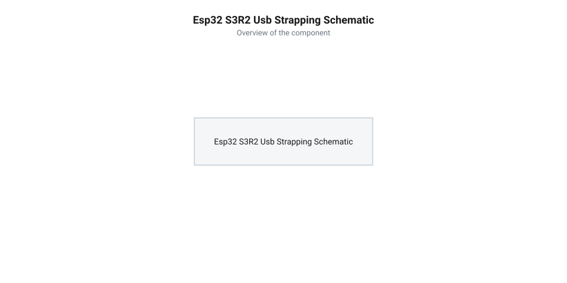

# Апаратна специфікація, цокольовка, розпіновка та схема живлення Waveshare ESP32-S3R2

<preknowlist>
- [Мікроконтролер ESP32-S3](root:cat-hw-boards/esp32s3-microcontroller) — Периферійна матриця GPIO та загальні призначення конфігураційних виводів strapping pins.
- [Родина плат і модулів на ESP32-S3](root:cat-hw-boards/esp32-s3-boards-family-overview) — Схемотехніка підключення шин пам'яті Quad/Octal SPI.
</preknowlist>

## Топологія плати та схемотехніка Waveshare

При спробі підключити зовнішні периферійні модулі до компактної розробницької платформи розробники нерідко стикаються з апаратним збоєм: прошивка припиняє завантажуватися, а флешпам'ять повертає помилки зчитування `ESP_ERR_FLASH_NOT_INITIALIZED`. Причина полягає у випадковому використанні контактів, які всередині схеми вже задіяні для високочастотного обміну з пам'яттю. Ультракомпактна плата Waveshare ESP32-S3R2 розроблена на базі чипа [мікроконтролера ESP32-S3](root:cat-hw-boards/esp32s3-microcontroller), виконаного за технологією @@en|SiP@@ (від англ. @@en|System-in-Package@@ — система в корпусі). Всередині спільного корпусу чипа змонтовано кристал псевдостатичної оперативної пам'яті @@en|PSRAM@@ (від англ. @@en|Pseudo Static RAM@@ — псевдостатична оперативна пам'ять, де *pseudo* з грец. *ψευδής* — хибний, імітує статичну пам'ять) ємністю 2 МБ, яка підключена до ядра через внутрішню шину `SPI0/SPI1`. Трасування цієї шини виконано безпосередньо всередині корпусу типу @@en|QFN@@ (від англ. @@en|QFN@@, від @@en|Quad Flat No-leads package@@ — прямокутний корпус без виводів) шляхом мікрозварювання провідників (від англ. @@en|wire bonding@@ — розварювання золотими чи мідними мікропровідниками) між контактними площадочками кремнієвого кристала PSRAM та внутрішніми виводами `GPIO33`–`GPIO37`. Завдяки герметичній ізоляції розварювальних провідників компаундом SiP-модуля високі частоти обміну до 80 МГц залишаються захищеними від паразитних ємностей друкованої плати, а самі контактні майданчики `GPIO33`–`GPIO37` не виводяться на зовнішні ніжки плати.

Завдяки SiP-компонуванню ліній `GPIO26`–`GPIO31` всередині мікросхеми розробники Waveshare звільнили простір на платі розміром 23.5 × 18 мм під зовнішню енергонезалежну флеш-пам'ять @@en|Flash@@ Winbond `W25Q128JV` обсягом 16 МБ (128 Мбіт). Мікросхема флеш-пам'яті підключена за схемою чотирибітного послідовного периферійного інтерфейсу @@en|Quad SPI@@ (від англ. @@en|Quad Serial Peripheral Interface@@ — чотирипровідний послідовний периферійний інтерфейс). На відміну від класичних повнорозмірних плат [родини плат і модулів на ESP32-S3](root:cat-hw-boards/esp32-s3-boards-family-overview), де під шину пам'яті витрачається до 12 зовнішніх контактів, на Waveshare ESP32-S3R2 усі системні траси QSPI Flash приховані між внутрішніми шарами друкованої плати, що запобігає випадковому замиканню та суттєво знижує рівень електромагнітних завад на частотах до 80 МГц.

Для забезпечення надійного зчитування даних із флеш-пам'яті на граничній частоті 80 МГц трасування чотирьох ліній даних D0–D3, сигналу вибору мікросхеми CS та тактової лінії CLK виконано з дотриманням суворого хвильового узгодження імпедансу (англ. @@en|impedance matching@@) на рівні `50 Ом`. Високочастотні провідники розведені у внутрішньому проміжному шарі друкованої плати над суцільним заземлювальним полігоном за топологією мікросмужкової лінії (англ. @@en|microstrip line@@). Щоб уникнути фазового зсуву (англ. @@en|phase skew@@) при передачі чотирибітного слова, довжини всіх трас шини вирівняні з точністю до `0.1 мм`. Крім того, у коло тактового сигналу CLK послідовно включено демпфувальний резистор номіналом `22 Ом` для придушення відбить сигналу (англ. @@en|series termination@@) та викидів на фронтах тактових імпульсів, що гарантує відсутність помилок зчитування Flash навіть при циклічних змінах температури навколишнього середовища.

## Цокольовка та карта виводів GPIO

Усі зовнішні лінії плати Waveshare ESP32-S3R2 виведені на 27 фізичних контактів формфактора @@en|castellated holes@@ (від англ. @@en|castellated holes@@ — крайові зубчасті отвори), розташованих по периметру друкованої плати з кроком 2.54 мм. Це дозволяє використовувати плату як звичайний DIP-модуль для безпайкових макетних плат, так і як поверхнево-монтований SMD-компонент для материнських плат. Апаратна матриця входу/виходу загального призначення @@en|GPIO@@ (від англ. @@en|General Purpose Input/Output@@) підтримує гнучку маршрутизацію периферійних блоків за допомогою внутрішнього мультиплексора `IO MUX`. При монтажі модуля як SMD-компонента на материнську плату-носій (англ. @@en|carrier board@@) напівзрізані металізовані отвори утворюють надійний електричний контакт із контактними майданчиками розводки шляхом капілярного втягування припою. Схемотехнічне узгодження контактних падів вимагає передбачення теплових розв'язок (англ. @@en|thermal relief@@ — тепловий бар'єр) на живильних і заземлювальних полігонах материнської плати для запобігання холодним паяним з'єднанням, а також дотримання однакової довжини провідників для вирівнювання паразитних індуктивностей високочастотних ліній.

*Підпис: Повна принципова схема цокольовки плати Waveshare ESP32-S3R2 з позначенням GPIO, живильних шин та периферійних функцій.*

Для реалізації аналогових вимірювань розведено 10 каналів аналого-цифрового перетворювача @@en|ADC@@ (від англ. @@en|Analog-to-Digital Converter@@), розподілених між двома блоками `ADC1` (виводи `GPIO1`–`GPIO8`) та `ADC2` (`GPIO9`–`GPIO10`). Використання каналів `ADC1` є переважним, оскільки блок `ADC2` апаратно ділить ресурси з контролером @@en|Wi-Fi@@ і може повертати помилки читання під час активного бездротового обміну. Для підключення систем зв'язку доступні апаратні шини `I2C` (`GPIO8` — SDA, `GPIO9` — SCL), `SPI` (`GPIO11` — MOSI, `GPIO12` — MISO, `GPIO13` — CLK, `GPIO10` — CS) та `UART0` (`GPIO43` — TX, `GPIO44` — RX). На відміну від плат типу [ESP32-S3 SuperMini](root:cat-hw-boards/esp32-s3-supermini) або [Waveshare ESP32-S3-Pico](root:cat-hw-boards/esp32-s3-pico), розпіновка даної платформи зберігає вільними всі 27 контактів без накладення на лінії PSRAM. На точність оцифрування блоку `ADC1` суттєво впливає нестабільність внутрішньої опорної напруги `V_ref` (номінально `1100 мВ` із заводським розкидом до `±10%`, записаним у eFuse) та високочастотні пульсації (англ. @@en|ripple@@) бортового LDO-стабілізатора. Оскільки внутрішній атенюатор (англ. @@en|attenuator@@) опирається на шину `3.3 В`, будь-які імпульсні наводки від перемикання ядер або роботи периферії викличуть флуктуації молодших розрядів ADC, що вимагає програмного усереднення вибірок та згладжування вхідних сигналів зовнішнім RC-фільтром з конденсатором `100 нФ`.

## Конфігураційні виводи завантаження та USB

Під час подачі живлення або скидання процесора внутрішній апаратний завантажувач мікроконтролера виконує зчитування логічних рівнів на спеціалізованих конфігураційних виводах @@en|strapping pins@@ (англ. @@en|strapping pins@@ — конфігураційні виводи засувки). На платі Waveshare ESP32-S3R2 критично важливими є виводи `GPIO0` та `GPIO45`. Схоплювання рівнів жорстко прив'язане до електричного циклу скидання @@en|Power-On Reset@@ (англ. @@en|Power-On Reset@@ — скидання при увімкненні живлення). Коли напруга на лінії `CHIP_PU` досягає порогу 0.75 × 3.3 В, апаратний таймер затримує момент фіксації @@en|latch timing@@ (англ. @@en|latch timing@@ — часова затримка фіксації рівнів) приблизно на 1–3 мс. Цей інтервал необхідний для повного завершення перехідних процесів та стабілізації напруги на зовнішніх підтягувальних резисторах. Наприкінці затримки апаратний регістр засувки стробує рівні: якщо вивід `GPIO0` підтягнутий до низького рівня (GND), чип переходить у режим завантаження прошивки через послідовний порт (ROM bootloader mode); якщо на ньому високий рівень (3.3 В) — починається виконання коду з флеш-пам'яті. Вивід `GPIO45` задає робочу напругу флеш-пам'яті та PSRAM (1.8 В або 3.3 В), тому наявність зовнішньої ємності чи активного навантаження, яке затягує наростання напруги понаднормово відносно 3 мс вікна засувки, призводить до помилкового зчитування потенціалу та блокування старту ядра.

*Підпис: Схема підключення роз'єму USB Type-C до виводів GPIO19/GPIO20 та розводка підтягувальних резисторів на strapping pins.*

Особливістю платформи є пряме підключення ліній дифпари роз'єму @@en|USB Type-C@@ до контактів `GPIO19` (USB D-) та `GPIO20` (USB D+). Вбудований апаратний контролер @@en|USB-Serial-JTAG@@ дозволяє прошивати мікроконтролер, виводити логи консолі та виконувати покрокове зневадження без використання зовнішніх USB-UART мікросхем-конвертерів (нашталк CP2102 чи CH340). На платах типу [Waveshare ESP32-S3-Zero](root:cat-hw-boards/esp32-s3-zero) застосовується аналогічне рішення, що суттєво зменшує загальні габарити пристрою. При використанні виводів `GPIO19` та `GPIO20` у ролі звичайних GPIO апаратна функція USB-аппарата вимикається, а повторне переведення в режим прошивки вимагає ручного замикання `GPIO0` на GND під час натискання кнопки скидання `RESET`.

## Підсистема живлення та електричні обмеження

Підсистема живлення Waveshare ESP32-S3R2 розрахована на подачу напруги від двох джерел: через шину 5V роз'єму @@en|USB Type-C@@ або безпосередньо через контакт `5V` на крайових зубчастих отворах. Для зниження напруги до системного рівня 3.3 В на платі встановлено вбудований лінійний стабілізатор з малим падінням напруги @@en|LDO@@ (від англ. @@en|Low Dropout Regulator@@ — стабілізатор напруги з малим падінням) типу `ME6211` або `RT9013`, який розрахований на максимальний вихідний струм до 500 мА. Захист від зворотного струму при одночасному підключенні USB та зовнішньої батареї забезпечується діодом Шотткі `SS14`. Проте компактний корпус @@en|SOT-23@@ стабілізатора характеризується високим тепловим опором кристал-довкілля (англ. @@en|thermal resistance@@) на рівні `230 °C/Вт`. При падінні напруги `1.7 В` (`5 В - 3.3 В = 1.7 В`) та тривалому струмі навантаження `300 мА` рассеиваемая потужність становить `0.51 Вт`, що спричиняє розігрів кристала більш ніж на `117 °C` вище температури середовища. Вбудована схема термозахисту (англ. @@en|thermal shutdown@@) спрацьовує при досягненні порогу `150 °C`, автоматично вимикаючи вихід LDO для запобігання тепловому пробою, що при високих навантаженнях призводить до циклів вимкнення живлення плати.

:::code api-waveshare-esp32-s3r2-hardware-pinout-and-power/c/esp-idf/check-power-rails.c

Під час пікових випромінювань передавача @@en|Wi-Fi@@ струм споживання мікроконтролера ESP32-S3R2 може досягати 350–400 мА короткочасними імпульсами тривалістю в кілька мікросекунд. Якщо до бортового виводу `3.3V` підключено зовнішні потужні споживачі (наприклад, графічні дисплеї чи інфрачервоне підсвічування, як на платах серії [ESP32-CAM з камерою OV3640](root:cat-hw-boards/esp32-cam-ov3640)), сумарний струм може перевищити межу LDO. Це призводить до просідання напруги нижче 2.8 В та спрацьовування внутрішньої схеми захисту `Brownout Detector`, що викликає циклічні перезавантаження чипа. Для відвернення збоїв зовнішню високонавантажену периферію слід живити від окремого стабілізатора, а лінію `3.3V` шунтувати керамічним конденсатором ємністю 10–22 мкФ. Всі логічні рівні GPIO суворо обмежені діапазоном 0–3.3 В; підключення 5-вольтових сигналів без підтяжки чи дільника напруги призводить до пробою захисних діодів і незворотного виходу з ладу вхідних каскадів мікроконтролера.
