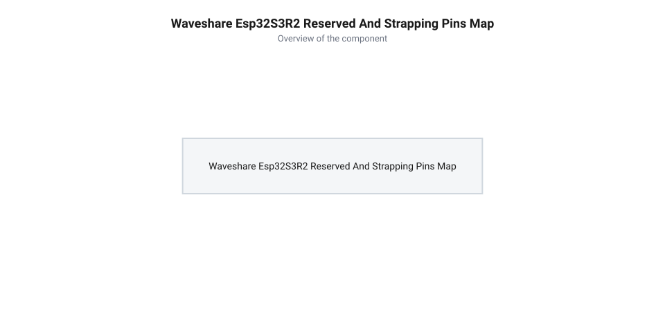
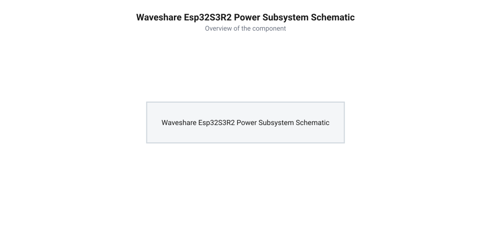
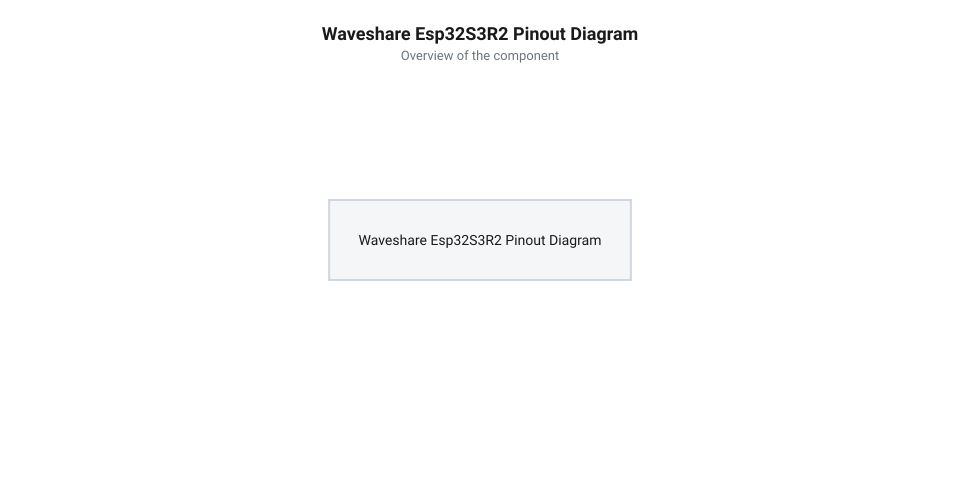

# Схемотехніка, призначення виводів та апаратна специфікація Waveshare ESP32-S3R2

<preknowlist>
- [Мікроконтролер ESP32-S3](root:cat-hw-boards/esp32s3-microcontroller) — архітектуру ядра Xtensa LX7, систему переривань та матрицю GPIO.
- [Родина плат і модулів на ESP32-S3](root:cat-hw-boards/esp32-s3-boards-family-overview) — загальний огляд сімейства плат та відмінності конфігурацій пам'яті.
</preknowlist>

## Принципи схемотехніки та апаратні обмеження

Під час проєктування вбудованих систем на базі плати Waveshare ESP32-S3R2 розробники часто стикаються із раптовими блокуваннями завантажувача або спотворенням даних в оперативній пам'яті. Причина цих збоїв полягає у фізичній топології внутрішніх шин. Плата побудована на базі модифікації мікроконтролера, що використовує технологію «система у корпусі» @@en|SiP@@ (від англ. *@@en|System-in-Package@@* — система у корпусі), де кристали обчислювального ядра та псевдостатичної оперативної пам'яті @@en|PSRAM@@ об'єднані в одному корпусі. Сам [мікроконтролер ESP32-S3](root:cat-hw-boards/esp32s3-microcontroller) взаємодіє з 2 МБ внутрішньої пам'яті PSRAM через швидкісну 8-бітну шину Octal SPI, яка функціонує на тактовій частоті до 80 МГц із режимним тактуванням за обома фронтами імпульсу @@en|DDR@@ (від англ. *@@en|Double Data Rate@@* — подвійна швидкість передачі даних). Оскільки передача 8-бітних слів здійснюється паралельно із синхронізацією через виділений сигнальний строб @@en|DQS@@ (від англ. *@@en|Data Strobe@@* — строб даних), шина вимагає жорсткого дотримання часових допусків затримок у діапазоні менше наносекунди, через що будь-який сторонній зв'язок чи паразитна ємність на лініях руйнує фазову узгодженість зчитування даних. Для забезпечення завадостійкого обміну вирівнювання довжин провідників @@en|length matching@@ (від англ. *@@en|length@@* — довжина та *@@en|matching@@* — узгодження) між стробом `DQS` та іншими 8 лініями даних має витримуватися з точністю до ±0.15 мм, що відповідає часовому розкешуванню фронтів @@en|skew@@ не більше 10 пікосекунд. Відхилення від цього допуску зсуває фронт зчитування стробу за межі часового «вікна очікування даних» (англ. *@@en|data eye@@* — вікно даних), викликаючи одиночні пошкодження бітів та паніку ядра при зверненні до PSRAM.

Головне апаратне обмеження полягає у тому, що сигнальні лінії шини Octal SPI задіяні внутрішньо. Якщо у зовнішній схемі випадково підключити сенсор, кнопку або дисплей до виводів `GPIO33`–`GPIO42`, розведені на внутрішній кристал пам'яті, виникає апаратний шинний конфлікт @@en|bus contention@@ (від англ. *@@en|bus@@* — шина та *@@en|contention@@* — конфлікт). Механізм цієї аварії розгортається у момент, коли ядро звертається до PSRAM для зчитування кадрового буфера камери чи масивів нейромережі: вихідний буфер зовнішнього пристрою протидіє сигналам контролера пам'яті, що спотворює біти даних і викликає помилку адресації кешу MMU. Апаратний контролер шини негайно фіксує виняткову ситуацію (англ. *@@en|exception@@* — виняток) некоректного доступу `Cache Error` або `LoadProhibited`, що запускає обробник паніки ядра @@en|kernel panic@@ (від англ. *@@en|kernel@@* — ядро та *@@en|panic@@* — паніка). Обробник миттєво зупиняє виконання коду, виводить аварійний дамп логів у `UART0` і відправляє мікроконтролер у нескінченний цикл перезавантаження @@en|boot loop@@ (від англ. *@@en|boot@@* — завантаження та *@@en|loop@@* — петля).

*Розподіл системних ліній шини SPI та конфігураційних виводів завантаження.*

Другим джерелом апаратних ризиків є виводи конфігурації завантаження (англ. *@@en|strapping pins@@* — виводи конфігурації завантаження), такі як `GPIO0`, `GPIO45` та `GPIO46`. У мікросекундному вікні після подачі живлення завантажувач мікроконтролера зчитує логічні рівні на цих штирках, визначаючи режим старту — запуск прошивки з Flash-пам'яті, режим прошивання через USB чи внутрішній рівень напруги живлення Flash. Як свідчить огляд [родини плат ESP32-S3](root:cat-hw-boards/esp32-s3-boards-family-overview), довільне підключення зовнішнього заліза з власною підтяжкою до виводів `strapping` блокує старт системи або може пошкодити внутрішній регулятор напруги пам'яті.

## Системна специфікація та підсистема живлення

Розробницька плата Waveshare ESP32-S3R2 призначена для високопродуктивних задач Edge AI та обробки медіапотоків. Обчислювальним серцем пристрою є двоядерний 32-бітний процесор Xtensa LX7 із тактовою частотою до 240 МГц, розширений 512 КБ внутрішньої SRAM, 8 МБ зовнішньої флеш-пам'яті Quad SPI та 2 МБ псевдостатичної пам'яті Octal PSRAM.

Підсистема живлення плати розрахована на подачу напруги через роз'єм USB Type-C або через вивід `5V`. Вбудований лінійний стабілізатор із малою різницею напруг вхід-вихід @@en|LDO@@ (від англ. *@@en|Low-DropOut regulator@@* — стабілізатор напруги з малою різницею напруг вхід-вихід) знижує вхідний потенціал до робочого рівня 3.3 В із максимальним вихідним струмом до 500 мА. При пікових струмах споживання радіомодуля Wi-Fi під час передачі даних, які досягають `I_peak = 350 мА`, падіння напруги на регуляторі `ΔV = 5.0 В - 3.3 В = 1.7 В` викликає виділення теплової потужності `P_D = ΔV × I_peak = 1.7 В × 0.35 А = 0.595 Вт`. Через високий тепловий опір компактного корпусу стабілізатора (близько 130 °C/Вт) кристалик нагрівається на `ΔT ≈ 78 °C`, що при кімнатній температурі піднімає його температуру до понад 100 °C і вимагає ефективного відведення тепла через мідні полігони друкованої плати для запобігання спрацюванню теплового захисту @@en|thermal shutdown@@. На відміну від простішої [компактної плати ESP32-S3-Zero](root:cat-hw-boards/esp32-s3-zero), плата Waveshare містить розширений електричний захист кіл живлення та інтерфейсів. Лінії даних `D+` і `D-` роз'єму USB шунтовані на землю парою двоспрямованих @@en|TVS@@-діодів (від англ. *@@en|Transient Voltage Suppressor@@* — супресор імпульсних перенапруг), які фіксують високовольтні сплески @@en|ESD@@ та відводять імпульсний струм до виходу з ладу фізичного трансивера мікроконтролера. Для безпечного моніторингу акумулятора використовується прецизійний резистивний подільник із двох однакових резисторів `R1` і `R2` по 100 кОм, що зменшує вхідну напругу вдвічі з коефіцієнтом `K_div = R2 / (R1 + R2) = 0.5`. Це дозволяє подавати на аналоговий вхід @@en|ADC@@ безпечний потенціал до 2.1 В при повній зарядці Li-Po елемента до 4.2 В, а програмне забезпечення розраховує реальну напругу живильної батареї як `V_BAT = V_ADC × 2`.

*Схемотехніка підсистеми живлення, USB TVS-захисту та вимірювання напруги акумулятора.*

Сигнальні лінії `D+` та `D-` вбудованого USB-контролера захищені від статичної електрики (англ. *@@en|electrostatic discharge@@* — електростатичний розряд, скорочено @@en|ESD@@) спеціалізованими супресорами імпульсних перенапруг @@en|TVS@@ (від англ. *@@en|Transient Voltage Suppressor@@* — супресор імпульсних перенапруг). Оскільки передача даних у стандарті @@en|USB Full-Speed@@ (зі швидкістю до 12 Мбіт/с) вимагає збереження малої тривалості фронтів сигналів та жорсткої цілісності (англ. *@@en|signal integrity@@* — цілісність сигналу), застосування звичайних силових захисних діодів із високою власною ємністю `C_j > 10–50 пФ` є неприпустимим, адже така паразитна ємність разом із 90-омним диференціальним опором лінії утворює фільтр нижніх частот, що викривляє око-діаграму (англ. *@@en|eye diagram@@*) та спричиняє помилки зчитування бітів. Для розв'язання цієї проблеми схемотехніка плати використовує супресори з наднизькою власною ємністю p-n переходу (англ. *@@en|ultra-low capacitance@@*, `C_j < 0.5–1.0 пФ`), які підключені за діодною топологією спрямування струму (англ. *@@en|steering diode topology@@*) від диференціальних шин до ліній живлення та землі. Така топологія залишає високочастотну смугу пропускання провідників практично неспотвореною, але під час ESD-імпульсу миттєво фіксує перенапругу на безпечному рівні обмежувальної напруги (англ. *@@en|clamping voltage@@*) та скидає струм розряду в землю до пошкодження напівпровідникового трансивера. Для забезпечення автономного батарейного живлення схемотехніка плати включає прецизійний резистивний подільник напруги, підключений до входу аналого-цифрового перетворювача @@en|ADC@@ (від англ. *@@en|Analog-to-Digital Converter@@* — аналого-цифровий перетворювач), що дозволяє програмі контролювати рівень розряду Li-Po акумулятора без встановлення зовнішніх компонентів.

## Карта виводів та мультиплексування периферії

Розробницька плата Waveshare ESP32-S3R2 виводить доступні інтерфейсні лінії на два однорядні 22-контактні роз'єми з кроком 2.54 мм. Головною перевагою внутрішньої архітектури є наявність комутаційної матриці виводів @@en|GPIO Matrix@@ (від англ. *@@en|general-purpose input/output matrix@@* — матриця перенаправлення вхідних-вихідних виводів загального призначення). Завдяки цій матриці більшість цифрових периферійних модулів — таких як послідовний шинний інтерфейс @@en|I2C@@, шина @@en|SPI@@, асинхронний трансивер @@en|UART@@ або генератор широтно-імпульсної модуляції @@en|PWM@@ — можуть бути програмно перепризначені на будь-який вільний цифровий вивід `GPIO`.

Незважаючи на гнучкість мультиплексування, розробницька плата має апаратно оптимізовані призначення виводів за замовчуванням:
- **Аналого-цифрові канали АЦП.** Виводи `GPIO1`–`GPIO10` належать до першого аналогового блоку `ADC1`, а виводи `GPIO11`–`GPIO20` — до блоку `ADC2`. Аналогові канали `ADC1` можуть зчитуватися без обмежень одночасно із роботою радіомодуля Wi-Fi, тоді як виклики `ADC2` вимагають програмної арбітрації з мережевим стеком.
- **Основні цифрові шини.** Для шини `I2C0` стандартними виводами є `GPIO8` (SDA) та `GPIO9` (SCL). Для шини `SPI2` (FSPI) рекомендовано вживати `GPIO11` (MOSI), `GPIO13` (MISO), `GPIO12` (SCLK) та `GPIO10` (CS). Системна консоль `UART0` зафіксована на виводах `GPIO43` (TX) та `GPIO44` (RX).
- **Адресний RGB-світлодіод.** На платі інтегровано керований світлодіод WS2812, підключений до лінії `GPIO21`.

На низькому рівні комутаційна матриця @@en|GPIO Matrix@@ здійснює таке перепризначення через два блоки системних регістрів. Для вихідних сигналів периферії задіюються регістри `GPIO_FUNCn_OUT_SEL_CFG_REG` (де `n` — номер фізичного виводу `GPIO`), у яких 9-бітне поле `GPIO_FUNCn_OUT_SEL` кодує числовий індекс периферійного сигналу виходу. Для вхідних сигналів використовуються регістри `GPIO_FUNCm_IN_SEL_CFG_REG` (де `m` — індекс вхідного сигналу периферійного модуля): значення `GPIO_FUNCm_IN_SEL` вказує номер фізичної ніжки `GPIO`, а біт `GPIO_SIGm_IN_SEL` активує проходження сигналу через матрицю. Така апаратна розв'язка дозволяє довільно комутувати периферійні блоки @@en|I2C@@, @@en|UART@@, @@en|SPI@@ чи @@en|PWM@@ без зміни друкованого монтажу, проте додає затримку у два такти системної шини. Для високошвидкісних інтерфейсів @@en|SPI@@ та @@en|SDMMC@@, де двотактне запізнення та часове розкешування обмежують граничну частоту обміну 40–80 МГц, розробники використовують механізм прямого обходу @@en|bypass@@ (від англ. *@@en|bypass@@* — обхід) матриці. Конфігуруванням поля `MCU_SEL` у регістрі `IO_MUX_GPIOx_REG` периферійний модуль з'єднується напряму з фізичним виводом через блок @@en|IO MUX@@ (від англ. *@@en|input/output multiplexer@@*, від лат. @@latin|multiplicare@@ — примножувати та англ. @@en|multiplexer@@ — комутатор) у кристалах, таких як [Мікроконтролер ESP32-S3](root:cat-hw-boards/esp32s3-microcontroller), що повністю усуває шинну затримку та забезпечує максимальну частоту й фазову точність передачі даних.

Як і на суміжних платах, таких як [Waveshare ESP32-S3-Pico](root:cat-hw-boards/esp32-s3-pico), така топологія полегшує трасування зовнішніх шлейфів, оскільки цифрові сигнали можна перепризначати без перебудови друкованої плати.

*Діаграма розведення 28 виводів плати Waveshare ESP32-S3R2 із мультиплексуванням периферії.*

## Зарезервовані та системні шинні лінії

Під час проєктування зовнішніх схем критично важливо відокремлювати вільні виводи загального призначення від зарезервованих системних ліній. У модифікації Waveshare ESP32-S3R2 частина фізичних виводів кристала розведена всередині SiP-корпусу для забезпечення зв'язку з пам'яттю.

Категорично заборонено використовувати у зовнішніх колах наступні зарезервовані виводи:
1. **Шина Octal PSRAM.** Лінії `GPIO33`, `GPIO34`, `GPIO35`, `GPIO36`, `GPIO37`, `GPIO38`, `GPIO39`, `GPIO40`, `GPIO41` та `GPIO42` забезпечують високошвидкісний 8-бітний обмін із 2 МБ оперативної пам'яті PSRAM. Будь-яке електричне підключення до цих штирків руйнує цілісність адресного простору й викликає фатальне виключення процесора.
2. **Шина Quad SPI Flash.** Виводи `GPIO26`, `GPIO27`, `GPIO28`, `GPIO29`, `GPIO30`, `GPIO31` та `GPIO32` задіяні під зчитування коду з 8 МБ флеш-пам'яті.
3. **Конфігураційні виводи (англ. *@@en|strapping pins@@* — виводи конфігурації завантаження).** Стан цих ліній зчитується засувками внутрішньої логіки точно в момент зняття сигналу скидання `EN` (наростаючий фронт живлення). Під час скидання внутрішні слабопідтягувальні резистори номіналом близько 45 кОм фіксують базові рівні (`GPIO0` — підтяжка до 3.3 В, `GPIO45` та `GPIO46` — підтяжка до землі). Тривалість вікна зчитування визначається RC-фільтром лінії `EN` (типово `R = 10 кОм`, `C = 1 мкФ` з постійною часу `τ = 10 мс`), який гарантує стабілізацію напруги живлення 3.3 В до зняття блокування. Зовнішні резистори номіналом менше 10 кОм на цих виводах здатні пересилити внутрішню 45-кілоомну підтяжку протягом цього вікна, спотворюючи зчитаний стан. Вивід `GPIO0` визначає режим старту: підтяжка до високого рівня 3.3 В фіксує нормальне завантаження прошивки з Flash, тоді як заземлення кнопкою BOOT переводить [Мікроконтролер ESP32-S3](root:cat-hw-boards/esp32s3-microcontroller) у режим завантажувача прошивки через послідовний порт. Вивід `GPIO45` регулює напругу внутрішнього домену живлення пам'яті `VDD_SPI`: низький рівень (0 В) задає напругу 3.3 В для стандартних мікросхем Flash та PSRAM, тоді як випадковий зовнішній підтяг до високого рівня (3.3 В) перемикає регулятор на 1.8 В, що повністю блокує живлення пам'яті й призводить до нескінченного циклу перезапуску (англ. *@@en|boot loop@@* — циклічний перезапуск). Вивід `GPIO46` у поєднанні з `GPIO0` кодує режим виводу відлагоджувальних логів ROM-завантажувача та джерело сигналів JTAG, тому будь-які зовнішні активні навантаження на цих ніжках під час увімкнення спричиняють апаратне блокування процесорного ядра.

Як підкреслює огляд [родини плат ESP32-S3](root:cat-hw-boards/esp32-s3-boards-family-overview), дотримання правил ізоляції зарезервованих ліній гарантує стабільний запуск прошивки та запобігає апаратному пошкодженню вбудованого кристала [мікроконтролера ESP32-S3](root:cat-hw-boards/esp32s3-microcontroller).

## Схеми підключення та правила проектування

Під час розробки власних материнських плат та дочірніх плат-розширення під Waveshare ESP32-S3R2 схемотехнік має дотримуватися трьох критичних інваріантів: гарантування 3.3-вольтової логічної сумісності, надійної підтяжки цифрових шин та узгодження ліній живлення.

Першим залізним правилом є дотримання допустимих рівнів напруги. Усі виводи `GPIO` кристала розраховані виключно на логічні рівні 3.3 В і не є 5-вольтово толерантними. Пряме підключення 5-вольтових датчиків чи сигнальних ліній застарілих контролерів спричиняє пробій внутрішніх захисних діодів. Для узгодження сигналів мусять застосовуватися двонаправлені конвертери логічних рівнів @@en|level shifter@@ (від англ. *@@en|level@@* — рівень та *@@en|shifter@@* — перетворювач) на польових транзисторах або резистивні дільники напруги для вхідних ліній. Типова принципова схема двонаправленого узгоджувача будується на N-канальному польовому транзисторі (наприклад, BSS138): затвор транзистора підключають до шини живлення 3.3 В, витік — до виводу `GPIO` мікроконтролера з підтяжкою резистором 10 кОм до 3.3 В, а стік — до 5-вольтової сигнальної лінії з підтяжкою 10 кОм до 5 В. Коли вивід `GPIO` встановлює низький рівень (0 В), різниця напруг затвор-витік перевищує порогову напругу відкривання транзистора, канал відкривається і підтягує 5-вольтову лінію до землі; коли ж 5-вольтова периферія притискає стік до 0 В, спочатку спрацьовує внутрішній паразитичний діод підкладки, знижуючи напругу на витоку і відкриваючи транзистор для передачі низького рівня на `GPIO`.

Другим аспектом є правильно організована підтяжка шин. Внутрішні підтягувальні резистори мікроконтролера @@en|pull-up resistor@@ (від англ. *@@en|pull-up@@* — підтягувати вгору) мають занадто високий опір (близько 45 кОм), що утворює з паразитною ємністю довгих шлейфів спотворення фронтів сигналів. Для надійної роботи шини `I2C` (лінії `GPIO8`/`GPIO9`) на зовнішній платі обов'язково розпаюють фізичні підтягувальні резистори номіналом 2.2–4.7 кОм до шини 3.3 В. Мінімальне значення опору підтяжки `R_min` визначається з умови обмеження втікаючого струму відкритого стоку `I_OL = 3 мА` при напрузі живлення `V_DD = 3.3 В` та вихідному рівні `V_OL = 0.4 В`:

    R_min = (V_DD - V_OL) / I_OL
    = (3.3 В - 0.4 В) / 0.003 А      [підстановка параметрів шини 3.3 В]
    = 967 Ом                          [розрахунок межі вихідного струму 3 мА]

Вираз показує, що опір не повинен бути меншим за 967 Ом, щоб не перевантажувати транзистори стоку. Максимальний опір `R_max` обмежується допустимим часом наростання фронту `t_r` та сумарною паразитною ємністю шини `C_bus`:

    R_max = t_r / (0.8473 × C_bus)
    = 300 нс / (0.8473 × 100 пФ)      [підстановка часу фронту Fast-mode 400 кГц та ємності]
    ≈ 3540 Ом                         [граничний опір для збереження крутизни фронту]

Отриманий діапазон від 967 Ом до 3.54 кОм пояснює, чому для робочих частот Fast-mode 400 кГц обирають стандартний номінал підтягувальних резисторів 2.2–4.7 кОм.

Третім правилом є грамотний розподіл струмового навантаження. Живлення потужних периферійних пристроїв (реле, сервоприводів, світлодіодних матриць) має здійснюватися безпосередньо від вхідної шини `5V` або зовнішнього джерела, щоб не перевантажувати вбудований LDO-стабілізатор 3.3 В. При підключенні чутливих аналогових датчиків до виводів `ADC1` силову й аналогову землі розділяють, а виводи живлення датчика шунтують керамічними конденсаторами ємністю 0.1 мкФ.

Як і у випадку з іншими платами компактного класу на кшталт [ESP32-S3 SuperMini](root:cat-hw-boards/esp32-s3-supermini) чи відеомодуля [ESP32-CAM (OV2640 + microSD)](root:cat-hw-boards/esp32-cam), дотримання цих схемотехнічних правил усуває апаратні зависання, запобігає проникненню високочастотних завад у вимірювальні канали та забезпечує довговічну роботу всієї системи.
