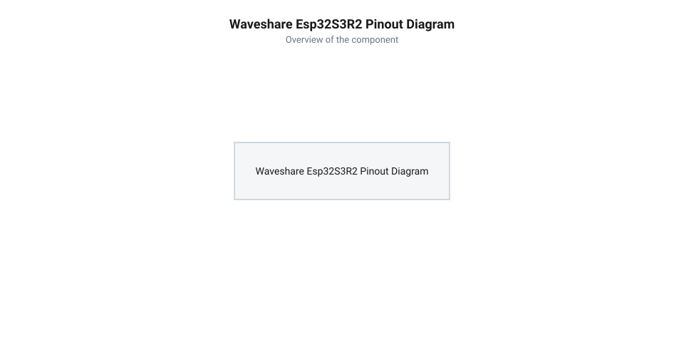
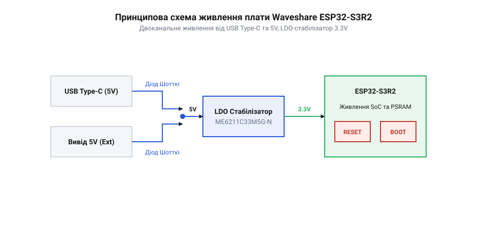

# Апаратна специфікація, цокольовка та схема живлення Waveshare ESP32-S3R2

<preknowlist>
- [Мікроконтролер ESP32-S3](root:cat-hw-boards/esp32s3-microcontroller) — розуміння архітектурних особливостей та загальних характеристик SoC ESP32-S3
- [Родина плат і модулів на ESP32-S3](root:cat-hw-boards/esp32-s3-boards-family-overview) — загальне уявлення про різноманіття формфакторів плат серії ESP32-S3
</preknowlist>

## Особливості апаратної будови та SiP-компонування

Плата розробки [Waveshare ESP32-S3R2](root:cat-hw-boards/esp32-s3-boards-family-overview) побудована на базі спеціалізованої модифікації мікроконтролера, в якій застосовано технологію @@en|SiP@@ (від англ. system-in-package — система в корпусі). Усередині єдиної кремнієвої упаковки мікросхеми розварено як двоядерний 32-бітний процесорний кристал, так і додатковий чип псевдостатичної оперативної пам'яті @@en|PSRAM@@ (від англ. pseudo-static random-access memory — псевдостатична оперативна пам'ять) обсягом `2 МБ`. Для обміну даними між ядром та оперативною пам'яттю використовується високочастотна шина @@en|Quad SPI@@ (від англ. quad serial peripheral interface — четверний послідовний периферійний інтерфейс), що працює на напрузі `1.8 В`. Конструктивно ефективне відведення тепла від двох високопотужних кристалів у компактному корпусі QFN-56 здійснюється через нижній заземлений теплорозсіювальний майданчик (англ. @@en|Thermal Pad@@, від *thermal* — тепловий, *pad* — майданчик), який вимагає якісного запаювання на масивну металеву область друкованої плати з сіткою теплопровідних перехідних отворів (англ. @@en|thermal vias@@, від *thermal* — тепловий, *via* — перехідний отвір). Крім того, для мінімізації паразитної індуктивності внутрішньокорпусних ліній живлення безпосередньо поруч із кристалом пам'яті всередині SiP-упаковки змонтовано високочастотні блокирувальні керамічні чип-конденсатори, які гасять швидкі імпульсні струми перемикання шини до їх проникнення на зовнішні доріжки плати.

На відміну від класичних модулів, де зовнішні дискретні мікросхеми пам'яті вимагають трасування до 10–12 провідників безпосередньо по друкованій платі, внутрішньокорпусне з'єднання в чипі @@en|Waveshare ESP32-S3R2@@ вивільняє значну кількість фізичних виводів. Завдяки тому, що шина @@en|PSRAM@@ не виходить на зовнішні контакти корпусу, виводи `GPIO33`, `GPIO34`, `GPIO35`, `GPIO36` та `GPIO37` стають повністю доступними для використання в користувацьких застосунках. Зарезервованими під внутрішню флеш-пам'ять @@en|Flash@@ (від англ. flash memory — напівпровідникова енергонезалежна пам'ять) обсягом `16 МБ` залишаються лише контакти `GPIO26`–`GPIO32`. Це робить плату суттєво компактнішою за стандартні плати розробки, збережених у [огляді родини ESP32-S3](root:cat-hw-boards/esp32-s3-boards-family-overview).

Таке інженерне рішення розширює можливості трасування компактних двошарових планок розширення без ризику пошкодження високочастотного інтерфейсу. Оскільки короткі внутрішньокорпусні з'єднання чипа пам'яті мають мінімальну паразитну ємність, шина @@en|Quad SPI@@ зберігає круті фронти сигналів на тактовій частоті `80 МГц` із низьким рівнем електромагнітних завад (англ. @@en|Electromagnetic Interference@@, скорочено @@en|EMI@@, від *electromagnetic* — електромагнітний, *interference* — завада). Вивільнені контакти дозволяють прямо підключати зовнішні швидкісні дисплеї та модулі зйомок без створення апаратних конфліктів шин, що є важливою перевагою при розробці пристроїв на основі плат розробки рівня [Waveshare ESP32-S3-Pico](root:cat-hw-boards/esp32-s3-pico) або чипа [Мікроконтролер ESP32-S3](root:cat-hw-boards/esp32s3-microcontroller).

Робота вбудованої @@en|PSRAM@@ на напрузі `1.8 В` замість стандартних `3.3 В` дозволяє суттєво зменшити амплітуду перемикання логічних рівнів на шині @@en|Quad SPI@@, що знижує динамічне енергоспоживання пам'яті під час активного обміну даними на частоті `80 МГц`. Живлення цього домену здійснюється через внутрішній регулятор напруги мікроконтролера, який вимагає надійної розв'язки зовнішніми фільтрувальними ємностями для запобігання просіданню напруги при пікових зчитуваннях. Утім, розміщення двох кристалів — процесорного ядра та пам'яті — у спільному корпусі @@en|QFN-56@@ (від англ. @@en|Quad Flat No-leads@@ — квадратний плоский корпус без виводів) розміром `7×7 мм` створює високу щільність теплового потоку. Оскільки тепловий опір між кристалом та навколишнім середовищем у такому компонуванні сильно залежить від відведення тепла через нижній відкритий майданчик @@en|ePAD@@ (від англ. @@en|Exposed Pad@@ — відкритий контактний майданчик), відсутність суцільного заземлення під корпусом спричиняє швидке нагрівання чипа понад `85 °C` під навантаженням. Це викликає температурний дрейф параметрів сигнальних ліній `1.8 В` та збої адресації, що вимагає ретельного розрахунку відведення тепла під час проєктування пристроїв на основі [чипа ESP32-S3](root:cat-hw-boards/esp32s3-microcontroller) або компактних плат на кшталт [Waveshare ESP32-S3-Pico](root:cat-hw-boards/esp32-s3-pico).

## Специфікація цокольовки та картування GPIO

Фізична розпіновка (англ. @@en|pinout@@ — схематична розпіновка контактів) плати містить дворядні гребінки контактів із стандартним кроком `2.54 мм`, на які виведено `34` доступні лінії @@en|GPIO@@ (від англ. general-purpose input/output — виводи вводу-виводу загального призначення), а також шини живлення та керування.

*Фізична розпіновка плати Waveshare ESP32-S3R2, що показує розташування контактів GPIO, периферійних шин та ліній живлення.*

Більшість виводів мікроконтролера є мультиплексованими, що дозволяє гнучко призначати апаратні периферійні блоки через матрицю сигналів. Для послідовного зв'язку @@en|UART@@ (від англ. universal asynchronous receiver-transmitter — універсальний асинхронний приймач-передавач) за замовчуванням задіяно виводи `GPIO43` (лінія `TXD0`) та `GPIO44` (лінія `RXD0`), які підключені до консольного інтерфейсу. Лінії `GPIO19` та `GPIO20` розведені під апаратний контролер @@en|USB@@ @@en|OTG@@ (від англ. on-the-go — стандарт підключення периферійних USB-пристроїв) і виведені безпосередньо на роз'єм @@en|USB Type-C@@. Для підключення сенсорів по шині @@en|I2C@@ (від англ. inter-integrated circuit — міжмікросхемна шина даних) рекомендовано використовувати `GPIO8` (`SDA`) та `GPIO9` (`SCL`), а для швидкісних дисплеїв чи розширювачів по шині @@en|SPI@@ (від англ. serial peripheral interface — послідовний периферійний інтерфейс) — лінії `GPIO10` (`CS`), `GPIO11` (`MOSI`), `GPIO12` (`CLK`) та `GPIO13` (`MISO`). При цьому аналогові виводи блоку `ADC2` (`GPIO11`–`GPIO20`) мають суворі апаратні обмеження: вони спільно використовуються радіочастотним трансивером @@en|Wi-Fi@@ для калібрування потужності, через що апаратний арбітр (від англ. @@en|arbiter@@, від *arbiter* — арбітр) блокує аналого-цифрове перетворення послідовного наближення (від англ. @@en|SAR ADC@@, від *successive approximation register*, від *successive* — послідовний, *approximation* — наближення, *register* — регістр) під час активного бездротового обміну, викликаючи помилки таймауту; тому відповідальні аналогові давачі слід підключати виключно до каналів `ADC1` (`GPIO1`–`GPIO10`).

Аналогові функції забезпечуються двома блоками аналого-цифрових перетворювачів @@en|ADC@@ (від англ. analog-to-digital converter — аналого-цифровий перетворювач): канали `ADC1` опитаються на виводах `GPIO1`–`GPIO10`, а канали `ADC2` — на `GPIO11`–`GPIO20`. Виводи `GPIO0`, `GPIO45` та `GPIO46` належать до групи @@en|strapping pins@@ (від англ. strapping pins — конфігураційні виводи завантаження), стан яких зчитується апаратним завантажувачем під час подачі живлення для вибору режиму роботи та напруги шини пам'яті.

## Двоканальна схема живлення та кнопки керування

Електрична система живлення плати @@en|Waveshare ESP32-S3R2@@ розроблена за двоканальною схемою, яка дозволяє подавати напругу як через вбудований роз'єм @@en|USB Type-C@@, так і від зовнішнього джерела через фізичний контакт `5V`.

*Принципова електрична схема системи живлення Waveshare ESP32-S3R2 з ор-діодною розв'язкою 5V, LDO-стабілізатором 3.3V та кнопками керування.*

Для запобігання пошкодженню портів комп'ютера при одночасному підключенні кабелю та зовнішнього акумулятора в схему вбудовано діодну розв'язку на діодах Шотткі. Вхідна напруга `5 В` подається на лінійний стабілізатор @@en|LDO@@ (від англ. low-dropout regulator — стабілізатор з низьким падінням напруги), який понижує її до робочого рівня `3.3 В` з максимальним струмом навантаження до `500 мА`. Паралельно лінії `3.3 В` встановлено керамічні фільтрувальні конденсатори ємністю `10 мкФ` та `100 нФ` для пригнічення високочастотних пульсацій під час пікових струмових сплесків бездротового трансивера. При розрахунку енергоспоживання автономних пристроїв у режимі глибокого сну (від англ. @@en|Deep Sleep@@ — режим глибокого сну) слід враховувати власний струм спокою @@en|LDO@@ стабілізатора (від англ. @@en|quiescent current@@ — струм спокою `I_q`). У той час як сам мікроконтролер у @@en|Deep Sleep@@ споживає лише близько `8 мкА`, власний спокійний струм стабілізатора становить від `40` до `55 мкА`, що робить @@en|LDO@@ основним джерелом розряду акумулятора в паузах між сеансами зв'язку.

Керування режимами роботи здійснюється двома тактовими кнопками. Кнопка @@en|Reset@@ підключена до виводу `EN` (вхід скидання `CHIP_PU`), який підтягнуто резистором `10 кОм` до лінії `3.3 В` та зашунтовано конденсатором `1 мкФ` для формування чистого фронту включення. Кнопка @@en|Boot@@ підключена до конфігураційного виводу `GPIO0`. Утримання кнопки @@en|Boot@@ у натиснутому стані під час короткого натискання кнопки @@en|Reset@@ примусово перевозить [мікроконтролер ESP32-S3](root:cat-hw-boards/esp32s3-microcontroller) у режим завантаження прошивки через вбудований @@en|ROM@@-завантажувач.

## Правила безпечного підключення зовнішньої периферії

Усі цифрові виводи @@en|GPIO@@ плати працюють строго за логічними рівнями `3.3 В` @@en|CMOS@@. Пряме підключення датчиків або джерел сигналів із рівнем `5 В` призводить до електричного пробою захисних діодів і виходу з ладу вхідних буферів. Для безпечного узгодження необхідно застосовувати двонаправлений конвертор логічних рівнів (англ. @@en|level shifter@@ — конвертор логічних рівнів).

Граничний вихідний струм одного виводу @@en|GPIO@@ не повинен перевищувати `40 мА`, а рекомендований робочий струм становить `12 мА`. Для керування силовими реле, світлодіодними стрічками або індикаторними джерелами слід використовувати зовнішні ключі на польових транзисторах. Сумарний струм, який споживає зовнішня периферія від контакту `3.3V`, не повинен перевищувати `300 мА`, оскільки сам чип у моменти активної передачі даних по Wi-Fi споживає до `200 мА`. Перевантаження стабілізатора @@en|LDO@@ викликає просідання напруги нижче `2.8 В`, що активує апаратний захист від зниження живлення (англ. @@en|Brown-out detector@@ — детектор зниження напруги живлення) і призводить до циклічного перезавантаження плати. Також високочастотні лінії широтно-імпульсної модуляції @@en|PWM@@ (від англ. pulse-width modulation — широтно-імпульсна модуляція) варто трасувати подалі від аналогових входів `ADC` задля уникнення ємнісних наводок. Окремої уваги потребує підключення високочутливих звукових модулів — цифро-аналогових перетворювачів @@en|DAC@@ (від англ. @@en|Digital-to-Analog Converter@@ — цифро-аналоговий перетворювач) та аналогово-цифрових перетворювачів `ADC`. Високочастотні завади від цифрової частини чипа та сплески споживання Wi-Fi через спільну шину `3.3V` проникають у звуковий тракт, створюючи фоновий шум і викривлення. Для ізоляції аналогового живлення в схему обв'язки додають феритову намистину @@en|Ferrite Bead@@ (від англ. @@en|Ferrite Bead@@ — феритова намистина), увімкнену послідовно в лінію живлення перед модулем, у поєднанні з шунтувальними конденсаторами на землю. На низьких частотах феритова намистина має мінімальний опір і безперешкодно пропускає постійний струм живлення, а на високих частотах її імпеданс різко зростає, розсіюючи цифрові завади у вигляді тепла та забезпечуючи чисте живлення аналогових кіл.
