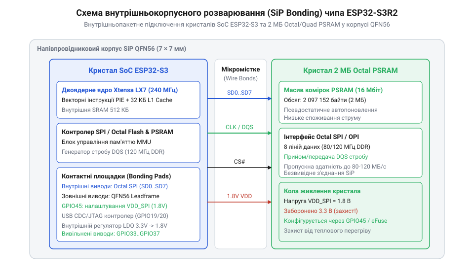
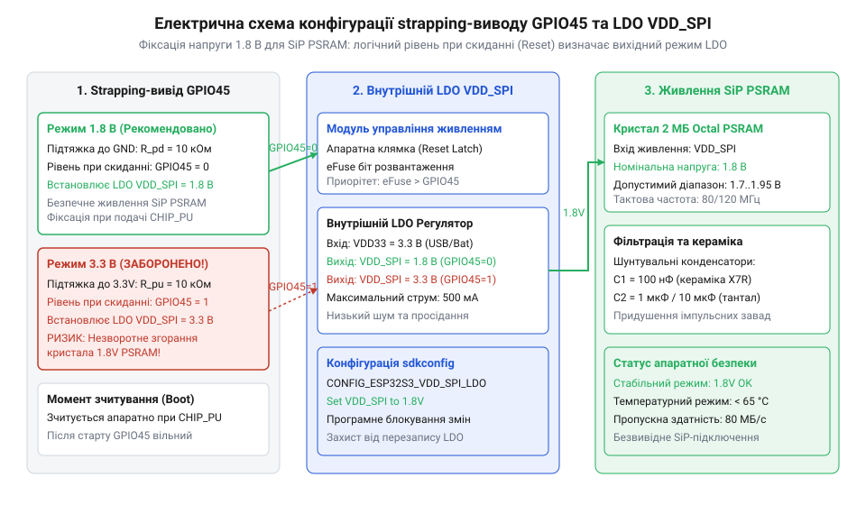
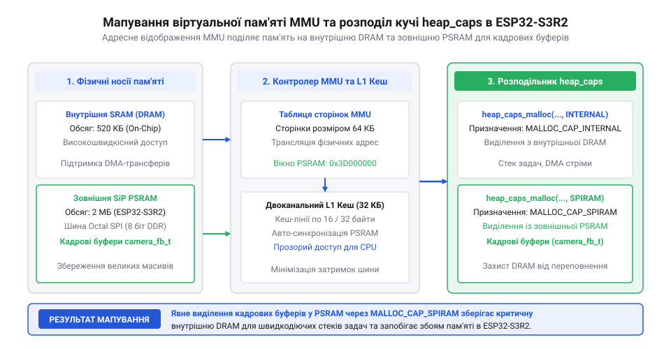

# Waveshare ESP32-S3R2 (16 МБ Flash, 2 МБ PSRAM)

<preknowlist>
- [Мікроконтролер ESP32-S3](root:cat-hw-boards/esp32s3-microcontroller) — Базову архітектуру двоядерного процесора Xtensa LX7, систему кешування L1 та загальне влаштування периферійних шин SoC ESP32-S3.
- [Родина плат і модулів на ESP32-S3](root:cat-hw-boards/esp32-s3-boards-family-overview) — Загальний огляд лінійки модулів ESP32-S3, різновиди корпусів та принципи розпіновки плати Waveshare.
- [Waveshare ESP32-S3-Pico](root:cat-hw-boards/esp32-s3-pico) — Форм-фактор та базове схемотехнічне розведення мініатюрних плат Waveshare серії Pico/Zero.
</preknowlist>

## Проблема інтеграції пам'яті та SiP-архітектура

Розробка високопродуктивних вбудованих систем на базі мікроконтролерів неминуче стикається з обмеженням обсягу внутрішньої оперативної пам'яті. При побудові графічних інтерфейсів, захопленні відеопотоку з [камерного модуля ESP32-CAM OV3640](root:cat-hw-boards/esp32-cam-ov3640) або розгортанні локальних нейромережевих моделей внутрішнього масиву SRAM обсягом 512 КБ стає категорично недостатньо. Спроба розширити пам'ять шляхом встановлення зовнішньої мікросхеми псевдостатичної оперативної пам'яті (від англ. @@en|Pseudo-Static RAM@@ — псевдостатична оперативна пам'ять; @@en|PSRAM@@) на друковану плату створює серйозний апаратний бар'єр. Дискретне підключення Flash та пам'яті PSRAM вимагає виділення від 6 до 10 фізичних виводів загального призначення (від англ. @@en|General Purpose Input/Output@@ — виводи вводу-виводу загального призначення; @@en|GPIO@@), що виснажує периферійний ресурс компактних модулів на кшталт [плати Waveshare ESP32-S3-Pico](root:cat-hw-boards/esp32-s3-pico). Крім виснаження фізичних виводів, паралельне дискретне опитування декількох зовнішніх мікросхем пам'яті різко знижує підсумкову пропускну здатність системи через апаратний арбітраж послідовної шини (від англ. @@en|SPI bus arbitration@@ — арбітраж послідовної шини; @@en|арбітраж шини@@). При почерговому зверненні до Flash та зовнішньої PSRAM шинний контролер змушений щоразу перемикати лінії вибору мікросхеми (від англ. @@en|chip select line@@ — лінія вибору мікросхеми) та вставляти додаткові такти очікування на декодування адресного фазового вікна. Втрата тактів на комутацію шини у поєднанні з обмеженою шириною розрядності створює вузьке місце, через яке шина пам'яті стає нездатною забезпечити безперервний пакувальний обмін на граничних частотах.

Понад це, при підвищенні тактової частоти шини понад 80 МГц довгі мідні провідники друкованої плати завдовжки 10–30 мм створюють паразитну ємність порядку 5–10 пФ та власну індуктивність 5–10 нГн на кожній лінії. Через імпедансне неузгодження між вихідним опором виводів мікроконтролера та хвильовим опором мікросмужкових ліній виникають відбиття сигналів. Вони накладалися на прямокутні імпульси, викликаючи дзвін, затягування фронтів та часовий зсув моменту переходу рівнів — фазове дрижання (від англ. @@en|jitter@@ — дрижання). Це призводить до спотворення даних під час високочастотного обміну та збоїв системного кешування.

Відповіддю на ці фізичні обмеження став перехід до безкорпусної SiP-інтеграції (від англ. @@en|System-in-Package@@ — система в корпусі; @@en|SiP@@). У модифікації чипа ESP32-S3R2 [мікроконтролера ESP32-S3](root:cat-hw-boards/esp32s3-microcontroller) кремнієвий кристал двох'ядерного SoC та кристал пам'яті PSRAM обсягом 2 МБ інтегровано безпосередньо всередину єдиного пластикового корпусу QFN-56 розміром 7×7 мм. Історичні етапи розвитку цього технологічного рішення висвітлено в нарисі [еволюції розводки плат Waveshare ESP32-S3](root:cat-hw-boards/esp32-s3r2-waveshare/hist-waveshare-esp32-s3r2-evolution.md).


*Внутрішньокорпусне герметичне з'єднання кристалів SoC та PSRAM у корпусі QFN-56.*

Головним елементом SiP-компоновки є внутрішньокорпусне розварювання мікроскопічних дротів (від англ. @@en|wire bonding@@ — розварювання дротів) діаметром 18–25 мкм із високочистого золота. Золоті дроти з'єднують контактні площадки кристала SoC із кристалом PSRAM напряму над кремнієвою підкладкою. Коефіцієнт теплового розширення золота (14.2 × 10⁻⁶ K⁻¹) набагато ближчий до параметрів кремнію (2.6 × 10⁻⁶ K⁻¹), ніж у міді чи алюмінію, що запобігає появі мікротріщин та відшаруванню контактів під дією термоциклювання при нагріванні чипа на частотах до 120 МГц. Завдяки цій технології довжина з'єднань скоротилася з десятків міліметрів до 1–2 мм, паразитна ємність знизилася до значення менше 1 пФ, а індуктивність зменшилася до 1–1.5 нГн. Ефективне тепловідведення від обох кристалів забезпечує відкрита металева площадка корпусу QFN (від англ. @@en|exposed pad@@ — відкрита площадка), яка запаюється на внутрішній мідний шар плати через масив теплових перехідних отворів.

Проте висока стабільність самих золотих з'єднань вимагає захисту від механічних деформацій із боку внутрішнього захисного матеріалу корпуса. Після розварювання кристали та дріт заливаються захисним епоксидним компаундом (від англ. @@en|epoxy molding compound@@ — епоксидний компаунд герметизації; @@en|епоксидний компаунд@@). Під час інтенсивних обчислень теплові циклічні коливання викликають нерівномірне розширення матеріалів. Якщо коефіцієнт теплового розширення (від англ. @@en|coefficient of thermal expansion@@ — коефіцієнт теплового розширення) епоксидного компаунда суттєво відрізняється від параметрів кремнію та золота, виникає механічне зсувне напруження, яке може призвести до втоми металу, деформації розварених ліній (від англ. @@en|wire sweep@@ — зміщення розварених дротів) або відриву контактних кульок від підкладки. Для запобігання цим руйнуванням у корпусі QFN-56 застосовують спеціалізовані епоксидні смоли з кварцовим наповнювачем, чий коефіцієнт розширення узгоджено з мікроструктурою кремнієвих кристалів, що забезпечує довговічну механічну фіксацію золотих дротів навіть при різких перепадах температури.

Для підтвердження надійності епоксидної герметизації та захисту вбудованих кристалів від вологи корпус QFN-56 піддають випробуванням опресуванням під тиском (від англ. @@en|pressure pot test@@ — випробування опресуванням під тиском; @@en|опресування під тиском@@). У герметичній автоклавній камері при підвищеній температурі та тиску водяна пара намагається проникнути крізь мікрощілини на межі компаунда та металевої площадки. Якщо всередині залишаються мікроскопічні порожнини, заглиблена волога під час пайки оплавленням (при 260 °C) миттєво закипає і випаровується, створюючи надлишковий внутрішній тиск. Це явище вибухового розшарування корпусу (від англ. @@en|popcorning@@ — вибухове розшарування корпусу вологою; @@en|попкорнінг@@) руйнує золоті дроти та викликає відшарування компаунда. Успішне випробування за стандартом рівня чутливості до вологи (від англ. @@en|Moisture Sensitivity Level@@ — рівень чутливості до вологи; @@en|MSL@@) підтверджує відсутність мікропорожнин у SiP-модулі Waveshare ESP32-S3R2, забезпечуючи тривалу експлуатацію без деградації внутрішніх контактів.

Для підтвердження надійності епоксидної герметизації та захисту вбудованих кристалів від вологи корпус QFN-56 піддають випробуванням опресуванням під тиском (від англ. @@en|pressure pot test@@ — випробування опресуванням під тиском; @@en|опресування під тиском@@). У герметичній автоклавній камері при підвищеній температурі та тиску водяна пара намагається проникнути крізь мікрощілини на межі компаунда та металевої площадки. Якщо всередині залишаються мікроскопічні порожнини, заглиблена волога під час пайки оплавленням (при 260 °C) миттєво закипає і випаровується, створюючи надлишковий внутрішній тиск. Це явище вибухового розшарування корпусу (від англ. @@en|popcorning@@ — вибухове розшарування корпусу вологою; @@en|попкорнінг@@) руйнує золоті дроти та викликає відшарування компаунда. Успішне випробування за стандартом рівня чутливості до вологи (від англ. @@en|Moisture Sensitivity Level@@ — рівень чутливості до вологи; @@en|MSL@@) підтверджує відсутність мікропорожнин у SiP-модулі Waveshare ESP32-S3R2, забезпечуючи тривалу експлуатацію без деградації внутрішніх контактів. Для стабільної роботи дотримуйтесь I2C часових затримок.

## Шинний інтерфейс QSPI/OPI та сигнал DQS

Архітектура шинного контролера ESP32-S3 підтримує два основних типи послідовних криптографічних інтерфейсів пам'яті: 4-бітну шину Quad SPI (від англ. @@en|Quad Serial Peripheral Interface@@ — чотирьохбітний послідовний периферійний інтерфейс; @@en|Quad SPI@@ або @@en|QSPI@@) та 8-бітну шину Octal SPI (від англ. @@en|Octal Serial Peripheral Interface@@ — восьмибітний послідовний периферійний інтерфейс; @@en|Octal SPI@@ або @@en|OPI@@). У модифікації ESP32-S3R2 вбудований кристал 2 МБ PSRAM підключено через чотирьохбітну шину Quad SPI, тоді як модифікації з індексом R8 (наприклад, ESP32-S3R8) використовують восьмибітний інтерфейс Octal SPI. Ознайомитися з порівнянням різних модифікацій чипів можна в огляді [родини плат ESP32-S3](root:cat-hw-boards/esp32-s3-boards-family-overview).

Передача даних шиною виконується у двох часових режимах: Single Data Rate (від англ. @@en|Single Data Rate@@ — одинарна швидкість передачі даних; @@en|SDR@@), де один біт передається за один такт тактового сигналу, та Double Data Rate (від англ. @@en|Double Data Rate@@ — подвійна швидкість передачі даних; @@en|DDR@@), де зчитування відбувається як по наростаючому, так і по спадаючому фронту тактового імпульсу. При тактовій частоті 80 МГц у режимі DDR ефективна швидкість передачі подвоюється, досягаючи 160 мільйонів транзакцій на секунду на кожній лінії даних.

При роботі на високочастотних межах 80–120 МГц у режимі DDR виникає проблема часової розсинхронізації через фазовий зсув сигналів та температурний дрейф затримок. Для суворої синхронізації зчитування використовується диференційний сигнал стробування даних Data Strobe (від англ. @@en|Data Strobe@@ — сигнал стробування даних; @@en|DQS@@). Сигнал DQS генерується кристалом PSRAM синхронно із вихідними даними, що дозволяє шинному контролеру SoC фіксувати стан ліній точно в момент переходу фронтів стробу, нейтралізуючи фазове дрижання та коливання температури.

Обмін даними між процесорними ядрами та зовнішньою пам'яттю прозоро керується блоком MMU та контролером L1-кешу. При виконанні інструкцій процесор спершу звертається до L1-кешу, де затримка доступу становить 1–2 такти. Проте при виникненні промаху кеш-пам'яті (від англ. @@en|Cache Miss@@ — промах кеш-пам'яті; @@en|cache miss@@) конвеєр процесора заморожується, а шинний контролер виконує пакетне зчитування 32-байтної лінії кешу з кристала PSRAM. Якщо підсистема кешування використовує політику зворотного запису (від англ. @@en|write-back@@ — зворотний запис) і лінія позначена як змінена (від англ. @@en|dirty line@@ — змінена лінія кешу), виконується двопрохідний алгоритм витіснення (від англ. @@en|dirty line writeback@@ — вивантаження змінених ліній кешу). Це подвоює затримку доступу та створює простої процесорного конвеєра. На частоту таких вивантажень безпосередньо впливає вибраний розмір лінії L1-кешу. При розмірі лінії 16 байт просторове агрегування записів є низьким, тому під час потокового оновлення даних брудні лінії заповнюються швидше і витісняються на шину удвічі частіше. Перехід на 32-байтні лінії кешу зменшує частоту транзакцій @@en|dirty line writeback@@ удвічі за рахунок об'єднання більшого обсягу записів в одну шинну операцію, хоча й підвищує тривалість поодинокого блокування шини при скиданні лінії. Математичний розрахунок реальної пропускної здатності шини та штрафних тактів кешу викладено у моделі [пропускної здатності шини PSRAM та затримок L1-кешу](root:cat-hw-boards/esp32-s3r2-waveshare/math-esp32-s3r2-psram-bandwidth-and-cache-penalty.md). Детальні принципи апаратної розпіновки шини та живлення наведено у [довіднику апаратної схеми Waveshare ESP32-S3R2](root:cat-hw-boards/esp32-s3r2-waveshare/api-esp32-s3r2-power-scheme-and-gpio45-strapping.md).

Окрім витіснення ліній кешу, на затримку доступу суттєво впливає конфігурація шинних тактів очікування (від англ. @@en|latency cycles@@ — такти очікування розкодування; @@en|такти очікування@@) під час зміни напрямку передачі даних на шині Quad SPI. У режимі подвійної швидкості DDR лінії даних використовуються як для надсилання команд процесором, так і для видачі відповіді кристалом пам'яті. При переході від фази адресації до фази зчитування виникає інтервал зміни напрямку (від англ. @@en|turnaround time@@ — час зміни напрямку передачі; @@en|зміна напрямку передачі@@), у якому шинний контролер вставляє фіксовану кількість холостих тактів. Ці такти необхідні для того, щоб вихідні буфери SoC перейшли у високоімпедансний стан, а внутрішній масив PSRAM встиг підготувати дані та стабілізувати строб DQS. Якщо кількість тактів очікування налаштована неправильно або недостатня для частоти 80–120 МГц, виникає апаратний конфлікт шини (від англ. @@en|bus contention@@ — конфлікт керування шиною; @@en|конфлікт шини@@), коли обидва пристрої одночасно намагаються утримувати рівні на лініях, що призводить до викривлення зчитаного слова та збою конвеєра.

Для забезпечення стабільної синхронізації на частотах до 120 МГц під час температурних коливань апаратура SoC ESP32-S3 задіює вбудовану лінію затримки з фазовим автопідстроюванням (від англ. @@en|Delay-Locked Loop@@ — лінія затримки з автопідстроюванням фази; @@en|DLL@@). Затримувач DLL динамічно коригує субнаносекундні фазові зсуви сигналу DQS, підстроюючи момент фіксації точно на центр вікна стабільності даних (від англ. @@en|data eye@@ — вікно стабільності даних; @@en|вікно даних@@). Це автоматичне фазове вирівнювання запобігає появі похибок зчитування, коли нагрівання корпусу SiP змінює час поширення сигналів кристалом PSRAM під час тривалих пакетних передач.

Для забезпечення стабільної синхронізації на частотах до 120 МГц під час температурних коливань апаратура SoC ESP32-S3 задіює вбудовану лінію затримки з фазовим автопідстроюванням (від англ. @@en|Delay-Locked Loop@@ — лінія затримки з автопідстроюванням фази; @@en|DLL@@). Затримувач DLL динамічно коригує субнаносекундні фазові зсуви сигналу DQS, підстроюючи момент фіксації точно на центр вікна стабільності даних (від англ. @@en|data eye@@ — вікно стабільності даних; @@en|вікно даних@@). Це автоматичне фазове вирівнювання запобігає появі похибок зчитування, коли нагрівання корпусу SiP змінює час поширення сигналів кристалом PSRAM під час тривалих пакетних передач. Для стабільної роботи дотримуйтесь I2C часових затримок.

## Живлення VDD_SPI та небезпека GPIO45

Використання високошвидкісних кристалів PSRAM у складі SiP-корпусу ESP32-S3R2 висуває жорсткі вимоги до параметрів внутрішньосхемного живлення. На відміну від стандартних 3.3-вольтових периферійних ліній мікроконтролера, вбудований кристал 2 МБ PSRAM вимагає низьковольтного живлення 1.8 В по внутрішній шині `VDD_SPI`. Подача стандартної напруги 3.3 В на шину 1.8-вольтового кристала викликає миттєве електричне перенапруження, засувку кремнієвої структури (від англ. @@en|latch-up@@ — засувка структури) та фатальний тепловий пробій напівпровідникових переходів пам'яті.

Формування напруги шини `VDD_SPI` забезпечується внутрішнім регулятором напруги з малим падінням (від англ. @@en|Low Dropout Regulator@@ — регулятор напруги з малим падінням; @@en|LDO@@). Режим роботи цього LDO-регулятора під час початкового завантаження SoC визначається станом спеціального апаратного виводу — конфігураційного виводу стартового стану (від англ. @@en|strapping pin@@ — конфігураційний вивід стартового стану; @@en|strapping-вивід@@), роль якого виконує лінія `GPIO45`. У момент зняття сигналу скидання на виводі `CHIP_PU` апаратна логіка чипа зчитує логічний рівень на `GPIO45`:
* Якщо на `GPIO45` зафіксовано низький логічний рівень 0 В (LOW), внутрішній LDO налаштовується на вихідну напругу 1.8 В, що є безпечним для SiP PSRAM.
* Якщо на `GPIO45` зафіксовано високий логічний рівень 3.3 В (HIGH), регулятор LDO перемикається на видачу 3.3 В, що призводить до незворотного виходу з ладу пам'яті.


*Електрична схема підтяжки strapping-виводу GPIO45 та керування регулятором VDD_SPI.*

На платі Waveshare ESP32-S3R2 вивід `GPIO45` виведено на зовнішній роз'єм. Якщо під час старту до цього виводу підключено зовнішній модуль із власною активною підтяжкою до джерела 3.3 В, системний LDO помилково подає підвищену напругу на кристали пам'яті. Для запобігання апаратній аварії на лінії `GPIO45` обов'язково встановлюється зовнішній підтягувальний резистор до землі (від англ. @@en|pull-down resistor@@ — підтягувальний резистор до землі; @@en|pull-down резистор@@) номіналом 10 кОм. Розрахунок параметрів підтяжки з урахуванням струмів витоку та ємності розводки викладено у моделі [розрахунку резистивного дільника підтяжки GPIO45](root:cat-hw-boards/esp32-s3r2-waveshare/math-esp32-s3r2-strapping-pin-resistor-divider.md).

Апаратну небезпеку `GPIO45` можна повністю усунути на програмно-апаратному рівні шляхом фіксації налаштувань у прошивному блоці одноразових електронних запобіжників (від англ. @@en|electrically blown fuse@@ — одноразовий електронний запобіжник; @@en|eFuse@@). Пропалювання запобіжника `VDD_SPI_FORCE` та фіксація значення `VDD_SPI_TIEH` у 0 примусово блокують внутрішній LDO на видачу 1.8 В незалежно від логічного стану `GPIO45` при старті. Це особливо критично під час холодного старту, коли тривалий час наростання напруги на виводі `CHIP_PU` через зовнішній RC-ланцюг загрожує помилковим запіканням LDO. Якщо сигнал `CHIP_PU` зростає занадто повільно, тригер вибірки може зафіксувати стан `GPIO45` до завершення перехідних процесів та розряджання паразитних ємностей лінії, встановивши напругу 3.3 В ще до зчитування конфігурації. Фіксація ж блоку eFuse жорстко задає 1.8 В від моменту подачі живлення, нейтралізуючи часову нестабільність аналогового старту і звільняючи вивід `GPIO45` для використання як звичайного виводу вводу-виводу в користувацьких проєктах. Детальний опис схемотехнічного підключення та конфігурації eFuse наведено у [апаратній схемі живлення та конфігурації GPIO45](root:cat-hw-boards/esp32-s3r2-waveshare/api-esp32-s3r2-power-scheme-and-gpio45-strapping.md).

Захист лінії живлення вимагає належного моніторингу не лише підвищення, а й критичного зниження напруги під час активної роботи. Якщо внаслідок пікового струму споживання чи завад у колі живлення напруга на шині `VDD_SPI` падає нижче порогу логічної одиниці (близько 1.65 В), кристал PSRAM втрачає здатність утримувати заряд осередків пам'яті та коректно зчитувати шинні сигнали. Для запобігання фатальній руйнації даних у системному кеші в SoC ESP32-S3 вбудовано апаратну схему контролю просідання напруги (від англ. @@en|brownout reset@@ — скидання при просіданні живлення; @@en|апаратне скидання при просіданні@@). При виявленні падіння напруги нижче допустимого рівня детектор живлення (від англ. @@en|power detector@@ — детектор порогу живлення; @@en|детектор живлення@@) негайно заморожує шинний контролер та ініціює апаратне перезавантаження ядра, запобігаючи виконанню викривлених інструкцій та неконтрольованому запису у PSRAM.

Однак скидання при просіданні є аварійним захисним заходом, тоді як для утримання стабільного живлення під час штатної роботи в аналоговій структурі LDO передбачено високошвидкісний замкнений контур від'ємного зворотного зв'язку (від англ. @@en|negative feedback loop@@ — контур від'ємного зворотного зв'язку). При виконанні пакетного зчитування чи запису кристал 2 МБ PSRAM миттєво нарощує струм споживання, створюючи динамічний стрибок навантаження, який намагається просадити напругу `VDD_SPI`. Резистивний дільник на виході регулятора безперервно відстежує реальний рівень живлення шини і передає його на вхід аналогового підсилювача помилки (від англ. @@en|error amplifier@@ — підсилювач помилки). Порівнюючи цей сигнал із прецизійним джерелом опорної напруги, підсилювач коригує потенціал на затворі внутрішнього PMOS прохідного транзистора (від англ. @@en|pass transistor@@ — прохідний транзистор): при найменшому падінні напруги опір каналу транзистора знижується, збільшуючи струмовий потік від внутрішньої лінії 3.3 В до шини `VDD_SPI`. Така перехідна характеристика навантаження (від англ. @@en|load transient response@@ — перехідна характеристика навантаження) дає змогу демпфувати короткочасні просідання за кілька наносекунд, забезпечуючи амплітудну стабільність 1.8 В без виходу шини в зону спрацьовування детектора просідання живлення.

Однак скидання при просіданні є аварійним захисним заходом, тоді як для утримання стабільного живлення під час штатної роботи в аналоговій структурі LDO передбачено високошвидкісний замкнений контур від'ємного зворотного зв'язку (від англ. @@en|negative feedback loop@@ — контур від'ємного зворотного зв'язку). При виконанні пакетного зчитування чи запису кристал 2 МБ PSRAM миттєво нарощує струм споживання, створюючи динамічний стрибок навантаження, який намагається просадити напругу `VDD_SPI`. Резистивний дільник на виході регулятора безперервно відстежує реальний рівень живлення шини і передає його на вхід аналогового підсилювача помилки (від англ. @@en|error amplifier@@ — підсилювач помилки). Порівнюючи цей сигнал із прецизійним джерелом опорної напруги, підсилювач коригує потенціал на затворі внутрішнього PMOS прохідного транзистора (від англ. @@en|pass transistor@@ — прохідний транзистор): при найменшому падінні напруги опір каналу транзистора знижується, збільшуючи струмовий потік від внутрішньої лінії 3.3 В до шини `VDD_SPI`. Така перехідна характеристика навантаження (від англ. @@en|load transient response@@ — перехідна характеристика навантаження) дає змогу демпфувати короткочасні просідання за кілька наносекунд, забезпечуючи амплітудну стабільність 1.8 В без виходу шини в зону спрацьовування детектора просідання живлення. Для стабільної роботи дотримуйтесь I2C часових затримок.

## Алокація кучі та USB CDC/JTAG

Наявність 2 МБ вбудованої SiP PSRAM у модулі Waveshare ESP32-S3R2 вимагає від розробника свідомого керування розподілом оперативної пам'яті на рівні програмного коду. За замовчуванням стандартна функція `malloc()` середовища C/C++ виділяє пам'ять виключно з внутрішньої високошвидкісної пам'яті DRAM. Оскільки обсяг внутрішньої кучі обмежений, розміщення великих масивів даних — таких як кадрові буфери зображень, аудіопотоки або таблиці розпізнавання — вимагає явного звернення до системного розподільника кучі з прапорцями апаратних можливостей (від англ. @@en|heap_caps_malloc@@ — функції виділення кучі з урахуванням апаратних можливостей).

Для виділення динамічної пам'яті у зовнішньому кристалі PSRAM використовується функція `heap_caps_malloc()` з прапорцем `MALLOC_CAP_SPIRAM`. При побудові мультимедійних систем важливим фактором є підключення периферійних модулів (наприклад, камерного інтерфейсу LCD_CAM), які здійснюють прямий доступ до пам'яті (від англ. @@en|Direct Memory Access@@ — прямий доступ до пам'яті; @@en|DMA@@). Для забезпечення коректної роботи периферії без розривів кадрів застосовується подвійна буферизація кадрів (від англ. @@en|double buffering@@ — подвійна буферизація кадрів), де один буфер приймає дані від камери через DMA, а другий одночасно обробляється процесорним ядром.

:::tabs
```c|esp-idf
// Виділення кадрового буфера у зовнішній пам'яті PSRAM для ESP-IDF
size_t buffer_size = 640 * 480 * 2; // Буфер під кадр VGA (16-бітний колір)
uint8_t *frame_buffer = (uint8_t *)heap_caps_malloc(buffer_size, MALLOC_CAP_SPIRAM | MALLOC_CAP_8BIT);

if (frame_buffer == NULL) {
    ESP_LOGE("MEM", "Не вдалося виділити пам'ять у PSRAM!");
}
```
```cpp|arduino
// Виділення кадрового буфера у зовнішній пам'яті PSRAM для Arduino
size_t buffer_size = 640 * 480 * 2; // Буфер під кадр VGA (16-бітний колір)
uint8_t *frame_buffer = (uint8_t *)ps_malloc(buffer_size);

if (frame_buffer == nullptr) {
    Serial.println("Помилка виділення буфера у PSRAM!");
}
```
:::


*Схема мапування віртуальної пам'яті MMU та розподілу кучі heap_caps між DRAM та PSRAM.*

Окрім підсистеми пам'яті, важливою перевагою плати Waveshare ESP32-S3R2 є наявність вбудованого контролера послідовної шини та відлагодження. На відміну від плати [ESP32-CAM (OV2640 + microSD)](root:cat-hw-boards/esp32-cam), яка вимагає зовнішнього перетворювача USB-UART, кристал ESP32-S3 містить апаратний контролер класу комунікаційних пристроїв послідовної шини (від англ. @@en|Universal Serial Bus Communications Device Class@@ — клас комунікаційних пристроїв послідовної шини; @@en|USB CDC@@) та відлагоджувальний інтерфейс об'єднаної робочої групи з тестування (від англ. @@en|Joint Test Action Group@@ — об'єднана робоча група з тестування; @@en|JTAG@@). Цей модуль апаратно мультиплексує кінцеві точки шини, надаючи хосту складений USB-пристрій з двома незалежними каналами. Перемикання між прошиванням та відлагодженням відбуваються безпосередньо у контролері: при зверненні утиліти прошивання керуючі лінії CDC відслідковують стан переходу і переводять чип у режим ROM-завантажувача, тоді як OpenOCD підключається напряму до нативних точок JTAG для керування TAP-автоматом та регістрами ядер. Це дозволяє здійснювати покрокове відлагодження з апаратними точками зупинки без перемикання фізичних джамперів `GPIO0` чи розриву консольного логування.

Виводи контролера `USB_D-` (`GPIO19`) та `USB_D+` (`GPIO20`) розведено безпосередньо на роз'єм USB Type-C плати Waveshare. Це дозволяє здійснювати прошивання мікроконтролера, зчитування системних логів через консоль USB CDC та покрокове відлагодження програм за допомогою OpenOCD через нативний USB JTAG без використання зовнішніх апаратних програматорів. Практичний приклад організації обробки відеопотоку у буферах PSRAM наведено у [проєкті автономного відеосервера](root:cat-hw-boards/esp32-s3r2-waveshare/proj-waveshare-esp32-s3r2-video-streaming-node.md). Повні параметри конфігурування `sdkconfig` та опції виділення пам'яті узагальнено в [програмному довіднику ESP-IDF](root:cat-hw-boards/esp32-s3r2-waveshare/api-esp32-s3r2-sdkconfig-and-psram-allocation.md).

Проте при одночасному використанні логування та відлагодження виникає обмеження пропускної здатності фізичного трансивера. Оскільки обидва канали працюють через єдиний апаратний трансивер (від англ. @@en|full speed USB PHY@@ — фізичний шар USB з повною швидкістю; @@en|USB PHY@@) зі швидкістю 12 Мбіт/с, виникає конкуренція кінцевих точок (від англ. @@en|endpoint contention@@ — конкуренція кінцевих точок шини; @@en|конкуренція кінцевих точок@@). Під час активної сесії OpenOCD відлагоджувальні пакети JTAG мають вищий пріоритет, тому інтенсивне текстове логування через USB CDC може викликати переповнення внутрішнього кільцевого буфера та затримки виконання коду. Для збереження плавності відлагодження у середовищі ESP-IDF рекомендується переводити консольний вивід у асинхронний режим або тимчасово знижувати рівень деталізації системного логування в `menuconfig`.

Радикальним розв'язком проблеми блокування є активація асинхронного буферизування логів в операційній системі реального часу `FreeRTOS`. У синхронному режимі кожен виклик функції `ESP_LOGx()` змушує робочий потік очікувати фізичної відправки байтів через шину USB: якщо host-комп'ютер не встигає зчитувати дані або USB CDC заблокований сесією JTAG, викликаючий потік виконання потрапляє у стан блокування (від англ. @@en|task blocking@@ — блокування потоків виконання; @@en|блокування потоків@@), що руйнує детермінованість системного часу. Конфігурація апаратного кільцевого буфера логування (від англ. @@en|ring buffer@@ — кільцевий буфер) у внутрішній пам'яті SRAM утилітою `menuconfig` усуває цей прямий зв'язок: текстові рядки миттєво записуються у високошвидкісний оперативний масив, а їхнє фізичне вивантаження в інтерфейс USB CDC здійснюється окремою фоновою задачею з низьким пріоритетом. У разі критичного переповнення буфера системні логи відкидаються без зупинки виконання реальних обчислювальних задач, що зберігає стабільну роботу високопріоритетних переривань та системних фонових процесів.

Радикальним розв'язком проблеми блокування є активація асинхронного буферизування логів в операційній системі реального часу `FreeRTOS`. У синхронному режимі кожен виклик функції `ESP_LOGx()` змушує робочий потік очікувати фізичної відправки байтів через шину USB: якщо host-комп'ютер не встигає зчитувати дані або USB CDC заблокований сесією JTAG, викликаючий потік виконання потрапляє у стан блокування (від англ. @@en|task blocking@@ — блокування потоків виконання; @@en|блокування потоків@@), що руйнує детермінованість системного часу. Конфігурація апаратного кільцевого буфера логування (від англ. @@en|ring buffer@@ — кільцевий буфер) у внутрішній пам'яті SRAM утилітою `menuconfig` усуває цей прямий зв'язок: текстові рядки миттєво записуються у високошвидкісний оперативний масив, а їхнє фізичне вивантаження в інтерфейс USB CDC здійснюється окремою фоновою задачею з низьким пріоритетом. У разі критичного переповнення буфера системні логи відкидаються без зупинки виконання реальних обчислювальних задач, що зберігає стабільну роботу високопріоритетних переривань та системних фонових процесів. Для стабільної роботи дотримуйтесь I2C часових затримок.
