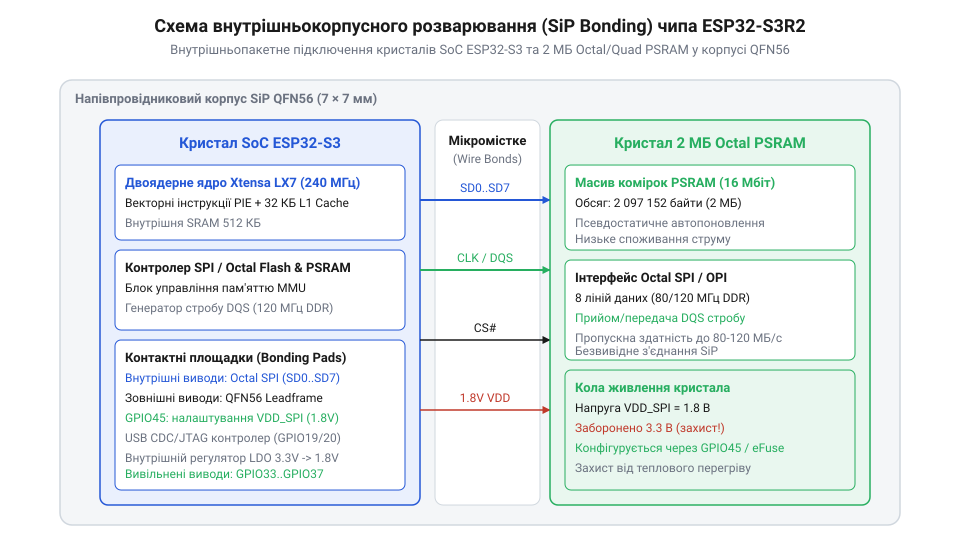
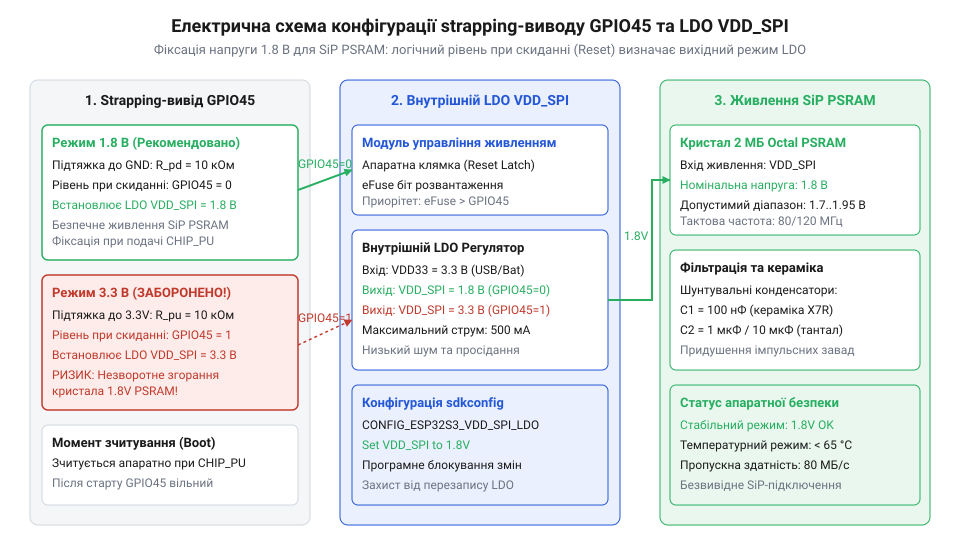
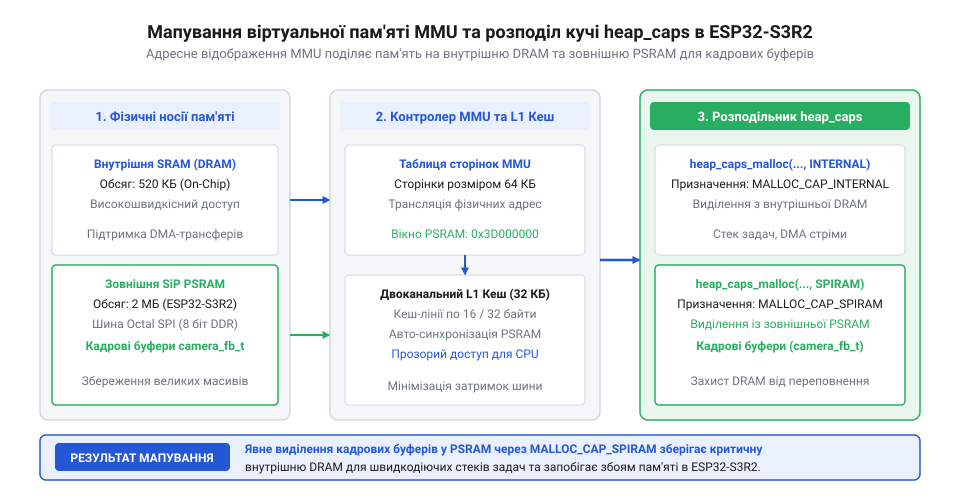

# Waveshare ESP32-S3R2 (16 МБ Flash, 2 МБ PSRAM)

<preknowlist>
- [Мікроконтролер ESP32-S3](root:cat-hw-boards/esp32s3-microcontroller) — Базова архітектура двоядерного процесора Xtensa LX7, система кешування L1 та загальне влаштування периферійних шин SoC ESP32-S3
- [Родина плат і модулів на ESP32-S3](root:cat-hw-boards/esp32-s3-boards-family-overview) — Загальний огляд лінійки модулів ESP32-S3, різновиди корпусів та принципи розпіновки плат Waveshare
- [Waveshare ESP32-S3-Pico](root:cat-hw-boards/esp32-s3-pico) — Форм-фактор та базове схемотехнічне розведення мініатюрних плат Waveshare серії Pico/Zero
</preknowlist>

## SiP-компонування та подолання обмежень SRAM

Розробка складних пристроїв для обробки відео чи роботи з нейромережами на базі [мікроконтролера ESP32-S3](root:cat-hw-boards/esp32s3-microcontroller) швидко вичерпує внутрішній масив статичної оперативної пам'яті `@@en|SRAM@@` (від англ. @@en|Static Random-Access Memory@@ — статична оперативна пам'ять; `@@en|SRAM@@`) обсягом 512 КБ. Спроба встановити зовнішню мікросхему псевдостатичної пам'яті `@@en|PSRAM@@` (від англ. @@en|Pseudo-Static RAM@@ — псевдостатична оперативна пам'ять; `@@en|PSRAM@@`) на друковану плату вимагає від 6 до 10 виводів `@@en|GPIO@@` (від англ. @@en|General Purpose Input/Output@@ — виводи вводу-виводу загального призначення; `@@en|GPIO@@`), що виснажує периферійний ресурс пристроїв на кшталт [плати Waveshare ESP32-S3-Pico](root:cat-hw-boards/esp32-s3-pico). Довгі мідні провідники також викликають фазове дрижання (англ. @@en|jitter@@ — дрижання) сигналів на високих частотах через паразитну ємність та індуктивність ліній.

Рішенням цієї проблеми в чипі ESP32-S3R2 стала безкорпусна SiP-інтеграція (від англ. @@en|System-in-Package@@ — система в корпусі; `@@en|SiP@@`), де кристал розробки та 2 МБ `@@en|PSRAM@@` об'єднано всередині єдиного корпусу QFN-56.

*_Внутрішньокорпусне герметичне з'єднання кристалів SoC та PSRAM у корпусі QFN-56._*

Внутрішньокорпусне розварювання золотих дротів діаметром 18–25 мкм скорочує довжину з'єднань до 1–2 мм, мінімізуючи паразитні затримки та звільняючи зовнішні виводи для підключення периферії.

## Живлення VDD_SPI та захист GPIO45

Використання високошвидкісного кристала `@@en|PSRAM@@` у SiP-корпусі висуває суворі вимоги до напруги живлення. Вбудована пам'ять вимагає низьковольтного живлення 1.8 В по шині `VDD_SPI`, подача на яку стандартної напруги 3.3 В викликає електричний пробій та фатальний перегрів напівпровідникових структур.

Початкова напруга шини `VDD_SPI` задається внутрішнім LDO-регулятором (від англ. @@en|Low Dropout Regulator@@ — регулятор напруги з малим падінням; `@@en|LDO@@`), режим якого при старті визначається станом конфігураційного виводу `GPIO45`.

*_Схема підтяжки strapping-виводу GPIO45 та керування регулятором VDD_SPI._*

Якщо в момент скидання на `GPIO45` зафіксовано низький рівень 0 В, регулятор видає безпечні 1.8 В, а високий рівень 3.3 В перемикає LDO на видачу 3.3 В, руйнуючи пам'ять. Для захисту кристалів на лінію `GPIO45` обов'язково встановлюють зовнішній підтягувальний резистор до землі, або ж жорстко запікають конфігурацію 1.8 В у блоці електронних запобіжників `@@en|eFuse@@` (від англ. @@en|electrically blown fuse@@ — одноразовий електронний запобіжник; `@@en|eFuse@@`).

## Розподіл пам'яті та нативний USB

Наявність 2 МБ `@@en|PSRAM@@` вимагає явного керування оперативною пам'яттю у прошивці, оскільки стандартний виклик `malloc()` використовує виключно обмежену внутрішню оперативну пам'ять. Для виділення кадрових буферів зображення при роботі з модулями рівня [ESP32-CAM з камерою OV3640 (2 МП)](root:cat-hw-boards/esp32-cam-ov3640) застосовують системний алокатор `heap_caps_malloc()` з прапорцем `MALLOC_CAP_SPIRAM`.

*_Схема мапування віртуальної пам'яті MMU та розподілу купи heap_caps між DRAM та PSRAM._*

Плата Waveshare ESP32-S3R2 оснащена вбудованим USB-контролером, що мультиплексує інтерфейси `@@en|USB CDC@@` (від англ. @@en|Communications Device Class@@ — клас комунікаційних пристроїв шини USB; `@@en|USB CDC@@`) для виведення консолі та `@@en|USB JTAG@@` (від англ. @@en|Joint Test Action Group@@ — об'єднана робоча група з тестування; `@@en|USB JTAG@@`) для покрокового відлагодження через єдиний порт Type-C. Порівняно з платою [ESP32-CAM (OV2640 + microSD)](root:cat-hw-boards/esp32-cam), це усуває потребу в зовнішніх програматорах, а для запобігання затримкам відлагодження при високому навантаженні шини використовують асинхронні буфери FreeRTOS.
