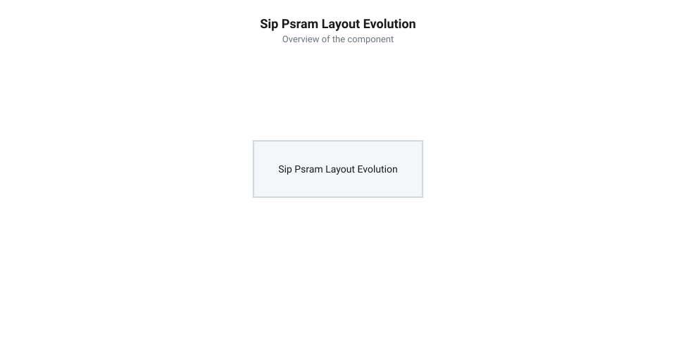
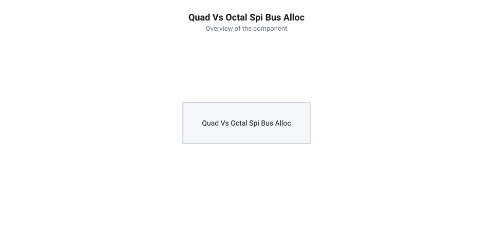

# Еволюція плат серії Waveshare ESP32-S3 та SiP-інтеграції пам'яті

<preknowlist>
- [Мікроконтролер ESP32-S3](root:cat-hw-boards/esp32s3-microcontroller) — архітектура ядра Xtensa LX7, внутрішні шини та підсистема пам'яті
- [Родина плат і модулів на ESP32-S3](root:cat-hw-boards/esp32-s3-boards-family-overview) — загальний огляд форматно-конструктивних рішень плат серії ESP32-S3
- [Waveshare ESP32-S3-Zero (Type-C, 4 МБ)](root:cat-hw-boards/esp32-s3-zero) — специфіка компактного конструктиву плат Waveshare у форматі Zero
</preknowlist>

## Криза площі й високі частоти

Розвиток портфоліо мікроконтролерів компанії @@en|Espressif Systems@@ на початку 2020-х років ознаменував новий етап вимог до обсягу пам'яті у вбудованих системах. З появою архітектури [мікроконтролера ESP32-S3](root:cat-hw-boards/esp32s3-microcontroller) інженери отримали векторне розширення інструкцій для обробки нейромереж та алгоритмів комп'ютерного зору, проте реалізація цих завдань вимагала мегабайтів швидкої оперативної пам'яті. На перших етапах проектування розробники адаптували випробуване схемотехнічне рішення: підключення зовнішньої мікросхеми PSRAM (від англ. @@en|Pseudo Static Random Access Memory@@ — псевдостатична оперативна пам'ять) у дискретному корпусі SOP-8 (від англ. @@en|Small Outline Package@@ — малий контурний корпус) або WSON-8 (від англ. @@en|Very Very Thin Small Outline No-Lead Package@@ — дуже тонкий безвивідний корпус) через послідовну шину SPI (від англ. @@en|Serial Peripheral Interface@@ — послідовний периферійний інтерфейс). Такий підхід добре зарекомендував себе у [модулях серії ESP32-CAM](root:cat-hw-boards/esp32-cam), проте для нових компактних відлагоджувальних плат він створив важкорозв'язну інженерну кризу.

Головним обмеженням виявилася площа друкованого монтажу на компактних платах. Компанія @@en|Waveshare@@ прагнула створити модулі з габаритами, що не перевищують розмір монети чи стандартної флеш-карти, де кожен квадратний міліметр поверхні був на вагу золота. Розміщення окремої мікросхеми PSRAM разом із кристалом Flash-пам'яті, пасивним обв'язуванням та роз'ємом USB Type-C змушувало інженерів зменшувати ширину друкованих провідників і використовувати багатошарові плати зі складними перехідними отворами. При використанні класичних двошарових плат технологічні норми (ширина провідника й зазору `0.15–0.20 мм`, діаметр отвору `0.3 мм`) обмежують граничну щільність монтажу на рівні `15–20 компонентів/см²`. Для плати формату Waveshare ESP32-S3-Zero площею всього `3.24 см²` (18 × 18 мм) це давало максимум `50–65 компонентів`:

    N_max = S_pcb × D_max
    = 3.24 см² × 18 компонентів/см²  [розрахунок для 2-шарової плати]
    ≈ 58 компонентів                 [гранична місткість]

Водночас повноцінна схема з дискретним МК, чипами Flash, PSRAM у корпусі SOP-8, роз'ємом USB Type-C, лінійним регулятором напруги та обв'язкою вимагала щонайменше 75–80 елементів. Перехід на чотиришарові плати за технологією HDI (від англ. @@en|High Density Interconnect@@ — з'єднання високої щільності) із зазорами `0.10 мм` та технологією via-in-pad (від англ. @@en|via-in-pad@@ — перехідний отвір у контактному майданчику) підвищує граничну щільність до `40–50 компонентів/см²` (до `145–160 компонентів` на плату), проте це призводить до трикратного здорожчання виробництва сирої плати.

Другою критичною проблемою стали високочастотні завади та паразитна індуктивність ліній зв'язку. Шина Quad SPI (від англ. @@en|Quad Serial Peripheral Interface@@ — чотирибітовий послідовний периферійний інтерфейс), що працює на частоті 80 МГц, має період тактового сигналу всього 12.5 нс, де тривалість активного напівперіоду становить 6.25 нс. За таких частот швидкість поширення сигналу в текстоліті FR-4 дорівнює близько 150 мм/нс (приблизно 6.6 пс/мм), тому навіть незначна різниця в довжині трас створює часовий перекіс сигналів (від англ. @@en|clock skew@@ — затримка тактового сигналу). Для забезпечення стабільних часових інтервалів утримування даних (від англ. @@en|hold time@@ — час утримування) припустиме відхилення довжини провідників між лініями тактування та даних не повинно перевищувати 5 мм, що відповідає часовому розсинхрону менше 33 пс. Довгі зовнішні траси між мікроконтролером і дискретним чипом PSRAM діяли як мініатюрні антени, випромінюючи електромагнітні завади та спричиняючи збої під час зчитування кадрів високої роздільної здатності. Збільшення кількості зовнішніх провідників також відбирало цінні периферійні виводи GPIO (від англ. @@en|General Purpose Input/Output@@ — виводи загального призначення), унеможливлюючи створення надкомпактних рішень.

## Перехід до SiP та кристал R2

Розв'язанням кризи стало використання технології SiP (від англ. @@en|System-in-Package@@ — система в корпусі), де кристал мікроконтролера та кристал пам'яті пакуються в єдиний корпус QFN-56 (від англ. @@en|Quad Flat No-leads@@ — плоский корпус без виводів). У ревізії кристала ESP32-S3R2 інженери @@en|Espressif Systems@@ інтегрували всередину корпусу чип 2 МБ Quad SPI PSRAM, який з'єднується з ядром безпосередньо через внутрішній мікроскопічний безкорпусний монтаж (від англ. @@en|wire bonding@@ — розварювання виводів дротом). Весь кристал залито монолітним термостійким епоксидним формувальним компаундом @@en|EMC@@ (від англ. @@en|Epoxy Molding Compound@@), чий коефіцієнт теплового розширення узгоджено із силіцієм для запобігання мікротріщинам при температурних циклах від -40 °C до +125 °C, а відкрита нижня площадка забезпечує ефективне відведення тепла. Це дозволило [родині плат на ESP32-S3](root:cat-hw-boards/esp32-s3-boards-family-overview) повністю позбутися зовнішніх трас шини пам'яті на друкованій платі.

Інженери @@en|Waveshare@@ одними з перших оцінили переваги нового SiP-компонування під час розробки платформи [Waveshare ESP32-S3-Zero](root:cat-hw-boards/esp32-s3-zero). Завдяки відсутності дискретного чипа пам'яті розробникам вдалося скорочити площу плати майже вдвічі, зберігши повноцінну периферію та розмістивши компоненти з високою щільністю. Довжина ліній між ядрами Xtensa LX7 і внутрішньою PSRAM скоротилася до часток міліметра, що практично нівелювало паразитну індуктивність й електромагнітний вплив на сусідні аналогові кола.

*Порівняння конструкції з дискретною зовнішньою пам'яттю та SiP-інтеграцією R2: внутрішньокорпусне пакування усуває довгі траси шини SPI та вивільняє площу плати.*

Інтеграція кристала R2 також суттєво спростила трасування друкованих плат, дозволивши використовувати дешевші двошарові текстолітові підкладки без втрати цілісності сигналів (від англ. *@@en|signal integrity@@* — цілісність сигналу). Вивільнені зовнішні лінії @@en|GPIO@@ (від англ. *@@en|General-Purpose Input/Output@@* — входи-виходи загального призначення), які у конфігураціях із зовнішніми мікросхемами пам'яті були жорстко задієні під шину вибірки й даних, отримали можливість розведення на контактні площадки. Зокрема, на платах формату [Waveshare ESP32-S3-Zero](root:cat-hw-boards/esp32-s3-zero) це дозволило вивести для користувача додаткові контактні виводи `GPIO33`, `GPIO34`, `GPIO35`, `GPIO36`, `GPIO37` та `GPIO38`, розширивши доступні ресурси підключення периферії. Це забезпечило розробникам можливість підключати додаткові сенсори й дисплеї на платах надкомпактного формату, таких як [ESP32-S3 SuperMini](root:cat-hw-boards/esp32-s3-supermini).

## Вибір між Quad та Octal SPI

Паралельно з впровадженням Quad SPI у SiP-версії мікроконтролера ESP32-S3, розробники компанії @@en|Waveshare@@ зіштовхнулися з потребою створення більш потужних відлагоджувальних плат для графічних інтерфейсів та обробки потокового відео. Для таких завдань пропускна здатність 4-бітної шини виявлялася вузьким місцем, що змусило інженерів звернутися до технології Octal SPI (від англ. @@en|Octal Serial Peripheral Interface@@ — восьмибітовий послідовний периферійний інтерфейс). Використання 8-бітної шини дозволило подвоїти швидкість обміну даними з зовнішньою PSRAM за один тактовий імпульс.

Однак розширення шини пам'яті до 8 біт вимагало значних схемотехнічних жертв. Для передачі даних Octal SPI задіює 8 ліній даних (D0–D7), тактовий сигнал, вибірку чипа та стробувальний сигнал DQS (від англ. @@en|Data Strobe Signal@@ — сигнал стробування даних). У результаті підсистема пам'яті заблокувала 4 додаткові лінії GPIO, які у версії Quad SPI залишалися доступними для розробника. На платах компактного формату, таких як [Waveshare ESP32-S3-Pico](root:cat-hw-boards/esp32-s3-pico), це суттєво обмежило кількість зовнішніх контактів для підключення периферії. Крім втрати виводів, апаратна реалізація вимагає суворого узгодження таймінгів: на частоті 80 МГц контролер шини реалізує фазовий зсув стробування @@en|DQS@@ на 90 градусів (приблизно 3.125 наносекунди) відносно тактового сигналу, що центрує фронт зчитування всередині вікна дійсності даних і запобігає збоям зчитування при вибірці.

*Розподіл виводів GPIO між шинами пам'яті: 8-бітна Octal SPI забезпечує подвійну пропускну здатність ціною блокування чотирьох додаткових периферійних контактів.*

Інженерам довелося шукати баланс між пропускною здатністю пам'яті та кількістю периферійних інтерфейсів. На тактовій частоті 80 МГц чотирибітна шина @@en|Quad SPI@@ у режимі single data rate (SDR) передає 4 біти за такт, що визначає теоретичну пікову пропускну здатність `80 × 4 ÷ 8 = 40` МБ/с. Натомість восьмибітна шина @@en|Octal SPI@@ у режимі double data rate (DDR) передає дані по обох фронтах тактового сигналу, що за 8 розрядів дає 2 байти за такт і формує пікову пропускну здатність `80 × 8 × 2 ÷ 8 = 160` МБ/с — у чотири рази вище за Quad SPI. У результаті [родина плат на ESP32-S3](root:cat-hw-boards/esp32-s3-boards-family-overview) від @@en|Waveshare@@ розділилася на дві гілки: надкомпактні модулі із 4-бітною SiP-пам'яттю Quad SPI (пропускна здатність до 40 МБ/с) для вбудованих сенсорних вузлів та повнорозмірні плати з 8-бітною зовнішньою пам'яттю Octal SPI (пропускна здатність до 160 МБ/с) для графічних терміналів.

## Спростування міфів та обмеження ревізій

Масовий перехід на SiP-компонування у платах Waveshare ESP32-S3 породив декілька поширених інженерних міфів серед розробників. Першим хибним твердженням стала думка про нібито критичне теплове саморозігрівання кристалів усередині єдиного SiP-корпусу. Скептики стверджували, що одночасна робота двоядерного процесора Xtensa LX7 на частоті 240 МГц та кристала PSRAM призводить до тротлінгу (від англ. @@en|thermal throttling@@ — температурне зниження частоти). Проте реальні тепловізиційні вимірювання довели, що розсіювана потужність вбудованого кристала PSRAM не перевищує десятків міліватів, а тепловий опір корпусу QFN-56 є цілком достатнім для пасивного охолодження через заземлювальний майданчик (від англ. @@en|thermal pad@@ — теплопровідний контакт).

Другим поширеним міфом стала уявна повна взаємозамінність різних ревізій ESP32-S3 на друкованій платі. Розробники нерідко вважали, що плату, спроектовану під ревізію R2 (з вбудованою 2 МБ Quad SPI PSRAM), можна беззмінно перевести на чип R8 (з 8 МБ Octal SPI PSRAM). Насправді внутрішня розводка виводів у SiP-корпусі R2 жорстко задіює лінії GPIO35, GPIO36 та GPIO37 для внутрішнього зв'язку з кристалом пам'яті, роблячи їх недоступними для зовнішньої розводки. Перелічені виводи змінюють своє безпосереднє призначення при зміні ревізії кристала:

| Вивід GPIO | Функціонал у ревізії R2 (2 МБ Quad SPI) | Функціонал у ревізії R8 (8 МБ Octal SPI) |
| :--- | :--- | :--- |
| `GPIO35` | Внутрішня вибірка чипа `PSRAM_CS` | Зовнішня лінія даних `OCTAL_D4` |
| `GPIO36` | Внутрішнє тактування `PSRAM_CLK` | Зовнішня лінія даних `OCTAL_D5` |
| `GPIO37` | Внутрішній захист запису `PSRAM_WP` | Зовнішній сигнал стробування `OCTAL_DQS` |

Спроба встановити кристал іншої ревізії без зміни трасування друкованої плати призводить до короткого замикання або неможливості ініціалізації підсистеми пам'яті в середовищі @@en|ESP-IDF@@.

Третім обмеженням виявився фіксований обсяг у 2 МБ внутрішньої PSRAM у ревізії R2, який неможливо розширити без зміни топології плати. Для складних задач обробки високодеталізованого відео на платах на кшталт [ESP32-CAM з камерою OV3640](root:cat-hw-boards/esp32-cam-ov3640) цього обсягу буває недостатньо, що змушує повертатися до дискретних модулів. Розуміння цих фізичних та архітектурних меж дозволяє розробникам правильно добирати ревізії плат @@en|Waveshare@@ і не припускатися помилок при розробці власної схемотехніки.
