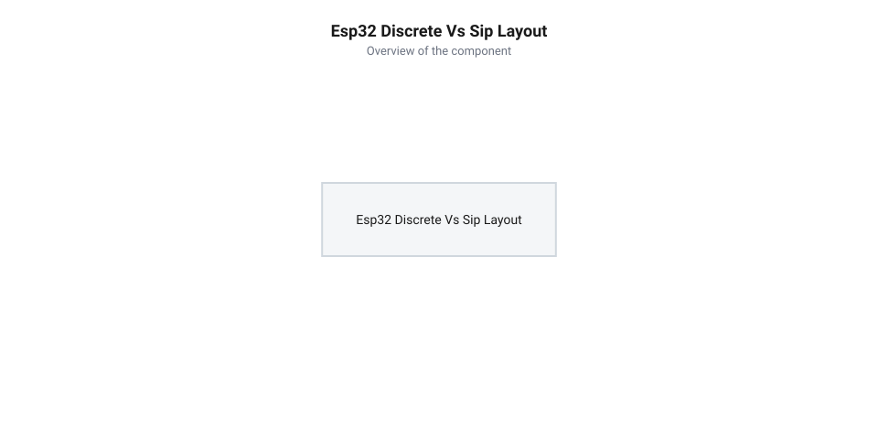
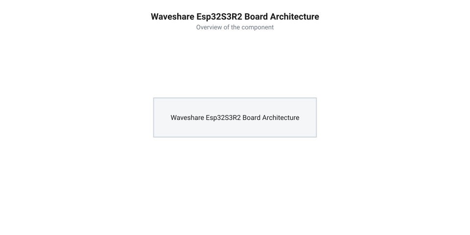

# Еволюція плат серії Waveshare ESP32-S3 та перехід до SiP-компонування пам'яті

<preknowlist>
- [Мікроконтролер ESP32-S3](root:cat-hw-boards/esp32s3-microcontroller) — розуміння архітектури ядра ESP32-S3 та системи внутрішніх шин
- [Родина плат і модулів на ESP32-S3](root:cat-hw-boards/esp32-s3-boards-family-overview) — загальне уявлення про різноманітність конфігурацій Flash/PSRAM у серії ESP32-S3
- [Waveshare ESP32-S3-Pico](root:cat-hw-boards/esp32-s3-pico) — знайомство з лінійкою розробницьких плат Waveshare та їхнім формфактором
</preknowlist>

## Проблема дискретної PSRAM у перших ESP32

Перше покоління мікроконтролерів серії @@en|ESP32@@, випущене компанією Espressif Systems у 2016 році, містило 520 КБ внутрішньої оперативної пам'яті @@en|SRAM@@ (від англ. @@en|Static RAM@@ — статична оперативна пам'ять). Цього обсягу вистачало для базових завдань стека @@en|Wi-Fi@@ та @@en|Bluetooth@@, проте швидкий розвиток вбудованих систем висунув нові вимоги. Обробка графічних інтерфейсів, буферизація відеопотоків у [модулях серії ESP32-CAM](root:cat-hw-boards/esp32-cam) та локальне виконання алгоритмів штучного інтелекту вимагали мегабайтів оперативної пам'яті.

Щоб подолати цей дефіцит, розробники апаратного забезпечення почали встановлювати на друковані плати додаткові мікросхеми зовнішньої оперативної пам'яті @@en|PSRAM@@ (від англ. @@en|Pseudo Static RAM@@ — псевдостатична оперативна пам'ять, де *pseudo* з грец. *ψευδής* — несправжній, бо імітує статичну пам'ять на базі динамічного ядра). Окремий корпус пам'яті підключався до мікроконтролера через послідовну шину @@en|SPI@@ (від англ. @@en|Serial Peripheral Interface@@ — послідовний периферійний інтерфейс, від лат. *serialis* — послідовний) або чотирипровідний інтерфейс @@en|Quad SPI@@.

Проте дискретне монтажне рішення створило критичні апаратні обмеження. По-перше, для підключення 4-бітної шини @@en|Quad SPI@@ потрібно було виділити 6 окремих виводів @@en|GPIO@@ (від англ. @@en|General Purpose Input/Output@@ — вхід/вихід загального призначення), а для 8-бітної шини @@en|Octal SPI@@ — 10-12 виводів. У компактних корпусах це позбавляло інженерів більшості зовнішніх контактів для підключення сенсорів та периферії. По-друге, високочастотні сигнали шини (40-80 МГц), які проходили через довгі мідні траси друкованої плати @@en|PCB@@ (від англ. @@en|Printed Circuit Board@@ — друкована плата), зазнавали впливу паразитної індуктивності та ємності. Неоднакова довжина паралельних провідників викликала часовий зсув фронтів (від англ. @@en|skew@@ — розсинхронізація сигнальних ліній) між тактовим сигналом `CLK` та лініями даних, оскільки затримка поширення імпульсу в текстоліті FR-4 становить близько 150 пс/см. Фізичною причиною цієї деградації є електричні параметри мікросмужкових ліній: типова траса шириною 0.2 мм має власну індуктивність `L_trace ≈ 7` нГн/см та паразитну ємність `C_trace ≈ 1.2` пФ/см. Для дискретної траси довжиною 4 см сумарна ємність досягає близько `5` пФ, а індуктивність — понад `28` нГн, що утворює паразитне еквівалентне коло, яке затягує тривалість фронту наростання сигналу `t_r` до 2–3 нс. При тактовій частоті 80 МГц з періодом прямокутного імпульсу `12.5` нс це затягування займає понад 20% тривалості півперіоду, а через брак шарів для витримування хвильового опору 50 Ом виникали зворотні відбиття хвилі (@@en|signal reflections@@) та перехресні завади, що призводило до деградації цілісності сигналів та змушувало знижувати тактову частоту обміну.

*Порівняння конструктивних підходів: дискретне розташування мікросхеми оперативної пам'яті вимагає 6 додаткових трас GPIO та збільшує площу плати, тоді як SiP-компонування об'єднує кристали всередині єдиного корпусу.*

Крім того, розміщення окремих мікросхем @@en|SoC@@ (від англ. @@en|System on Chip@@ — система на чипі) та пам'яті суттєво збільшувало загальну площу плати. Це ставало перешкодою для розробки мініатюрних формфакторів, у які згодом еволюціонувала лінійка [платок Waveshare ESP32-S3-Pico](root:cat-hw-boards/esp32-s3-pico).

## Апаратний прорив SiP-архітектури ESP32-S3R2

Відповіддю на виклики дискретного монтажу став випуск у 2021 році нового кристала [мікроконтролера ESP32-S3](root:cat-hw-boards/esp32s3-microcontroller), у якому компанія Espressif Systems впровадила технологію @@en|SiP@@ (від англ. @@en|System-in-Package@@ — система в корпусі). У модифікації @@en|ESP32-S3R2@@ кристал 2 МБ пам'яті @@en|Quad SPI@@ @@en|PSRAM@@ було змонтовано безпосередньо всередині спільного корпусу @@en|QFN@@ над основним кристалом мікроконтролера за допомогою ультракоротких золотих провідників. Технологічний процес розварювання дротяних виводів (від англ. @@en|wire bonding@@ — мікрозварювання дротяних з'єднань) спирається на тривимірне розміщення кристалів та термокомпресійний механізм зварювання золотих або мідних мікропровідників діаметром 18–25 мкм: під дією одночасного нагріву до 150–200 °C, механічного тиску капіляра та ультразвукових коливань золота кулька формує міжатомний дифузійний зв'язок із алюмінієвими контактними площадочками кристала пам'яті та внутрішньою шиною мікроконтролера. Скорочення довжини з'єднань із сантиметрів друкованих трас до часток міліметра знизило паразитну індуктивність ліній з одиниць наногенрі до кількох пікогенрі, усунувши зворотні відбиття сигналів та дозволивши стабільно тактувати шину на частоті 80 МГц без ризику деградації даних.

Таке архітектурне рішення повністю змінило топологію розробницьких плат. Усі 6 сигнальних ліній шини пам'яті опинилися всередині корпусу чипа. Це повернуло в користувальницьке розпорядження виводи від `GPIO26` до `GPIO31`, що суттєво розширило можливості підключення зовнішніх пристроїв. Мінімальна довжина внутрішніх з'єднань повністю усунула паразитні наводки друкованої плати, забезпечивши стабільну роботу пам'яті на частоті 80 МГц.

Інженери компанії Waveshare скористалися цією перевагою для створення серії ультракомпактних плат, серед яких виділяється модель Waveshare ESP32-S3R2. Завдяки SiP-компонуванню вдалося поєднати 2 МБ вбудованої @@en|PSRAM@@ із зовнішньою мікросхемою 16 МБ флеш-пам'яті @@en|Flash@@ та нативним роз'ємом @@en|USB Type-C@@ у компактному корпусі, зберігши максимальну кількість вільних контактів для розробників.

*Структурна схема плати Waveshare ESP32-S3R2: поєднання SiP-мікроконтролера з інтегрованою 2 МБ PSRAM та зовнішньої 16 МБ Flash забезпечує максимальну кількість вільних виводів GPIO для компактних вбудованих систем.*

Перехід на SiP-архітектуру розвіяв поширені апаратні міфи. Застереження щодо нібито перегріву пам'яті через близьке розташування двох кристалів не справдилися: низьке енергоспоживання пам'яті та ефективне відведення тепла через контактну площадку корпусу чипа гарантують стабільну роботу в діапазоні від -40 °C до +85 °C. Твердження про «втрату гнучкості» спростовується тим, що для переважної більшості задач вбудованого бачення та обробки сигналів 2 МБ оперативної пам'яті є оптимальним балансом вартістю та продуктивністю, що підтверджує популярність плат формату [Waveshare ESP32-S3-Zero](root:cat-hw-boards/esp32-s3-zero) та [ESP32-S3 SuperMini](root:cat-hw-boards/esp32-s3-supermini).

## Створення ультракомпактної плати Waveshare ESP32-S3R2

Вихід на ринок кристала @@en|ESP32-S3R2@@ з інтегрованою псевдостатичною оперативною пам'яттю дозволив розробникам апаратури кардинально переглянути щільність компонування розробницьких плат. У 2022 році інженери компанії @@en|Waveshare@@ скористалися перевагами SiP-архітектури для створення серії ультракомпактних модулів. Завдяки тому, що 2 МБ пам'яті @@en|PSRAM@@ розмістилися всередині корпусу мікроконтролера, на друкованій платі звільнилося місце під зовнішню енергонезалежну пам'ять @@en|Flash@@ мікросхеми Winbond ємністю 16 МБ (128 Мбіт), що працює через чотирибітну шину @@en|Quad SPI@@.

*Підпис: Схема архітектурного компонування плати Waveshare ESP32-S3R2 з 16 МБ Flash та нативним USB Type-C.*

Конструктивним досягненням платформи Waveshare ESP32-S3R2 стала розводка 27 фізичних виводів @@en|GPIO@@ на крайові зубчасті контакти (англ. @@en|castellated holes@@ — крайній зубчастий монтаж). Відсутність зовнішніх трас шини RAM дозволила вивести нативні інтерфейси @@en|USB Serial/JTAG@@ до роз'єму @@en|USB Type-C@@ без використання громіздких проміжних конвертерів UART-USB. Схема підключення роз'єму задіює виводи `GPIO19` (лінія `D-`) та `GPIO20` (лінія `D+`), які апаратно комутуються внутрішнім перемикачем фізичного рівня @@en|PHY@@ (англ. @@en|PHY@@ від @@en|Physical Layer@@ — фізичний рівень). При старті чипа первинний завантажувач ROM автоматично підключає ці лінії до внутрішнього контролера @@en|CDC@@ (англ. @@en|CDC@@ від @@en|Communications Device Class@@ — клас комунікаційних пристроїв) та відлагоджувача @@en|JTAG@@. Проте, якщо користувацька програма перевизначає `GPIO19` та `GPIO20` під звичайний цифровий вхід/вихід або зовнішню периферійну шину, фізичний зв'язок з USB-портом комп'ютера миттєво переривається. Для запобігання блокуванню прошивки апаратний механізм системного перемикача PHY реагує на стан конфігураційної ніжки `GPIO0`: затискання кнопки `BOOT` (підтяжка `GPIO0` до землі) у момент зняття сигналу скидання змушує ROM-завантажувач ігнорувати налаштування матриці GPIO та примусово комутувати трансивер PHY напряму на виводи `GPIO19` і `GPIO20`. Апаратна схема при цьому на коротку мить вимикає та знову вмикає внутрішню резистивну підтяжку @@en|pull-up@@ (англ. @@en|pull-up@@ — підтяжка до напруги живлення) на лінії `D+`, що ініціює повторне розпізнавання пристрою @@en|re-enumeration@@ (англ. @@en|re-enumeration@@ — повторна ініціалізація шини USB) у системі комп'ютера як завантажувального вузла. Порівняно з іншими рішеннями [родини плат і модулів на ESP32-S3](root:cat-hw-boards/esp32-s3-boards-family-overview) або компактною платою [ESP32-S3 SuperMini](root:cat-hw-boards/esp32-s3-supermini), таке гнучке інженерне рішення від Waveshare забезпечило максимальний обсяг флешпам'яті для збереження моделей машинного навчання та графічних ресурсів при габаритах платформи всього 23.5 × 18 мм.

## Розвінчання міфів та обмеження SiP-пам'яті

Поява систем у корпусі @@en|SiP@@ (від англ. @@en|System-in-Package@@ — система в корпусі) викликала гарячі дискусії серед розробників вбудованого апаратного забезпечення. Основним технічним застереженням було припущення про погіршення теплового режиму: стверджувалось, що тепловиділення двох обчислювальних ядер @@en|Xtensa LX7@@ під навантаженням спричинить паразитний нагрів сусіднього кристала оперативної пам'яті. Фізична небезпека нагріву полягає у прискоренні витоку електричного заряду з конденсаторів осередків @@en|DRAM@@ (від англ. @@en|dynamic RAM@@ — динамічна оперативна пам'ять), що скорочує часовий інтервал збереження інформації та вимагає частішого авторегенераційного тактування. При перевищенні критичної температури прискорений витік заряду загрожує втратою даних до завершення циклу оновлення. Проте теплові виміри довели, що власне споживання псевдостатичної пам'яті @@en|PSRAM@@ (від англ. @@en|pseudo-static RAM@@ — псевдостатична оперативна пам'ять) у режимі @@en|Quad SPI@@ не перевищує 30 мВт, а спільний підкладковий тепловізнімач корпусу @@en|QFN-56@@ (від англ. @@en|quad flat no-leads@@ — плоский корпус без виводів) ефективно розсіює тепло через заземлені перехідні отвори друкованої плати, утримуючи робочу температуру в межах 85 °C без деградації інтервалу регенерації комірок.

Іншим спростованим міфом стала теза про «втрату гнучкості» SiP-компонування. Хоча фіксований обсяг 2 МБ вбудованої PSRAM дійсно не можна розширити, він є оптимальним компромісом для більшості задач обробки аудіосигналів, кадрових буферів дисплеїв та алгоритмів розпізнавання облич. Для складніших завдань глибоких нейромереж або обробки відеопотоків високої роздільності, якими вирізняється [модуль ESP32-CAM: огляд архітектури, периферії та сімейства плат](root:cat-hw-boards/esp32-cam-camera-module-family), Espressif випускає окремі модифікації чипів з 8 МБ Octal SPI PSRAM. Водночас для автономних пристроїв та мініатюрних контролерів серії [Waveshare ESP32-S3-Pico](root:cat-hw-boards/esp32-s3-pico) саме SiP-компонування ESP32-S3R2 забезпечує оптимальний баланс продуктивності, енергоефективності та ціни.
