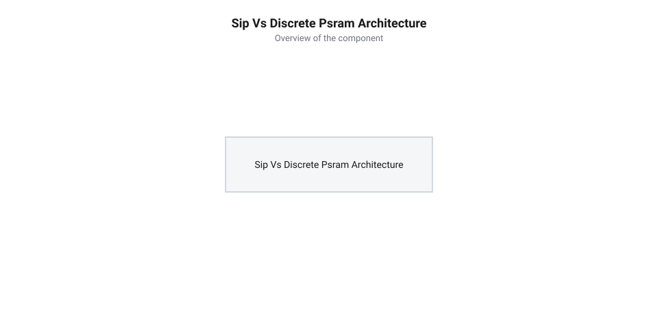

# Еволюція інтеграції пам'яті PSRAM від дискретних чипів WROVER до корпусу SiP у платах ESP32-S3

<preknowlist>
- [Мікроконтролер ESP32-S3](root:cat-hw-boards/esp32s3-microcontroller) — архітектура двоядерного процесора, внутрішня пам'ять SRAM та периферійні контролери
- [Родина плат і модулів на ESP32-S3](root:cat-hw-boards/esp32-s3-boards-family-overview) — різноманітність виконань плат розробки та сфер їх застосування
</preknowlist>

## Обмеження SRAM та перші дискретні WROVER

Поява у 2016 році мікроконтролера ESP32 зробила революцію у сфері бездротових пристроїв, проте перші розробники швидко зіштовхнулися з жорсткою стелею продуктивності. Вбудованої оперативної пам'яті @@en|SRAM@@ (англ. *Static Random-Access Memory* — статична оперативна пам'ять) обсягом 520 КБ цілком вистачало для базових протоколів передачі даних чи опитування датчиків, але запуск складної обробки зображень чи буферизації відеопотоків спричиняв негайне вичерпання ресурсів. Виробництво великих обсягів @@en|SRAM@@ безпосередньо на одному напівпровідниковому кристалі з процесорними ядрами істотно здорожчувало чип і збільшувало його фізичні розміри.

Щоб розв'язати проблему дефіциту пам'яті без кардинальної зміни кристала мікроконтролера, інженери Espressif створили сімейство модулів @@en|ESP32-WROVER@@. На спільній підкладці модуля поруч із чипом ESP32 встановили окрему мікросхему псевдостатичної пам'яті @@en|PSRAM@@ (англ. *Pseudo Static RAM* — псевдостатична оперативна пам'ять) ємністю 4 МБ. Підключення здійснювалося через чотирипотоковий послідовний інтерфейс @@en|Quad SPI@@ (англ. *Quad Serial Peripheral Interface* — чотирипотоковий послідовний периферійний інтерфейс). Це дало змогу розгортати повноцінні мережеві стеки та утримувати в пам'яті неспідснуті кадрові буфери, що стало основою для перших популярних мультимедійних платформ, таких як [модуль ESP32-CAM](root:cat-hw-boards/esp32-cam).

Апаратна реалізація псевдостатичної пам'яті поєднувала низьку вартість матриці комірок динамічної пам'яті @@en|DRAM@@ із простим інтерфейсом керування, оскільки вбудована схема самовідновлення заряду (англ. @@en|self-refresh circuit@@, від англ. @@en|refresh@@ — оновлювати) приховувала регенерацію конденсаторів від зовнішнього контролера. Комірки пам'яті PSRAM побудовані за однотранзисторною топологією з запасальним конденсатором (1T1C), чий електричний заряд природно розсіюється протягом кількох мікросекунд. Внутрішній апаратний таймер кристала PSRAM автоматично ініціює приховані цикли перезарядки комірок між зовнішніми операціями зчитання та запису: у разі конфлікту зовнішнього звернення із внутрішнім тактом регенерації арбітр затримує шину на кілька наносекунд, завдяки чому зовнішній мікроконтролер сприймає масив як енергозалежну статичну пам'ять. Апаратний блок картування пам'яті @@en|MMU@@ (англ. @@en|Memory Management Unit@@ — блок керування пам'яттю) мікроконтролера ESP32 відображав 4 МБ зовнішньої шини @@en|Quad SPI@@ у віртуальний адресний простір процесора, що дозволило програмному забезпеченню виділяти динамічну пам'ять під великі масиви даних через стандартні виклики системної кучі. Це стало першим успішним кроком у створенні бюджетних IoT-пристроїв із підтримкою обробки зображень, проте розміщення двох окремих мікросхем на одній підкладці викрило серйозні апаратні компроміси, які зумовили подальший пошук досконаліших системних рішень.

## Проблеми зовнішньої шини та дефіцит виводів

Незважаючи на успіх модулів WROVER, розміщення @@en|PSRAM@@ у вигляді окремого корпусного компонента на друкованій платі створило низку важких схемотехнічних компромісів. Головною проблемою став хронічний дефіцит контактів @@en|GPIO@@ (англ. *General-Purpose Input/Output* — виводи загального призначення). Для підключення зовнішньої мікросхеми пам'яті по шині @@en|Quad SPI@@ доводилося віддавати 6 фізичних ліній (виводи тактування, вибору мікросхеми та 4 лінії даних), через що розробники втрачали повноцінний доступ до `GPIO16` та `GPIO17`, які раніше використовувалися для апаратних послідовних портів чи шин керування периферією.

Другим критичним недоліком зовнішньої шини були фізичні обмеження трасування на друкованій платі @@en|PCB@@ (англ. *Printed Circuit Board* — друкована плата). Довгі мідні провідники між чипом мікроконтролера та мікросхемою пам'яті володіли власною паразитною ємністю та індуктивністю. На тактових частотах понад 40 МГц це призводило до викривлення фронтів імпульсів, виникнення високочастотних електромагнітних завад @@en|EMI@@ (англ. *Electromagnetic Interference* — електромагнітні завади) та наведень на сусідні чутливі аналогові кола. Подальше підвищення швидкості обміну даними у дискретній топології стало технічно неможливим без погіршення завадостійкості всієї системи.

## Прорив SiP та архітектура ESP32-S3

Вирішенням накопичених проблем дискретної топології став перехід до тривимірної корпусної упаковки @@en|SiP@@ (англ. *System-in-Package* — система в корпусі), втілений у мікроконтролерах серії @@en|ESP32-S3@@. Замість розміщення двох окремих корпусів на платі модуля, кристал оперативної пам'яті @@en|PSRAM@@ розмістили безпосередньо всередині єдиного кремнієвого корпусу мікроконтролера поруч із двоядерним процесором. З'єднання між кристалами виконано за допомогою мікроскопічних внутрішніх провідників довжиною у частки міліметра.

*Порівняльна схема еволюції підключення PSRAM: від зовнішньої дискретної мікросхеми QSPI на друкованій платі WROVER до внутрішнього міжкристального з'єднання SiP Octal SPI в корпусі ESP32-S3.*

Внутрішньокорпусне інтегрування повністю вивільнило зовнішні виводи @@en|GPIO@@ для користувацької периферії та звело паразитрану ємність шини практично до нуля. Це дозволило впровадити високошвидкісний 8-бітний інтерфейс @@en|Octal SPI@@ із підтримкою технології @@en|DDR@@ (англ. *Double Data Rate* — подвійна швидкість передачі даних), де передача здійснюється за обома фронтами тактового сигналу. Завдяки цьому у модифікаціях @@en|ESP32-S3R2@@ (2 МБ пам'яті) та @@en|ESP32-S3R8@@ (8 МБ пам'яті) пропускна здатність оперативної пам'яті зросла до 80–160 МБ/с, що відкрило можливість обробляти високодеталізоване відео та запускати локальні нейромережі на [мікроконтролерах серії ESP32-S3](root:cat-hw-boards/esp32s3-microcontroller).

## Мікроплати Waveshare та маркування модифікацій

Технологія @@en|SiP@@ змінила підхід до конструювання системних плат. Усунення зовнішньої мікросхеми пам'яті та її провідників дало змогу інженерам компанії @@en|Waveshare@@ розробити надкомпактні відлагоджувальні модулі, які за обчислювальною потужністю не поступаються повнорозмірним платам DevKit. Яскравими прикладами такої мініатюризації є [плати Waveshare ESP32-S3-Pico](root:cat-hw-boards/esp32-s3-pico) та мікроскопічний [модуль ESP32-S3-Zero](root:cat-hw-boards/esp32-s3-zero), де на мінімальній площі розміщено повноцінний двоядерний процесор із розширеною оперативною пам'яттю.

Для точного вибору необхідного чипа розробники орієнтуються на буквено-цифрові суфікси у маркуванні серії @@en|ESP32-S3@@:
- `N4`, `N8`, `N16` визначають обсяг вбудованої енергонезалежної пам'яті @@en|Flash@@ (4 МБ, 8 МБ чи 16 МБ відповідно);
- `R2` вказує на наявність вбудованої пам'яті @@en|PSRAM@@ обсягом 2 МБ;
- `R8` або `R8V` означає наявність високошвидкісної 8-бітної пам'яті @@en|Octal SPI PSRAM@@ обсягом 8 МБ.

При проєктуванні апаратури слід враховувати, що чипи з 8-бітною пам'яттю `Octal PSRAM` внутрішньо задіюють лінії `GPIO33`–`GPIO37` для швидкісного зв'язку між кристалами. З цієї причини дані виводи не виводяться на зовнішні контакти плати або жорстко заблоковані для периферії. Докладніші рекомендації щодо побудови готових пристроїв висвітлено в огляді [родини плат ESP32-S3](root:cat-hw-boards/esp32-s3-boards-family-overview).
