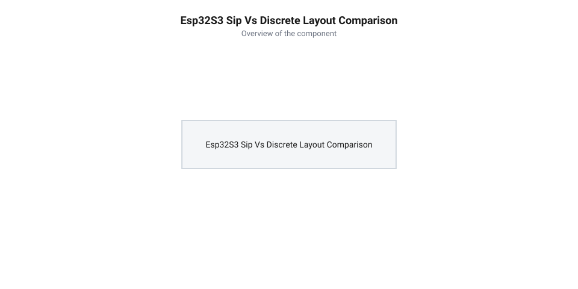

# Еволюція формфакторів плат ESP32-S3 та поява SiP-модулів з інтегрованою PSRAM

<preknowlist>
- [Мікроконтролер ESP32-S3](root:cat-hw-boards/esp32s3-microcontroller) — розуміння архітектури чипа ESP32-S3, ядра Xtensa LX7 та характеристик системної пам'яті
- [Родина плат і модулів на ESP32-S3](root:cat-hw-boards/esp32-s3-boards-family-overview) — загальний огляд сімейства модулів WROOM, MINI та системних формфакторів
</preknowlist>

## Обмеження дискретної PSRAM у модулях ESP32

При розробці складних пристроїв на базі [мікроконтролера ESP32-S3](root:cat-hw-boards/esp32s3-microcontroller) розробники стикаються з потребою в додатковій оперативній пам'яті для обробки зображень чи аудіобоферів. У перших поколіннях модулів серії @@en|WROVER@@ розширення пам'яті реалізовували шляхом установки окремої дискретної мікросхеми псевдостатичної оперативної пам'яті @@en|PSRAM@@ (від англ. @@en|Pseudo-Static Random-Access Memory@@ — псевдостатична оперативна пам'ять) поруч із головним кристалом на спільній підкладці модуля. Для обміну даними між чипами розводили зовнішню 4-бітну шину @@en|Quad SPI@@ (від англ. @@en|Quad Serial Peripheral Interface@@ — чотирипровідний послідовний периферійний інтерфейс). При довжині друкованих трас шини `l₁ = 15` мм затримка розповсюдження сигналу `t_pd = l × √ε_eff ÷ c` у матеріалі плати FR-4 з ефективною діелектричною проникністю `ε_eff ≈ 3.4` становить близько 92 пікосекунд (`t_pd ≈ 92` пс). На частоті 80 МГц тактовий період дорівнює лише 12.5 нс, тому ця затримка у поєднанні з розкидом довжин ліній створює розсинхронізацію сигналів. Крім часового фазового зсуву, довгі траси викликають високочастотне згасання сигналів: розрахунок амплітудного послаблення гармоніки 80 МГц (з урахуванням діелектричних втрат `α ≈ 0.12` дБ/мм) показує, що на трасі `l₁ = 15` мм згасання досягає `A₁ = 1.8` дБ (втрата до 19% амплітуди напруги фронту імпульсу), що розмиває прямокутний фронт та звужує часове вікно `t_setup`. Зменшення довжини трас до `l₂ = 5` мм скорочує згасання до `A₂ = 0.6` дБ (втрата лише 6.7% амплітуди), зберігаючи крутизну фронтів та виключаючи апаратні помилки зчитування даних.

Таке дискретне компонування створило суттєві інженерні обмеження. Фізичне рознесення чипів вимагало прокладання довгих друкованих трас (від 5 до 15 мм) для сигналів тактування, вибору мікросхеми та чотирьох ліній даних. На високих частотах обміну (80 МГц) довгі провідники викликають суттєву паразитну індуктивність та @@en|паразитну ємність@@ (від англ. @@en|parasitic capacitance@@ — паразитна ємність) шини, що призводить до спотворення прямокутних імпульсів і виникнення високочастотних @@en|перехресних завад@@ (від англ. @@en|crosstalk@@ — перехресні завади). Окрім того, площа підкладки для розміщення двох окремих корпусів та обв'язки заважала мініатюризації плати, що описує [огляд сімейства модулів ESP32-S3](root:cat-hw-boards/esp32-s3-boards-family-overview).

Додатковою проблемною ланкою дискретної топології стало підвищене енергоспоживання через постійне перезаряджання паразитної ємності зовнішніх провідників, де динамічна потужність втрат на шині зростала пропорційно тактовій частоті. Для забезпечення стабільності зчитування на частоті 80 МГц інженери змушені були впроваджувати додаткові пасивні елементи узгодження імпедансу та коригувати фазові зсуви в прошивці, що ускладнювало розробку й знижувало відсоток виходу придатних плат на виробництві. Усі ці апаратні перешкоди сформували гостру потребу у створенні принципово нового системного рішення, де кристали обчислювального ядра та псевдостатичної пам'яті об'єднуються всередині єдиного напівпровідникового корпусу.

## Перехід Espressif до технології SiP

Для подолання фізичних обмежень дискретного трасування інженери Espressif розробили нову архітектуру корпусування @@en|SiP@@ (від англ. @@en|System-in-Package@@ — система в корпусі) для [мікроконтролерів серії ESP32-S3](root:cat-hw-boards/esp32s3-microcontroller). Замість розміщення окремих мікросхем на друкованій платі кристал процесора Xtensa LX7 та кристал оперативної пам'яті @@en|PSRAM@@ обсягом 2 МБ змонтували безпосередньо в єдиний монолітний корпус @@en|QFN-56@@ (від англ. @@en|Quad Flat No-leads@@ — плаский корпус без виводів). Усередині корпуса обидва кристали розташовані на спільній рамці підкладки, а контактні майданчики шини Quad SPI контролера Xtensa LX7 сполучені з контактними майданчиками кристала пам'яті напряму тонкодисперсними нитками мікрозварювання @@en|wire bonding@@ (від англ. @@en|wire bonding@@ — мікрозварювання дротяних виводів). Технологічний процес виготовлення корпусу QFN-56 передбачає використання золотого мікродроту діаметром 18 мкм, який приварюється методом термозвукового варіння (англ. @@en|thermosonic bonding@@ — термозвукове зварювання) під дією ультразвукових коливань, локального нагріву до 150–200 °C та механічного тиску. Це створює надміцні міжкристальні кулькові з'єднання з мінімальним омичним опором, що повністю усуває потребу виводити лінії шини пам'яті на зовнішні виводи чипа, захищає високочастотні сигнали від завад та звільняє зовнішні виводи @@en|GPIO@@ для периферії.

Головним розв'язком стало з'єднання кристалів усередині корпуса за допомогою ультракоротких провідників методом мікрозварювання (від англ. @@en|wire bonding@@ — мікрозварювання дротяних виводів). Довжина внутрішніх золотих ниток становить менше 0.5 мм, що у десятки разів коротше за траси на друкованій платі. Це дозволило знизити паразитну індуктивність шини майже до нуля, ліквідувати імпульсні викиди та забезпечити стабільний обмін даними на максимальній частоті Quad SPI.


*Топологічне порівняння трасування дискретної шини PSRAM у модулі WROVER та SiP-компоновки в ESP32-S3R2.*

## Поява платформи Waveshare ESP32-S3R2

Технологічний прорив @@en|Espressif@@ дозволив стороннім виробникам створити ультракомпактні плати розробки. Компанія @@en|Waveshare@@ випустила плату @@en|Waveshare ESP32-S3R2@@, де в одному чипі серії @@en|ESP32-S3R2@@ об'єднано 2 МБ внутрішньої @@en|SiP@@ @@en|PSRAM@@-пам'яті (від англ. @@en|System-in-Package@@ — система у корпусі) та 16 МБ зовнішньої @@en|Flash@@-пам'яті. Це дало змогу зменшити габарити модуля до стандартного дворядного корпусу @@en|DIP@@ (від англ. @@en|Dual In-line Package@@ — дворядний корпус), зберігши повноцінний обсяг пам'яті для графіки та обчислень, подібний за можливостями до [плати ESP32-S3-Zero](root:cat-hw-boards/esp32-s3-zero) або [серії ESP32-S3 SuperMini](root:cat-hw-boards/esp32-s3-supermini). Для забезпечення стабільної роботи інтегрованої пам'яті в умовах обмеженого простору @@en|DIP@@-плати схемотехніка живлення включає виділену лінію `VDD_SPI`, підключену до внутрішнього @@en|LDO@@-регулятора (від англ. @@en|Low Dropout Regulator@@ — регулятор з малим падінням напруги). Для пригнічення високочастотних імпульсних завад під час сплесків струму шини @@en|Quad SPI@@ безпосередньо біля виводів живлення мікросхеми розміщено розв'язувальні керамічні конденсатори (англ. *@@en|decoupling capacitors@@*, від @@en|decoupling@@ — розв'язка та @@en|capacitor@@ — конденсатор) типу @@en|MLCC@@ номіналом 0.1 мкФ та 4.7 мкФ із мінімальним еквівалентним послідовним опором. Така схема фільтрації усуває просідання напруги живлення кристала @@en|SiP@@-пам'яті та забезпечує безперебійний обмін даними без збільшення загальних габаритів модуля. З погляду трасування друкованої плати, лінійне розташування виводів у формфакторі @@en|DIP@@ змушує прокладати 4-бітну шину @@en|Quad SPI@@ уздовж вузького поздовжнього каналу між двома рядами гребінок безпосередньо до зовнішньої мікросхеми @@en|Flash@@, що вимагає ретельного дотримання однакової довжини провідників для запобігання фазовому зсуву сигналів. Натомість у формфакторі [модуля Waveshare ESP32-S3-Pico](root:cat-hw-boards/esp32-s3-pico) з прямокутним периметральним розташуванням контактів мікросхема @@en|Flash@@ та розв'язувальні компоненти розміщуються радіально навколо центрального корпусу @@en|SiP@@, що забезпечує коротші й симетричніші траси без ризику паралельних перехресних наводок.

Практичне впровадження SiP-платформ спростувало кілька популярних міфів. По-перше, існувала хибна думка, що інтегрована в кристал пам'ять уступає за продуктивністю дискретним чипам. Насправді коротка довжина з'єднань зменшує затримки сигналу, забезпечуючи стабільну роботу на частоті 80 МГц без ризику втрати бітів. По-друге, міф про неможливість гнучкого налаштування спростовується наявністю в SDK підтримки програмування регістрів SPI-контролера, що дає змогу динамічно перемикати частоту та таймінги внутрішньої Quad SPI шини. Окрім того, надкомпактні рішення, такі як [Waveshare ESP32-S3-Pico](root:cat-hw-boards/esp32-s3-pico), доводять вигоду SiP-чипів для щільного компонування портативної електроніки.

## Спростування міфів про продуктивність SiP-пам'яті

Незважаючи на поширення @@en|SiP@@-технології, у середовищі розробників тривалий час існувало уявлення, нібито інтегрована у корпус кристала оперативна пам'ять @@en|PSRAM@@ поступається у швидкості зовнішнім дискретним мікросхемам. Головним аргументом прибічників цього міфу було припущення про вимушене заниження робочої частоти шини задля запобігання перегріву спільного корпусу чипа. Однак фізичні вимірювання та електричні специфікації спростовують цю думку: внутрішній кристал пам'яті в чипах серії ESP32-S3R2 підключений через тотожну 4-бітну шину @@en|Quad SPI@@ і функціонує на повній тактовій частоті 80 МГц, забезпечуючи пікову пропускну здатність до 40 МБ/с.

Іншим поширеним міфом було твердження про жорстку фіксацію режимів тактування внутрішньої шини без можливості програмної оптимізації. Насправді системний завантажувач та драйвери [мікроконтролера ESP32-S3](root:cat-hw-boards/esp32s3-microcontroller) дозволяють гнучко налаштовувати дільники тактової частоти та затримки шини пам'яті в залежності від температурного режиму пристрою. Скорочення довжини фізичних провідників усередині корпусу навпаки покращує цілісність сигналів, знижуючи кількість вимушених тактів очікування при зверненні до внутрішньої кеш-пам'яті @@en|DRAM@@ (англ. @@en|Dynamic Random-Access Memory@@ — динамічна оперативна пам'ять).

Математично гранична фізична пропускна здатність `BW_max` 4-бітної шини @@en|Quad SPI@@ при тактовій частоті `f_spi = 80` МГц обчислюється шляхом множення частоти на ширину шини та переведення бітів у байти:

```
BW_max = 80 · 10⁶ × 4 ÷ 8
       = 320 · 10⁶ ÷ 8          [множення тактової частоти на кількість ліній шини]
       = 40 · 10⁶ Б/с          [ділення на кількість бітів у байті]
       = 40 МБ/с               [переведення в мегабайти на секунду]
```

Цей розрахунок підтверджує, що інтегрована @@en|SiP@@-пам'ять чипів у [родинах плат на ESP32-S3](root:cat-hw-boards/esp32-s3-boards-family-overview) забезпечує тотожну з дискретними чипами пікову пропускну здатність 40 МБ/с, виграючи в стабільності сигналів завдяки ультракоротким внутрішнім виводам.

## Сучасний вплив SiP-архітектури на мікроконтролери

Упровадження @@en|SiP@@-архітектури встановило новий інженерний стандарт для компактних обчислювальних платформ кінцевого рівня. Поєднання двох ядер Xtensa LX7 із векторними інструкціями та 2 МБ інтегрованої оперативної пам'яті дозволило запускати складні алгоритми машинного навчання @@en|TinyML@@ (англ. @@en|Tiny Machine Learning@@ — компактне машинне навчання) та обробку аудіосигналів у реальному часі без використання зовнішніх великогабаритних плат. Налагоджувальні модулі на кшталт [модуля ESP32-S3 SuperMini](root:cat-hw-boards/esp32-s3-supermini) демонструють, як висока щільність компонування дозволяє створювати автономні давачі та носимні пристрої @@en|Wearables@@ (англ. @@en|wearable devices@@ — носимні пристрої).

Еволюція від дискретних платформ до монолітних компоновок спростила проектування пристроїв для концепції @@en|IoT@@ (англ. @@en|Internet of Things@@ — інтернет речей). Інженери отримали можливість розводити двошарові друковані плати мінімальної площі, уникнувши складного трасування високошвидкісних шин пам'яті. Завдяки цьому [огляд плат сімейства](root:cat-hw-boards/esp32-s3-boards-family-overview) на базі ESP32-S3 став базовим орієнтиром для розробки сучасних інтелектуальних контролерів із високими вимогами до обсягу пам'яті та компактності.

Практична цінність інтегрованої в @@en|SiP@@-чип оперативної пам'яті 2 МБ наочно проявляється в завданнях комп'ютерного зору. Для утримання одного нестиснутого кадру роздільності @@en|VGA@@ (`640×480` пікселів) у форматі @@en|RGB565@@ або @@en|YUV422@@ потрібно `600 кБ` пам'яті, а функціонування схеми подвійного буферування (англ. @@en|double buffering@@) вимагає `1.17 МБ` (`1228800` байтів). Завдяки наявності 2 МБ псевдостатичної пам'яті @@en|PSRAM@@ подвійний кадровий буфер займає близько `60%` загального обсягу пам'яті, залишаючи понад `800 кБ` під динамічну купу операційної системи, мережеві буфери та вагові коефіцієнти алгоритмів обробки зображень. Це дозволяє реалізувати локальний аналіз відеопотоку у реальному часі без застосування компресії та без ризику передчасного вичерпання внутрішньої купи мікроконтролера, що було б фізично неможливим на стандартних платах без розширеної пам'яті.
