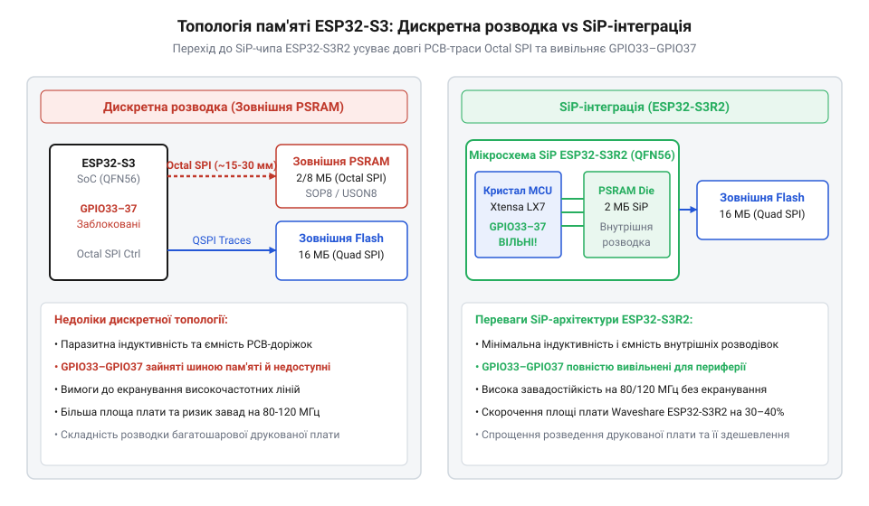
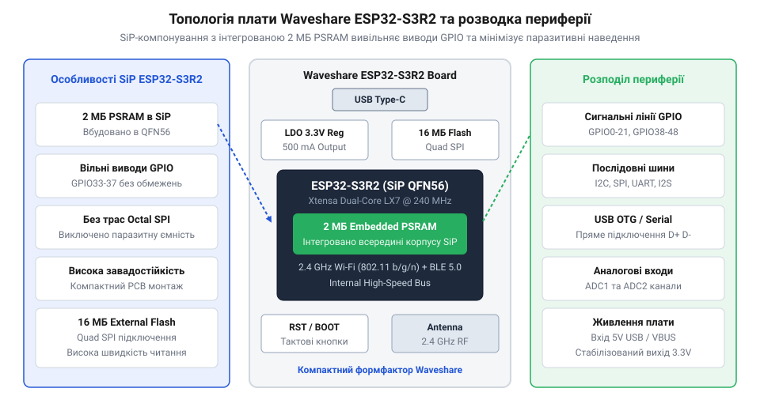

# Еволюція компоновки Waveshare ESP32-S3R2 та перехід до SiP-пам'яті

<preknowlist>
- [Родина плат і модулів на ESP32-S3](root:cat-hw-boards/esp32-s3-boards-family-overview) — загальні схемотехнічні відмінності платформи ESP32-S3 та варіації шин пам'яті
- [Мікроконтролер ESP32-S3](root:cat-hw-boards/esp32s3-microcontroller) — архітектура ядра Xtensa LX7, внутрішня пам'ять SRAM та контролер IO MUX
</preknowlist>

## Проблема розводки дискретної пам'яті Octal-SPI

Поява мікроконтролера @@en|ESP32-S3@@ від компанії @@en|Espressif Systems@@ відкрила нові можливості для локальної обробки сигналів та алгоритмів штучного інтелекту @@en|TinyML@@ (від англ. @@en|Tiny Machine Learning@@). Проте реалізація високої обчислювальної потужності вимагала обсягів оперативної пам'яті, що значно перевищували внутрішні 512 КБ статичної пам'яті @@en|SRAM@@ (від англ. @@en|Static Random-Access Memory@@). Перші розробницькі плати від компанії @@en|Waveshare@@, створені на базі стандартних модулів, покладалися на зовнішні дискретні мікросхеми флеш-пам'яті @@en|Flash@@ та псевдостатичної оперативної пам'яті @@en|PSRAM@@ (від англ. @@en|Pseudo-Static Random-Access Memory@@), під'єднані через 8-бітну послідовну шину @@en|Octal SPI@@ (від англ. @@en|Octal Serial Peripheral Interface@@).

Така дискретна топологія створила серйозні схемотехнічні виклики під час проєктування друкованих плат (від англ. @@en|Printed Circuit Board@@, @@en|PCB@@). Для роботи шини @@en|Octal SPI@@ на тактовій частоті 80 МГц у режимі подвійної передачі даних @@en|DDR@@ (від англ. @@en|Double Data Rate@@) вимагалося розведення 8 паралельних ліній даних `SD0`–`SD7`, сигналів тактування `CLK` і `DQS` (від англ. @@en|Data Strobe@@ — строб даних) та ліній вибору пристрою `CS`. На друкованій платі довжина доріжок між корпусом мікроконтролера та дискретним кристалом пам'яті сягала кількох сантиметрів. На таких високих частотах кожна доріжка стає довгою лінією передачі з відчутною паразитною індуктивністю та ємністю, що спричиняло спотворення фронтів сигналів, дзвін (від англ. @@en|ringing@@) та перехресні наводки (від англ. @@en|crosstalk@@). Оскільки тривалість часового вікна вибірки даних за частоти 80 МГц у режимі @@en|DDR@@ становить лише 6.25 нс, розрахунок допустимого фазового зсуву спирається на швидкість поширення електромагнітної хвилі у матеріалі підкладки FR4. При ефективній діелектричній проникності підкладки швидкість поширення сигналу становить близько 150 мкм/пс (15 см/нс), тому фізичне неспівпадіння довжин трас `ΔL = 1.5 мм` між лініями `SD0`–`SD7` та стробом `DQS` викликає часовий зсув `Δt = ΔL / v = 1.5 мм / 150 мкм/пс = 10 пс`. Гранично допустиме неспівпадіння довжин трас не повинно було перевищувати ці ±1.5 мм (10 пс), адже більший часовий зсув призводив до зміщення фази сигналу, згортання стробуючого вікна та збоїв зчитування секторів пам'яті. Щоб забезпечити стабільність читання, інженерам доводилося встановлювати додаткові узгоджувальні резистори та застосовувати хвилеподібне змієподібне трасування (від англ. @@en|meander tracing@@) для строгого вирівнювання довжин, як це описує [родина плат і модулів на ESP32-S3](root:cat-hw-boards/esp32-s3-boards-family-overview).

Окрім завадостійкості, дискретна 8-бітна шина викликала гострий дефіцит виводів загального призначення @@en|GPIO@@ (від англ. @@en|General-Purpose Input/Output@@). Контролер виводів @@en|IO MUX@@ мікроконтролера апаратно вилучав контакти `GPIO33`, `GPIO34`, `GPIO35`, `GPIO36` та `GPIO37` із загальної матриці й жорстко задіював їх під лінії даних пам'яті. У компактних розробницьких платах це позбавляло розробника значної частини периферійних ліній, ускладнюючи підключення зовнішніх датчиків, дисплеїв та модулів розширення.

## Перехід до SiP-компоновки ESP32-S3R2

Для подолання фізичних обмежень дискретної трасувальної шини компанія @@en|Espressif@@ впровадила технологію компонування система в корпусі @@en|SiP@@ (від англ. @@en|System-in-Package@@). Кристал мікроконтролера [мікроконтролер ESP32-S3](root:cat-hw-boards/esp32s3-microcontroller) та кристал псевдостатичної оперативної пам'яті @@en|PSRAM@@ обсягом 2 МБ було об'єднано у єдиному напівпровідниковому корпусі @@en|QFN56@@ (від англ. @@en|Quad Flat No-leads 56-pin@@), утворивши модифікацію чипа @@en|ESP32-S3R2@@.

*Порівняння схемотехніки розведення дискретної шини Octal SPI та внутрішнього підключення PSRAM у SiP-корпусі.*

Інтеграція кристалів у єдиний SiP-корпус радикально змінила схемотехніку відлагоджувальних плат Waveshare. З'єднання між ядрами процесора та оперативною пам'яттю перенесли з зовнішніх доріжок друкованої плати безпосередньо на внутрішній технологічний процес мікрозварювання (англ. *wire bonding*, @@en|wire bonding@@) провідників з високочистого золота діаметром лише 18–25 мкм між контактними площадочками кристалів МК та @@en|PSRAM@@ усередині компаунду корпуса @@en|QFN56@@. Для захисту мікроскопічних дротів та кристалів заливається спеціалізований епоксидний герметизуючий компаунд з дрібнодисперсним кварцовим наповнювачем, чий коефіцієнт теплового розширення (14–16 × 10⁻⁶ K⁻¹) точно узгоджений з кремнієм та золотом. Довжина високочастотних ліній скоротилася з кількох сантиметрів до 1–2 мм, що знизило паразитну індуктивність ліній до 1–1.5 нГн та ємність нижче 1 пФ. Це практично повністю усунуло затримки та забезпечило високу завадостійкість і стабільне тепловідведення крізь епоксидний компаунд до центрального заземленого майданчика корпуса без потреби у складній зовнішній обв'язці та екрануванні.

Головним результатом цієї еволюції для розробників стало апаратне вивільнення виводів. Оскільки 8-бітна шина оперативної пам'яті стала повністю внутрішньою для корпусу SiP, лінії `GPIO33`–`GPIO37` повернулися до складу загальної комутаційної матриці @@en|GPIO Matrix@@. Це дозволило створювати ультракомпактні одноплатники на кшталт [ESP32-S3 SuperMini](root:cat-hw-boards/esp32-s3-supermini) та [ESP32-S3-Zero (Type-C, 4 МБ)](root:cat-hw-boards/esp32-s3-zero), де на мінімальній площі збережено повний набір периферійних інтерфейсів.

*Топологія друкованої плати та розташування периферійних виводів Waveshare ESP32-S3R2.*

Завдяки впровадженню SiP-чипа @@en|ESP32-S3R2@@ інженери @@en|Waveshare@@ змогли поєднати 16 МБ зовнішньої флеш-пам'яті @@en|Flash@@ та 2 МБ оперативної пам'яті у формфакторі, орієнтованому на поверхневий монтаж @@en|SMD@@ (від англ. @@en|Surface-Mount Device@@). Вбудований регулятор живлення з малим падінням напруги @@en|LDO@@ (від англ. @@en|Low-DropOut Regulator@@) гарантував стабільну роботу системи навіть при спалахах споживання струму безпроводним модулем, а відсутність громіздких зовнішніх трас пам'яті підвищила надійність пристрою у промислових умовах.

## Апаратна сумісність та розвінчання міфів

Впровадження мікроконтролерів @@en|ESP32-S3R2@@ (англ. *System-in-Package*, @@en|SiP@@) супроводжувалося виникненням низки поширених помилок серед розробників щодо прошивки (англ. *firmware*, @@en|firmware@@) та апаратної сумісності. Найголовнішим міфом стала впевненість у повній бінарній сумісності бінарних образів між платами з дискретними модулями пам'яті та SiP-чипами. На практиці спроба завантаження прошивки, скомпільованої під 8-бітний дискретний модуль @@en|Octal SPI@@, у мікроконтролер з вбудованою 2-мегабайтною пам'яттю @@en|PSRAM@@ призводить до аварійного перезавантаження чипа (англ. *kernel panic*, @@en|panic@@) на етапі ініціалізації вторинного завантажувача. Це зумовлено відмінностями у конфігураційних файлах @@en|Kconfig@@ середовища @@en|ESP-IDF@@, де для кристала @@en|ESP32-S3R2@@ вимагається чітке визначення режиму Quad SPI або Octal SPI відповідно до внутрішнього зварювання виводів пам'яті. Детальні схематичні відмінності між варіаціями шин описані в [огляді родини плат ESP32-S3](root:cat-hw-boards/esp32-s3-boards-family-overview).

Другим популярним хибним уявленням стала думка про нібито гірші теплові характеристики SiP-корпусу порівняно з дискретним розташуванням кристалів на друкованій платі (англ. *printed circuit board*, @@en|PCB@@). Скептики припускали, що щільна компоновка кристала мікроконтролера та матриці пам'яті всередині корпусу @@en|QFN56@@ створюватиме локальні точки перегріву при інтенсивних розрахунках алгоритмів штучного інтелекту. Проте інженерні вимірювання компанії @@en|Espressif Systems@@ довели протилежне: спільне тепловідведення через суцільний центральний майданчик заземлення (англ. *thermal pad*, @@en|thermal pad@@) на нижній площині корпусу @@en|QFN56@@ забезпечує нижчий тепловий опір, ніж окремі планарні корпуси з поверхневим монтажем (англ. *surface-mount device*, @@en|SMD@@). Для стабільної роботи вимагається лише коректно розведена сітка перехідних отворів (англ. *thermal vias*, @@en|thermal vias@@) під корпусом чипа.

Конкретним виявом програмної несумісності є поведінка вторинного завантажувача (англ. *bootloader*, @@en|bootloader@@) середовища @@en|ESP-IDF@@ при помилково вказаній опції `CONFIG_ESP32S3_SPIRAM_MODE`. Якщо у конфігураторі обрати режим 8-бітної шини `CONFIG_SPIRAM_MODE_OCT` замість 4-бітної `CONFIG_SPIRAM_MODE_QUAD`, завантажувач під час старту намагається ініціалізувати пам'ять за допомогою команд й алгоритмів синхронізації @@en|Octal SPI@@. Оскільки в чипі @@en|ESP32-S3R2@@ кристал пам'яті фізично зварений лише чотирма лініями даних, функція `esp_spiram_init()` не отримує коректного відгуку про ідентифікатор виробника (англ. *Vendor ID*, @@en|Vendor ID@@). У результаті в логу консолі з'являється критична помилка `E (xxx) spiram: SPI RAM enabled but initialization failed`, після чого система здійснює аварійну зупинку через виклик `abort()`, так і не діставшись до виконання функції `app_main()`.

## Сучасна топологія плат Waveshare ESP32-S3R2

Сучасна лінійка відлагоджувальних плат серії @@en|Waveshare ESP32-S3R2@@ втілює оптимізовану топологію, яка поєднує SiP-мікроконтролер [ESP32-S3](root:cat-hw-boards/esp32s3-microcontroller) із 16-мегабайтною зовнішньою енергонезалежною пам'яттю @@en|NOR Flash@@. Відмова від зовнішніх трас шини PSRAM дозволила інженерам розмістити всі компоненти на компактній чотиришаровій платі без втрати сигнальної цілісності. Завдяки вивільненню виводів контролера @@en|IO MUX@@ на крайові роз'єми плати виведено повний набір цифрових периферійних інтерфейсів, включно з шинами @@en|SPI@@, @@en|I2C@@, @@en|UART@@ та інтерфейсом камери, подібним до плат форми [ESP32-CAM](root:cat-hw-boards/esp32-cam).

Живлення платформи реалізовано через надійний імпульсний чи лінійний регулятор напруги (англ. *low dropout regulator*, @@en|LDO@@), що забезпечує стабільний струм для пікових навантажень Wi-Fi та Bluetooth радіомодулів. Для зручності розробки та прошивки на платах розміщено сучасний роз'єм @@en|USB Type-C@@, з'єднаний безпосередньо з нативним апаратним контролером @@en|USB CDC/JTAG@@. Порівняно з ультракомпактними рішеннями на кшталт [Waveshare ESP32-S3-Pico](root:cat-hw-boards/esp32-s3-pico) або [ESP32-S3 SuperMini](root:cat-hw-boards/esp32-s3-supermini), топологія Waveshare ESP32-S3R2 пропонує ідеальний баланс між високою завадостійкістю, доступністю периферії та надійністю для промислових розробок.

З точки зору енергоефективності вибір схеми живлення визначає автономність пристрою у системних режимах глибокого сну (англ. *Deep Sleep*, @@en|Deep Sleep@@). Використання лінійного регулятора @@en|LDO@@ гарантує мінімальний рівень пульсацій та наднизький струм власного споживання (англ. *quiescent current*, @@en|quiescent current@@) лише 1–5 мкА у сплячому стані, що забезпечує загальне споживання всієї плати на рівні 7–12 мкА. Натомість імпульсні перетворювачі напруги (англ. *DC-DC buck converter*, @@en|DC-DC converter@@) забезпечують ККД понад 90% при високих активних навантаженнях (під час спалахів струму Wi-Fi до 240–350 мА), але у режимі малого навантаження PFM їхній власний струм споживання становить 25–40 мкА, збільшуючи загальний струм Deep Sleep плати до 30–50 мкА. Через цей три-п'ятикратний приріст фонового струму розробникам доводиться спиратися на точний вибір схемотехніки живлення, аби не знівелювати енергетичну перевагу SiP-чипа при довготривалому живленні пристрою від акумулятора.
