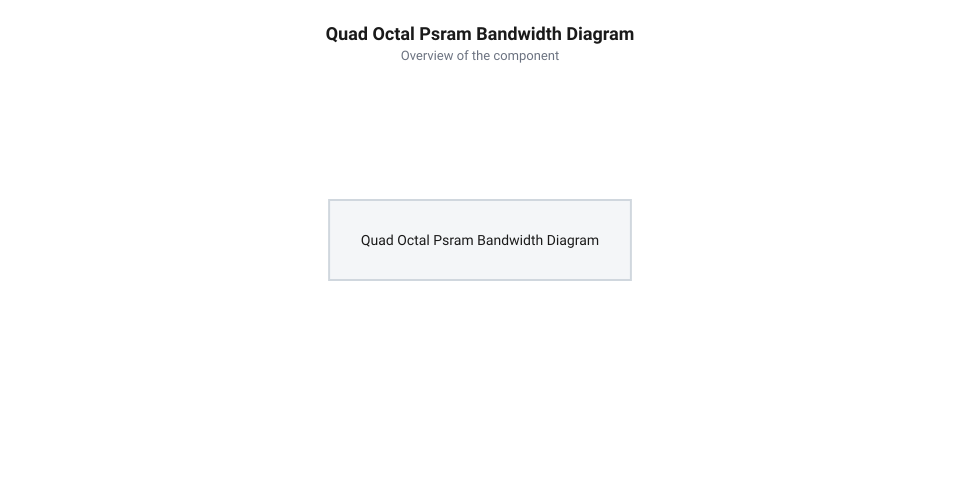

# Розрахунок пропускної здатності шини PSRAM, затримок MMU та обсягу кадрових буферів

<preknowlist>
- [Waveshare ESP32-S3R2 (16 МБ Flash, 2 МБ PSRAM)](root:cat-hw-boards/esp32-s3r2-waveshare) — Конструктивні особливості та апаратні параметри підключення PSRAM.
- [Мікроконтролер ESP32-S3](root:cat-hw-boards/esp32s3-microcontroller) — Принцип роботи блоку управління пам'яттю MMU та контролера DMA.
- [Модуль ESP32-CAM: огляд архітектури, периферії та сімейства плат](root:cat-hw-boards/esp32-cam-camera-module-family) — Базові поняття про кадрову буферизацію та стиснення зображень.
</preknowlist>

## Пропускна здатність шини PSRAM

Під час розробки відеосистем реального часу на базі мікроконтролерів спроба передати потік зображень високої роздільності часто спричиняє випадання кадрів, спотворення піксельних рядків або зупинку системи. Причиною цього є фізична обмеженість пропускної здатності шини зовнішньої псевдостатичної оперативної пам'яті (@@en|PSRAM@@, від англ. *Pseudo Static Random Access Memory* — псевдостатичний оперативний запам'ятовувальний пристрій). Коли [мікроконтролер ESP32-S3](root:cat-hw-boards/esp32s3-microcontroller) зчитує потік із камери через прямий доступ до пам'яті (@@en|DMA@@, від англ. *Direct Memory Access* — прямий доступ до пам'яті), кожен байт має бути розміщений у пам'яті без затримок. На компактній платі розробки [Waveshare ESP32-S3R2 (16 МБ Flash, 2 МБ PSRAM)](root:cat-hw-boards/esp32-s3r2-waveshare) використовується високошвидкісна шина пам'яті, проте її ефективна швидкість залежить від режиму адресації та тактової частоти.

Теоретична пікова пропускна здатність шини пам'яті `B_peak` обчислюється як добуток тактової частоти `f_clk`, ширини шини даних `W_bus` у бітах та кількості передач за один такт `N_trans` (1 для @@en|SDR@@, 2 для @@en|DDR@@), поділений на 8 для переведення в байти. На граничних тактових частотах 120 МГц у режимі @@en|DDR@@ тривалість одного часового інтервалу передачі даних скорочується до `T_UI = 1 ÷ (2 · 120 · 10⁶) ≈ 4.17 нс`, через що температурний дрейф і фазове зсунення ліній викликають збої зчитування. Для стабілізації тактування в інтерфейсах Octal SPI застосовують вирівнювальний сигнал @@en|DQS@@ (від англ. @@en|Data Strobe@@ — строб даних), який випромінюється пам'яттю синхронно з даними та усуває розсинхронізацію `Δt_skew`, що забезпечує стабільну роботу на розрахованій піковій швидкості. Співвідношення частот і параметрів шини описується формулою:

    B_peak
    = (f_clk · W_bus · N_trans) ÷ 8      [формула пікової пропускної здатності шини в байтах за секунду]

Для 4-бітної шини @@en|Quad SPI@@ (англ. *Quad Serial Peripheral Interface* — чотирьохпровідний послідовний периферійний інтерфейс) в режимі @@en|SDR@@ (від англ. *Single Data Rate* — одинарна швидкість передачі) на частоті 40 МГц пікова швидкість становить 20 МБ/с. При переході на 8-бітну шину @@en|Octal SPI@@ (англ. *Octal Serial Peripheral Interface* — восьмипровідний послідовний периферійний інтерфейс) з технологією @@en|DDR@@ (від англ. *Double Data Rate* — подвійна швидкість передачі) на частоті 80 МГц теоретична межа зростає до 160 МБ/с.

Проте реальна ефективна пропускна здатність `B_eff` завжди менша за пікову через накладні витрати шинного арбітражу, командні цикли, паузи перемикання напрямку даних та рефіл ліній кешу. Ці витрати враховуються коефіцієнтом ефективності шини `η_bus` (типово `0.65–0.75` для Quad SPI та `0.70–0.80` для Octal SPI):

    B_eff
    = B_peak · η_bus                      [ефективна пропускна здатність із урахуванням накладних витрат]

**Умова обчислення:** Обчислимо реальну пропускну здатність для 8-бітної шини Octal SPI DDR на частоті 80 МГц при коефіцієнті ефективності `η_bus = 0.70`.

    B_eff_Octal
    = ((80000000 · 8 · 2) ÷ 8) · 0.70     [підстановка частоти 80 МГц, 8 біт шини та 2 передач за такт]
    = 160000000 · 0.70                    [множення пікової швидкості 160 МБ/с на коефіцієнт ефективності]
    = 112000000                           [байтів за секунду, або 112 МБ/с]

*Часова діаграма передачі даних та накладних витрат шин Quad SPI і Octal SPI DDR.*

Для порівняння, 4-бітна шина Quad SPI на частоті 40 МГц із `η_bus = 0.65` забезпечує лише `20 · 0.65 = 13 МБ/с`, що унеможливлює передачу некодованих відеокадрів високої роздільності.

## Обчислення обсягу кадрових буферів

Знаючи реальну пропускну здатність шини, необхідно визначити обсяг оперативної пам'яті, який вимагає кадрова буферизація відеопотоку. Обсяг некодованого кадру `S_raw` у байтах розраховується як добуток ширини кадру `W`, висоти кадру `H` та кількості байтів на один піксель `N_bytes`:

    S_raw
    = W · H · N_bytes                      [обсяг некодованого кадру зображення]

Для стандартних колірних форматів @@en|RGB565@@ (по 5 бітів на червоний і синій, 6 бітів на зелений) та @@en|YUV422@@ (субдискретизація колірності) на один піксель припадає рівно 2 байти (`N_bytes = 2`). При роздільності @@en|VGA@@ (`640 × 480` пікселів) обсяг одного кадру становить `640 · 480 · 2 = 614400` байтів (600 КБ). Для роздільності @@en|UXGA@@ (`1600 × 1200` пікселів) некодований кадр вимагає `1600 · 1200 · 2 = 3840000` байтів (3.66 МБ), що перевищує обсяг PSRAM у 2 МБ на платі Waveshare ESP32-S3R2.

При використанні апаратного стиснення @@en|JPEG@@ (від англ. *Joint Photographic Experts Group* — об'єднана група експертів у галузі фотографії) обсяг стисненого кадру `S_JPEG` зменшується пропорційно коефіцієнту стиснення `C_ratio`. Сам коефіцієнт `C_ratio` є динамічною величиною, яка математично визначається співвідношенням фактора квантування `Q` (англ. *quantization factor*, що визначає рівень огрублення частотних коефіцієнтів у матриці дискретного косинусного перетворення) та просторової складності сцени `D_scene` (ентропії високих частот кадру): при зменшенні значення параметра `jpeg_quality` (що відповідає грубшому квантуванню та нижчому числу `Q`) більша частина високочастотних коефіцієнтів обнуляється, підвищуючи `C_ratio` до 1:20–1:30, тоді как деталізовані високоентропійні зображення з високим `Q` зменшують `C_ratio` до 1:8–1:10 через збереження дрібних деталей:

    S_JPEG
    ≈ S_raw ÷ C_ratio                     [оцінка обсягу стисненого кадру JPEG]

Типовий коефіцієнт стиснення `C_ratio` для середньої якості варіюється від 1:10 до 1:20. Для забезпечення стабільної частоти кадрів без розривів застосовують подвійну буферизацію (англ. @@en|double buffering@@), при якій контролер DMA заповнює один буфер, поки процесор обробляє або передає другий. Сумарний обсяг пам'яті `S_total` обчислюється як:

    S_total
    = N_buffers · S_frame                  [загальний обсяг кадрових буферів у пам'яті]

**Умова обчислення:** Розрахуємо необхідний обсяг PSRAM для подвійної буферизації (`N_buffers = 2`) кадрів роздільності @@en|SVGA@@ (`800 × 600` пікселів) у форматі RGB565.

    S_SVGA_double
    = 2 · (800 · 600 · 2)                 [множення кількості буферів на обсяг одного кадру SVGA]
    = 2 · 960000                           [множення 2 буферів на 960 КБ]
    = 1920000                              [байтів, або 1.83 МБ]

Обсяг у 1.83 МБ повністю вміщується у 2 МБ PSRAM чипа ESP32-S3R2, залишаючи 228 КБ для інших системних потреб.

## Затримки MMU та оцінка FPS

Розміщення кадрових буферів у зовнішній пам'яті вимагає врахування затримок блоку управління пам'яттю (@@en|MMU@@, від англ. *Memory Management Unit* — блок управління пам'яттю). Коли процесор або контролер DMA звертається до адреси в PSRAM, якої немає у внутрішньому кеші, виникає промах кешу (англ. @@en|Cache Miss@@). На оновлення кеш-лінії витрачається додатковий час `T_miss`, що створює відносні накладні витрати затримки `δ_mmu`:

    δ_mmu
    = (N_miss · T_miss) ÷ T_transfer      [коефіцієнт додаткових затримок кешу MMU]

Загальний час передачі одного кадру `T_frame` з урахуванням прямого доступу до пам'яті та затримок MMU обчислюється через ефективну пропускну здатність `B_eff`:

    T_frame
    = (S_frame ÷ B_eff) · (1 + δ_mmu)     [загальний час обробки та передачі одного кадру]

Гранично можлива частота кадрів @@en|FPS@@ (від англ. *Frames Per Second* — кадрів за секунду) обчислюється як обернена величина до часу кадру:

    FPS
    = 1 ÷ T_frame                         [підсумкова частота кадрів відеопотоку]
    = B_eff ÷ (S_frame · (1 + δ_mmu))     [розгорнута формула частоти кадрів]

**Умова обчислення:** Обчислимо граничну частоту кадрів FPS для потоку SVGA RGB565 (`S_frame = 960000` байтів) при шині Octal SPI 80 МГц (`B_eff = 112` МБ/с) та затримці MMU `δ_mmu = 0.15` (15% накладних витрат кешу).

    FPS_SVGA
    = 112000000 ÷ (960000 · (1 + 0.15))   [підстановка ефективної швидкості та обсягу кадру]
    = 112000000 ÷ (960000 · 1.15)         [врахування 15% затримки MMU]
    = 112000000 ÷ 1104000                 [ділення пропускної здатності на повний час кадру]
    = 101.45                              [кадрів за секунду]

Для стабільної трансляції без переповнення апаратного буфера DMA вхідна швидкість надходження даних з камери `B_input` мусить задовольняти умову відсутності переповнення:

    B_input ≤ B_eff ÷ (1 + δ_mmu)         [критерій завадостійкості та відсутності втрати кадрів]

Якщо `B_input` перевищує це значення, виникає переповнення внутрішніх буферів (англ. @@en|FIFO overrun@@), що призводить до скидання кадрів. Порівняти параметри буферизації у складніших мультимедійних пристроях можна на прикладі платформи [ESP32-CAM з камерою OV3640 (2 МП)](root:cat-hw-boards/esp32-cam-ov3640).
