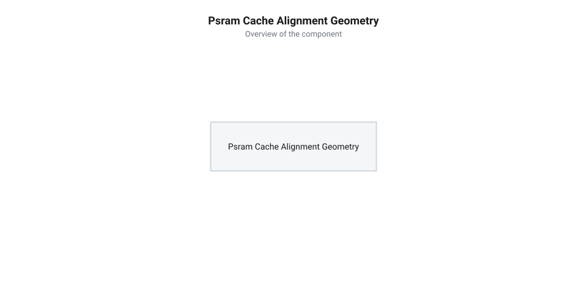

# Розрахунок пропускної здатності шини PSRAM та геометричного вирівнювання кеш-ліній

<preknowlist>
- [Мікроконтролер ESP32-S3](root:cat-hw-boards/esp32s3-microcontroller) — системну архітектуру чипа ESP32-S3 та організацію шин доступу до зовнішньої пам'яті PSRAM
- [Родина плат і модулів на ESP32-S3](root:cat-hw-boards/esp32-s3-boards-family-overview) — апаратні конфігурації модулів із Quad SPI та Octal SPI PSRAM
</preknowlist>

## Падіння кадрової частоти та артефакти

Під час розробки прошивок для обробки відеопотоків або виведення графіки високої роздільності на [мікроконтролері ESP32-S3](root:cat-hw-boards/esp32s3-microcontroller) інженери регулярно стикаються з раптовим падінням кадрової частоти. Графічний інтерфейс починає підсмикуватися, а під час трансляції зображення з камери виникають пропущені кадри й візуальні артефакти. Симптоми вказують на дефіцит пропускної здатності, хоча теоретична частота зовнішньої пам’яті здається цілком достатньою для обраного відеорежиму. Фізична причина полягає в апаратному арбітражі між контролером прямого доступу до пам'яті @@en|DMA@@ (від англ. @@en|Direct Memory Access@@ — прямий доступ до пам'яті) та L1-кешем даних. Коли DMA-контролер записує черговий фрагмент відеокадру в невирівняну область пам'яті, шинний арбітр виявляє перетин меж кеш-рядків і запускає вимушене апаратне скидання (англ. @@en|writeback@@ — зворотний запис) або інвалідацію модифікованих кеш-блоків. У момент цієї колізії передача даних по шині призупиняється на час вивантаження брудних рядків кешу в зовнішню оперативну пам'ять @@en|PSRAM@@, що створює мікропаузи й призводить до втрати кадрів.

Головна причина такої поведінки полягає в тому, як виділяється пам’ять під буфери кадру. Стандартний системний виклик `malloc()` повертає вказівник на масив, вирівняний лише за 4-байтовою або 8-байтовою межею. Проте обмін даними між процесором, контролером периферії та зовнішньою мікросхемою @@en|PSRAM@@ (Pseudo Static Random Access Memory, від грецького *pseudes* — несправжній) відбувається не побайтово, а через L1-кеш даних та контролер @@en|DMA@@ (Direct Memory Access).

L1-кеш даних ESP32-S3 оперує фіксованими блоками — @@en|cache lines@@ (лінії кешу, від латинського *capsa* — скриня) розміром 32 байти. Якщо кадровий буфер починається з довільного зміщення (наприклад, з адреси `0x3C000006`), то кожен 32-байтовий транзакційний блок перетинає фізичну межу двох сусідніх кеш-рядків. При кожному зчитуванні чи запису даних через @@en|DMA@@ системна шина змушена виконувати подвійну кількість циклів вибірки, викликів @@en|cache invalidation@@ (інвалідація кешу) та арбітражу. Це викликає тривалі паузи шини, через які підсистема не встигає передати кадр за відведений проміжок часу, що знижує підсумковий показник @@en|FPS@@ (frames per second, від англійського *frame rate*).

## Математична модель пропускної здатності PSRAM

Щоб обґрунтувати вибір відеорежиму та запобігти перенасиченню шини, необхідно вивести формулу реальної швидкості передачі даних. Пропускна здатність зовнішньої пам’яті залежить від частоти тактування шини `f_clk`, кількості паралельних ліній даних `N_lanes` та режиму передачі за фронтами сигналу. При одночасній роботі кількох периферійних модулів (наприклад, паралельного запису кадрового потоку з камери та виведення зображення на дисплей) сумарна необхідна швидкість визначається як сума вимог усіх активних каналів `B_total = ∑ B_i`. Коефіцієнт завантаження шини @@en|PSRAM@@ (від англ. *@@en|Pseudo Static Random Access Memory@@* — псевдостатична оперативна пам'ять) обчислюється як співвідношення `U_bus = B_total ÷ B_eff`, де `B_eff` — реальна пропускна здатність з урахуванням арбітражу. Якщо `U_bus` наближається до одиниці або перевищує її (`U_bus ≥ 1.0`), арбітр контролера @@en|DMA@@ (від англ. *@@en|Direct Memory Access@@* — прямий доступ до пам'яті) не встигає обслуговувати транзакції, що призводить до затримок, переповнення вхідних буферів @@en|FIFO@@ (від англ. *@@en|First In, First Out@@* — першим зайшов, першим вийшов) та пошкодження кадрових даних.

Теоретична пікова швидкість шини `B_peak` (у байтах за секунду) обчислюється як добуток частоти на кількість ліній, з урахуванням множника `DDR` (Double Data Rate) для передачі по обох фронтах тактового імпульсу:

Співвідношення для пікової пропускної здатності шини:
```
B_peak = (f_clk × N_lanes × DDR) ÷ 8
```

Проте реальна пропускна здатність `B_eff` завжди нижча за пікову через командний оверхед шини `C_cmd` (цикли передачі команди, адреси та фази очікування). Якщо пакетний транзакційний блок має довжину `L_block` байтів, то загальна кількість тактових циклів `T_block` на передачу одного блоку складає:

Загальний час передачі блоку з урахуванням накладних витрат:
```
T_block = (L_block × 8 ÷ (N_lanes × DDR)) + C_cmd
```

Звідси реальна ефективна пропускна здатність `B_eff` визначається формулою:

Формула ефективної пропускної здатності шини PSRAM:
```
B_eff = (L_block × f_clk) ÷ T_block
```

**Розрахунок граничного FPS для відеопотоку VGA (640×480) у колірній глибині RGB565 (2 байти/піксель) на Quad SPI PSRAM при 80 МГц SDR**:

Обсяг одного кадру зображення `S_frame`:
```
S_frame = 640 × 480 × 2
= 614400         [байтів на кадр]
```

Для шини Quad SPI (`N_lanes = 4`, `DDR = 1`) на частоті `f_clk = 80000000` Гц з командним оверхедом `C_cmd = 8` тактових циклів на кожний 32-байтовий блок `L_block = 32`:

Кількість тактових циклів на 32-байтовий блок `T_block`:
```
T_block = (32 × 8 ÷ 4) + 8
= 64 + 8
= 72             [тактових циклів]
```

Ефективна швидкість передачі даних `B_eff`:
```
B_eff = (32 × 80000000) ÷ 72
= 2560000000 ÷ 72
= 35555555       [байтів/с ≈ 35.55 МБ/с]
```

Гранично досяжна кадрова частота `FPS_max`:
```
FPS_max = B_eff ÷ S_frame
= 35555555 ÷ 614400
= 57.87          [кадрів на секунду]
```

Порівняння цих розрахунків з [родиною модулів ESP32-S3](root:cat-hw-boards/esp32-s3-boards-family-overview) демонструє, що перехід на Octal SPI з шириною шини 8 біт подвоює `B_eff` і дає змогу впевнено працювати з високими частотами оновлення екрана без ризику виникнення затримок.

## Геометрія вирівнювання адрес кеш-ліній

Різниця між теоретичною та фактичною пропускною здатністю суттєво зростає, якщо адреси буферів у пам’яті не узгоджені з геометричною сіткою кеш-ліній. Коли довільний кадровий чи системний буфер довжиною `L` виділяється з невирівняною початковою адресою `A_0`, перший байт даних потрапляє всередину 32-байтового рядка L1-кешу зі зсувом `A_0 mod 32`. Для гарантування цілісності даних периферійний контролер прямого доступу до пам'яті @@en|DMA@@ (від англ. *@@en|Direct Memory Access@@* — прямий доступ до пам'яті) та арбітр купи [мікроконтролера ESP32-S3](root:cat-hw-boards/esp32s3-microcontroller) змушені обробляти як головну частину рядка до межі вирівнювання, так і хвостову частину після закінчення корисного навантаження. Математичне виведення підсумкового вирівняного розміру пам'яті `L_aligned` починається з обчислення початкового зсуву `P_head = (32 - (A_0 mod 32)) mod 32`, який доповнює початкову адресу до найближчої 32-байтової межі. Додавання цього зсуву до довжини `L` дає повну протяжність буфера від початку вирівняного рядка `L_padded = L + P_head`. Оскільки остання частина корисних даних може також завершуватися всередині кеш-рядка, підсумковий розмір округлюють угору до найближчого кратного 32 значення виразом `L_aligned = ⌈(L + P_head) ÷ 32⌉ × 32`. Таке геометричне розширення гарантує, що апаратні операції інвалідації та списання кешу не зачіпатимуть сусідні дані в пам’яті @@en|PSRAM@@ (від англ. *@@en|Pseudo Static Random Access Memory@@* — псевдостатична оперативна пам'ять).


*Геометрична прив'язка буфера пам'яті до меж кеш-рядків L1 та DMA-структур ESP32-S3.*

Адреса `A` вважається геометрично вирівняною за межею `M` (де `M = 32` байти для L1-кешу ESP32-S3 або `M = 16` байтів для дескрипторів DMA), якщо остача від ділення дорівнює нулю:

Умова геометричного вирівнювання адреси:
```
A mod M = 0
```

Якщо масив довжиною `L` починається з невирівняної адреси `A_0`, то кількість задіяних кеш-рядків `N_cache` обчислюється через кінцеву адресу `A_end = A_0 + L - 1`:

Кількість кеш-рядків для невирівняного буфера:
```
N_cache = ⌊A_end ÷ 32⌋ - ⌊A_0 ÷ 32⌋ + 1
```

Коли `A_0 mod 32 ≠ 0`, значення `N_cache` завжди на одиницю більше за мінімально необхідну кількість рядків. Зайвий кеш-рядок призводить до додаткових циклів списання брудних даних та скидання кешу при перезаписі буфера.

Для усунення цього ефекту початкову адресу зміщують на вирівнювальний падінг `P_head`:

Обчислення головного падінгу вирівнювання:
```
P_head = (32 - (A_0 mod 32)) mod 32
```

А підсумковий підготовлений розмір буфера `L_aligned` округлюють угору до найближчого кратного 32 значення:

Обчислення підсумкового вирівняного розміру буфера:
```
L_aligned = ⌈(L + P_head) ÷ 32⌉ × 32
```

## Затримки виділення вирівняної пам'яті PSRAM

Динамічний розподіл вирівняної пам’яті здійснюється через спеціалізований виклик `heap_caps_aligned_alloc()`, який забезпечує геометричне вирівнювання вказівника ціною додаткових витрат пам’яті й затримок арбітражу. Щоб ґарантувати вирівнювання повернутої адреси за межею `alignment` (наприклад, 16 або 32 байти під вимоги L1-кешу чи DMA), системний алокатор купи виділяє базовий блок збільшеного розміру. До запитаного обсягу корисних даних додається падінг вирівнювання розміром до `alignment - 1` байтів, а також заголовок метаданих `H_meta` (зазвичай 8–12 байтів), який зберігає початковий вказівник на сирий блок для подальшого коректного звільнення через виклик `free()`. У результаті сумарні накладні витрати пам’яті на один вирівняний буфер розраховуються як `S_overhead = P_pad + H_meta`, де максимальний падінг `P_pad = alignment - 1`. Для дрібних кадрових структур це може створювати відчутну фрагментацію купи @@en|PSRAM@@, тому для високонавантажених медіапотоків вирівняні буфери виділяють одноразово при старті системи.

При виділенні вирівняного блоку системний розподільник купи додає до запитаного розміру `size` розмір вирівнювання `alignment` та метадані `H_meta` (зазвичай 8–12 байтів) для збереження початкової адреси блоку:

Загальний обсяг виділеної пам'яті в купі:
```
S_allocated = size + alignment + H_meta
```

Крім накладних витрат обсягу, виникає затримка доступу `T_access`. Якщо транзакція @@en|DMA@@ або CPU перетинає межу 32-байтового кеш-рядка або 1-кілобайтову сторінку @@en|PSRAM@@, арбітр шини розбиває одну операцію на дві окремі SPI-транзакції:

Обчислення підсумкової затримки шини при розщепленні транзакцій:
```
T_access = T_bus + (N_split - 1) × T_penalty
```

Тут `N_split = 2` при перетині межі вирівнювання, а `T_penalty` — штрафна затримка повторного захоплення шини арбітром. Використання геометрично вирівняних буферів гарантує `N_split = 1`, повністю виключаючи штрафні затримки та забезпечуючи максимальну детермінованість часу виконання в прошивках реального часу.
