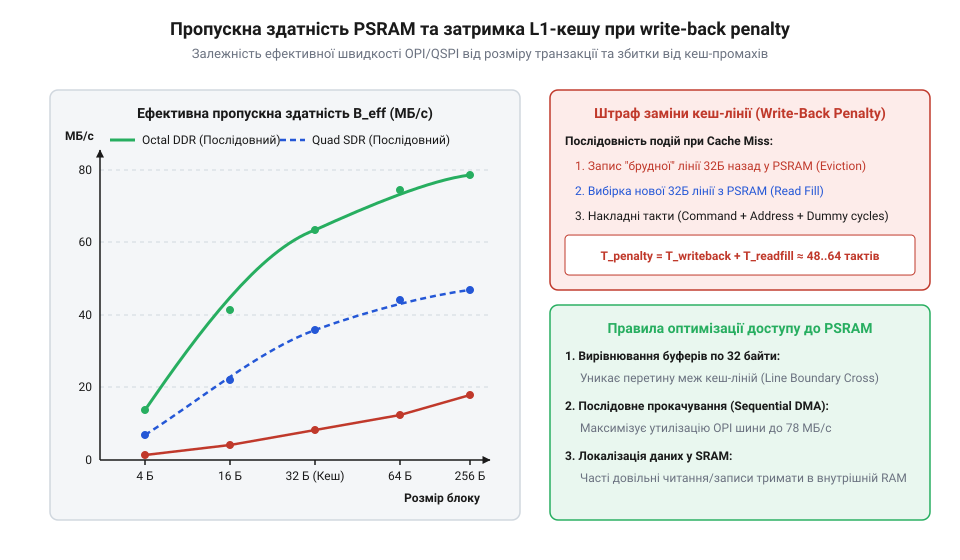

# Розрахунок пропускної здатності шини PSRAM та затримок L1-кешу

<preknowlist>
- [Waveshare ESP32-S3-Pico](root:cat-hw-boards/esp32-s3-pico) — особливості організації пам'яті PSRAM
- [ESP32-S3-Zero (Type-C, 4 МБ)](root:cat-hw-boards/esp32-s3-zero) — специфіка 4-бітної шини Quad SPI
- [Мікроконтролер ESP32-S3](root:cat-hw-boards/esp32s3-microcontroller) — архітектура двоядерного процесора та L1-кешу
</preknowlist>

## Проблема пропускної здатності кадрових буферів

Під час розробки систем обробки відеопотоку або виконання алгоритмів штучного інтелекту у вбудованих системах розробники часто очікують, що номінальна тактова частота зовнішньої пам'яті гарантує відповідну швидкість обміну даними. Проте спроба передавати кадрові буфери високої роздільної здатності (наприклад, RGB565 з роздільністю QVGA чи VGA) або виконувати матричні обчислення у зовнішній пам'яті @@en|PSRAM@@ через [4-бітної шини Quad SPI](root:cat-hw-boards/esp32-s3-zero) демонструє вузьке місце: реальна частота кадрів різко падає порівняно із розрахунковим максимумом. Додатково пропускну здатність знижують мікроконтролерні паузи прямого доступу до пам'яті (англ. *Direct Memory Access*, @@en|DMA@@), які виникають під час циклів регенерації заряду динамічних осередків (англ. *DRAM refresh*, @@en|DRAM refresh@@) усередині @@en|PSRAM@@. Оскільки осередки пам'яті побудовані на мікроскопічних конденсаторах, що безперервно втрачають заряд, внутрішній контролер мікросхеми кожні кілька мікросекунд примусово ініціює цикл оновлення (англ. *refresh cycle*, @@en|refresh cycle@@). Під час виконання цього циклу всі зовнішні операції читання та запису блокуються на десятки тактів шини, змушуючи арбітр @@en|DMA@@ виставляти такти очікування та створювати часовий джитер при трансляції потокового відео.

Це падіння виникає через те, що кожен сеанс обміну із зовнішньою пам'яттю у [мікроконтролері ESP32-S3](root:cat-hw-boards/esp32s3-microcontroller) супроводжується обов'язковими транзакційними накладними витратами. Для зчитування або запису блоку даних контролер пам'яті мусить передати командні коди, адресні байти та витримати такти синхронізації перед тим, як почнеться передача корисного навантаження. Без точної математичної моделі цих накладних витрат неможливо обґрунтовано обрати конфігурацію пам'яті для [родини плат ESP32-S3](root:cat-hw-boards/esp32-s3-boards-family-overview) та витримати жорсткі часові обмеження реального часу.

Математичний розрахунок часових затримок та ефективної швидкості дозволяє оцінити реально доступну пропускну здатність шин пам'яті ще на етапі проектування архітектури системи. Саме кількісний аналіз фаз команд, адресних заголовочних байтів та штрафних тактів @@en|L1-кешу@@ показує межу продуктивності при використанні високороздільних матриць, наприклад у компактних фотомодулях кшталт [ESP32-CAM з камерою OV3640](root:cat-hw-boards/esp32-cam-ov3640).

## Математична модель шин Quad і Octal SPI

Для виведення реальної пропускної здатності `B_real` (у мегабайтах за секунду, МБ/с) шин зовнішньої пам'яті PSRAM розглянемо тривалість однієї транзакції `T_trans` обсягом `N_bytes` байт.

Транзакція складається з тактів передачі корисних даних та фіксованих накладних тактів шини `N_overhead`. Накладні такти включають фазу команди `N_cmd` (лат. *command*, 1 або 2 байти), фазу адреси `N_addr` (лат. *address*, 3 або 4 байти) та такти очікування синхронізації `N_dummy` (англ. @@en|dummy cycles@@, від 6 до 10 тактів для високочастотної PSRAM).

Кількість тактів для передачі корисного навантаження `N_payload` залежить від ширини шини `W_bus` (4 біти для @@en|Quad SPI@@, 8 бітів для @@en|Octal SPI@@) та режиму передачі `M_mode` (1 для @@en|Single Data Rate@@ або @@en|SDR@@ — передача за фронтом; 2 для @@en|Double Data Rate@@ або @@en|DDR@@ — передача за фронтом і зрізом тактового імпульсу). У режимі DDR, коли дані передаються двічі за один тактовий імпульс, фізична фаза очікування @@en|dummy cycles@@ відіграє вирішальну роль у забезпеченні стабільності стробування. Під час тактів очікування внутрішній конвеєр мікросхеми PSRAM вирівнює фазовий зсув сигналу стробу даних DQS відносно тактового сигналу `CLK` за допомогою лінії затримки DLL. Це створює стабільне вікно вибірки сигналів часу встановлення та утримання (англ. @@en|setup and hold time@@), запобігаючи зсуву фаз і викривленню даних при високих частотах обміну 80–120 МГц.

```
N_payload
= (N_bytes × 8) ÷ (W_bus × M_mode)    [число тактів для передачі N_bytes байт]
```

Загальна тривалість транзакції `T_trans` у мікросекундах (мкс) при тактовій частоті шини `f_clk` (у МГц) становить:

```
T_trans
= (N_cmd + N_addr + N_dummy + N_payload) ÷ f_clk    [сумарний час транзакції шини]
```

Ефективна пропускна здатність `B_real` (МБ/с) виражається співвідношенням:

```
B_real
= N_bytes ÷ T_trans                                 [ефективна швидкість обміну]
= (N_bytes × f_clk) ÷ (N_overhead + N_payload)      [підстановка складових тактів]
```

Порівняємо ефективність шини Quad SPI SDR на частоті 80 МГц та Octal SPI DDR на частоті 80 МГц для одного блоку розміром 64 байти (розмір однієї лінії L1-кешу).

Обчислення для блоку 64 байти (Quad SPI SDR 80 МГц): `W_bus = 4`, `M_mode = 1`, `N_cmd = 2`, `N_addr = 6`, `N_dummy = 6`.

```
N_payload
= (64 × 8) ÷ (4 × 1)
= 128                                               [активні такти передачі даних]

N_overhead
= 2 + 6 + 6
= 14                                                [накладні такти шини]

T_trans
= (14 + 128) ÷ 80
= 1.775                                             [тривалість транзакції в мікросекундах]

B_real
= 64 ÷ 1.775
= 36.056                                            [ефективна швидкість Quad SPI SDR в МБ/с]
```

Обчислення для блоку 64 байти (Octal SPI DDR 80 МГц): `W_bus = 8`, `M_mode = 2`, `N_cmd = 2`, `N_addr = 4`, `N_dummy = 10`.

```
N_payload
= (64 × 8) ÷ (8 × 2)
= 32                                                [активні такти передачі в режимі Octal DDR]

N_overhead
= 2 + 4 + 10
= 16                                                [накладні такти шини]

T_trans
= (16 + 32) ÷ 80
= 0.6                                               [тривалість транзакції в мікросекундах]

B_real
= 64 ÷ 0.6
= 106.667                                           [ефективна швидкість Octal SPI DDR в МБ/с]
```

При теоретичному максимумі Octal SPI DDR 80 МГц у 160 МБ/с ефективність передачі малого 64-байтового блоку становить 66.67% через відносний вплив фіксованих тактів очікування `N_dummy = 10`.

## Затримки витіснення та промахів L1 кешу

Процесорні ядра Xtensa LX7 в ESP32-S3 звертаються до зовнішньої пам'яті PSRAM виключно через внутрішній двоканальний L1-кеш із розміром лінії `L_line = 64` байти.

При виникненні кеш-промаху (англ. @@en|cache miss@@) процесорне ядро блокується на час завантаження відсутньої 64-байтової лінії з PSRAM. Якщо витісняна з кешу лінія була модифікована ("брудна"), контролер кешу повинен спочатку виконати зворотний запис (англ. @@en|write-back penalty@@) модифікованого блоку у зовнішню пам'ять.

Сумарний штраф затримки `T_miss` (у тактах процесора при частоті `f_cpu = 240` МГц) при витісненні модифікованої лінії виражається формулою нижче. Чому саме виникає витіснення, визначає двоканальна асоціативна структура L1-кешу та апаратний алгоритм заміщення найменш використовуваних елементів LRU (від англ. @@en|Least Recently Used@@). Оскільки кожен набір кешу містить лише дві незалежні лінії ("дороги"), вибірковий доступ із кроком, який потрапляє в той самий індекс набору, призводить до швидкого вичерпання ємності двох ліній. Алгоритм LRU примусово витісняє старішу лінію для звільнення місця під новий блок. Якщо витіснена лінія була модифікована ("брудна"), система витрачає `T_writeback` тактів на вивантаження її у зовнішню SiP-пам'ять перед зчитуванням нових даних `T_fetch`, що катастрофічно збільшує загальну затримку промаху:

```
T_miss
= T_writeback + T_fetch                             [сумарна затримка при витісненні]
= (T_trans_write + T_trans_read) × f_cpu            [переведення часу транзакцій у такти CPU]
```

Для шини Octal SPI DDR 80 МГц кожна 64-байтова транзакція триває `T_trans = 0.6` мкс.
Обчислимо затримку витіснення у тактах процесора:

```
T_miss
= (0.6 + 0.6) × 240
= 1.2 × 240
= 288                                               [штрафні такти CPU на один промах кешу]
```

Якщо паттерн доступу до пам'яті не є послідовним (хаотичний вибірковий доступ під час обробки графів чи матричних операцій), кожен запит спричиняє кеш-промах і перезапис брудних ліній, зумовлюючи простій процесора у 288 тактів на кожні 64 байти.


*Залежність ефективної пропускної здатності та тактових затримок від розміру блоку передачі і паттерну доступу.*

## Розрахунок продуктивності для ESP32-S3R2

Для розробницької плати Waveshare ESP32-S3R2 з 2 МБ SiP PSRAM у корпусі @@en|System-in-Package@@ (@@en|SiP@@), підключеної через Octal SPI DDR, розрахуємо граничну частоту кадрів `FPS_max` при обробці нестиснутого кадрового буфера QVGA (320 × 240 пікселів у форматі RGB565, 2 байти на піксель).

Обсяг кадру `S_frame`:

```
S_frame
= 320 × 240 × 2
= 153600                                            [розмір кадру в байтах]
```

Кількість 64-байтових ліній кешу `N_lines`:

```
N_lines
= 153600 ÷ 64
= 2400                                              [кількість ліній L1-кешу]
```

При послідовному прямому доступі DMA (наприклад, зчитування відеопотоку в буфер) накладні витрати витіснення кешу мінімальні, а ефективна швидкість шини Octal SPI DDR 80 МГц досягає `B_real ≈ 138` МБ/с за рахунок потокового читання великого масиву.

Час передачі одного кадру `T_frame`:

```
T_frame
= 153600 ÷ 138000000
= 0.001113                                          [час передачі кадру в секундах]
```

Гранична частота кадрів `FPS_max`:

```
FPS_max
= 1 ÷ 0.001113
= 898.4                                             [максимальний FPS за пропускною здатністю шини]
```

Проте якщо алгоритм обробки зображення звертається до пікселів вертикальними стовпчиками з кроком, що виходить за межі 64-байтової лінії, кожна операція викликає кеш-промах із перезаписом брудних ліній. Додаткова затримка `T_random` для 2400 ліній становить:

```
T_random
= 2400 × 288 ÷ 240000000
= 0.00288                                           [суммарний час затримки витіснення кешу]
```

Сумарний час обробки кадру зростає до `T_total = 0.001113 + 0.00288 = 0.003993` с, знижуючи реальну швидкість до `FPS_effective = 1 ÷ 0.003993 = 250.4` FPS.

Вирівнювання адрес кадрових буферів за межею 64 байтів (атрибут `__attribute__((aligned(64)))`) у коді гарантує, що транзакції DMA не перетинають межі ліній кешу, виключаючи часткові витіснення та оптимізуючи інференс моделей @@en|Tiny Machine Learning@@ (@@en|TinyML@@) на [плата ESP32-S3-Pico](root:cat-hw-boards/esp32-s3-pico) та ESP32-S3R2. Якщо ж буфер вирівняно лише на 32 байти, початок масиву зміщується на середину 64-байтової кеш-лінії, збільшуючи кількість транзакцій до `N_split = 153600 ÷ 64 + 1 = 2401` ліній. Алгебраїчний розрахунок додаткового часового штрафу `T_misaligned` показує втрату ефективної пропускної здатності:

```
T_misaligned
= 2401 × 288 ÷ 240000000
= 0.002881                                          [затримка витіснення з урахуванням зсуву]
```

При цьому реальна частота кадрів додатково падає з `250.4` FPS до `FPS_misaligned = 1 ÷ (0.001113 + 0.002881) = 249.7` FPS, а кожен зсунутий перетин межі лінії викликає парне зчитування та примусове перезаписування двох брудних кеш-блоків замість одного.
