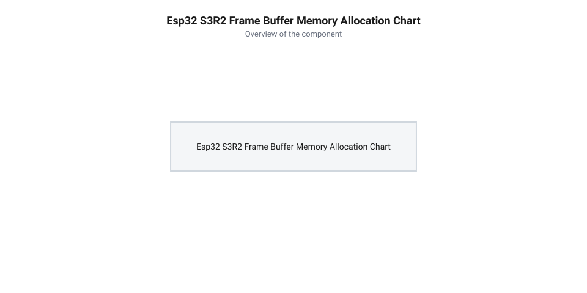
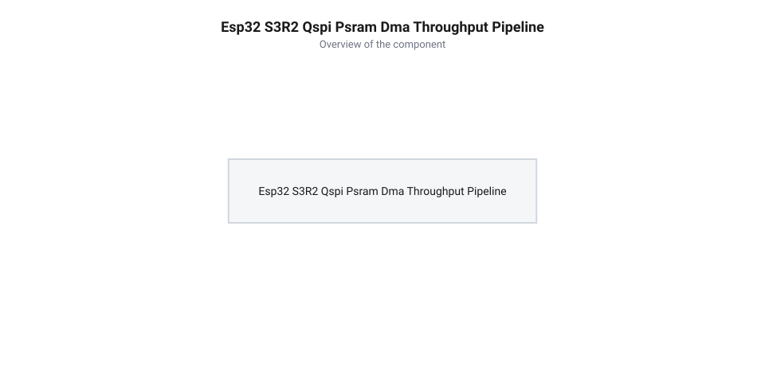

# Обчислення обсягу кадрових буферів та пропускної здатності пам'яті для відеоіснування

<preknowlist>
- [ESP32-CAM (OV2640 + microSD)](root:cat-hw-boards/esp32-cam) — базові принципи організації кадрового буфера та підключення камери
- [Мікроконтролер ESP32-S3](root:cat-hw-boards/esp32s3-microcontroller) — архітектура підсистеми пам'яті та контролера DMA
- [Родина плат і модулів на ESP32-S3](root:cat-hw-boards/esp32-s3-boards-family-overview) — характеристики шини Quad SPI та інтегрованої PSRAM
</preknowlist>

## Обмеження пам'яті SRAM та потреба кадрових буферів

При розробці вбудованих графічних та відеосистем на мікроконтролерах ключовим апаратним обмеженням є доступний обсяг внутрішньої оперативної пам'яті статичного типу (від англ. @@en|Static Random-Access Memory@@, @@en|SRAM@@). У двоядерному [мікроконтролері ESP32-S3](root:cat-hw-boards/esp32s3-microcontroller) загальний фізичний обсяг SRAM становить `512 кБ`, з яких після завантаження операційної системи реального часу, створення системних завдань та ініціалізації стека протоколів під динамічну купу (англ. @@en|heap memory@@) користувача залишається не більше `328 кБ`. При захопленні або виведенні навіть одного кадрового буфера стандартної роздільності @@en|VGA@@ (`640×480` пікселів) у форматі кольору @@en|RGB565@@ (2 байти на піксель) необхідний обсяг суцільного масиву пам'яті обчислюється як `640 × 480 × 2 = 614400` байтів (`600 кБ`), що майже удвічі перевищує увесь доступний ресурс внутрішньої купи. Ця нестача пам'яті загострюється під час трансляції відео через протокол реального часу (від англ. @@en|Real-Time Streaming Protocol@@, @@en|RTSP@@) у бездротових мережах @@en|Wi-Fi@@, де виникає критичний розсинхрон між затримками захоплення та відправки даних. Тривалість зчитування кадру периферійним контролером прямого доступу до пам'яті (від англ. @@en|Direct Memory Access@@, @@en|DMA@@) становить `t_DMA = S_frame ÷ BW_cam` і жорстко обмежена тактовою частотою шини камери. Водночас час передачі пакета в мережу `t_net = S_frame ÷ BW_net` безпосередньо залежить від пропускної здатності `BW_net`, яка постійно змінюється через інтерференцію радіоефіру та повторні спроби передачі кадрів. Коли через падіння швидкості радіоканалу виконується умова `t_net > t_DMA`, контролер @@en|DMA@@ починає перезаписувати єдиний буфер новими пікселями до завершення відправки поточного кадру, що руйнує структуру кадрів @@en|RTSP@@ та викликає артефакти розриву зображення.

Ситуація додатково ускладнюється під час безперервного стрімінгу або виведення зображення на дисплей. Використання єдиного кадрового буфера спричиняє апаратну гонку умов (англ. @@en|race condition@@) між периферійним контролером прямого доступу до пам'яті (від англ. @@en|Direct Memory Access@@, @@en|DMA@@), який зчитує байти з шини відеосенсора, та мережевим стеком чи дисплейним контролером, який паралельно вибирає дані для передачі. Математично ця проблема описується умовою `t_net > t_DMA`, де час зчитування й відправки кадру мережевим стеком `t_net = S_frame ÷ BW_net` перевищує час повного перезапису буфера контролером `t_DMA = S_frame ÷ BW_cam`. У разі зниження смуги пропускання мережі Wi-Fi контролер @@en|DMA@@ починає записувати нові пікселі в той самий масив до завершення читання, що спотворює структуру кадру. Для усунення артефактів розриву кадру (англ. @@en|screen tearing@@) застосовують подвійне буферування (від англ. @@en|double buffering@@) за схемою «пінг-понг», де один буфер приймає нові пікселі через @@en|DMA@@, а інший зчитується передавачем. Організація двох кадрових масивів подвоює необхідну пам'ять до `1.17 МБ`, що робить неможливим функціонування системи без зовнішньої розширеної пам'яті. Спроба виділити такі буфери у внутрішній купі безперечно викликає фатальну помилку вичерпання пам'яті (від англ. @@en|Out of Memory@@, @@en|OOM@@) та аварійний перезапуск пристрою. Винесення кадрових буферів у зовнішню псевдостатичну оперативну пам'ять (від англ. @@en|Pseudo-Static RAM@@, @@en|PSRAM@@) обсягом 2 МБ або 8 МБ на [родині плат на ESP32-S3](root:cat-hw-boards/esp32-s3-boards-family-overview) знімає це обмеження та уможливлює функціонування мультимедійних конвеєрів.

## Математична модель геометрії та форматів кадрових буферів

Математичний розрахунок обсягу кадрового буфера `S_frame` в байтах визначається залежністю від геометричної роздільності матриці пікселів та кількості байтів на піксель `bpp` (від англ. @@en|bytes per pixel@@ — глибина кодування кольору). Для прямокутного кадру з шириною `W` у пікселях та висотою `H` у пікселях базовий обсяг нестиснутого масиву описується рівнянням:

```
S_frame = W · H · bpp
```

Зокрема, для кадрового буфера роздільності @@en|SVGA@@ (`800×600` пікселів) у кольоровому форматі @@en|RGB565@@, де на один піксель припадає `bpp = 2` байти, обсяг одного нестиснутого кадру `S_svga` обчислюється як:

```
S_svga
= 800 · 600 · 2                                            [множення ширини, висоти та 2 байтів на піксель]
= 960000 B                                                 [обсяг одного кадру SVGA в байтах]
= 937.5 KiB                                                [переведення в кілобайти (960000 ÷ 1024)]
```

Отриманий результат у `937.5 кБ` показує, що навіть один кадр роздільності @@en|SVGA@@ у форматі @@en|RGB565@@ перевищує загальний фізичний розмір внутрішньої оперативної пам'яті @@en|SRAM@@ мікроконтролера, роблячи використання зовнішньої @@en|PSRAM@@ безальтернативним.

```
S_frame = W · H · bpp
```

Для кольорових форматів @@en|RGB565@@ (де 16 біт розподіляються як 5 біт червоного, 6 біт зеленого та 5 біт синього) та @@en|YUV422@@ (з субдискретизацією хроматичності 4:2:2, де два пікселі кодуються чотирма байтами) значення `bpp = 2`. У разі використання апаратного стиснення @@en|JPEG@@ розмір кадру стає динамічною величиною `S_jpeg`, яка залежить від середнього коефіцієнта стиснення `K_comp` (типово `K_comp ≈ 10–30` залежно від квантування й просторової деталізації):

```
S_jpeg = (W · H · 2) ÷ K_comp
```

При побудові відеоконвеєра із закріпленою кількістю активних буферів `fb_count` (де `fb_count = 2` відповідає подвійній буферизації, а `fb_count = 3` — потрійній буферизації, англ. @@en|triple buffering@@) сукупна потреба в динамічній пам'яті `RAM_req` обчислюється як:

```
RAM_req = S_frame · fb_count
```


*Графік розподілу пам'яті кадрових буферів для різних роздільностей та схем буферизації з виділенням порогової межі доступної SRAM.*

Розрахуємо обсяг пам'яті для конкретних конфігурацій відеосистеми.

**Умова розрахунку:** обчислити необхідний обсяг пам'яті `RAM_req` для подвійної буферизації (`fb_count = 2`) роздільності @@en|HQVGA@@ (`240×160`), @@en|VGA@@ (`640×480`) та @@en|HD@@ (`1280×720`) у форматі @@en|RGB565@@ (`bpp = 2`), а також порівняти із потрійною буферизацією (`fb_count = 3`) кадру @@en|VGA@@ у форматі @@en|JPEG@@ при `K_comp = 20`.

```
S_hqvga
= 240 · 160 · 2                                            [множення ширини, висоти та 2 байтів на піксель]
= 76800 B                                                  [обсяг одного кадру HQVGA в байтах]
= 75 KiB                                                   [переведення в кілобайти (76800 ÷ 1024)]

RAM_req_hqvga_double
= 76800 · 2                                                [підстановка 2 буферів у формулу RAM_req]
= 153600 B                                                 [сукупний обсяг для подвійного буфера]
= 150 KiB                                                  [переведення в кілобайти (153600 ÷ 1024)]

S_vga
= 640 · 480 · 2                                            [множення ширини, висоти та 2 байтів на піксель]
= 614400 B                                                 [обсяг одного кадру VGA в байтах]
= 600 KiB                                                  [переведення в кілобайти (614400 ÷ 1024)]

RAM_req_vga_double
= 614400 · 2                                               [підстановка 2 буферів у формулу RAM_req]
= 1228800 B                                                [сукупний обсяг для подвійного буфера]
= 1200 KiB                                                 [переведення в кілобайти (1228800 ÷ 1024)]

S_hd
= 1280 · 720 · 2                                           [множення ширини, висоти та 2 байтів на піксель]
= 1843200 B                                                [обсяг одного кадру HD в байтах]
= 1800 KiB                                                 [переведення в кілобайти (1843200 ÷ 1024)]

RAM_req_hd_double
= 1843200 · 2                                              [підстановка 2 буферів у формулу RAM_req]
= 3686400 B                                                [сукупний обсяг для подвійного буфера HD]
= 3600 KiB                                                 [переведення в кілобайти (3686400 ÷ 1024)]

S_vga_jpeg
= (640 · 480 · 2) ÷ 20                                     [ділення сирого обсягу VGA на коефіцієнт стиснення 20]
= 614400 ÷ 20                                              [обчислення стиснутого кадру]
= 30720 B                                                  [обсяг кадру JPEG у байтах]
= 30 KiB                                                   [переведення в кілобайти (30720 ÷ 1024)]

RAM_req_vga_jpeg_triple
= 30720 · 3                                                [підстановка 3 буферів JPEG]
= 92160 B                                                  [сукупна потреба у пам'яті для 3 буферів]
= 90 KiB                                                   [переведення в кілобайти (92160 ÷ 1024)]
```

Аналіз обчислень показує, що лише роздільність @@en|HQVGA@@ у подвійній буферизації (`150 кБ`) може поміститися у внутрішню купу @@en|SRAM@@. Для нестиснутого кадру @@en|VGA@@ (`1200 кБ`) та @@en|HD@@ (`3600 кБ`) виділення пам'яті можливе виключно у зовнішній @@en|PSRAM@@. Водночас використання стиснення @@en|JPEG@@ зменшує потребу потрійної буферизації @@en|VGA@@ до `90 кБ`, що дозволяє утримувати три буфери у пам'яті без ризику переповнення.

Однак під час розрахунку системних резервів пам'яті слід враховувати, що коефіцієнт стиснення `K_comp` не є статичною константою, а залежить від вибору таблиць квантування (англ. @@en|quantization tables@@) та рівня деталізації зніманого зображення. Зменшення коефіцієнта квантування для підвищення якості кодування (високе значення @@en|Quality Factor@@) або поява у кадрі виключно високочастотних деталей знижує ефективний коефіцієнт стиснення до мінімальних значень `K_comp_min ≈ 5–8`. Це призводить до зростання верхньої межі обсягу стиснутого кадру до значення `S_jpeg_max = (W · H · 2) ÷ K_comp_min`, що для роздільності @@en|VGA@@ вимагає виділення не `30 кБ`, а до `120 кБ` на один буфер. Нехтування цією динамікою та розрахунок пам'яті лише за середнім показником створює ризик апаратного переповнення буфера @@en|DMA@@ (англ. @@en|buffer overrun@@) під час знімання складних високоентропійних сцен.

## Розрахунок навантаження та пропускної здатності QSPI PSRAM

Для аналізу роботи відеосистеми на платі розробник мусить враховувати, що зовнішня псевдостатична оперативна пам'ять (англ. @@en|Pseudo Static RAM@@, @@en|PSRAM@@) підключена через 4-бітну шину @@en|Quad SPI@@. Ефективна пропускна здатність цієї шини при тактовій частоті 80 МГц з урахуванням накладних тактів адресації, паузових циклів (англ. @@en|dummy cycles@@) та затримок блоку управління пам'яттю (англ. @@en|Memory Management Unit@@, @@en|MMU@@) становить `BW_eff` = 31.74 МБ/с (31 736 586 Б/с). Архітектуру шинної підсистеми розкриває [мікроконтролер ESP32-S3](root:cat-hw-boards/esp32s3-microcontroller). Однак у моменти одночасного спрацьовування апаратного таймера дисплея та активності периферії ця реальна пропускна здатність додатково знижується через штрафні затримки шинного арбітражу. Коли таймер дисплея генерує переривання для вибірки чергової лінії кадру, шинний матричний арбітр @@en|AHB@@ (від англ. @@en|Advanced High-performance Bus@@ — високопродуктивна шина) мусить призупинити поточні операції ядра й перерозподілити пріоритети між каналами прямого доступу до пам'яті (англ. @@en|Direct Memory Access@@, @@en|DMA@@). Це викликає штраф у 4–8 додаткових тактів процесора на кожен конфлікт арбітражу `t_arb`, що витрачаються на збереження стану шинного пакета, повторну передачу командного байта адреси та очікування вирівнювання пакетного пакетизування шини @@en|Quad SPI@@. У разі високої частоти переривань таймера сукупна штрафна затримка накопичується, тимчасово спустошуючи апаратні буфери @@en|FIFO@@ (від англ. @@en|First In, First Out@@ — першим прийшов, першим вийшов) дисплейного контролера й створюючи загрозу розриву кадру.

У реальних застосунках шина пам'яті обслуговує одночасно декілька паралельних потоків прямого доступу до пам'яті (англ. @@en|Direct Memory Access@@, @@en|DMA@@). Перший потік `BW_cam` формується периферійним блоком камери, який записує вхідні пікселі у кадровий буфер. Другий потік `BW_disp` створюється дисплейним контролером, який паралельно зчитує зформований кадр для виведення на екран. Сумарний запит до пропускної здатності `BW_demand` для кадрового потоку роздільної здатності VGA (`640 × 480` пікселів) у форматі RGB565 (розмір кадру `S_frame` = 614 400 байтів) при частоті кадрів `FPS` обчислюється так:

```
BW_demand = BW_cam + BW_disp
          = (S_frame × FPS) + (S_frame × FPS)        [сумування потоків запису камери та зчитування дисплея]
          = 2 × S_frame × FPS                        [зведення подвійного кадрового навантаження]
          = 2 × 614400 × FPS                         [підстановка обсягу кадру VGA RGB565]
          = 1228800 × FPS Б/с                        [загальний обсяг даних на секунду]
```

Для оцінки стійкості роботи системи вводиться коефіцієнт утилізації шини `U_bus`, який визначається як відношення сумарного навантаження до ефективної пропускної здатності: `U_bus = BW_demand ÷ BW_eff`.

Для упередження переповнення внутрішніх апаратних FIFO-буферів периферійних модулів та запобігання втраті синхронізації рядків граничне значення утилізації не повинно перевищувати 80% (`U_bus_max` = 0.80). Залишок у 20% є технологічним резервом на перемикання шинного арбітра та обробку промахів кешу процесорних ядер, конструкцію яких описує [родина плат на ESP32-S3](root:cat-hw-boards/esp32-s3-boards-family-overview). Крім того, на підсумкову пропускну здатність суттєво впливають паузові цикли (англ. @@en|dummy cycles@@), кількість яких обчислюється залежно від тактової частоти шини: при підвищенні частоти з 80 МГц (період такту `T_clk = 12.5 ns`) до 120 МГц (період такту `T_clk = 8.33 ns`) для дотримання фіксованого часу апаратного доступу до матриці пам'яті `t_access = 75 ns` необхідна кількість паузових циклів розраховується як `N_dummy = ⌈t_access ÷ T_clk⌉`. Якщо при 80 МГц це вимагає `6` тактів (`75 ÷ 12.5`), то при 120 МГц число тактів зростає до `10` (`75 ÷ 8.33`), що збільшує частку накладних витрат у кожному транзакційному пакеті шини @@en|Quad SPI@@ і відносно знижує підсумкову ефективність вищої частоти.


*Схема паралельних потоків DMA камери та дисплея до шини Quad SPI PSRAM з аналізом арбітражу смуги пропускання.*

Розрахуємо максимально безпечну частоту кадрів `FPS_max_safe` за умови граничної утилізації 80%:

```
BW_limit = 0.80 × BW_eff
         = 0.80 × 31736586          [обчислення 80-відсоткового ліміту пропускної здатності]
         = 25389268 Б/с             [максимально допустимий потік даних]

FPS_max_safe = BW_limit ÷ (2 × S_frame)
             = 25389268 ÷ 1228800   [ділення допустимого потоку на розмір подвійного кадру]
             = 20.661               [отримане значення частоти]
             ≈ 20.6 FPS             [безпечна межа частоти кадрів]
```

Таким чином, математичний розрахунок доводить, що при роботі з необробленим кадром VGA RGB565 безпечна частота кадрів на 4-бітній шині Quad SPI обмежена значенням 20.6 кадрів/с. Перевищення цієї межі викликає апаратне переповнення FIFO та розрив кадру (англ. @@en|screen tearing@@).

Для подолання цього обмеження та досягнення частоти 30 кадрів на секунду застосовують апаратне стиснення даних кадру (від англ. @@en|Joint Photographic Experts Group@@, @@en|JPEG@@). При середньому коефіцієнті стиснення `K_comp = 8` обсяг кадрового буфера зменшується у 8 разів, що суттєво знижує сумарне навантаження на шину пам'яті:

```
BW_demand_jpeg
= 2 × (S_frame ÷ K_comp) × FPS              [формула подвійного потоку стиснених кадрів]
= 2 × (614400 ÷ 8) × 30                     [підстановка обсягу кадру VGA та частоти 30 FPS]
= 2 × 76800 × 30                            [обчислення подвійного навантаження стисненого буфера]
= 4608000 Б/с                               [підсумковий потік даних шини Quad SPI]
```

Отриманий сумарний потік у 4.61 МБ/с дає коефіцієнт утилізації шини `U_bus = 4608000 ÷ 31736586 ≈ 0.145` (лише 14.5%), що виключає ризик затримок прямого доступу до пам'яті під час роботи [модулів камери](root:cat-hw-boards/esp32-cam-camera-module-family) та забезпечує передачу відеопотоку без розриву зображення.

## Балансування ресурсу пам'яті та упередження розриву кадру

Окрім пропускної здатності шини, критичним обмеженням при розробці прошивок є баланс внутрішньої та зовнішньої оперативної пам'яті. У двоядерному [мікроконтролері ESP32-S3](root:cat-hw-boards/esp32s3-microcontroller) внутрішня статична пам'ять (від англ. @@en|Static RAM@@, @@en|SRAM@@) обсягом `512 кБ` містить близько `328 кБ` доступної динамічної кучі (англ. @@en|heap memory@@). Системні служби операційної системи, стеки задач та мережеві сокети вимагають резервування недоторканного залишку внутрішньої пам'яті `Heap_min = 128 кБ` для запобігання помилкам браку пам'яті (англ. @@en|Out-Of-Memory@@, @@en|OOM@@). Додаткові вимоги виникають під час динамічного виділення пам'яті під робочі буфери кодека @@en|JPEG@@ (таблиці Гаффмана, квантування та кільцевий буфер мінімальних кодованих блоків @@en|MCU@@). Для запобігання апаратним конфліктам когерентності під час операцій прямого доступу до пам'яті (від англ. @@en|Direct Memory Access@@, @@en|DMA@@) кожний масив виділяється з обов'язковим вирівнюванням за межею кеш-ліній першого рівня кешу даних (від англ. @@en|Level 1 Data Cache@@, @@en|L1 DCache@@) розміром 16 або 32 байти. Необхідність вирівнювання змушує менеджер пам'яті додавати вирівнювальний заповнювач (від англ. @@en|padding@@) `S_pad` до кожного масиву, через що підсумковий необхідний розмір обчислюється як `S_alloc = S_buffer + S_pad`. Спроба виділити невирівняні буфери викликає руйнування сусідніх даних у купі під час апаратного очищення або інвалідації кеш-рядків.

При відсутності зовнішньої пам'яті доступний обсяг внутрішньої купи для кадрових буферів становить: `Heap_avail` = 328 - 128 = 200 кБ. Оскільки один кадр VGA RGB565 потребує 600 кБ, його розміщення у внутрішній SRAM є неможливим, що вимагає задіяння зовнішньої мікросхеми @@en|PSRAM@@ обсягом 2 МБ на платі.

Обчислимо необхідну пам'ять `RAM_req` при використанні подвійної (англ. @@en|Double Buffering@@) та потрійної (англ. @@en|Triple Buffering@@) буферизації для кадру VGA RGB565 у зовнішній PSRAM:

```
RAM_req_double = 2 × S_frame
               = 2 × 614400          [помноження обсягу кадру на два буфери]
               = 1228800 Б           [необхідний обсяг пам'яті]
               ≈ 1.20 МБ             [обсяг для подвійної буферизації]

RAM_req_triple = 3 × S_frame
               = 3 × 614400          [помноження обсягу кадру на три буфери]
               = 1843200 Б           [необхідний обсяг пам'яті]
               ≈ 1.84 МБ             [обсяг для потрійної буферизації]
```

Порівняння отриманих значень з ємністю PSRAM (2.0 МБ) показує, що подвійна буферизація залишає `RAM_free` = 2.0 - 1.2 = 0.8 МБ (800 кБ) вільного простору під алгоритми обробки зображень. Потрійна буферизація виділяє 1.84 МБ, залишаючи лише 160 кБ, що створює високий ризик виникнення фатальних помилок @@en|OOM@@ при динамічному виділенні пам'яті.

У випадку активації стиснення JPEG з коефіцієнтом стиснення `K_comp` = 15 розмір стиснутого кадру зменшується до: `S_jpeg` = 614 400 ÷ 15 = 40 960 байтів (40 кБ). Однак окрім самих кадрових буферів для функціонування кодека виділяється додаткова робоча пам'ять: статичні таблиці Гаффмана (англ. @@en|Huffman tables@@) обсягом `S_huffman = 1.5 кБ`, таблиці квантування `S_quant = 0.5 кБ` та кільцевий буфер мінімальних кодованих блоків (від англ. @@en|Minimum Coded Unit@@, @@en|MCU@@) розміром `S_mcu = 4 кБ`. Сукупні накладні витрати кодека `S_codec = 6 кБ` у поєднанні з потрійним кадровим буфером (`120 кБ`) складають `RAM_jpeg_total = 126 кБ`. Віднімання цієї величини від наявної купи `Heap_avail = 200 кБ` дає точний математичний залишок зарезервованої пам'яті `Heap_rem = 200 - 126 = 74 кБ`, що ґарантує стабільну роботу мережевих токенів і захищає систему від аварійного вичерпання ресурсів.

Розрахуємо баланс пам'яті для стиснутого потоку JPEG при потрійній буферизації:

```
RAM_req_jpeg = 3 × S_jpeg
             = 3 × 40960             [помноження стиснутого кадру на три буфери]
             = 122880 Б              [загальний обсяг потрійного JPEG-буфера]
             ≈ 120 кБ                [необхідний обсяг пам'яті]
```

Оскільки 120 кБ менше за вільну внутрішню купу `Heap_avail` (200 кБ), стиснутий потік JPEG у потрійному буфері повністю розміщується у внутрішній швидкій пам'яті SRAM. Це усуває навантаження на шину Quad SPI PSRAM, розвантажує арбітр шини DMA та дозволяє використовувати відеомодулі типу [камери ESP32-CAM](root:cat-hw-boards/esp32-cam) з високою частотою кадрів без розривів зображення та витоків пам'яті.
