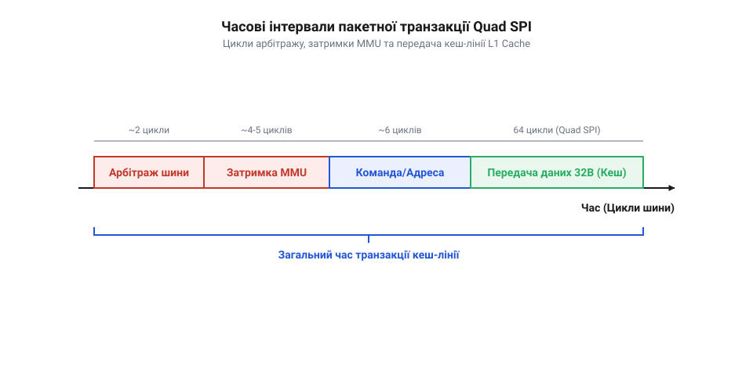

# Розрахунок пропускної здатності шин Flash/PSRAM та затримок адресації MMU

<preknowlist>
- [Мікроконтролер ESP32-S3](root:cat-hw-boards/esp32s3-microcontroller) — знання апаратної шинної структури, блоку MMU та кешу L1
- [Родина плат і модулів на ESP32-S3](root:cat-hw-boards/esp32-s3-boards-family-overview) — розуміння конструктивних конфігурацій Flash і PSRAM у сімействі ESP32-S3
</preknowlist>

## Обмеження швидкості та промахи кешу

При розробці високопродуктивних пристроїв на базі мікроконтролера ESP32-S3 розробники часто оцінюють швидкість обміну з зовнішньою пам'яттю за паспортними характеристиками шини. Наприклад, для 4-бітної шини псевдостатичної оперативної пам'яті (англ. @@en|Pseudo Static Random Access Memory@@, @@en|PSRAM@@) @@en|Quad SPI@@ при тактовій частоті 80 МГц теоретична гранична пропускна здатність здається рівною 40 МБ/с. Проте під час практичного виконання програм, які обробляють великі кадрові буфери або масиви даних, реальна швидкість читання виявляється значно нижчою і становить лише 15–20 МБ/с. Оглядові конфігурації модулів описує [родина плат на ESP32-S3](root:cat-hw-boards/esp32-s3-boards-family-overview). Така деградація продуктивності пояснюється апаратною затримкою, яка виникає під час взаємодії контролера кеш-пам'яті даних першого рівня (англ. @@en|L1 Data Cache@@, @@en|L1 DCache@@) з апаратним блоком управління пам'яттю (англ. @@en|Memory Management Unit@@, @@en|MMU@@). Коли контролер @@en|L1 DCache@@ фіксує відсутність потрібного блоку в кеші, він передає віртуальну адресу блоку @@en|MMU@@ для її трансляції через таблиці сторінок (англ. @@en|page tables@@). Блок @@en|MMU@@ виконує пошук запису у внутрішній таблиці сторінок, зіставляючи віртуальну адресу з фізичним зміщенням у @@en|PSRAM@@ для відповідної сторінки пам'яті. Вибірка записів із таблиці сторінок супроводжується апаратними тактами очікування (англ. @@en|wait cycles@@), під час яких конвеєр інструкцій процесора призупиняється, що створює затримку трансляції адрес ще до початку фізичного обміну по шині.

Причина такої розбіжності полягає в апаратній архітектурі доступу ядра до зовнішніх шин. Усі виклики звернення до зовнішньої пам'яті проходять через кеш даних першого рівня (англ. @@en|L1 Data Cache@@, @@en|L1 DCache@@) та апаратний блок управління пам'яттю (англ. @@en|Memory Management Unit@@, @@en|MMU@@). Якщо потрібні дані вже знаходяться в швидкій внутрішній оперативній пам'яті @@en|SRAM@@ кешу, читання виконується за один такт процесора. Проте коли виникає промах кешу (англ. @@en|cache miss penalty@@), процесорне ядро вимушене призупинити виконання інструкцій, поки шинний арбітр блокує шину, блок @@en|MMU@@ транслює віртуальну адресу у фізичну адресацію SPI, а шинний контролер зчитує суцільний блок даних розміром 32 байти (кеш-лінію). Структуру кеш-пам'яті описує [мікроконтролер ESP32-S3](root:cat-hw-boards/esp32s3-microcontroller).

Враховуючи, що кожен промах кешу вимагає передачі додаткових командних байтів, адресних фаз та очікування тактів технологічної затримки (англ. @@en|dummy cycles@@), реальний обмін даними складається з двох частин: тривалості безпосередньої передачі корисного навантаження та накладних часових витрат. Для точного визначення реальної швидкодії необхідно побудувати покрокову математичну модель часових інтервалів пакетної транзакції (англ. @@en|burst transfer@@).

У такій моделі тривалість одиночного звернення визначається сумою фіксованого часу ініціалізації транзакції — що охоплює передачу 8-бітного коду команди читання, 24- або 32-бітного адресоутворення в @@en|MMU@@ та 6–8 загороджувальних тактів затримки — і безпосереднього часу зчитування 32-байтового блоку даних. Оскільки часові накладні витрати на ініціалізацію є константними для кожної кеш-лінії незалежно від частоти, при частому виникненні промахів кешу відносний внесок корисного навантаження падає, що й призводить до падіння ефективної пропускної здатності шини. Розгляд цих часових складових дозволяє вивести точну формулу ефективної швидкодії для різних тактових частот шини [мікроконтролера ESP32-S3](root:cat-hw-boards/esp32s3-microcontroller).

## Моделювання затримок шини Quad SPI

Для обчислення тривалості зчитування однієї кеш-лінії `L_line` = 32 байти (256 біт) через шину @@en|Quad SPI@@ визначимо кількість тактів кожної фази обміну. Сумарний час зчитування `t_fetch` складається з часу передачі по шині SPI `t_spi_bus` та апаратної затримки блоку @@en|MMU@@ `t_mmu`:

Фаза команд та адреси `N_cmd_addr` включає 1 байт команди та 3 байти адреси (разом 32 біти). Оскільки передача адреси відбувається по 4 лініях даних, кількість тактів становить:
N_cmd_addr = 32 ÷ 4 = 8 тактів.

Фаза стабілізації `N_dummy` вимагає 6 тактових імпульсів для підготовки внутрішніх підсилювачів зчитування мікросхеми @@en|PSRAM@@.

Фаза передачі даних `N_data` для кеш-лінії 32 байти (256 біт) по 4-бітній шині становить:
N_data = 256 ÷ 4 = 64 такти.

Загальна кількість тактів шини `N_total` обчислюється як сума фаз:

```
N_total = N_cmd_addr + N_dummy + N_data
        = 8 + 6 + 64      [додавання тактів командної, паузової та дата-фаз]
        = 78 тактів      [підсумкова кількість тактів шини SPI]
```

При тактовій частоті шини `f_spi` = 80 МГц період одного такту дорівнює `T_spi` = 1 ÷ 80 000 000 = 12.5 нс. Час роботи шини `t_spi_bus` дорівнює:

```
t_spi_bus = N_total × T_spi
          = 78 × 12.5      [множення кількості тактів на період такту]
          = 975 нс      [тривалість шинної транзакції]
```

Додаючи часову затримку трансляції блоку @@en|MMU@@ та шинного арбітражу `t_mmu` = 33.3 нс (8 тактів ядра при частоті 240 МГц), отримуємо повний час вибірки `t_fetch`:

```
t_fetch = t_spi_bus + t_mmu
        = 975 + 33.3      [сумування шинного часу та затримки MMU]
        = 1008.3 нс      [повна тривалість вибірки кеш-лінії]
```


*Схема часових інтервалів пакетної транзакції Quad SPI з виділенням циклів арбітражу, затримок MMU та передачі кеш-лінії L1 Cache.*

Тепер обчислимо ефективну пропускну здатність `BW_eff` для шини 80 МГц:

```
BW_eff = L_line ÷ t_fetch
       = 32 ÷ 0.0000010083      [ділення обсягу кеш-лінії на повний час вибірки]
       = 31736586 Б/с      [дійсне значення пропускної здатності]
       ≈ 31.74 МБ/с      [округлений результат реальної швидкості]
```

Якщо ж тактова частота шини становить `f_spi` = 40 МГц (`T_spi` = 25 нс), час шини зростає до `t_spi_bus` = 78 × 25 = 1950 нс, а повний час вибірки дорівнює `t_fetch` = 1983.3 нс. При цьому ефективна швидкість становить лише `BW_eff` = 32 ÷ 0.0000019833 ≈ 16.13 МБ/с.

## Порівняння Quad SPI та Octal SPI

Для підвищення швидкодії підсистеми пам'яті вищих версій мікроконтролерів застосовують 8-бітний інтерфейс @@en|Octal SPI DDR@@ (від англ. @@en|Dual Data Rate@@ — подвійна швидкість передачі даних). На відміну від @@en|Quad SPI@@, де дані передаються по 4 лініях лише на зростаючому зрізі тактового сигналу, в режимі Octal SPI DDR використовується 8 паралельних ліній даних, а зчитування здійснюється як на зростаючому, так і на спадному зрізах тактового імпульсу.

Розрахуємо тривалість вибірки тієї ж кеш-лінії `L_line` = 32 байти (256 біт) при частоті 80 МГц у режимі Octal SPI DDR. Оскільки за один такт шини передається 16 біт (8 біт × 2 зрізи), кількість тактів фази даних `N_data_octal` дорівнює:
N_data_octal = 256 ÷ 16 = 16 тактів.

Командна та адресна фаза в 8-бітному DDR-режимі займає `N_cmd_addr_octal` = 4 такти, а фаза стабілізації сигналів `N_dummy_octal` становить 10 тактів. Сумарна кількість тактів шини `N_total_octal` дорівнює:

```
N_total_octal = N_cmd_addr_octal + N_dummy_octal + N_data_octal
              = 4 + 10 + 16      [додавання тактів фаз Octal DDR]
              = 30 тактів      [підсумкова кількість тактів шини Octal SPI]
```

Час шини `t_spi_octal` при `T_spi` = 12.5 нс обчислюється як:

```
t_spi_octal = N_total_octal × T_spi
            = 30 × 12.5      [множення кількості тактів на період такту]
            = 375 нс      [тривалість шинної транзакції Octal DDR]
```

Враховуючи затримку блоку @@en|MMU@@ `t_mmu` = 33.3 нс, підсумковий час вибірки `t_fetch_octal` становить:

```
t_fetch_octal = t_spi_octal + t_mmu
              = 375 + 33.3      [сумування шинного часу та затримки MMU]
              = 408.3 нс      [повна тривалість вибірки в режимі Octal DDR]
```

Ефективна пропускна здатність `BW_octal` для 80 МГц Octal SPI DDR становить:

```
BW_octal = L_line ÷ t_fetch_octal
         = 32 ÷ 0.0000004083      [ділення обсягу кеш-лінії на час вибірки Octal]
         = 78373745 Б/с      [дійсне значення пропускної здатності Octal DDR]
         ≈ 78.37 МБ/с      [округлений результат реальної швидкості Octal DDR]
```

Порівняння результатів показує, що перехід з Quad SPI на Octal SPI DDR підвищує ефективну пропускну здатність з 31.74 МБ/с до 78.37 МБ/с, тобто у 2.47 раза.

## Розрахунок кадрових буферів відеопотоку

Застосуємо виведену математичну модель для розрахунку граничних параметрів відеопотоку, який зберігається у зовнішній пам'яті @@en|PSRAM@@ модуля на зразок [камери ESP32-CAM](root:cat-hw-boards/esp32-cam). Розглянемо випадок передачі відеокадрів роздільної здатності VGA (`640 × 480` пікселів) у кольоровому форматі RGB565, де кожен піксель займає 2 байти.

Розмір одного кадру `S_frame` обчислюється так:

```
S_frame = 640 × 480 × 2
        = 307200 × 2      [перемноження кількості пікселів кадру на розмір пікселя]
        = 614400 Б      [обсяг одного відеокадру в байтах]
        = 600 кБ      [розмір кадру в кілобайтах]
```

Для забезпечення безперервного виведення без розривів зображення застосовують подвійну буферизацію (англ. @@en|double buffering@@), коли контролер прямого доступу до пам'яті записує новий кадр у перший буфер, а процесор або дисплейний контролер зчитує попередній кадр з другого буфера. Загальний обсяг оперативної пам'яті `S_total` дорівнює: `S_total` = 2 × 614 400 = 1 228 800 Б ≈ 1.2 МБ.

Оскільки кожен кадр спочатку записується в @@en|PSRAM@@ шиною DMA, а потім зчитується процесором для передачі, сумарний потік даних через шину `BW_stream` на один кадр дорівнює подвійному розміру кадру: `2 × S_frame` = 1 228 800 Б.

Визначимо максимально можливу частоту кадрів `FPS_max` для шини Quad SPI 80 МГц з ефективною швидкістю `BW_eff` = 31.74 МБ/с (31 736 586 Б/с):

```
FPS_max = BW_eff ÷ (2 × S_frame)
        = 31736586 ÷ 1228800      [ділення ефективної швидкості на сумарний потік кадру]
        = 25.827      [значення частоти кадрів]
        ≈ 25.8 FPS      [гранична частота кадрів для Quad SPI 80 МГц]
```

Для шини Octal SPI DDR 80 МГц з ефективною швидкістю `BW_octal` = 78.37 МБ/с (78 373 745 Б/с) гранична частота кадрів становить:

```
FPS_max_octal = BW_octal ÷ (2 × S_frame)
              = 78373745 ÷ 1228800      [ділення швидкості Octal DDR на потік кадру]
              = 63.780      [значення частоти кадрів]
              ≈ 63.8 FPS      [гранична частота кадрів для Octal SPI DDR 80 МГц]
```

Таким чином, розрахунок показує, що шина Quad SPI 80 МГц дозволяє досягти не більше 25.8 кадрів/с для суцільного відеопотоку VGA RGB565, тоді як Octal SPI DDR забезпечує запас продуктивності для повноцінних 60 кадрів/с без ризику вичерпання кадрових буферів.
