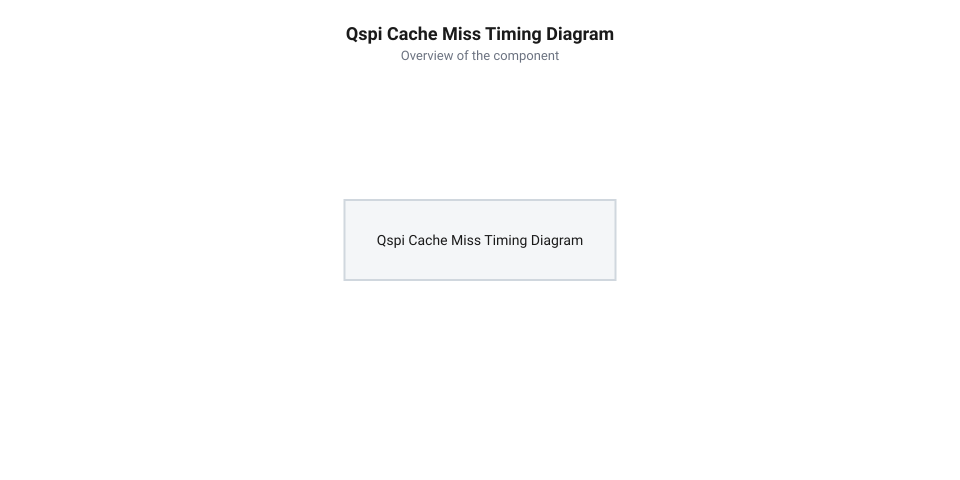

# Розрахунок пропускної здатності шини QSPI PSRAM, затримок L1-кешу та кадрових буферів

<preknowlist>
- [Waveshare ESP32-S3R2 (16 МБ Flash, 2 МБ PSRAM)](root:cat-hw-boards/esp32-s3r2-waveshare) — розуміння схемотехніки та архітектури підключення Quad SPI PSRAM у виробі
- [Мікроконтролер ESP32-S3](root:cat-hw-boards/esp32s3-microcontroller) — знання системи шин, кеш-контролера L1 та організації оперативної пам'яті
</preknowlist>

## Проблема затримок та вичерпання смуги PSRAM

При розробці компактних систем комп'ютерного зору або потокового відео на базі [плат Waveshare ESP32-S3R2](root:cat-hw-boards/esp32-s3r2-waveshare) розробники часто стикаються з раптовими артефактами рендерингу, просіданням частоти кадрів та переповненням буферів. Внутрішньої оперативної пам'яті мікроконтролера не вистачає для збереження повнорозмірних кадрових буферів, тому система покладається на зовнішню оперативну пам'ять @@en|PSRAM@@ (від англ. @@en|pseudo-static RAM@@ — псевдостатична оперативна пам'ять). Передача даних між процесорним ядром та зовнішнім чипом пам'яті відбувається через 4-бітну шину @@en|Quad SPI@@ (скорочено @@en|QSPI@@, від англ. @@en|quad serial peripheral interface@@ — чотириканальний послідовний периферійний інтерфейс).

Спрощений підрахунок швидкодії на основі лише паспортної частоти шини створює ілюзію надлишкової пропускної здатності. На тактовій частоті 80 МГц по 4 лініях даних теоретично можна передати 40 МБ/с. Проте спрощена оцінка не враховує, що кожна транзакція зчитування чи запису містить обопільні накладні фазові інтервали шинного протоколу. Перед передачею корисного навантаження шина витрачає тактові цикли на передачу коду операції (англ. @@en|command phase@@ — фаза команди), адреси вибірки в пам'яті (англ. @@en|address phase@@ — фаза адреси) та фіктивні холості такти (англ. @@en|dummy cycles@@ — холості цикли очікування) для стабілізації внутрішніх підсилювачів матриці пам'яті.

Крім того, процесорні ядра [мікроконтролера ESP32-S3](root:cat-hw-boards/esp32s3-microcontroller) звертаються до зовнішньої пам'яті не напряму, а через підсистему дворангового кешування @@en|L1-кеш@@ (від англ. @@en|Level 1 cache@@ — кеш-пам'ять першого рівня). Коли потрібних даних немає у швидких регістрах кешу, виникає ситуація промаху кешу (англ. @@en|cache miss@@ — промах кешу). Контролер змушений заблокувати виконання поточного потоку інструкцій і перезавантажити весь 32-байтовий рядок кешу з @@en|PSRAM@@, ініціюючи нову шинну транзакцію. У поєднанні з арбітражем системної шини та вимогою дотримуватися мінімальної паузи між транзакціями `tCPH` (від англ. @@en|chip select high time@@ — час високого стану сигналу вибору чипа) дісна швидкість обміну падає майже вдвічі. Для запобігання втратам кадрів та руйнуванню відеопотоку необхідне точне математичне моделювання дійсної пропускної здатності та затримок кешування.

## Математична модель дійсної пропускної здатності QSPI

Фізична швидкість передачі даних через послідовну шину пам'яті обмежується її тактовою частотою та шириною паралельних ліній. Гранична теоретична пропускна здатність шини `BW_theoretical` (у байтах за секунду) для режиму одинарної швидкості @@en|SDR@@ (від англ. @@en|single data rate@@ — одинарна швидкість передачі) обчислюється за формулою:

        BW_theoretical
        = (f_clk × N_lines × K_sdr) ÷ 8      [формула теоретичної пропускної здатності шини]

де `f_clk` — тактова частота шини @@en|SPI@@ у герцах (Гц); `N_lines` — кількість активних ліній даних (4 для Quad SPI); `K_sdr = 1` — коефіцієнт тактування за один наростаючий фронт; `8` — кількість бітів у байті.

Проте під час виконання операції читання при промаху кешу контролер ініціює транзакцію вибірки 32-байтового рядка. Структура цієї транзакції містить службові фазові затримки.

*Схема фазових інтервалів транзакції QSPI при промаху кешу із виділенням тривалості паузи tCPH та затримок арбітражу.*

Повна кількість тактів `N_total`, необхідна для перезавантаження одного 32-байтового рядка L1-кешу, є сумою тактів корисного навантаження `N_data` та службових інтервалів:

        N_total
        = N_data + N_cmd + N_addr + N_dummy + N_cph + N_arb      [загальна кількість тактів транзакції]

де `N_data` — кількість тактів для передачі 32 байтів даних по 4 лініях (`N_data = (32 × 8) ÷ 4 = 64`); `N_cmd` — фаза команди (8 тактів); `N_addr` — фаза адреси у 24-бітному форматі по 4 лініях (`N_addr = 24 ÷ 4 = 6`); `N_dummy` — холості такти очікування стабілізації пам'яті (6 тактів); `N_cph` — такт паузи деактивації вибору чипа `tCPH` (від англ. @@en|chip select high time@@, 4 такти); `N_arb` — затримка арбітражу системної шини @@en|AXI@@ (від англ. @@en|AXI@@ — розширений системний інтерфейс, 2 такти).

Загальний час затримки при промаху кешу `T_miss` (у секундах) розраховується через тривалість одного тактового циклу `T_clk = 1 ÷ f_clk`:

        T_miss
        = N_total × T_clk      [час завантаження рядка кешу]

Відношення корисного часу передачі даних до загального часу транзакції дає безрозмірний коефіцієнт ефективності шини `η_eff`:

        η_eff
        = N_data ÷ N_total      [коефіцієнт корисного використання шини]

Тоді дійсна пропускна здатність шини `BW_real` становить:

        BW_real
        = BW_theoretical × η_eff      [дісна пропускна здатність шини QSPI]

**Обчислення на прикладі:**
Обчислимо теоретичну й дійсну пропускну здатність шини Quad SPI на частоті 80 МГц та затримку промаху L1-кешу `T_miss` для плати [Waveshare ESP32-S3R2](root:cat-hw-boards/esp32-s3r2-waveshare).

Теоретична пропускна здатність:

        BW_theoretical
        = (80 000 000 × 4 × 1) ÷ 8
        = 320 000 000 ÷ 8
        = 40 000 000 байт/с = 40.0 МБ/с      [теоретична межа QSPI 80 МГц]

Кількість тактів та затримка промаху кешу:

        N_total
        = 64 + 8 + 6 + 6 + 4 + 2
        = 90 тактів                          [загальний обсяг тактового інтервалу]

        T_clk
        = 1 ÷ 80 000 000
        = 0.0000000125 с = 12.5 нс           [тривалість одного такту]

        T_miss
        = 90 × 12.5
        = 1125 нс = 1.125 мкс                [затримка вибірки 32 байтів із PSRAM]

Коефіцієнт ефективності та дійсна пропускна здатність:

        η_eff
        = 64 ÷ 90
        ≈ 0.7111                             [ефективність використання смуги 71.11%]

        BW_real
        = 40.0 × 0.7111
        ≈ 28.44 МБ/с                         [дісна пропускна здатність шини QSPI]

Висновок: через фазові затримки команди, адреси, холостих тактів та паузи `tCPH` реальна пропускна здатність 4-бітної шини QSPI знижується з 40.0 МБ/с до 28.44 МБ/с, а кожен промах L1-кешу заморожує процесорний конвеєр на 1.125 мкс.

## Розрахунок кадрових буферів та граничного фреймрейту

Обсяг кадрового буфера `S_frame` визначає кількість оперативної пам'яті, необхідну для збереження одного кадру зображення. Для неспрощених нестиснутих форматів на кшталт @@en|RGB565@@ або @@en|YUV422@@ (де кожен піксель кодується 2 байтами, `Bpp = 2`) розмір кадру `S_raw` обчислюється через роздільну здатність екрана `W × H`:

        S_raw
        = W × H × Bpp      [обсяг нестиснутого кадру в байтах]

При роботі з потоковим відео з сенсора камери (наприклад у пристроях серії [ESP32-CAM](root:cat-hw-boards/esp32-cam)) застосовують апаратне стиснення @@en|JPEG@@ (від англ. @@en|Joint Photographic Experts Group@@ — об'єднана група експертів із фотографії). Вихідний обсяг стиснутого кадру `S_jpeg` суттєво менший і залежить від коефіцієнта стиснення `K_comp`, який визначається налаштуванням Q-фактора (англ. @@en|quality factor@@ — фактор якості):

        S_jpeg
        = S_raw ÷ K_comp      [середній обсяг стиснутого JPEG-кадру]

Під час трансляції відеопотоку через контролер прямого доступу до пам'яті @@en|DMA@@ (від англ. @@en|Direct Memory Access@@ — прямий доступ до пам'яті) в оперативній пам'яті @@en|PSRAM@@ виділяється кільцевий буфер. Навантаження на шину є подвійним: периферійний модуль @@en|DMA@@ записує новий кадр у буфер, а мережевий стек чи графічний рушій одночасно зчитує його для передачі, вимагаючи пропускну здатність `2 × S_frame`. Граничний фреймрейт `FPS_max` (від англ. @@en|frames per second@@ — кадрів за секунду) обчислюється як відношення дійсної пропускної здатності `BW_real` до подвійного обсягу кадру:

        FPS_max
        = BW_real ÷ (2 × S_frame)      [гранична частота кадрів]

Оскільки складність деталей у кадрі динамічно змінюється, піковий обсяг `S_jpeg_peak` може перевищувати середнє значення на коефіцієнт сплеску `K_peak` (`K_peak = 1.5...2.0`). Для усунення втрати кадрів розраховують мінімальний обсяг черги буферів `S_queue` на `N_buffers` кадрів:

        S_queue
        = N_buffers × S_jpeg_peak      [обсяг буферної черги у PSRAM]

**Обчислення на прикладі:**
Зіставимо граничний фреймрейт `FPS_max` для нестиснутого відеопотоку VGA (640×480 пікселів, `Bpp = 2`) та стиснутого JPEG-потоку (при `K_comp = 12`) для плати [Waveshare ESP32-S3R2](root:cat-hw-boards/esp32-s3r2-waveshare) з дійсною пропускною здатністю шини QSPI `BW_real = 28.44` МБ/с (28 440 000 байт/с).

Обчислення розмірів кадрів:

        S_raw_vga
        = 640 × 480 × 2
        = 614 400 байт ≈ 614.4 КБ             [розмір неспрощеного кадру VGA RGB565]

        S_jpeg_vga
        = 614 400 ÷ 12
        = 51 200 байт = 51.2 КБ               [середній розмір JPEG-кадру VGA]

Обчислення граничного фреймрейту:

        FPS_max_raw
        = 28 440 000 ÷ (2 × 614 400)
        = 28 440 000 ÷ 1 228 800
        ≈ 23.14 FPS                           [граничний FPS для нестиснутого VGA]

        FPS_max_jpeg
        = 28 440 000 ÷ (2 × 51 200)
        = 28 440 000 ÷ 102 400
        ≈ 277.73 FPS                          [граничний FPS для стиснутого JPEG VGA]

Обчислення черги буферів для 4 кадрів при піковому коефіцієнті сплеску `K_peak = 1.8`:

        S_jpeg_peak
        = 51.2 × 1.8
        = 92.16 КБ                            [піковий обсяг складності кадру]

        S_queue
        = 4 × 92.16
        = 368.64 КБ                           [розрахунковий обсяг черги у PSRAM]

Висновок: нестиснутий відеопотік VGA RGB565 на 4-бітній шині QSPI обмежує швидкодію на рівні 23.14 кадрів/с, не досягаючи стандартних 30 FPS. Використання апаратного JPEG-стиснення з Q-фактором зменшує навантаження на шину у 12 разів, звільняючи смугу для досягнення високих частот оновлення, а виділення 368.64 КБ у 2 МБ PSRAM повністю гарантує захист від переповнення буферної черги.
