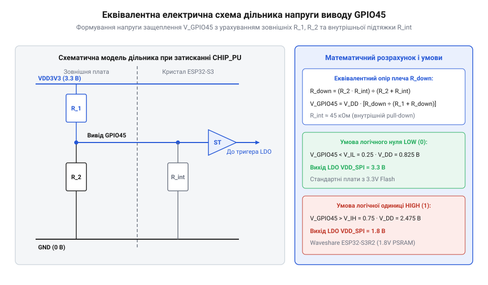

# Розрахунок резистивного дільника та підтяжок strapping-виводу GPIO45

<preknowlist>
- [Мікроконтролер ESP32-S3](root:cat-hw-boards/esp32s3-microcontroller) — функціональне призначення strapping-виводів та принципи роботи внутрішнього регулятора VDD_SPI
- [Родина плат і модулів на ESP32-S3](root:cat-hw-boards/esp32-s3-boards-family-overview) — призначення виводу GPIO45 для конфігурації напруги живильного домену пам'яті 3.3V/1.8V
</preknowlist>

## Проблема неконтрольованого стану виводу GPIO45

Під час подачі живлення або примусового затискання лінії скидання `CHIP_PU` у мікроконтролерах відбувається фіксація апаратних конфігурацій через спеціальні виводи. У чипі [Мікроконтролер ESP32-S3](root:cat-hw-boards/esp32s3-microcontroller) одним із найкритичніших є вивід `GPIO45`, який працює як @@en|strapping (strap)|фіксація конфігураційного стану виводу при скиданні@@-лінія. Саме стан цього виводу в момент відпускання скидання визначає вихідну напругу внутрішнього інтегрованого регулятора `VDD_SPI`. Цей регулятор живить зовнішній кристал флеш-пам'яті та псевдостатичну оперативну пам'ять `PSRAM`.

Якщо на виводі `GPIO45` у момент скидання зафіксовано низький логічний рівень LOW (`V_GPIO45 < V_IL`), внутрішній @@en|LDO (Low Dropout Regulator)|лінійний регулятор напруги з малим падінням@@ встановлює напругу `VDD_SPI` на рівень 3.3 В. Це є стандартним режимом для більшості планарних мікросхем пам'яті, якими оснащується [Родина плат і модулів на ESP32-S3](root:cat-hw-boards/esp32-s3-boards-family-overview). Проте якщо вивід `GPIO45` під час скидання опиняється у високому стані HIGH (`V_GPIO45 > V_IH`), регулятор `VDD_SPI` перемикається у режим 1.8 В.

Невизначений або плаваючий стан виводу `GPIO45` створює пряму загрозу апаратних збоїв під час ініціалізації мікроконтролера. Апаратний фіксатор спирається на часове вікно фіксації strapping-стану тривалістю лише кілька тактів генератора після переднього фронту скидання на контакті `CHIP_PU`. Якщо паразитна ємність монтажного майданчика та доріжки друкованої плати `C_pad` створює тривалу затримку розряду з постійною часу `τ = R_ext × C_pad`, напруга на виводі `GPIO45` не встигає впасти нижче порогу `V_IL` до моменту зчитування конфігурації. У результаті, коли флеш-пам'ять розрахована на 3.3 В, а живильний домен `VDD_SPI` помилково перемикається на 1.8 В, мікроконтролер втрачає можливість зчитувати первинний завантажувач, що призводить до циклічних перезавантажень. У зворотному випадку, при випадковій подачі 3.3 В на 1.8 В мікросхеми, виникає ризик термічного пошкодження кремнієвого кристала. Для усунення неконтрольованого стану необхідно розрахувати та встановити зовнішній стягувальний резистор @@en|pull-down (pull down)|стягувальний резистор до землі@@, який компенсує вплив `C_pad` та надійно утримуватиме напругу нижче порогу `V_IL` протягом усього часового вікна фіксації.

## Еквівалентна схема strapping-кола та напруги

Щоб вирахувати необхідний опір зовнішніх компонентів, необхідно розглянути електричну схему кола виводу `GPIO45` під час активного сигналу скидання `CHIP_PU`.


*Еквівалентна електрична схема дільника напруги на виводі GPIO45 під час фіксації strapping-рівнів при затисканні лінії CHIP_PU.*

У момент скидання внутрішня логіка мікроконтролера вмикає слабкий підтягувальний резистор @@en|pull-up (pull up)|підтягувальний резистор до живлення@@ з еквівалентним опором `R_int` до внутрішньої шини живлення `V_DD` (3.3 В). Значення `R_int` перебуває у межах від 30 кОм до 60 кОм. Ззовні до виводу `GPIO45` підключається резистор `R_2` до спільного проводу GND, а також можливий резистор `R_1` до шини 3.3 В. Окрім пасивних опорів, на потенціал вузла впливає паразитна паралельна складова — струм витоку вхідного каскаду @@en|leakage current (leak)|струм витоку через паразитні діоди та кристал@@ `I_leakage` (до 1 мкА при підвищеній температурі). Складання рівняння струмів за першим законом Кірхгофа у вузлі `V_GPIO45` дає зсув напруги `ΔV_leak = I_leakage · (R_top || R_2)`, який у разі впорскування струму витоку додатково підвищує потенціал вузла на 5–10 мВ, зменшуючи запаси завадостійкості відносно порогу `V_IL`.

Паралельне з'єднання зовнішнього резистора `R_1` та внутрішнього опору `R_int` утворює верхнє плече дільника `R_top`, тоді як `R_2` становить нижнє плече `R_bottom`:

        R_top = (R_1 · R_int) ÷ (R_1 + R_int)

Якщо зовнішній резистор `R_1` відсутній (відкрите коло), верхній опір дорівнює виключно `R_int`. Напруга на вузлі `V_GPIO45` утворюється класичним дільником напруги:

        V_GPIO45 = V_DD · R_2 ÷ (R_top + R_2)

Для надійного встановлення вихідної напруги `VDD_SPI` = 3.3 В потенціал вузла `V_GPIO45` під час скидання обов'язково повинен задовольняти умову `V_GPIO45 < V_IL`.

## Математичний розрахунок меж опорів дільника

Для розрахунку граничних номіналів визначимо нерівність для логічного рівня LOW. Виходячи з формули дільника напруги без зовнішнього верхнього резистора `R_1`:

        V_DD · R_2 ÷ (R_int + R_2) < V_IL

Виконаємо алгебраїчні перетворення для вираження зовнішнього опору `R_2`:

        V_DD · R_2 < V_IL · (R_int + R_2)        [помножили обоє боків на (R_int + R_2)]
        V_DD · R_2 - V_IL · R_2 < V_IL · R_int   [розкрили дужки та перенесли R_2]
        R_2 · (V_DD - V_IL) < V_IL · R_int       [винесли R_2 за дужки]
        R_2 < R_int · V_IL ÷ (V_DD - V_IL)        [виразили граничний опір R_2]

Проведемо аналіз найгіршого випадку (@@en|worst-case (worst case)|аналіз найгіршого випадку з урахуванням допусків@@). Найнесприятливіші умови виникають при максимальній напрузі живлення `V_DD_max` = 3.6 В, мінімальному внутрішньому опорі підтяжки `R_int_min` = 30 кОм та мінімальному гарантованому пороговому значенні низького рівня `V_IL_min` = 0.75 В. Ураховуючи температурну деградацію порогової напруги @@en|thermal degradation (degrade)|температурний зсув порогу спрацьовування КМОН-входів@@ `V_IL(T)` у промисловому діапазоні від -40 °C до +85 °C (з коефіцієнтом від'ємного зсуву порогу КМОН-затворів близько -1.5 мВ/°C), порогова напруга `V_IL(+85°C)` знижується до 0.65 В. Це зменшує гранично припустимий опір `R_2_max(+85°C) = 30000 · 0.65 ÷ (3.6 - 0.65) = 6610.17` Ом порівняно з нормальним значенням 7894.7 Ом при кімнатній температурі. Такий порівняльний розрахунок показує звуження безпечного інтервалу на 16%, що вимагає жорсткішого обмеження номіналу `R_2`:

        R_2_max = 30000 · 0.75 ÷ (3.6 - 0.75)
        = 22500 ÷ 2.85                            [обчислення частки]
        = 7894.7 Ом                               [верхня межа опору R_2]

Отримане значення означає, що опір `R_2` не повинен перевищувати 7.89 кОм. Ураховуючи технологічний допуск (@@en|tolerance (tolerare)|технологічний допуск відхилення номіналу@@) 5% для стандартних резисторів серії E24, максимальний номінальний опір `R_2_nom` обчислюється як:

        R_2_nom < 7894.7 ÷ 1.05
        = 7518.7 Ом                               [максимальний номінал із допуском 5%]

Отже, вибір номіналу `R_2` = 4.7 кОм або 3.3 кОм забезпечує гарантований запас міцності за будь-яких температурних та технологічних відхилень.

## Практичний алгоритм вибору резисторів підтяжки

Під час проєктування друкованих плат на кшталт [ESP32-S3-Zero (Type-C, 4 МБ)](root:cat-hw-boards/esp32-s3-zero) або [ESP32-S3 SuperMini](root:cat-hw-boards/esp32-s3-supermini) розробнику слід дотримуватися послідовного алгоритму розрахунку @@en|pull-down@@-кола, враховуючи не лише електричні пороги напруги, але й статичне енергоспоживання у режимах енергозбереження. У режимі глибокого сну (англ. @@en|Deep Sleep@@) або при активному виведенні високого рівня логічною периферією на резисторі `R_2` виникають безперервні втрати потужності `P_resistor`, які розраховуються за формулою:

```
P_resistor
= (V_DD)² ÷ R_2
= (3.3)² ÷ 4700                                     [обчислення розсіюваної потужності]
= 10.89 ÷ 4700
= 0.002317 Вт                                       [2.317 мВт статичних втрат]
```

Для автономних пристроїв із живленням від акумулятора розсіювання 2.317 мВт є критичним фактором, що може скоротити час автономної роботи. Тому вибір номіналу `R_2` повинен балансувати між максимальним опором для мінімізації `P_resistor` та забезпеченням належного запасу по напрузі `V_GPIO45 < V_IL` з урахуванням струму витоку.

1. Визначити тип встановленої пам'яті Flash/PSRAM та потрібну напругу `VDD_SPI` (3.3 В).
2. Зафіксувати необхідний логічний стан виводу `GPIO45` при скиданні (LOW).
3. Обчислити максимальний допустимий опір `R_2_max` за формулою найгіршого випадку.
4. Обрати найближчий менший стандартний номінал із ряду E24/E96 (наприклад, 4.7 кОм із допуском 1%).
5. Перевірити додаткове струмове навантаження на вивід у робочому режимі, коли `GPIO45` переводиться програмою у стан HIGH:

        I_pin = V_DD ÷ R_2
        = 3.3 ÷ 4700                              [обчислення струму виводу]
        = 0.000702 А                              [0.702 мА]

Струм 0.7 мА знаходиться значно нижче гранично припустимого значення 20 мА для GPIO ESP32-S3, що гарантує енергоефективну та безпечну роботу пристрою.
