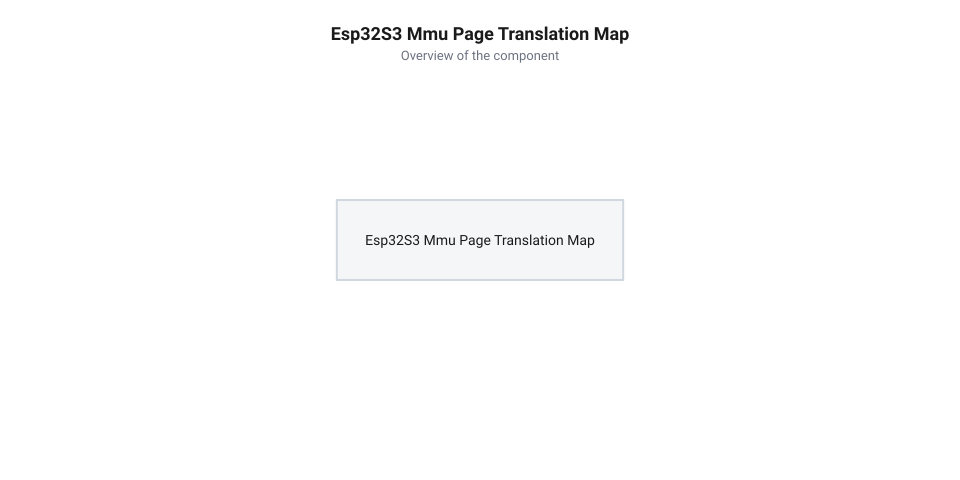

# Розрахунок пропускної здатності шин Flash/PSRAM та сторінкової адресації MMU ESP32-S3

<preknowlist>
- [Мікроконтролер ESP32-S3](root:cat-hw-boards/esp32s3-microcontroller) — внутрішню архітектуру процесорних ядер Xtensa LX7, підсистеми кЕШу та загальні характеристики пам'яті
- [Родина плат і модулів на ESP32-S3](root:cat-hw-boards/esp32-s3-boards-family-overview) — конфігурації Flash та PSRAM у модулях WROOM та MINI
</preknowlist>

## Обмеження продуктивності та пропускна здатність

При розробці інтенсивних графічних застосунків або виконанні алгоритмів машинного навчання на розрахункових ядрах [мікроконтролера ESP32-S3](root:cat-hw-boards/esp32s3-microcontroller) розробники стикаються з несподіваним провисанням швидкодії. Процесорне ядро працює на частоті 240 МГц, проте реальна частота кадрів дисплея або швидкість інференсу нейромереж виявляється суттєво нижчою за теоретичні розрахунки. Причина полягає у тому, що виконання інструкцій коду та обробка великих масивів даних вимагають постійного зчитування інформації з зовнішньої пам'яті @@en|NOR Flash@@ (англ. Flash memory, від flash — спалах) та зовнішньої статичної оперативної пам'яті @@en|PSRAM@@ (англ. Pseudo Static RAM, від pseudo — псевдо + static — статична + RAM — оперативна пам'ять).

Теоретична гранична пропускна здатність шини @@en|bus bandwidth@@ `B` визначається добутком частоти тактування `f_bus` на фізичну ширину шини `W_bus` у бітах. Для стандартної конфігурації @@en|Quad SPI@@ з 4-бітною шиною (`W_bus = 4`) на базовій частоті 40 МГц граничний потік даних становить:

```
B_40_qspi = 40 × 10⁶ × 4 ÷ 8
= 20000000               [підстановка частоти 40 МГц та 4-бітної шини: 20 МБ/с]
```

При підвищенні частоти того самого 4-бітного інтерфейсу до 80 МГц межа пропускної здатності подвоюється:

```
B_80_qspi = 80 × 10⁶ × 4 ÷ 8
= 40000000               [підстановка частоти 80 МГц та 4-бітної шини: 40 МБ/с]
```

Використання розширеної 8-бітної шини @@en|Octal SPI@@ (`W_bus = 8`) забезпечує паралельне передавання повного байта за один тактовий цикл. На частоті 40 МГц це дає таку саму теоретичну межу 40 МБ/с:

```
B_40_ospi = 40 × 10⁶ × 8 ÷ 8
= 40000000               [підстановка частоти 40 МГц та 8-бітної шини: 40 МБ/с]
```

Тоді як при максимізації частоти 8-бітної шини Octal SPI до 80 МГц теоретична межа пропускання сягає 80 МБ/с:

```
B_80_ospi = 80 × 10⁶ × 8 ÷ 8
= 80000000               [підстановка частоти 80 МГц та 8-бітної шини: 80 МБ/с]
```

Порівняння цих режимів показує, що перехід від 4-бітної шини 40 МГц (20 МБ/с) до 8-бітної шини 80 МГц (80 МБ/с) дає чотирикратне теоретичне прискорення вибірки даних.

Шина підключення зовнішньої пам'яті виступає звуженим горлом усієї обчислювальної системи. Якщо ядро виконує операції за один або два тактових цикли `T_clk` (англ. @@en|clock cycle@@), то передача 32-бітного слова з зовнішнього чипа може вимагати десятків тактових імпульсів шини. Загальна пропускна здатність шини @@en|bus bandwidth@@ `B` визначає граничну кількість байтів, яку підсистема пам'яті здатна передати за одну секунду:

```
B = f_bus × W_bus ÷ 8
= 120 × 10⁶ × 8 ÷ 8      [підстановка частоти 120 МГц та 8-бітної шини]
= 120000000              [байтів за секунду, 120 МБ/с]
```

Тут `f_bus` позначає тактову частоту шини пам'яті в герцах, а `W_bus` — фізичну ширину шини в бітах. Проте ця величина є лише теоретичною межею. Реальна продуктивність завжди нижча через накладні витрати на передачу команд, адрес та пауз очікування. Для проєктування систем на базі [родини модулів ESP32-S3](root:cat-hw-boards/esp32-s3-boards-family-overview) необхідний точний математичний розрахунок втрат на шинах передачі даних.

Асинхронність між тактовою частотою процесорного ядра `f_cpu` (до 240 МГц) та тактовою частотою шини пам'яті `f_bus` (40–120 МГц) призводить до того, що під час кожного промаху внутрішнього кешу ядра (англ. @@en|cache miss@@) обчислювальний конвеєр вимушено зупиняється на такти очікування (англ. @@en|wait states@@). Оскільки кожна транзакція зчитування з вибіркою за межі кеш-лінії вимагає не лише передачі корисного слова, але й витримування протокольного заголовка команд та адрес, реальна ефективна швидкість стає функцією від розміру блоку даних та системних затримок контролера. Формулювання цієї математичної залежності дозволяє обчислити точний коефіцієнт корисного використання шини та оцінити реальні втрати продуктивності в інтенсивних обчислювальних циклах.

## Розрахунок шин SPI, Quad та Octal

Для зв'язку з зовнішніми чипами пам'яті в ESP32-S3 застосовуються послідовні інтерфейси різної розрядності: класичний @@en|SPI@@ (англ. Serial Peripheral Interface, від serial — послідовний + peripheral — периферійний + interface — інтерфейс) з 1-бітною шиною даних, @@en|Quad SPI@@ (чотирибітна шина даних) та @@en|Octal SPI@@ (восьмибітна шина даних). Кожен транзакційний запит до пам'яті складається з чотирьох послідовних фаз: передачі коду команди, передачі адреси комірки, фази холостих тактових циклів затримки (англ. @@en|dummy cycles@@) та фази безпосереднього зчитування або запису корисних даних.

Загальний час виконання однієї транзакції зчитування `t_trans` обчислюється як сума тривалостей усіх чотирьох фаз. Кількість тактових циклів для фази даних `C_data` залежить від розміру порції даних `N_bytes` та ширини шини `W_bus` в бітах:

```
C_data = N_bytes × 8 ÷ W_bus
```

Кількість тактових циклів фази команди `C_cmd` та адреси `C_addr` становить `8 ÷ W_bus` та `32 ÷ W_bus` відповідно за умови використання того самого режиму розрядності. Сумарна кількість тактових циклів транзакції `C_total` визначається виразом:

```
C_total = C_cmd + C_addr + C_dummy + C_data
```

Ефективна пропускна здатність шини `B_eff` розраховується як відношення обсягу корисних даних `N_bytes` до повного часу транзакції `C_total ÷ f_bus`:

```
B_eff = N_bytes × f_bus ÷ C_total
```

**Обчислення ефективної пропускної здатності для транзакції 64 байти на частоті 80 МГц:**

Розглянемо порівняльний розрахунок для @@en|Quad SPI@@ (`W_bus = 4`) та @@en|Octal SPI@@ (`W_bus = 8`) у режимі single data rate при зчитуванні блоку `N_bytes = 64` байти зі значенням `C_dummy = 6` такти на частоті `f_bus = 80` МГц (80 000 000 Гц).

Для Quad SPI:
```
C_data = 64 × 8 ÷ 4 = 128
C_cmd = 8 ÷ 4 = 2
C_addr = 32 ÷ 4 = 8
C_total = 2 + 8 + 6 + 128
= 144                      [сумарна кількість тактових циклів]
B_eff = 64 × 80000000 ÷ 144
= 35555555.55              [байтів за секунду, ≈ 35.56 МБ/с]
```

Для Octal SPI на тій самій частоті 80 МГц з `C_dummy = 6`:
```
C_data = 64 × 8 ÷ 8 = 64
C_cmd = 8 ÷ 8 = 1
C_addr = 32 ÷ 8 = 4
C_total = 1 + 4 + 6 + 64
= 75                       [сумарна кількість тактових циклів]
B_eff = 64 × 80000000 ÷ 75
= 68266666.67              [байтів за секунду, ≈ 68.27 МБ/с]
```

У режимі @@en|Octal SPI DDR@@ (англ. Double Data Rate, від double — подвійна + data — дані + rate — швидкість) дані передаються за обома фронтами тактового сигналу, що подвоює ефективну розрядність до 16 бітів за цикл для фази даних. На частоті 120 МГц це забезпечує пікову корисну пропускну здатність понад 190 МБ/с.

## Сторінкова адресація блоку MMU

Процесорні ядра Xtensa LX7 у [мікроконтролері ESP32-S3](root:cat-hw-boards/esp32s3-microcontroller) не звертаються до зовнішніх чипів пам'яті напряму через фізичні адреси шини SPI. Замість цього вони працюють у 32-бітному віртуальному адресному просторі. Перетворення віртуальних адрес `VA` (англ. @@en|virtual address@@) у фізичні адреси `PA` (англ. @@en|physical address@@) виконує апаратний блок керування пам'яттю @@en|MMU@@ (англ. Memory Management Unit, від memory — пам'ять + management — керування + unit — блок).


_Схема сторінкової трансляції 64 КБ блоків MMU між віртуальним простором адрес Xtensa LX7 та фізичною шиною Octal SPI._

Вся пам'ять у MMU ESP32-S3 розбита на фіксовані блоки — сторінки обсягом 64 КБ (`65536` байтів, або `2¹⁶` байтів). Тому старші 16 бітів 32-бітної віртуальної адреси виконують роль індексу віртуальної сторінки `VPI` (англ. @@en|virtual page index@@), а молодші 16 бітів визначають зміщення `Offset` всередині цієї сторінки.

Математична модель трансляції адреси базується на зчитуванні запису з таблиці сторінок @@en|PTE@@ (англ. @@en|page table entry@@):

```
Offset = VA & 0xFFFF
VPI = VA >> 16
PA = (PTE[VPI] × 65536) + Offset
```

Зміщення всередині сторінки лишається незмінним при будь-якій трансляції, оскільки `64 КБ = 2¹⁶`:

```
VA = (VPI << 16) + Offset
= (VPI × 65536) + Offset   [розкладання адреси за розрядними масками]
```

Якщо звернення відбувається до адреси, яка не кешована в внутрішній швидкій оперативній пам'яті SRAM, виникає промах кешу (англ. @@en|cache miss@@). У цей момент контролер MMU блокує конвеєр процесора на час підвантаження усієї 64-кілобайтної сторінки або її окремого кеш-рядка (32 або 64 байти) з фізичної пам'яті Flash або PSRAM через шину Octal SPI.

## Затримки PSRAM та частота кадрів

При роботі з графічними дисплеями у проєктах на кшталт [модулів ESP32-CAM](root:cat-hw-boards/esp32-cam) кадровий буфер зображення @@en|framebuffer@@ зберігається у зовнішній @@en|PSRAM@@ через її великий обсяг. Обчислення граничної частоти оновлення екрана (англ. @@en|frame rate@@, FPS) вимагає врахування як смуги пропускання шини, так і апаратних затримок доступу @@en|latency@@.

Обсяг одного кадру зображення `S_frame` в байтах для роздільної здатності `W × H` при кодуванні кольору 16 біт на піксель (формат RGB565, 2 байти на піксель) дорівнює:

```
S_frame = W × H × 2
```

Для дисплея роздільністю 480 × 320 пікселів:

```
S_frame = 480 × 320 × 2
= 307200                   [байтів на один кадр, ≈ 307.2 КБ]
```

Час зчитування одного кадру `t_frame` з урахуванням ефективної пропускної здатності `B_eff` та середнього часу початкової затримки вибірки `t_lat` на кожен пакетний запит обчислюється як:

```
t_frame = (S_frame ÷ B_eff) + (N_bursts × t_lat)
```

Де `N_bursts` — кількість пакетних звернень до пам'яті для вибірки всього буфера. Гранична частота кадрів `FPS` розраховується за формулою:

```
FPS = 1 ÷ t_frame
```

**Обчислення граничного FPS для дисплея 480 × 320 при шині Octal SPI 80 МГц:**

Нехай ефективна швидкість передачі даних складає `B_eff = 68.27` МБ/с (`68266667` Б/с), а сумарні втрати на затримки вибірки пакетів `N_bursts × t_lat` складають `0.0008` секунди (0.8 мілісекунди).

```
t_data = 307200 ÷ 68266667
= 0.0045                   [секунд, 4.5 мілісекунди]
t_frame = 0.0045 + 0.0008
= 0.0053                   [секунд на один кадр, 5.3 мілісекунди]
FPS = 1 ÷ 0.0053
= 188.68                   [кадрів за секунду]
```

Проте при одночасному виконанні розрахунків моделей штучного інтелекту процесорне ядро постійно конкурує з DMA-контролером дисплея за доступ до шини PSRAM. Якщо шина завантажена обчисленнями на 70%, доступна смуга для кадрового буфера падає до `0.30 × B_eff` (приблизно 20.48 МБ/с):

```
t_data_busy = 307200 ÷ 20480000
= 0.0150                   [секунд, 15 мілісекунди]
t_frame_busy = 0.0150 + 0.0008
= 0.0158                   [секунд]
FPS_busy = 1 ÷ 0.0158
= 63.29                    [кадрів за секунду]
```

Таким чином, конкуренція за шину пам'яті знижує швидкодію виводу більше ніж утричі, що необхідно враховувати під час розподілу ресурсів у реальних системах.
