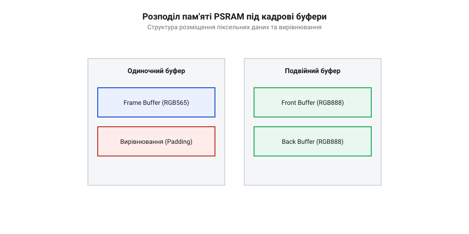
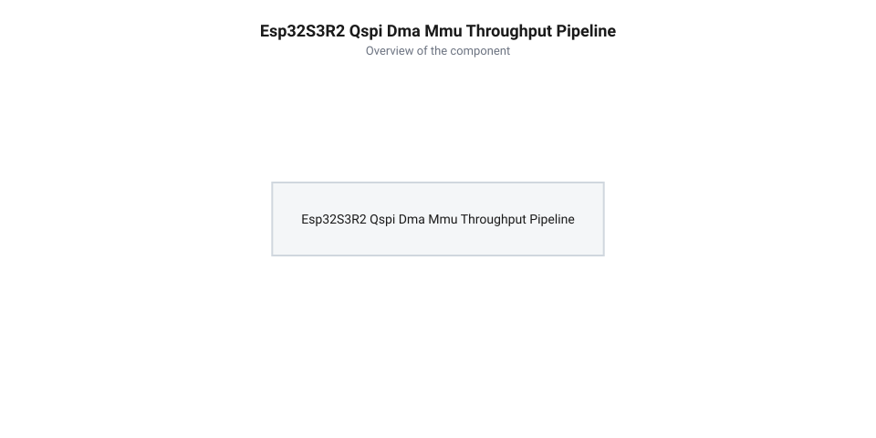

# Розрахунок пропускної здатності шини QSPI та кадрових буферів у PSRAM

<preknowlist>
- [Мікроконтролер ESP32-S3](root:cat-hw-boards/esp32s3-microcontroller) — розуміння архітектури ядра Xtensa LX7, системи кешування та організації внутрішньої SRAM
- [Waveshare ESP32-S3-Pico](root:cat-hw-boards/esp32-s3-pico) — специфіка підключення зовнішньої пам’яті PSRAM та конфігурація шини QSPI в модулях серії S3
- [ESP32-CAM (OV2640 + microSD)](root:cat-hw-boards/esp32-cam) — базові поняття формування відеопотоку та організація кадрових буферів для зйомки
</preknowlist>

## Проблема пам'яті для кадрових буферів

Спроба зберегти нестиснений графічний або відеокадр безпосередньо у внутрішній оперативній пам'яті на [мікроконтролерах ESP32-S3](root:cat-hw-boards/esp32s3-microcontroller) спричиняє негайне вичерпання апаратних ресурсів. Хоча кристал ESP32-S3 містить 512 кБ загальної статичної пам'яті @@en|SRAM@@ (англ. *static random-access memory*, від *static* — статичний, *random-access* — з довільним доступом, *memory* — пам'ять), ця область суворо сегментована між пам'яттю інструкцій ядра IRAM, системними буферами та динамічною кучею @@en|DRAM@@ (англ. *dynamic random-access memory*). На практиці неперервний блок доступної кучі для виділення великих масивів рідко перевищує 320 кБ.

Обчислимо необхідний обсяг байтів `V_frame` для збереження одного графічного кадрового буфера стандартної роздільності VGA (640×480 пікселів) у колірному форматі @@en|RGB565@@:

```
N_pix = W × H
= 640 × 480              [роздільність кадру VGA]
= 307200 пікселів        [кількість пікселів кадру]

V_frame = N_pix × bpp
= 307200 × 2             [кодуванню RGB565 відповідає 2 байти на піксель]
= 614400 байтів          [обсяг одиночного кадрового буфера]
≈ 600 кБ                 [переведення в кілобайти]
```

Зіставлення отриманого значення `V_frame ≈ 600` кБ із теоретично доступним обсягом динамічної пам'яті SRAM (320 кБ) показує перевищення апаратного ліміту у 1.875 раза. Спроба виділити пам'ять під два такі буфери для плавної зміни кадрів вимагатиме вже 1200 кБ. На практиці реальний найбільший суцільний блок пам'яті в системному стеку виявляється ще меншим за 320 кБ: частина внутрішньої SRAM (зазвичай від 64 до 128 кБ) резервується ще при старті системного завантажувача під область інструкцій ядра IRAM для збереження векторів переривань та швидкодіючих функцій FreeRTOS, а динамічна куча DRAM зазнає неминучої фрагментації при виділенні дрібних системних об'єктів. Фрагментація розбиває загальний простір кучі на множину розрізнених фрагментів, через що найбільший суцільний блок, доступний алокатору пам'яті, часто не перевищує 100–120 кБ. Це робить використання внутрішньої SRAM принципово неможливим для нестиснених масивів пікселів роздільностей VGA і вище та змушує інженерів застосовувати зовнішню псевдостатичну оперативну пам'ять @@en|PSRAM@@ (англ. *pseudo-static random-access memory*, від *pseudo* — псевдо, *static* — статичний, *memory* — пам'ять), яка встановлюється у компактних модулях розробки на кшталт [Waveshare ESP32-S3-Pico](root:cat-hw-boards/esp32-s3-pico).

Математичний аналіз втрат оперативної пам'яті показує, що додатковим чинником вичерпання кучі @@en|DRAM@@ є розміщення та динамічне розширення системних структур операційної системи @@en|FreeRTOS@@. Таблиця векторів переривань (англ. @@en|Interrupt Vector Table@@, скорочено IVT: interrupt — переривання, vector — вектор, table — таблиця) двоядерного процесора та резервовані апаратні стеки переривань вимагають неперервного виділення пам'яті. Обчислимо загальний обсяг пам'яті `V_ivt`, який виділяється під таблицю векторів та окремі стеки переривань для двох ядер `N_core = 2` при кількості векторів на ядро `N_vec = 32`, розмірі елемента таблиці `S_entry = 16` байтів і розмірі апаратного стека переривань `S_stack = 4096` байтів:

```
V_table = N_core × N_vec × S_entry
= 2 × 32 × 16                [множення кількості ядер, векторів та розміру запису]
= 1024 байтів                [розмір базової таблиці векторів]

V_ivt = V_table + N_core × S_stack
= 1024 + 2 × 4096            [додавання стеків переривань двох ядер]
= 9216 байтів                [сумарний обсяг системної пам'яті під переривання]
≈ 9.0 кБ                     [переведення в кілобайти]
```

При підключенні складних периферійних драйверів (таких як камери чи Wi-Fi) кожен зареєстрований обробник переривань виділяє додаткові дескриптори контексту `S_ctx = 256` байтів для `N_active = 16` периферійних ліній. Обчислимо додаткові накладні витрати пам'яті `V_ext`:

```
V_ext = N_active × S_ctx
= 16 × 256                   [множення кількості активних ліній на розмір контексту]
= 4096 байтів                [додатковий обсяг пам'яті під дескриптори]
= 4.0 кБ                     [переведення в кілобайти]
```

Сумарне вилучення `V_ivt_total = 9.0 + 4.0 = 13.0` кБ здійснюється у вигляді непересувних статичних блоків прямо з внутрішньої пам'яті @@en|DRAM@@. Оскільки ці блоки розміщуються алокатором кучі на ранньому етапі ініціалізації ядра, вони додатково розсікають адресний простір, підсилюючи ефект фрагментації та остаточно унеможливлюючи виділення кадрових буферів розміром у сотні кілобайтів у внутрішній пам'яті.

## Розрахунок обсягу кадрових буферів

Обсяг оперативної пам'яті під один кадр залежить від горизонтальної роздільності `W`, вертикальної роздільності `H` та колірної глибини `bpp` (від англ. @@en|bpp@@ — *bits per pixel*, кількість бітів або байтів на один піксель). Для монохромних або сирих сенсорних даних @@en|RAW8@@ використовується `bpp = 1` байт, для упакованого розширеного формату @@en|RAW10@@ — `bpp = 1.25` байта, а для стандартних колірних систем @@en|RGB565@@ та @@en|YUV422@@ потрібні `bpp = 2` байти (16 бітів) на піксель.

При організації неблокуючого виведення графіки застосовують подвійну буферизацію @@en|double buffering@@ (англ. *double buffering*, від *double* — подвійний, *buffering* — буферизація), де один буфер відображається на екрані, а другий паралельно заповнюється контролером. Обсяг подвійного кадрового масиву `V_double` розраховується за формулою:

```
V_single = W × H × bpp    [обсяг одного кадрового буфера]

V_double = 2 × V_single  [подвійний обсяг під подвійну буферизацію]
```


*Схема розподілу пам'яті PSRAM під одиночний та подвійний кадрові буфери різних колірних форматів, що показує розміщення піксельних даних та їх вирівнювання за межами слів.*

Обчислимо необхідну пам'ять `V_double` для роздільності SVGA (800×600 пікселів) у формати @@en|RGB565@@ з урахуванням вирівнювання адреси контролера @@en|DMA@@ (англ. *direct memory access*) за межею 32-бітних слів (4 байти):

```
N_pix = 800 × 600
= 480000 пікселів        [кількість пікселів кадру SVGA]

V_single = 480000 × 2
= 960000 байтів          [обсяг одиночного кадру]
= 937.5 кБ               [переведення в кілобайти]

V_double = 2 × 960000
= 1920000 байтів         [обсяг подвійного буфера]
≈ 1.831 МБ               [переведення в мегабайти]
```

Для вищої роздільності HD (1280×720 пікселів) у кодуванні @@en|YUV422@@ одиночний буфер вимагає `V_single = 1280 × 720 × 2 = 1843200` байтів (1.758 МБ), а подвійний — `V_double = 3.686` МБ, що легко вміщується у 2 МБ чи 8 МБ PSRAM чипу ESP32-S3R2.

Для упакованого фотоформату @@en|RAW10@@ (англ. *raw 10-bit image format*, від *raw* — необроблений, *bit* — двійковий розряд) сенсор транслює 10 бітів на один піксель, об'єднуючи 4 суміжні пікселі (40 бітів) у 5 послідовних байтів пам'яті. У цій схемі 4 перші байти зберігають старші 8 бітів кожного пікселя, а 5-й байт містить молодші 2 біти усіх 4 пікселів, що дає середню колірну глибину `bpp = 5 ÷ 4 = 1.25` байта на піксель. Для роздільності HD (1280×720 пікселів) обчислення обсягу кадрового буфера за цим алгоритмом дає наступне значення:

```
N_pix = 1280 × 720
= 921600 пікселів        [кількість пікселів кадру HD]

V_single = 921600 × 1.25
= 1152000 байтів         [обсяг одиночного буфера RAW10]
= 1125 кБ                [переведення в кілобайти]
≈ 1.099 МБ               [переведення в мегабайти]

V_double = 2 × 1152000
= 2304000 байтів         [обсяг під подвійне буферизування]
≈ 2.197 МБ               [переведення в мегабайти]
```

Завдяки упаковуванню в @@en|RAW10@@ обсяг кадрового буфера зменшується на 37.5% порівняно з @@en|RGB565@@, вивільняючи понад 1.38 МБ в [оперативній пам'яті ESP32-S3](root:cat-hw-boards/esp32s3-microcontroller) для розміщення інших структур даних.

Проте залишкова економія обсягу пам'яті при використанні упакованого формату @@en|RAW10@@ вимагає додаткових обчислювальних накладних витрат процесорного ядра на розпаковку бітових масок (англ. @@en|bitmask@@). Для відновлення повноцінного 16-бітного значення кожного пікселя ядро Xtensa LX7 у чипі [Мікроконтролер ESP32-S3](root:cat-hw-boards/esp32s3-microcontroller) мусить для кожної групи з 5 байтів виконати ссуви та побітові операції `AND`/`OR` для вилучення молодших 2 бітів з 5-го байта. Обчислимо процесорний час `t_unpack`, необхідний для розпаковки кадру HD-роздільності (`1280×720` пікселів, `N_pix = 921600`) при середніх накладних витратах `k_op = 5` інструкцій на піксель та тактовій частоті ядра `f_cpu = 240` МГц:

```
N_inst = N_pix × k_op
       = 921600 × 5             [підстановка 921600 пікселів та 5 інструкцій на піксель]
       = 4608000 інструкцій     [загальний обсяг інструкцій розпаковки кадру]

t_unpack = N_inst ÷ f_cpu
         = 4608000 ÷ (240 × 10⁶) [підстановка тактової частоти ядра 240 МГц]
         = 1.92 × 10⁻² с        [теоретичний час програмного витягування пікселів]
         = 19.2 мс              [переведення в мілісекунди]
```

Тривалість `t_unpack = 19.2` мс показує, що програмна розпаковка @@en|RAW10@@ одним ядром без використання векторних @@en|SIMD@@-інструкцій вимагає близько 57.6% обчислювального ресурсу процесора при частоті `30 FPS` (`30 × 19.2 мс = 576 мс` за секунду), що необхідно враховувати при розподілі задач між двома ядрами.

## Теоретична пропускна здатність шини QSPI

Зовнішня пам'ять PSRAM у модифікаціях ESP32-S3R2 підключається через 4-бітну послідовну шину Quad SPI — @@en|QSPI@@ (англ. *Quad Serial Peripheral Interface*, від *quad* — чотириразовий, *serial* — послідовний, *peripheral* — периферійний, *interface* — інтерфейс). Інтерфейс працює на тактовій частоті `f_clk = 80` МГц та передає 4 біти даних за один тактовий імпульс.

Обчислимо питому теоретичну швидкість передачі даних `R_raw` по шині QSPI:

```
R_raw = f_clk × w_bus
= 80 × 10⁶ × 4 біт/с     [підстановка частоти 80 МГц та 4-бітної шини]
= 320 × 10⁶ біт/с        [теоретичний пропускний потік у бітах]
= 40000000 байт/с        [ділення на 8 бітів у байті]
= 40.0 МБ/с              [теоретична пропускна здатність шини]
```

Проте реальний потік обміну обмежується апаратними накладними витратами командних циклів, адресації та затримок трансляції блоком управління пам'яттю @@en|MMU@@ (англ. *memory management unit*, від *memory* — пам'ять, *management* — управління, *unit* — блок). При неперервному прокачуванні блоків контролером DMA коефіцієнт корисного використання шини становить близько `η = 0.85`, що дає дійсну пропускну здатність `R_eff = 40.0 × 0.85 = 34.0` МБ/с.


*Конвеєр передачі даних кадрового буфера через MMU, кеш та DMA контролер шини QSPI з покроковим виділенням затримок арбітражу та накладних витрат.*

Визначимо теоретичну граничну частоту кадрів @@en|FPS@@ (англ. *frames per second*, від *frames* — кадри, *second* — секунда) для передачі буфера SVGA (960000 байтів) по шині QSPI, врахувавши вплив командних і адресових фаз протоколу на реальну тривалість транзакції. Кожне звернення до мікросхеми @@en|PSRAM@@ по шині @@en|QSPI@@ містить службові фази: фазу команди (1 байт, тобто 2 такти на 4-бітній шині), фазу адреси (3–4 байти, тобто 6–8 тактів) та фазу очікування (англ. *dummy cycles*, від *dummy* — фіктивний, *cycle* — цикл, зазвичай 6–8 тактових імпульсів для внутрішньої вибірки осередків), після яких слідує фаза передачі даних (4 біти за такт). У результаті повна тривалість транзакції `T_trans` складається з накладних витрат заголовка `t_hdr` та часу передачі корисного навантаження `t_data` (`T_trans = t_hdr + t_data`). Під час заповнення ліній кешу чи пакетних передач @@en|DMA@@ фіксований заголовок `t_hdr ≈ 16–24` тактів додається до кожної окремої порції даних, через що реальний коефіцієнт використання шини `η = t_data ÷ T_trans` знижується до значення близько `0.85` і визначає граничний потік кадрів:

```
FPS_max = R_eff ÷ V_single
= 34000000 ÷ 960000      [підстановка ефективної швидкості та розміру кадру]
= 35.416667 кадр/с       [обчислення граничної частоти кадрів]
≈ 35.4 FPS               [округлення до одного знака]
```

Розрахована частота `35.4 FPS` доводить, що пропускна здатність 4-бітної шини QSPI на 80 МГц є достатньою для плавної трансляції SVGA-відеопотоку, але створює вузьку шийку при спробах виведення нестисненого HD-відео (`1843200` байтів, де `FPS_max ≈ 18.4 FPS`).

## Вплив кешу MMU та затримок DMA

При прямому зверненні ядра процесора або периферійного контролера до зовнішньої пам'яті @@en|PSRAM@@ реальна швидкість обміну виявляється нижчою за теоретичну межу 40 МБ/с шини @@en|Quad SPI@@ (4 біти × 80 МГц ÷ 8 = 40 МБ/с). Головною причиною додаткових накладних витрат є необхідність апаратного перетворення віртуальних адрес у фізичні через блок керування пам'яттю (від англ. @@en|Memory Management Unit@@ — блок керування пам'яттю, @@en|MMU@@) та затримки при оновленні рядків кеш-пам'яті (від англ. @@en|cache line@@ — рядок кешу). Кожне звернення до нової сторінки пам'яті обсягом 64 КБ вимагає від транслятора MMU оновлення записів таблиці сторінок, що додає затримку очікування (від англ. @@en|lookup latency@@ — затримка пошуку в таблиці).

Контролер прямого доступу до пам'яті (від англ. @@en|Direct Memory Access@@ — прямий доступ до пам'яті, @@en|DMA@@) у [мікроконтролері ESP32-S3](root:cat-hw-boards/esp32s3-microcontroller) вибирає дані з шини не поодинокими байтами, а пакетними транзакціями (від англ. @@en|burst transaction@@ — пакетна передача) через фіксовані дескриптори (від англ. @@en|DMA descriptor@@ — дескриптор DMA). Якщо розмір чанка (від англ. @@en|chunk size@@ — розмір блоку) `S_chunk` обрано занадто малим (наприклад, `64` або `128` байтів), накладні витрати на перезавантаження покажчиків наступного дескриптора `t_desc` почнуть домінувати над часом корисної передачі. Для оцінки ефективної пропускної здатності `B_eff` враховують коефіцієнт влучань у кеш `h_cache` (від англ. @@en|cache hit ratio@@ — частка влучань у кеш) та накладний оверхед DMA.

Ефективна пропускна здатність `B_eff` розраховується через теоретичну швидкість `B_theory = 40 МБ/с`, коефіцієнт оверхеду трансляції MMU `k_mmu` та коефіцієнт ефективності дескрипторів `k_dma = S_chunk / (S_chunk + B_theory × t_desc)`:

**Обчислення ефективної пропускної здатності шини QSPI для чанку DMA розміром 4095 байтів:**
```
k_dma = S_chunk ÷ (S_chunk + B_theory × t_desc)
      = 4095 ÷ (4095 + 40 × 10^6 × 0.5 × 10^-6) [підстановка S_chunk = 4095 байт, t_desc = 0.5 мкс]
      = 4095 ÷ (4095 + 20)                     [обчислення байтового еквівалента затримки]
      = 4095 ÷ 4115                            [сума у знаменнику]
      ≈ 0.9951                                 [коефіцієнт ефективності DMA]

B_eff = B_theory × k_mmu × k_dma
      = 40 × 0.92 × 0.9951                     [підстановка k_mmu = 0.92 для розпереділеного кешу]
      = 36.8 × 0.9951                          [добуток теоретичної швидкості на оверхед MMU]
      ≈ 36.62 МБ/с                             [дісна пропускна здатність шини]
```

З обчислення видно, що використання максимального розміру дескриптора DMA `S_chunk = 4095 байтів` забезпечує ефективність вибірки понад `99.5%`, зменшуючи реальну втрату швидкості лише до рівня накладних витрат MMU. Зменшення ж розміру чанка до `128` байтів знизило б `k_dma` до `0.865`, зрізавши підсумкову швидкість шини до `31.8 МБ/с`, що спричинило б переповнення апаратного FIFO камери й втрату пакетів.

Окремим фактором погіршення швидкодії є промахи кешу (англ. @@en|cache miss@@) при нелінійному доступі до пікселів у кадровому буфері @@en|framebuffer@@, зокрема під час повороту зображення на 90° або 270°. У растровому поданні графіки пікселі розміщуються послідовно рядок за рядком, тому при звичайному послідовному зчитуванні один рядок кешу обсягом 32 байти завантажує одразу 16 суміжних пікселів у форматі @@en|RGB565@@, що забезпечує високий коефіцієнт влучань `h_cache ≈ 95–98%`. Проте при вертикальному обході матриці для повороту кадру кожне наступне звернення по осі Y відбувається з кроком страйду (англ. @@en|stride@@) `W × 2` байти (для роздільності SVGA `800 × 2 = 1600` байтів). Це призводить до виходу за межі поточного рядка кешу та спричиняє промах при кожному пікселі, знижуючи частку влучань майже до нуля `h_cache ≈ 3–6%`. Штраф за промах кешу `t_miss ≈ 1.5` мкс на завантаження нового рядка через шину @@en|Quad SPI@@ знижує коефіцієнт оверхеду `k_mmu` до `0.12–0.15`, зрізаючи реальну пропускну здатність `B_eff` з 36.6 МБ/с до критичних `4.8–6.0` МБ/с. У результаті частота кадрів при поворотній обробці падає з 30 FPS до 3–4 FPS, що робить алгоритмічне блокове розбиття (англ. @@en|tiling@@) через внутрішню оперативну пам'ять неминучим для компенсації затримок шини, які має [мікроконтролер ESP32-S3](root:cat-hw-boards/esp32s3-microcontroller).

## Обчислення граничної частоти кадрів

Фінальною задачею проєктування відеотракту чи графічного інтерфейсу є розрахунок граничної частоти кадрів `FPS_max` (від англ. @@en|Frames Per Second@@ — кадрів на секунду), яку здатна забезпечити шина пам'яті без виникнення артефактів розриву кадру (від англ. @@en|tearing@@ — розрив зображення через неузгодженість частот оновлення). При використанні подвійної буферизації на [платі Waveshare ESP32-S3-Pico](root:cat-hw-boards/esp32-s3-pico) шина QSPI одночасно обслуговує два зустрічні потоки: зчитування попереднього кадру графічним контролером або мережевим стеком та паралельний запис нового кадру від камери чи алгоритму рендерингу.

Гранична частота кадрів `FPS_max` визначається як частка від ділення дісної пропускної здатності `B_eff` на сумарний обсяг даних, який необхідно прокачати через шину за один кадровий цикл. Для режиму подвійної буферизації `V_double` з урахуванням коефіцієнта шинної конкуренції `k_bus` розраховують максимальну частоту кадрів за формулою.

Розрахуємо граничну частоту кадрів `FPS_max` для роздільності `VGA` (`640×480` пікселів, колірний формат `RGB565`, обсяг одного кадру `V_frame = 614.4 КБ = 0.6144 МБ`, обсяг подвійного буфера `V_double = 1.2288 МБ`) при ефективній швидкості шини `B_eff = 36.62 МБ/с` та коефіцієнті конкуренції ядра й периферії `k_bus = 0.85`:

**Обчислення граничної частоти кадрів (FPS) для роздільності VGA (640×480, RGB565) у режимі подвійної буферизації:**
```
V_cycle = V_frame × 2
        = 0.6144 × 2                           [подвійне прокачування кадру через PSRAM]
        = 1.2288 МБ                            [обсяг даних за один повний кадровий цикл]

FPS_max = (B_eff × k_bus) ÷ V_cycle
        = (36.62 × 0.85) ÷ 1.2288              [підстановка дісної швидкості шини та обсягу циклу]
        = 31.127 ÷ 1.2288                      [врахування коефіцієнта шинної конкуренції]
        ≈ 25.33 кадрів/с                       [максимальна частота оновлення кадрів]
```

Результат у `25.33 кадрів/с` показує, що для роздільності `VGA` у нестисненому форматі `RGB565` 4-бітна шина QSPI працює на граничних режимах, забезпечуючи базову плавність відео `25 FPS`. Для підвищення частоти кадрів у розробках на базі [модулів ESP32-CAM](root:cat-hw-boards/esp32-cam) необхідно застосовувати апаратне стиснення JPEG або переходити на нижчі роздільності (наприклад, `HVGA` `480×320`), що зменшує `V_frame` удвічі й піднімає граничну частоту кадрів понад `50 FPS` без ризику розривів зображення `tearing`. Впровадження потрійної буферизації (англ. @@en|triple buffering@@) повністю усуває затримки очікування кадрової синхронізації та ліквідує ефект @@en|tearing@@ за рахунок додавання третього транзитного буфера, що збільшує загальний обсяг виділеної пам'яті до `V_triple = 3 × V_frame = 3 × 0.6144 МБ = 1.8432 МБ`. Оскільки обробка трьох рознесених у пам'яті блоків підвищує ймовірність промахів кешу MMU, коефіцієнт шинної конкуренції знижується до `k_bus,triple ≈ 0.78`. При використанні перемикання вказівників (англ. @@en|pointer swapping@@) без фізичного копіювання даних обсяг транзакцій на один кадр становить `V_cycle = 2 × V_frame = 1.2288 МБ`, що дає граничну частоту `FPS_max,triple = (36.62 × 0.78) ÷ 1.2288 ≈ 23.24` кадрів/с. У випадку ж помилкової реалізації з байтовим копіюванням вмісту буферів шинний цикл зростає до `V_cycle = 3 × V_frame = 1.8432 МБ`, скорочуючи пропускну здатність до `FPS_max = (36.62 × 0.78) ÷ 1.8432 ≈ 15.5` кадрів/с, що математично обґрунтовує критичну важливість покажчикової адресації при роботі з потрійними буферами в пам'яті @@en|PSRAM@@.
