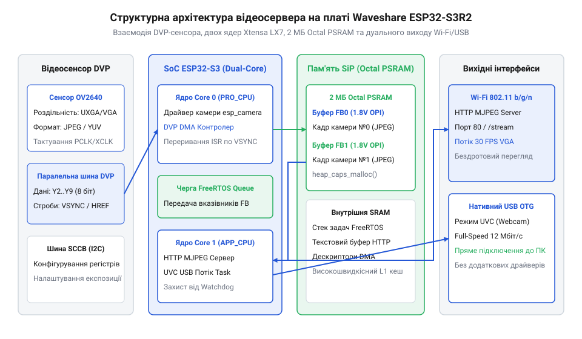
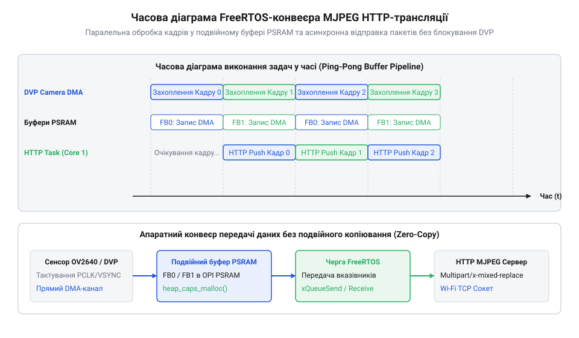

# Проєкт автономного відеосервера на базі Waveshare ESP32-S3R2

<preknowlist>
- [ESP32-CAM (OV2640 + microSD)](root:cat-hw-boards/esp32-cam) — базові принципи роботи камери OV2640 та плати розробки з кадровим буфером
- [Модуль ESP32-CAM: огляд архітектури, периферії та сімейства плат](root:cat-hw-boards/esp32-cam-camera-module-family) — архітектура DVP-інтерфейсу, виклики esp_camera_fb_get() та вивільнення ресурсів esp_camera_fb_return()
- [Родина плат і модулів на ESP32-S3](root:cat-hw-boards/esp32-s3-boards-family-overview) — відмінності шин пам'яті Quad SPI та Octal SPI PSRAM у мікроконтролерах ESP32-S3
</preknowlist>

## Архітектура відеосервера та апаратні обмеження

Розробка компактних автономних систем відеоспостереження та бездротової трансляції на базі мікроконтролерів традиційно впирається у жорстке обмеження обсягу оперативної пам'яті. При спробі організувати трансляцію відеопотоку у форматі @@en|MJPEG@@ (від англ. @@en|Motion Joint Photographic Experts Group@@, алгоритм покадрового стиснення зображень) розробники стикаються з катастрофічним просіданням частоти кадрів (@@en|FPS@@, від англ. @@en|Frames Per Second@@) або повним аварійним завершенням програми.

Причина полягає у фізичній природі кадрового буфера. Для обробки одного кадру роздільної здатності @@en|VGA@@ (`640 × 480` точок) у форматі @@en|JPEG@@ потрібен суцільний блок пам'яті розміром від 30 до 100 КБ залежно від коефіцієнта стиснення. Популярні модулі попереднього покоління, такі як [плата ESP32-CAM з фотосенсором](root:cat-hw-boards/esp32-cam), спираються на внутрішню статичну оперативну пам'ять @@en|SRAM@@ (від англ. @@en|Static Random-Access Memory@@, швидка напівпровідникова пам'ять на тригерах). Обсяг внутрішньої кучі обмежений кількома сотнями кілобайтів, які також мусять ділитися з буферами бездротового стека @@en|Wi-Fi@@ та робочими стеками задач. Огляд [модулів сімейства ESP32-CAM](root:cat-hw-boards/esp32-cam-camera-module-family) детально показує, що розміщення кадрового буфера у внутрішній пам'яті примушує знижувати роздільну здатність до мінімальної та унеможливлює використання подвійної буферизації (@@en|double buffering@@).

Без подвійної буферизації фотосенсор змушений очікувати, поки мережевий сокет повністю відправить поточний кадр клієнту. Під час цієї паузи нові кадри втрачаються, а швидкість мовлення падає до кількох кадрів на секунду. Побудова повноцінного асинхронного відеосервера вимагає наявності принаймні двох кадрових буферів високої роздільності, що потребує мегабайтів оперативної пам'яті.

Плата розробки @@en|Waveshare ESP32-S3R2@@ докорінно змінює архітектурні можливості завдяки інтеграції 2 МБ зовнішньої квазістатичної пам'яті @@en|PSRAM@@ (від англ. @@en|Pseudo-Static Random-Access Memory@@, динамічна пам'ять із внутрішнім контролером регенерації та послідовним інтерфейсом). На відміну від повільніших шин минулих поколінь, у цьому модулі застосовано шину @@en|Quad SPI@@ (від англ. @@en|Serial Peripheral Interface@@ з четвіркою ліній даних), яка забезпечує високу пропускну здатність читання й запису. Це дозволяє легко розміщувати у зовнішній пам'яті два повноцінні кадрові буфери високої роздільної здатності @@en|UXGA@@ (`1600 × 1200` точок).

Аналіз [родини плат на ESP32-S3](root:cat-hw-boards/esp32-s3-boards-family-overview) підкреслює ще одну вирішальну перевагу сучасного процесора: двоядерну обчислювальну архітектуру. Потужний [мікроконтролер ESP32-S3](root:cat-hw-boards/esp32s3-microcontroller) містить два ядра @@en|Xtensa LX7@@, що працюють на частоті 240 МГц. Це дає змогу чітко розмежувати задачі реального часу. Ядро Core 0 виділяється під обслуговування бездротового мережевого стека @@en|Wi-Fi@@ та обробку сокетів асинхронного @@en|HTTP@@-сервера. Ядро Core 1 повністю присвячується захопленню кадрів із фотосенсора через паралельну шину @@en|DVP@@ (від англ. @@en|Digital Video Port@@) із використанням прямого доступу до пам'яті @@en|DMA@@ (від англ. @@en|Direct Memory Access@@).

Додатково апаратний периферійний модуль @@en|USB@@ у складі @@en|ESP32-S3@@ підтримує роботу у режимі @@en|UVC@@ (від англ. @@en|USB Video Class@@, стандартний протокол передачі відеопристроїв). Це дозволяє використовувати модуль @@en|Waveshare ESP32-S3R2@@ не лише як бездротовий @@en|Wi-Fi@@ відеовузол, але й як нативну @@en|USB@@ веб-камеру прямого підключення без використання зовнішніх мікросхем мосту.

*Структурна архітектура відеовузла Waveshare ESP32-S3R2, що показує зв'язок камери DVP, двох ядер ESP32-S3, буферів PSRAM, черг FreeRTOS та виходів Wi-Fi MJPEG і USB UVC.*

## Ініціалізація DVP-камери та конфігурація PSRAM

Захоплення відеопотоку починається з налаштування апаратного інтерфейсу взаємодії між мікроконтролером та фотосенсором. Паралельна шина @@en|DVP@@ передає піксельні дані через 8 паралельних ліній даних `d0`–`d7`, що супроводжуються сигналами тактування `pclk` (від англ. @@en|Pixel Clock@@), кадрової синхронізації `vsync` (від англ. @@en|Vertical Synchronization@@) та рядкового імпульсу `href` (від англ. @@en|Horizontal Reference@@). Налаштування параметрів камери здійснюється через двопровідний послідовний інтерфейс @@en|SCCB@@ (від англ. @@en|Serial Camera Control Bus@@, аналог протоколу @@en|I2C@@).

Низькорівневий драйвер `esp_camera` спирається на структуру конфігурації @@en|camera_config_t@@. Ключовим завданням розробника є правильне прикріплення фізичних виводів @@en|GPIO@@ плати @@en|Waveshare ESP32-S3R2@@ та вибір стратегії розміщення кадрових буферів. Для генерування базової тактової частоти фотосенсора `xclk` (від англ. @@en|External Clock@@, зазвичай 20 МГц) призначається внутрішній генератор ШІМ периферії @@en|LEDC@@.

Перш ніж ініціалізувати драйвер камери, необхідно виконати динамічний аудит доступної пам'яті. Для цього використовується функція @@en|heap_caps_get_free_size()@@ із маскою @@en|MALLOC_CAP_SPIRAM@@. Цей виклик звертається до кучі та повертає поточний обсяг вільної псевдостатичної пам'яті @@en|PSRAM@@. Якщо функція повертає значення, більше за пороговий розмір (наприклад, 1 МБ), система підтверджує наявність швидкісної пам'яті @@en|Octal SPI PSRAM@@ і переходить до конфігурації подвійної буферизації високої роздільної здатності.

:::code proj-waveshare-esp32-s3r2-video-streaming-node/c/main/camera_psram_config.h

У разі підтвердження наявності @@en|PSRAM@@ параметр `fb_location` встановлюється у значення `CAMERA_FB_IN_PSRAM`, а лічильник буферів `fb_count` дорівнює 2. Режим захоплення `grab_mode` налаштовується як `CAMERA_GRAB_LATEST`, що гарантує отримання найсвіжішого кадру з DMA-черги без затримок. Драйвер камери автоматично виділяє пам'ять під два кадрові буфери у @@en|PSRAM@@ через внутрішній виклик @@en|heap_caps_malloc()@@ із прапором пам'яті зовнішнього виконання.

Якщо ж перевірка показує відсутність @@en|PSRAM@@, функція конфігурації автоматично перемикається у безпечний режим сумісності. У цьому випадку буфер кадру переноситься у внутрішню оперативну пам'ять @@en|DRAM@@ (`CAMERA_FB_IN_DRAM`), лічильник `fb_count` зменшується до 1, а роздільна здатність падає до @@en|QVGA@@ (`320 × 240` точок), щоб запобігти виснаженню внутрішньої кучі.

:::code proj-waveshare-esp32-s3r2-video-streaming-node/c/main/camera_psram_config.c

Модуль ініціалізації на C забезпечує коректну передачу параметрів до функції `esp_camera_init()`. Після завершення ініціалізації драйвер створює каналовий контролер @@en|DMA@@, який без участі центрального процесора перекачує байтовий потік із шини @@en|DVP@@ безпосередньо у буфери в @@en|PSRAM@@.

:::code proj-waveshare-esp32-s3r2-video-streaming-node/c/main/main.c

Для об'єктно-орієнтованого середовища C++ низькорівнева конфігурація загортається у клас `CameraDriver`. Він забезпечує контроль стану ініціалізації, первинне налаштування орієнтації матриці камери (перевертання кадру `set_vflip` та дзеркальне відображення `set_hmirror`) і надає безпечний інтерфейс для виклику `esp_camera_fb_get()`.

:::code proj-waveshare-esp32-s3r2-video-streaming-node/cpp/main/camera_driver.hpp

## Багатозадачна обробка кадрів у FreeRTOS

Синхронна обробка кадрового потоку у single-thread моделі створює серйозні проблеми стабільності. Якщо задача захоплення кадру виконується в тому ж циклі, що й відправка пакетів у мережевий сокет @@en|Wi-Fi@@, будь-яка затримка на стороні клієнта блокує зчитування з камери. Тривале блокування циклу призводить до переповнення внутрішніх черг @@en|DMA@@ та викликає спрацьовування апаратного сторожового таймера @@en|Watchdog@@ (від англ. *watchdog*, вартівничий собака — таймер автоматичного перезавантаження мікроконтролера при зависанні задачі).

Для розв'язки швидкості захоплення й передачі кадрів використовується операційна система реального часу @@en|FreeRTOS@@. Архітектура конвеєра базується на розподілі обов'язків між ядрами процесора @@en|ESP32-S3@@ та використанні неблокуючих задач.

Для усунення витоків пам'яті під час маніпулювання буферами камери в C++ реалізовано паттерн @@en|RAII@@ (від англ. @@en|Resource Acquisition Is Initialization@@, «отримання ресурсу є ініціалізацією»). Клас-обгортка `CameraFrame` захоплює вказівник `camera_fb_t*` під час конструювання та автоматично викликає функцію повернення буфера в драйвер `esp_camera_fb_return()` у своєму деструкторі. Це унеможливлює зависання буферів у пам'яті навіть при передчасному виході з обробника помилок.

Трансляція відеопотоку у мережу реалізується асинхронним @@en|HTTP@@-сервером `HttpStreamServer`. Сервер налаштовує заголовок відповіді `multipart/x-mixed-replace` із унікальним розділювачем `boundary=frame_boundary`. Загальний конвеєр регулярно викликами `httpd_resp_send_chunk()` виштовхує JPEG-кадри в мережевий сокет. Між кадрами додається невелике квантування часу через `vTaskDelay()`, яке передає управління планувальнику задач і запобігає голодуванню сторожового таймера @@en|Watchdog@@.

:::code proj-waveshare-esp32-s3r2-video-streaming-node/cpp/main/http_stream_server.hpp

Паралельно з мережевим мовленням модуль підтримує нативну передачу відеопотоку через порт @@en|USB@@ завдяки пристрою `UsbUvcDevice`. Вбудований стек @@en|TinyUSB@@ ініціалізує клас @@en|UVC@@, створюючи додаткову задачу `usb_uvc_task`, прикріплену до ядра 1 за допомогою виклику `xTaskCreatePinnedToCore()`. Передача зображення здійснюється через ізохронні кінцеві точки @@en|USB@@ (від англ. @@en|isochronous endpoints@@, потокові канали з гарантованою смугою пропускання).

:::code proj-waveshare-esp32-s3r2-video-streaming-node/cpp/main/usb_uvc_device.hpp

Запуск і координація усіх підсистем здійснюється в головній функції `app_main()`. Спочатку ініціалізується енергонезалежна пам'ять @@en|NVS@@ (від англ. @@en|Non-Volatile Storage@@) та створюється точка доступу @@en|Wi-Fi@@. Після цього запускаються драйвер камери, мережевий @@en|HTTP@@-сервер та стек @@en|USB UVC@@. Головний цикл реалізує фоновий моніторинг стану купи пам'яті, періодично виводячи в лог обсяг вільної @@en|SRAM@@ та @@en|PSRAM@@.

:::code proj-waveshare-esp32-s3r2-video-streaming-node/cpp/main/main.cpp

*Часова діаграма асинхронної обробки кадрів, яка показує паралельне захоплення фотосенсором через DMA та передачу HTTP-пакетів без блокування кадрового драйвера.*

## Побудова асинхронного MJPEG HTTP-відеосервера

Формування кадрових буферів у псевдостатичній оперативній пам'яті @@en|PSRAM@@ є лише першою частиною завдання. Захоплені з камери відеокадри залишаються локальними масивами байтів в адресному просторі мікроконтролера, якщо пристрій не має мережевого транспортного рівня. Для передачі відеопотоку на веб-браузери, мобільні додатки або зовнішні системи комп'ютерного зору без встановлення спеціалізованих плагінів необхідний уніфікований протокол мовлення. Стандартним розв'язком для вбудованих систем є побудова асинхронного @@en|HTTP@@-сервера (від англ. @@en|Hypertext Transfer Protocol@@, протокол передачі гіпертексту) з підтримкою покадрового мовлення @@en|MJPEG@@ (від англ. @@en|Motion Joint Photographic Experts Group@@) через бездротову мережу @@en|Wi-Fi@@.

Механізм трансляції @@en|MJPEG@@ спирається на специфічний тип вмісту @@en|MIME@@ (від англ. @@en|Multipurpose Internet Mail Extensions@@) під назвою `multipart/x-mixed-replace`. На відміну від ззвичайного @@en|HTTP@@-запиту, де сервер надсилає один документ і відразу закриває сокет, заголовок `multipart/x-mixed-replace` інформує клієнта про те, що відповідь складається з послідовності окремих частин, де кожна наступна частина повністю замінює попередню. Ключовим параметром у цьому заголовку є межа частин (від англ. @@en|boundary@@), яка визначає унікальний текстовий маркер-розділювач між кадрами. Кожен новий кадр у сокетному потоці починається з маркера `--frame_boundary`, за яким слідують внутрішні заголовки `Content-Type: image/jpeg` та `Content-Length: <розмір_байтів>`, після чого передається бінарне тіло @@en|JPEG@@-зображення.

В ESP-IDF реалізація мережевого ендпоінта потокового відео виконується за допомогою компонента `esp_http_server`. Клас `HttpStreamServer` обгортає створення та конфігурування сервера в об'єктній структурі. Для забезпечення стійкості до високих навантажень у структурі `httpd_config_t` задається збільшений розмір стека задач сервера (8192 байти) та ліміт відкритих сокетів. Під час старт-процедури сервер реєструє URI-обробник для шляху `/stream` із методом `HTTP_GET`.

:::code proj-waveshare-esp32-s3r2-video-streaming-node/cpp/main/http_stream_server.hpp

Головний статичний метод-обробник `stream_handler` встановлює заголовок відповіді та додає параметр `Access-Control-Allow-Origin: *` для забезпечення сумісності з веб-додатками через @@en|CORS@@ (від англ. @@en|Cross-Origin Resource Sharing@@, механізм взаємодії між різними джерелами). Після ініціалізації заголовків сервер входить у нескінченний цикл відправки кадрів `while (true)`. На кожній ітерації через метод `camera_.capture()` зчитується свіжий кадр, загорнутий у @@en|RAII@@-обгортку `CameraFrame`. Якщо кадр тимчасово недоступний, задача викликає `vTaskDelay(pdMS_TO_TICKS(10))`, що запобігає марному завантаженню процесорного ядра.

Відправка даних виконується трьома послідовними викликами `httpd_resp_send_chunk()`. Спочатку передається маркер межі, потім текстовий заголовок розміру кадру `STREAM_PART`, і врешті-решт сам бінарний буфер зображення з @@en|PSRAM@@. Якщо клієнт закриває вкладку браузера або розриває мережеве з'єднання, виклик `httpd_resp_send_chunk()` повертає помилку `ESP_FAIL`. Це негайно перериває цикл `while`, виходить із функції обробника й викликає деструктор `CameraFrame`, який безпечно повертає кадровий буфер у драйвер камери без витоків пам'яті. Невелике квантування часу `vTaskDelay(pdMS_TO_TICKS(30))` у кінці циклу забезпечує стабільну частоту кадрів близько 30 @@en|FPS@@ (від англ. @@en|Frames Per Second@@) і передає управління планувальнику [мікроконтролера ESP32-S3](root:cat-hw-boards/esp32s3-microcontroller), запобігаючи голодуванню сторожового таймера @@en|Watchdog@@.

## Налаштування режиму UVC та автономне живлення

Трансляція відеопотоку через бездротову мережу @@en|Wi-Fi@@ забезпечує високу мобільність, але має суттєві вади: високу затримку передачі в насиченому радіоефірі, залежність від зовнішньої інфраструктури маршрутизаторів та підвищене енергоспоживання фізичного трансивера. При створенні робототехнічних комплексів, бортових обчислювачів чи пристроїв прямого підключення до персонального комп'ютера оптимальним є передавання відеопотоку через нативний @@en|USB@@-інтерфейс (від англ. @@en|Universal Serial Bus@@, універсальна послідовна шина) без проміжних мережевих протоколів.

Апаратний периферійний модуль @@en|ESP32-S3@@ містить контролер @@en|Full-Speed USB OTG@@. Завдяки інтеграції бібліотеки @@en|TinyUSB@@ у стек ESP-IDF мікроконтролер може функціонувати в режимі @@en|UVC@@ (від англ. @@en|USB Video Class@@, стандартний клас пристроїв для передачі відео). Це дозволяє операційним системам @@en|Windows@@, @@en|Linux@@ та @@en|macOS@@ розпізнавати модуль як стандартну вебкамеру без встановлення сторонніх драйверів. Клас `UsbUvcDevice` реалізує ініціалізацію стека через виклик `tinyusb_driver_install()`. Після успішного змонтування пристрою запускається виділена задача `usb_uvc_task`, прикріплена до ядра Core 1 за допомогою виклику `xTaskCreatePinnedToCore()`.

:::code proj-waveshare-esp32-s3r2-video-streaming-node/cpp/main/usb_uvc_device.hpp

Задача `usb_uvc_task` перевіряє стан підключення до хоста за допомогою функції `tud_mounted()`. У разі наявності активного @@en|USB@@-з'єднання задача отримує новий кадр із драйвера камери та надсилає його через функцію `tud_video_n_frame_xfer()` у зворотному конвеєрі ізохронних кінцевих точок @@en|USB@@ (від англ. @@en|isochronous endpoints@@).

Архітектура прошивки у файлі `main.cpp` об'єднує мережевий модуль та пристрій @@en|USB UVC@@ у єдиний комбінований відеовузол. Під час старт-процедури функція `app_main()` ініціалізує енергонезалежну пам'ять @@en|NVS@@ (від англ. @@en|Non-Volatile Storage@@), створює точку доступу @@en|Wi-Fi AP@@ (від англ. @@en|Access Point@@) та піднімає обидва сервіси мовлення паралельно.

:::code proj-waveshare-esp32-s3r2-video-streaming-node/cpp/main/main.cpp

У головному нескінченному циклі `app_main()` виконується постійна діагностика системних ресурсів. Виклики `heap_caps_get_free_size()` з масками `MALLOC_CAP_INTERNAL` та `MALLOC_CAP_SPIRAM` оновлюють дані про залишок внутрішньої оперативної пам'яті @@en|SRAM@@ та зовнішньої пам'яті @@en|PSRAM@@. Це дає змогу контролювати відсутність деградації купи під час тривалої роботи.

Для побудови повністю автономних портативних пристроїв критичним фактором є оптимізація джерела живлення. Порівняно з компактними платами розробки, такими як [модуль ESP32-S3 SuperMini](root:cat-hw-boards/esp32-s3-supermini) або [плата Waveshare ESP32-S3-Pico](root:cat-hw-boards/esp32-s3-pico), модуль @@en|Waveshare ESP32-S3R2@@ потребує стабільного живлення ліній аналогового кадрового сенсора та квазістатичної пам'яті. При роботі від літій-полімерного акумулятора @@en|LiPo@@ (від англ. @@en|Lithium-Polymer@@) струм споживання в режимі бездротової @@en|Wi-Fi@@ трансляції досягає 250–350 мА під час піків передачі.

Для оптимізації автономності у прошивці передбачено вимикання бездротового модуля `esp_wifi_stop()`, якщо пристрій виявляє підключення по @@en|USB UVC@@. Робота виключно в режимі @@en|USB Video Class@@ знижує струм споживання до 80–120 мА, виключаючи нагрівання мікроконтролера та суттєво продовжуючи час роботи від акумулятора. Огляд [родини плат на ESP32-S3](root:cat-hw-boards/esp32-s3-boards-family-overview) підтверджує, що грамотне відключення невикористовуваної периферії є вирішальним фактором для створення надійних портативних систем відеоспостереження та комп'ютерного зору.
