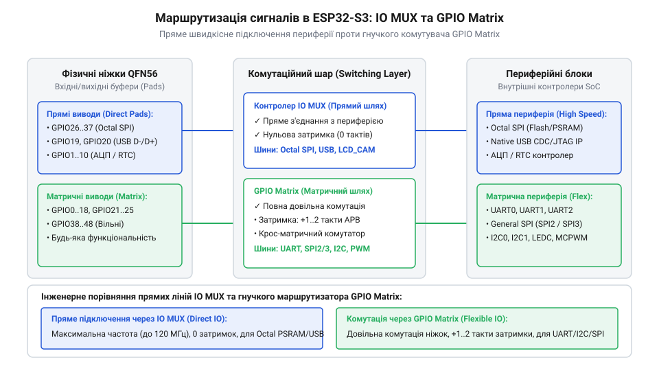
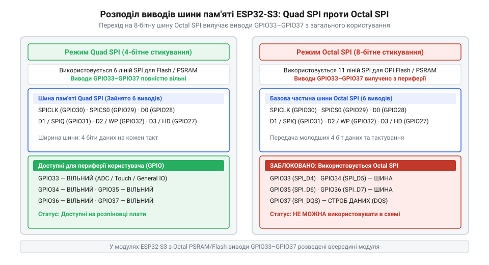
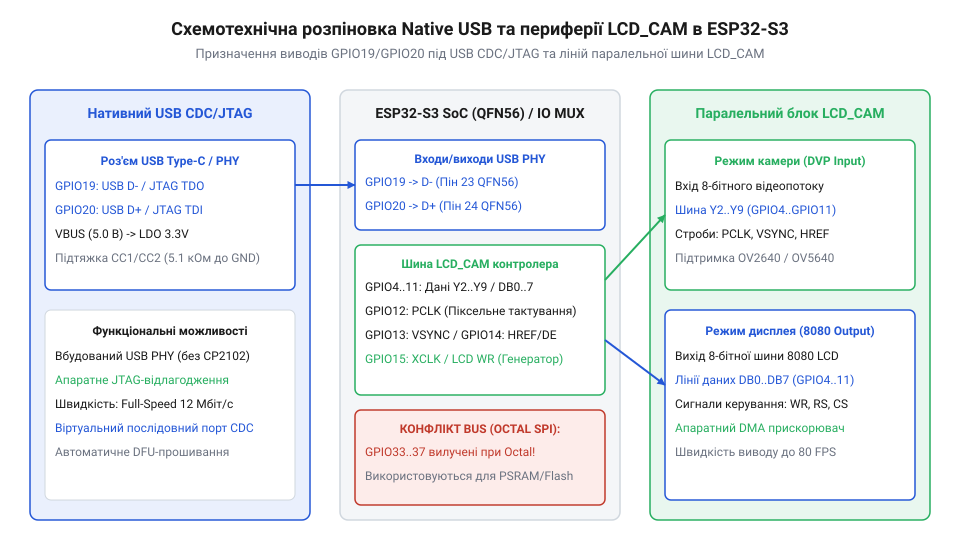
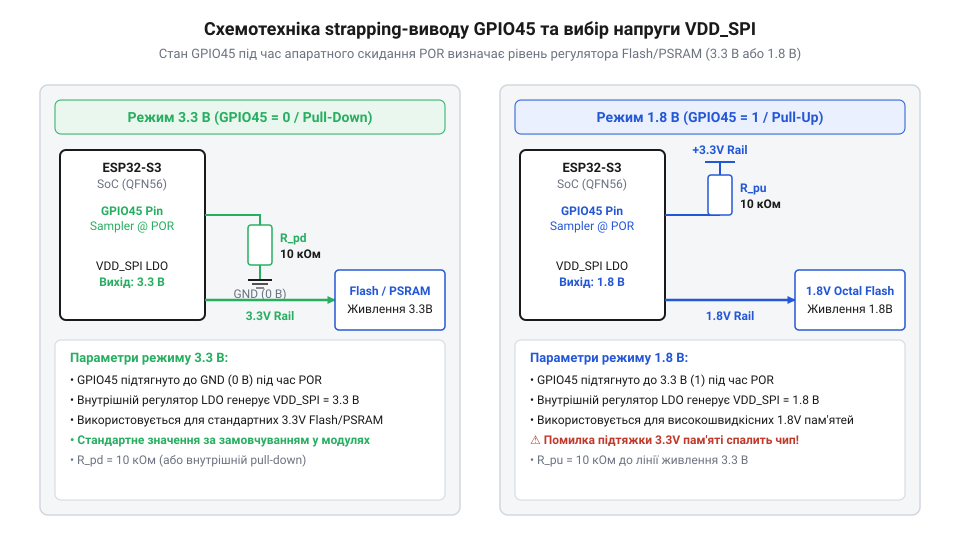

# Апаратна специфікація розпіновки, шин пам'яті та strapping-виводів ESP32-S3

<preknowlist>
- [Родина плат і модулів на ESP32-S3](root:cat-hw-boards/esp32-s3-boards-family-overview) — загальні принципи побудови платформи ESP32-S3 та схемотехнічні відмінності плат
- [Waveshare ESP32-S3R2 (16 МБ Flash, 2 МБ PSRAM)](root:cat-hw-boards/esp32-s3r2-waveshare) — практична розводка SiP-чипа ESP32-S3R2 та живлення домену VDD_SPI
</preknowlist>

## Проблема конфліктів периферійних виводів

Спроба одночасного підключення високошвидкісних периферійних модулів (наприклад, паралельних відеокамер, кольорових дисплейних панелей та зовнішньої високооб'ємної пам'яті) до мікроконтролерів @@en|ESP32-S3@@ нерідко призводить до раптового блокування запуску системи або апаратних збоїв під час ініціалізації. Розробник, розводячи друковану плату, може призначити довільні вільні контактні площадки корпуса @@en|QFN56@@ (англ. *Quad Flat No-leads*, @@en|QFN56@@) під виходи керування дисплеєм чи лінії зчитування кадрів. Однак під час подачі живлення пристрій впадає в циклічне перезавантаження. Така поведінка виникає через те, що фізичні виводи чипа суміщають декілька критичних функцій: системні виводи конфігурації завантаження (англ. *strapping pins*, @@en|strapping pins@@), високочастотні лінії шини пам'яті та каналів виводу завантажувача. Якщо під час апаратного скидання (англ. *reset*, @@en|reset@@) зовнішня периферія підтягує службову лінію до протилежного логічного рівня, контролер помилково змінює напругу живлення пам'яті або переходить у режим прошивки через послідовний порт.

Глибинна причина цих конфліктів полягає в обмеженій кількості ніжок корпусу чипа @@en|ESP32-S3@@ при високій щільності внутрішніх периферійних блоків. На відміну від простих 8-бітних мікроконтролерів, де кожен вивід загального призначення (англ. *General Purpose Input/Output*, @@en|GPIO@@) має лише одну-дві фіксовані функції, у [родині плат ESP32-S3](root:cat-hw-boards/esp32-s3-boards-family-overview) більшість фізичних ніжок підключені до внутрішньої комутаційної системи. Спроба довільного використання виводів без урахування апаратного розподілу шин створює апаратне накладення сигналів. Наприклад, використання 8-бітної шини пам'яті примусово вилучає цілу групу контактів із загального користування, а виводи нативного комунікаційного порту блокують пряме перепризначення системних ліній.

Для запобігання апаратним збоям та збереження завадостійкості розробник мусить чітко розуміти внутрішню архітектуру розподілу сигналів між фіксованими апаратними блоками та гнучкою матрицею перепризначення. Без системного аналізу апаратної розпіновки, арбітражу комутатора сигналів та схемотехніки службових ліній скидання неможливо створити стабільну розробницьку плату чи компактний модуль кшталт [плати Waveshare ESP32-S3R2](root:cat-hw-boards/esp32-s3r2-waveshare).

Процедура первинного аудиту розпіновки при створенні принципової схеми починається з категоріювання виводів за ступенем жорсткості їх зв'язків. На першому етапі схемотехнік резервує недоторканні системні лінії: службові виводи конфігурації завантаження (англ. *strapping pins*, @@en|strapping pins@@), виводи нативного USB та фіксовану групу шини Octal SPI, щоб виключити їх випадкове задіяння під звичайний `@@en|GPIO@@`. На другому етапі всі аналогові сенсори жорстко прив'язуються до первинного блоку аналого-цифрового перетворювача `ADC1`, що повністю звільняє виводи `ADC2` від конфліктів та викривлення даних під час активної роботи бездротового радіомодуля `@@en|Wi-Fi@@`. На третьому етапі залишкові вільні контактні площадки корпусу @@en|QFN56@@ розподіляються між гнучкою периферією через комутаційну матрицю. На завершальному етапі виконується покроковий чек-лист перевірки електричних підтяжок під час апаратного скидання (англ. *reset*, @@en|reset@@): спочатку контролюються статичні рівні напруги на виводах `GPIO0`, `GPIO45` та `GPIO46` у вузькому часовому вікні підняття сигналу `CHIP_PU`, далі розраховуються номінали зовнішніх підтягувальних резисторів 10 кОм без додавання ємнісних фільтрів, перевіряється відсутність протилежних активних підтяжок з боку зовнішніх мікросхем чипетаун та аналізується збереження порогів спрацьовування внутрішніх компараторів для захисту від помилкового вибору напруги домену `VDD_SPI`, що є стандартною практикою проєктування [плат родини ESP32-S3](root:cat-hw-boards/esp32-s3-boards-family-overview).

## Арбітраж IO MUX та GPIO Matrix

Маршрутизація цифрових сигналів між периферійними блоками ядра Xtensa LX7 та фізичними виводами корпуса @@en|QFN56@@ здійснюється через двокомпонентну систему арбітражу. Першим рівнем комутації є периферийний мультиплексор введення/виведення @@en|IO MUX@@ (від англ. *Input/Output Multiplexer* — мультиплексор введення/виведення; @@en|IO MUX@@). Контролер @@en|IO MUX@@ безпосередньо з'єднаний із контактними майданчиками чипа та забезпечує прямий зв'язок із високошвидкісними апаратними інтерфейсами — шинами пам'яті @@en|Flash@@ та @@en|PSRAM@@ (режими @@en|Quad SPI@@ та @@en|Octal SPI@@), паралельним контролером виводу кадру та нативним портом. Пряме підключення через @@en|IO MUX@@ забезпечує мінімальні часові затримки розповсюдження сигналу та найвищу частоту перемикання (до 80–120 МГц), проте вимагає жорстко зафіксованих фізичних ніжок чипа.

Другим рівнем є гнучка комутаційна матриця @@en|GPIO Matrix@@. Вона розташована між контролером @@en|IO MUX@@ та периферійними модулями ядра (послідовними інтерфейсами UART, SPI, I2C, таймерами ШІМ). Матриця @@en|GPIO Matrix@@ дозволяє перепризначити будь-який внутрішній цифровий сигнал периферії на майже будь-який вільний вивід @@en|GPIO@@ через конфігураційні регістри без зміни схемотехніки друкованої плати. Проте проходження сигналу через логіку матриці додає фіксовану апаратную затримку приблизно у два такти системної частоти `APB_CLK` (близько 25 нс). Через це високочастотні шини обміну даними з пам'яттю або швидкісні відеоінтерфейси прокладаються виключно через прямі лінії @@en|IO MUX@@ в обхід матриці.

*Схема маршрутизації сигналів між фізичними виводами QFN56, матрицею GPIO Matrix та контролером IO MUX.*

При розробці принципової схеми розробник повинен розрізняти виводи з жорсткою прив'язкою та перепризначувані лінії. Сигнали прямого доступу через @@en|IO MUX@@ мають пріоритет над матрицею @@en|GPIO Matrix@@. Якщо у регістрах конфігурації увімкнено функцію @@en|IO MUX@@ для конкретного виводу, внутрішні зв'язки @@en|GPIO Matrix@@ для нього автоматично відключаються. Це правило гарантує, що критичні лінії тактування шини пам'яті не будуть викривлені додатковими вентилями затримки комутаційної матриці.

Аналіз часових діаграм виявляє фундаментальну відмінність у фазових затримках обох шляхів: при прямому комутуванні через `@@en|IO MUX@@` фронт сигналу передається на фізичний вивід безпосередньо з затримкою менше ніж 1 нс, що зберігає вирівнювання фаз тактового сигналу `SPICLK` та стробу `SPIDQS`. Натомість при маршрутизації через `@@en|GPIO Matrix@@` імпульс проходить через додаткові каскади логічних вентилів та тригерів синхронізації, що формує фіксоване часове зсунення на два такти шини `APB_CLK` (близько 25 нс при частоті 80 МГц). Якщо для низькошвидкісних шин UART чи I2C ця затримка є повністю некритичною, то для високочастотних сигналів пам'яті вона порушує часові інтервали встановлення та утримання даних (англ. *setup/hold time*; @@en|інтервали setup/hold time@@). Оскільки на частоті 80 МГц у режимі подвійної передачі даних тривалість одного напівперіоду тактового сигналу становить лише 6.25 нс, апаратний зсув на 25 нс перевищує допустиме часове вікно у декілька разів. Це призводить до того, що зчитування лінії відбувається під час перехідного процесу фронту замість стабільного логічного рівня, породжуючи циклічні помилки контролю парності та незворотне викривлення даних на [платах родини ESP32-S3](root:cat-hw-boards/esp32-s3-boards-family-overview).

## Топологія шин Quad та Octal SPI

Підключення зовнішньої енергонезалежної пам'яті `@@en|Flash@@` та псевдостатичної оперативної пам'яті `@@en|PSRAM@@` в мікроконтролері ESP32-S3 здійснюється через контролери шини SPI0/SPI1. Оскільки трафік обміну даними з пам'яттю критичний до затримок тактування, виводи шини комутуються через залізне блокове ядро `@@en|IO MUX@@` з фіксованими фізичними ніжками кристала. Залежно від конфігурації використовується або 4-бітна шина `@@en|Quad SPI@@`, або 8-бітна шина `@@en|Octal SPI@@` з подвійною передачею даних `@@en|DDR@@` (від англ. @@en|Double Data Rate@@ — подвійна швидкість передачі даних).

*_Схема розподілу фізичних виводів шини пам'яті для Quad SPI та Octal SPI з позначенням апаратного вилучення ліній GPIO33–GPIO37._*

При стандартному підключенні `@@en|Quad SPI@@` базові сигнальні лінії (тактування `SPICLK`, вибір мікросхеми `SPICS0`/`SPICS1` та чотири лінії даних `SPIQ`, `SPID`, `SPIHD`, `SPIWP`) займають виводи от `GPIO26` до `GPIO32`. У цій конфігурації інші ніжки залишаються повністю доступними для розробника як звичайні виводи загального призначення `@@en|GPIO@@`.

У разі переходу на 8-бітний режим `@@en|Octal SPI@@`, який застосовується для високошвидкісної пам'яті у чипах на кшталт [Waveshare ESP32-S3R2 (16 МБ Flash, 2 МБ PSRAM)](root:cat-hw-boards/esp32-s3r2-waveshare), контролер задіює додаткові чотири лінії даних `SPI_D4`–`SPI_D7` та лінію стробування `SPIDQS`. Апаратна топологія кристала жорстко прив'язує ці сигнали до виводів `GPIO33`, `GPIO34`, `GPIO35`, `GPIO36` та `GPIO37`. Внаслідок цього комутатор `@@en|IO MUX@@` повністю вилучає виводи `GPIO33`–`GPIO37` із загального арбітражу, унеможливлюючи їх використання для підключення будь-якої зовнішньої периферії чи програмного керування. Спроба комутації цих виводів у прикладній програмі викликає прямий апаратний конфлікт вихідних каскадів драйверів: ініціалізація виводу як звичайного дискретного виходу подає логічний рівень на лінію, яка одночасно перемикається зовнішнім чипом пам'яті. Це спричиняє наскрізні струми короткого замикання, спотворення пакетів кеш-інструкцій ядра, миттєве виникнення винятків процесора `StoreProhibited` та руйнування шинного трафіку `@@en|PSRAM@@` з апаратним блокуванням системи.

Функціонування шини `@@en|Octal SPI@@` у режимі `@@en|DDR@@` на тактовій частоті 80 МГц означає передачу двох байтів даних за один період тактового імпульсу (по наростаючому та спадаючому фронтах), що забезпечує пікову пропускну здатність 160 МБ/с. На таких високочастотних режимах критично зростає чутливість до цілісності сигналів: паразитні індуктивності трас друкованої плати та перехресні наводки створюють відбиття і перекіс фаз стробу `SPIDQS`. Для запобігання помилкам зчитування байтів із пам'яті всі 8 ліній даних `SPI_D0`–`SPI_D7` разом з лініями тактування мусять розводитися з суворим вирівнюванням довжин трас і контролем хвильового опору 50 Ом при проєктуванні пристроїв у [родині плат ESP32-S3](root:cat-hw-boards/esp32-s3-boards-family-overview).

## Спеціалізовані виводи LCD_CAM, USB та АЦП

Для забезпечення апаратного зневадження та зв'язку без зовнішніх мікросхем-перетворювачів у мікроконтролері ESP32-S3 виводи `GPIO19` та `GPIO20` жорстко прив'язані до нативного апаратного контролера `USB Serial/JTAG`. Сигнал `USB D-` виведено на `GPIO19`, а `USB D+` — на `GPIO20`. Використання цих виводів за прямим призначенням дає змогу задіяти інтерфейси `@@en|USB CDC@@` та `@@en|JTAG@@` безпосередньо з виводів кристала, але вимагає від розробника відмови від використання `GPIO19`/`GPIO20` як звичайних дискретних виводів.

*_Схемотехнічна розпіновка ліній нативного USB CDC/JTAG та паралельного шинного інтерфейсу LCD_CAM з розподілом аналогових каналів._*

Для підключення фотомодулів та дисплейних панелей ESP32-S3 містить спеціалізований паралельний шинний периферичний модуль `LCD_CAM`. Він підтримує 8- та 16-бітні інтерфейси введення фотокамери `@@en|DVP@@` (від англ. @@en|Digital Video Port@@ — цифровий відеопорт) і виведення дисплеїв. На відміну від шини пам'яті, лінії `LCD_CAM` можуть гнучко комутуватися через масив `@@en|GPIO Matrix@@` на довільні вільні виводи `@@en|GPIO@@`. Це дозволяє створювати компактні пристрої обробки зображень на базі платформ на кшталт [ESP32-CAM з камерою OV3640 (2 МП)](root:cat-hw-boards/esp32-cam-ov3640), обираючи ніжки без конфліктів із трасами шини `@@en|Octal SPI@@`. Особливістю апаратної синхронізації `LCD_CAM` є наявність вбудованого контролера тактування кадру: для компенсації затримок при проходженні піксельного тактового сигналу `PCLK` та сигналів стробування `VSYNC` і `HREF` через масив матриці, периферичний блок дозволяє програмувати інверсію фронту `PCLK` та фазовий зсув тригерів стробування. Це гарантує точне захоплення байтів кадру у прямий буфер прямого доступу до пам'яті (англ. *Direct Memory Access*, @@en|DMA@@) навіть при незначному викривленні фаз на зовнішніх провідниках.

При розведенні аналогових кіл слід враховувати схему розподілу каналів аналого-цифрового перетворювача `@@en|ADC@@` (від англ. @@en|Analog-to-Digital Converter@@ — аналого-цифровий перетворювач; `@@en|АЦП@@`). Внутрішні канали розбиті на два блоки: `ADC1` (виводи `GPIO1`–`GPIO10`) та `ADC2` (виводи `GPIO11`–`GPIO20`). Важливою апаратною особливістю є те, що блок `ADC2` використовує спільний арбітр із бездротовим контролером `@@en|Wi-Fi@@`. Під час активної роботи радіомодуля виклики зчитування каналів `ADC2` блокуються або повертають некоректні значення. Тому всі точні аналогові датчики мусять підключатися виключно до виводів першої групи `ADC1`.

Для прецизійного аналогового зчитування в умовах активного бездротового зв'язку використовують таку зведену карту каналів першої групи `ADC1`:

| Канал `ADC1` | Фізичний вивід `GPIO` | Схемотехнічне призначення |
| :--- | :--- | :--- |
| `ADC1_CH0` | `GPIO1` | Прецизійні сенсори струму та напруги |
| `ADC1_CH1` | `GPIO2` | Вимірювання терморезисторів й мостових схем |
| `ADC1_CH2` | `GPIO3` | Сигнали аналогових датчиків тиску |
| `ADC1_CH3` | `GPIO4` | Аналоговий канал / безпечна шина SDA I2C |
| `ADC1_CH4` | `GPIO5` | Аналоговий канал / безпечна шина SCL I2C |
| `ADC1_CH5` | `GPIO6` | Моніторинг рівня напруги акумулятора |
| `ADC1_CH6` | `GPIO7` | Зчитування віддалених аналогових сенсорів |
| `ADC1_CH7` | `GPIO8` | Вхід АЦП / прецизійні вимірювальні кола |
| `ADC1_CH8` | `GPIO9` | Аналоговий вхід сенсорів навколишнього середовища |
| `ADC1_CH9` | `GPIO10` | Зчитування системних опорних напруг |

Використання виводів `GPIO1`–`GPIO10` забезпечує безперервний збір аналогових даних незалежно від стану трансівера `@@en|Wi-Fi@@` при розробці пристроїв у [родині плат ESP32-S3](root:cat-hw-boards/esp32-s3-boards-family-overview).

## Конфігурація strapping-виводів та напруги VDD_SPI

Під час відновлення системи після скидання або подачі живлення внутрішній апаратний автомат мікроконтролера ESP32-S3 зчитує логічні рівні на групі спеціалізованих виводів `@@en|strapping pins@@`. Зафіксовані рівні напруги в момент підняття сигналу на лінії `CHIP_PU` визначають режими завантаження процесорних ядер та апаратні параметри живлення периферійних доменів.

*_Принципова схема обв'язки strapping-виводу GPIO45 із розрахунком резистивного дільника для вибору напруги VDD_SPI._*

Найважливішу роль у схемотехніці відіграє вивід `GPIO45`, який контролює вихідну напругу вбудованого регулятора `@@en|LDO@@` (від англ. @@en|Low Dropout Regulator@@ — регулятор напруги з малим падінням) домену `VDD_SPI`. Цей домен живить внутрішні чи зовнішні мікросхеми пам'яті `@@en|Flash@@` та `@@en|PSRAM@@`. Якщо під час скидання на `GPIO45` утримується рівень логічного нуля (підтяжка підтягувальним резистором 10 кОм до землі), внутрішній регулятор видає напругу `3.3 В`. Якщо ж на `GPIO45` подано логічну одиницю (підтяжка 10 кОм до живлення `3.3 В`), напруга домену `VDD_SPI` встановлюється на рівні `1.8 В`. Помилковий розрахунок підтяжки на `GPIO45` є кричущою апаратною загрозою: подача напруги `3.3 В` на кристал `1.8 В` пам'яті у моделях на кшталт [Waveshare ESP32-S3R2 (16 МБ Flash, 2 МБ PSRAM)](root:cat-hw-boards/esp32-s3r2-waveshare) призводить до незворотного виходу з ладу мікросхеми `@@en|PSRAM@@`.

Інші службові виводи визначають вектори запуску: вивід `GPIO0` задає режим між нормальним завантаженням із прошивки `@@en|Flash@@` (логічна одиниця) та переходом у режим програмного завантажувача `ROM Bootloader` через послідовний порт (логічний нуль). Вивід `GPIO46` використовується для налаштування рівня логування первинного завантажувача. Оскільки ці виводи опитуються лише в момент скидання, після завершення ініціалізації вони повертаються в загальний доступ `@@en|GPIO@@`, проте зовнішня обв'язка не повинна спотворювати напругу на них під час старту.

Апаратне опитування стану `@@en|strapping pins@@` прив'язане до часової діаграми підняття сигналу скидання `CHIP_PU`. Фіксація логічних рівнів відбувається у вузькому часовому вікні тривалістю від 1 мс до 3 мс після перетину сигналом `CHIP_PU` порогу спрацьовування внутрішнього компаратора (близько 0.75 від напруги `VDD33`). Упродовж цього інтервалу стан ліній `GPIO0`, `GPIO45` та `GPIO46` має залишатися суворо стабільним. Додавання паразитних ємностей на ці виводи або передчасне активне керування з боку зовнішньої периферії затримує фронт напруги й викликає помилкове замикання засувки. Зокрема, наявність навіть невеликої паразитної ємності понад 10–22 пФ у поєднанні з підтягувальними резисторами створює додаткову RC-затримку, яка затягує наростання напруги на виводі `GPIO45`. Якщо на момент опитування рівень напруги не встигає досягти логічної одиниці, внутрішній апаратний автомат помилково фіксує логічний нуль, вмикаючи регулятор на 3.3 В замість необхідних 1.8 В та спричиняючи апаратний збій старту пристроїв у [родині плат ESP32-S3](root:cat-hw-boards/esp32-s3-boards-family-overview).

## Регістри конфігурації та правила проектування

Пряме керування електричними параметрами фізичних ніжок мікроконтролера здійснюється через апаратні регістри конфігурації `IO_MUX_GPIOx_REG` та `GPIO_PINx_REG`. Регістр `IO_MUX_GPIOx_REG` регулює підключення внутрішніх підтягувальних резисторів `FUN_PU` (підтяжка до живлення) та `FUN_PD` (підтяжка до землі), вибір режиму роботи `MCU_SEL`, а також навантажувальну здатність вихідного драйвера `FUN_DRV`, яка задає рівні струму від 5 мА до 40 мА. Регістр `GPIO_PINx_REG` керує налаштуваннями генерації переривань та енергозбереженням у режимах глибокого сну.

При проєктуванні друкованих плат на базі ESP32-S3 для високошвидкісних шин пам'яті та периферії слід дотримуватися суворих правил розведення сигнальних трас:

Для нативного порту `USB CDC/JTAG` (лінії `GPIO19` та `GPIO20`) ключовою вимогою є розрахунок диференційного імпедансу дифпари `USB D-`/`USB D+` на рівні 90 Ом (з допуском ±10%). На прикладі стандартної 4-шарової платформи FR-4 із діелектричною проникністю 4.2 та товщиною внутрішнього диелектричного шару 0.2 мм до суцільної площини заземлення GND, необхідний хвильовий опір досягається шириною провідника 0.15 мм та міжосьовим зазором між трасами 0.18 мм. Відхилення від розрахованого геометрією імпедансу викликає відбиття високочастотних імпульсів та спотворення діаграми вічка, що призводить до втрати USB-з'єднання під час прошивки чи зневадження на [платах родини ESP32-S3](root:cat-hw-boards/esp32-s3-boards-family-overview).

- Траси сигналів тактування `SPICLK` та даних 8-бітної шини `@@en|Octal SPI@@` мусять мати хвильовий опір 50 Ом та рівну фізичну довжину для виключення часового перекосу фаз (англ. @@en|skew@@ — часовий зсув, перекіс сигналів; `@@en|skew@@`).
- Службові виводи `GPIO45`, `GPIO0` та `GPIO46` повинні оснащуватися зовнішніми підтягувальними резисторами номіналом 10 кОм без додавання ємнісних конденсаторів, щоб не затримувати наростання напруги під час скидання.
- Аналогові чутливі лінії `ADC1` необхідно віддаляти від високочастотних імпульсних трас `@@en|USB CDC@@` та ліній шини пам'яті для запобігання наведенню наводкам та шумам.

Дотримання цих правил гарантує завадостійкість пристрою у всьому діапазоні робочих частот [родини плат і модулів на ESP32-S3](root:cat-hw-boards/esp32-s3-boards-family-overview).
