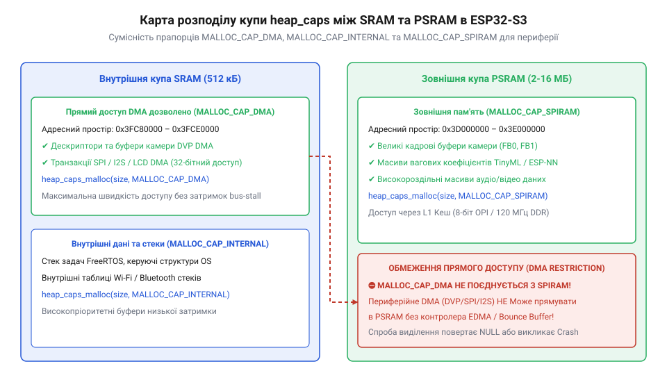

# Програмний інтерфейс ESP-IDF: конфігурація sdkconfig, керування купою PSRAM та векторні інструкції

<preknowlist>
- [Родина плат і модулів на ESP32-S3](root:cat-hw-boards/esp32-s3-boards-family-overview) — Читач має розуміти базові апаратні модифікації чипа ESP32-S3 та обсяги вбудованої і зовнішньої пам'яті.
- [Waveshare ESP32-S3R2 (16 МБ Flash, 2 МБ PSRAM)](root:cat-hw-boards/esp32-s3r2-waveshare) — Читач має знати особливості плат із вбудованою Octal SPI PSRAM.
</preknowlist>

## Активація Octal SPI DDR у sdkconfig

У разі первинного створення проєкту в середовищі @@en|ESP-IDF@@ під [родину плат ESP32-S3](root:cat-hw-boards/esp32-s3-boards-family-overview), середовище за замовчуванням вимикає підсистему зовнішньої пам'яті або конфігурує її у повільному 4-бітному режимі. Таке обмеження впроваджено для забезпечення сумісності із базовими модулями без розширеного накопичувача. Проте для роботи з високою пропускною здатністю необхідно примусово встановити конфігураційні прапорці у файлі @@en|sdkconfig@@ (від англ. *software development kit configuration* — конфігурація засобу розробки; @@en|sdkconfig@@).

Першим кроком є активація загальної підтримки зовнішньої пам'яті за допомогою опції `CONFIG_SPIRAM=y`. Після цього обирається режим підключення шини. Для чипів із 8-бітною пам'яттю, таких як на [платі Waveshare ESP32-S3R2](root:cat-hw-boards/esp32-s3r2-waveshare), встановлюється прапорець `CONFIG_SPIRAM_MODE_OCT=y`, який вмикає інтерфейс `@@en|Octal SPI@@` замість стандартного `CONFIG_SPIRAM_MODE_QUAD=y`. Для досягнення пікової швидкості обміну додатково активується режим подвійної передачі даних `@@en|Double Data Rate@@` (`@@en|DDR@@`) на тактовій частоті 120 МГц шляхом задання `CONFIG_SPIRAM_SPEED_120M=y`. У цьому режимі зчитування та запис інформації здійснюються за обома фронтами тактового сигналу, що забезпечує теоретичну пропускну здатність шини до 240 МБ/с. Проте вибір граничної частоти 120 МГц `@@en|DDR@@` накладає суворі апаратні обмеження: підсистема вимагає використання виключно 1.8-вольтового живлення домену `VDD_SPI`, оскільки 3.3-вольтова периферія не забезпечує необхідних часових затримок фронтів сигналу. Крім того, при 120 МГц контролер `MSPI` висуває високі вимоги до стабільності сигнальних ліній `GPIO33`–`GPIO37`, вимагаючи суворого узгодження довжини трас і повного виключення зовнішнього ємнісного навантаження для запобігання фазовому зсуву.

Додатково рекомендується налаштувати інтеграцію пам'яті в загальний простір адресації ядра Xtensa LX7. Параметри `CONFIG_SPIRAM_FETCH_INSTRUCTIONS=y` та `CONFIG_SPIRAM_RODATA=y` дозволяють розміщувати у зовнішній пам'яті не лише динамічні масиви даних, а й виконуваний код програм та незмінні константи, звільняючи цінний обсяг внутрішньої оперативної пам'яті.

Розміщення інструкцій та констант у зоні `@@en|PSRAM@@` змінює режим навантаження апаратного кешу `L1` процесорних ядер. Оскільки швидкість доступу до зовнішньої шини пам'яті навіть у 8-бітному режимі поступається шині внутрішньої `@@en|SRAM@@`, кожна спроба вибірки інструкцій за наявності `CONFIG_SPIRAM_FETCH_INSTRUCTIONS=y` або зчитування таблиць робить виконання повністю залежним від кеш-ліній `L1`. Пропуск кешу (англ. @@en|cache miss@@ — промах кешу) спричиняє затримку виконання коду через додаткові шинні транзакції до зовнішнього кристала. Якщо промах кешу виникає під час синхронного виклику обробника переривань @@en|ISR@@ (від англ. @@en|Interrupt Service Routine@@ — процедура обслуговування переривання), конвеєр процесора апаратно заморожується в стані простою (англ. *stall*, @@en|stall@@), поки блок керування пам'яттю `MMU` та контролер `MSPI` виконують багатоетапне узгодження шини `Octal SPI` для завантаження 64-байтного рядка пам'яті. Цей синхронний шинний запит додає критичну затримку в 30–40 тактових імпульсів процесора, що при високій частоті переривань призводить до джиттеру часу відгуку та ризику спрацьовування сторожового таймера @@en|watchdog@@ (англ. *watchdog timer*, від англ. *watch* — стежити, *dog* — пес, @@en|watchdog@@). Для запобігання втраті детермінованості критичні обробники переривань `ISR` та процедури реального часу мусять обов'язково позначатися макросом `IRAM_ATTR`, який примусово утримує їхні машинні інструкції у внутрішній пам'яті `IRAM` вхідного блоку `SRAM` вільними від промахів кешу.

## Керування купою та прапорці heap_caps_malloc

Адресний простір мікроконтролера ESP32-S3 чітко розмежовує внутрішню оперативну пам'ять @@en|SRAM@@ (англ. *Static RAM*, @@en|SRAM@@) обсягом 512 КБ та зовнішню динамічну пам'ять @@en|PSRAM@@ (англ. *Pseudo-Static RAM*, @@en|PSRAM@@). Стандартна функція виділення пам'яті `malloc()` за замовчуванням звертається до внутрішньої купи (англ. *heap*, @@en|heap@@) @@en|SRAM@@, обсяг якої обмежений декількома сотнями кілобайтів. Для явного вибору фізичного середовища розміщення буферів середовище @@en|ESP-IDF@@ надає спеціалізований функціональний інтерфейс `heap_caps_malloc()`.

Функція `heap_caps_malloc()` приймає розмір масиву в байтах та комбінацію бітових масок можливостей пам'яті. Прапорець `MALLOC_CAP_SPIRAM` наказує контролеру купи виділити пам’ять у зовнішній @@en|PSRAM@@, що є ідеальним вибором для розміщення великих кадрових буферів при роботі з модулями типу [ESP32-CAM з камерою OV3640](root:cat-hw-boards/esp32-cam-ov3640) або вагових коефіцієнтів нейромереж. Натомість прапорець `MALLOC_CAP_INTERNAL` гарантує виділення осередків у високошвидкісній внутрішній пам'яті @@en|SRAM@@.

Окремим випадком при оптимізації внутрішньої пам'яті є застосування маски `MALLOC_CAP_32BIT`. Цей прапорець виділяє блоки у внутрішній `@@en|SRAM@@`, які підтримують виключно 32-бітні слово-вирівняні транзакції шини. Такий режим дозволяє задіяти вільні ділянки кодового простору `IRAM` під 32-бітні масиви даних, звільняючи байтово-адресовану купи `DRAM`. Однак використання маски `MALLOC_CAP_32BIT` вимагає суворого обережності: будь-яка спроба побайтового чи 16-бітного читання або запису байтів за такою адресою спричиняє негайний апаратний збій вирівнювання `@@en|LoadStoreError@@`.

Головним апаратним обмеженням при роботі з периферією є підтримка прямого доступу до пам'яті (англ. *Direct Memory Access*, `@@en|DMA@@`). Фізичні контролери периферійних шин (SPI, LCD_CAM, I2S) в ESP32-S3 не можуть здійснювати пряме зчитування чи запис із зовнішньої пам'яті `@@en|PSRAM@@`. Буфери, призначені для передачі через `@@en|DMA@@`, повинні обов'язково виділятися у внутрішній пам'яті з маскою `MALLOC_CAP_DMA`. Спроба передати периферійному контролеру вказівник на область у `@@en|PSRAM@@` призводить до виклику апаратного винятку або спотворення даних. Для подолання цього обмеження при роботі з великими кадровими буферами в `@@en|PSRAM@@` застосовують механізм проміжних буферів (англ. @@en|bounce buffer@@ — транзитний буфер). У цій схемі драйвер середовища `@@en|ESP-IDF@@` виділяє невеликий `@@en|DMA@@`-сумісний масив у внутрішній `@@en|SRAM@@`, куди фонове завдання або обробник переривань порційно копіює дані з `@@en|PSRAM@@` безпосередньо перед шинною транзакцією. Це дозволяє прозоро прокачувати мегабайтові потоки даних через периферійний контролер без вичерпання суцільного обсягу внутрішньої купи. Проте тривала робота з регулярним виділенням та звільненням масивів різного обсягу спричиняє явище фрагментації (від лат. *fragmentum* — уломок; `@@en|heap fragmentation@@` — фрагментація купи). Через це навіть за значного загального показника вільної пам'яті за викликом `heap_caps_get_free_size()` контролер не здатний виділити великий суцільний блок під кадр або DMA-пакет, що призводить до повернення вказівника `NULL`. Для контролю цього стану застосовують функцію `heap_caps_get_largest_free_block()`, яка повертає розмір саме найбільшого суцільного незайнятого сегмента у байтах для заданої маски можливостей (`MALLOC_CAP_SPIRAM` чи `MALLOC_CAP_DMA`), дозволяючи завчасно виявити ризик відмови виділення пам'яті ще до виклику `heap_caps_malloc()`.

*Схема розподілу адресного простору купи між внутрішньою SRAM та зовнішньою PSRAM із показом прапорців MALLOC_CAP_SPIRAM та MALLOC_CAP_DMA.*

Розподіл буферів між типами купи реалізується через функціональні виклики середовища розробки:

:::tabs
:::code api-esp32-s3-sdkconfig-and-psram-api/c/esp-idf/allocate-memory-example.c
:::code api-esp32-s3-sdkconfig-and-psram-api/cpp/esp-idf/memorymanager.cpp
:::

## Векторні операції з бібліотекою ESP-NN

Двоядерні процесори Xtensa LX7 в ESP32-S3 містять апаратне векторне розширення @@en|PIE@@ (від англ. *Processor Extension for AI* — векторне розширення процесора для штучного інтелекту; @@en|PIE@@). Векторний співпроцесор підтримує 128-бітні SIMD-регістри та інструкції паралельного множення із накопиченням, що дозволяє прискорити математичні обчислення в 4–8 разів порівняно зі скалярним виконанням. Для виклику цих інструкцій компанія Espressif надає оптимізовану бібліотеку @@en|ESP-NN@@.

Бібліотека `@@en|ESP-NN@@` містить низькорівневі виклики для виконання стандартних шарів нейронних мереж: 2D-згортки `esp_nn_conv_s8()`, матричного множення `esp_nn_matmul_s8()` та елементного додавання. Функції працюють із квантованими 8-бітними знаковими даними `int8_t`, що мінімізує обсяг пам'яті під вагові коефіцієнти та масиви активацій. Під час обчислення добутків 8-бітних чисел результати тимчасово накопичуються у 32-бітних акумуляторах `int32_t`, що унеможливлює математичне переповнення середніх сум. Для зворотного приведення 32-бітного результату до 8-бітного діапазону наступного шару процедури приймають параметри множника та зсуву (англ. @@en|quantization shift@@ — зсув квантування). Акумульоване значення множиться на масштабний коефіцієнт, побітово зсувається вправо на задану кількість розрядів та насичується до меж `[-128, 127]`, що забезпечує точність інференсу без залучення повільних обчислень із плаваючою крапкою. Особливою специфікою реалізації 2D-згортки `esp_nn_conv_s8()` є обов'язкове виділення додаткових робочих буферів (англ. *scratchpad buffer*, `@@en|scratchpad buffer@@` — тимчасовий робочий буфер). Векторний співпроцесор розгортає двовимірні фрагменти входів у лінійні масиви для паралельних SIMD-транзакцій, а самі математичні ядра `@@en|ESP-NN@@` уникають внутрішніх викликів виділення пам'яті заради збереження детермінованості обчислень реального часу. Тому перед запуском згортки розробник заздалегідь визначає обсяг пам'яті функцією `esp_nn_get_conv_s8_scratch_size()` та передає виділений 16-байтово вирівняний `@@en|scratchpad buffer@@` безпосередньо в обчислювальну процедуру, запобігаючи збоям адресації та відмові від векторного прискорення.

Критичною вимогою при використанні векторного розширення є апаратне вирівнювання адрес вказівників у пам'яті. Векторні інструкції вимагають, щоб вхідні та вихідні масиви були вирівняні за межею 16 байтів (128 бітів). Для виділення вирівняних буферів використовується функція `heap_caps_aligned_alloc(16, size, caps)`. Якщо вказівник на масив не відповідає вимозі вирівнювання, бібліотека @@en|ESP-NN@@ прозоро повертається до повільного скалярного обчислення на C або викликає помилку адресації.

У разі спроби використання обчислень `@@en|ESP-NN@@` над масивами, розміщеними у зовнішній `@@en|PSRAM@@` без належного вирівнювання, виникають додаткові апаратні затримки. Якщо вказівник у `@@en|PSRAM@@` не відповідає 16-байтовій сітці, векторний співпроцесор `@@en|PIE@@` не спроможний виконати 128-бітні шинні транзакції та непомітно перемикає виконання на скалярний цикл звичайними інструкціями C. Оскільки вибірка даних із `@@en|PSRAM@@` при скалярному виконанні додатково сповільнюється промахами кешу `L1`, швидкість інференсу нейромережі падає у 5–10 разів порівняно з вирівняним масивом у внутрішній `@@en|SRAM@@`. Тому при розміщенні вагових коефіцієнтів у `@@en|PSRAM@@` виділення слід робити через `heap_caps_aligned_alloc(16, size, MALLOC_CAP_SPIRAM)` з обов'язковим попереднім прогрівом кешу.

Виклик процедури 8-бітного матричного множення з векторним прискоренням реалізується так:

:::tabs
:::code api-esp32-s3-sdkconfig-and-psram-api/c/esp-idf/run-vector-matrix-multiplication.c
:::code api-esp32-s3-sdkconfig-and-psram-api/cpp/esp-idf/vectormath.cpp
:::
