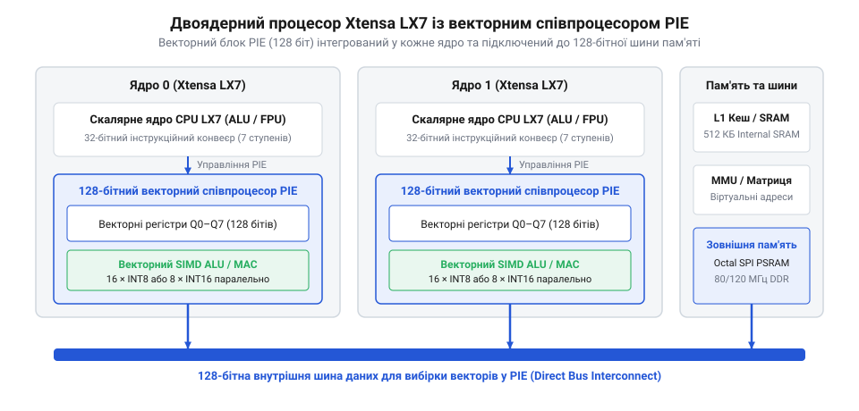
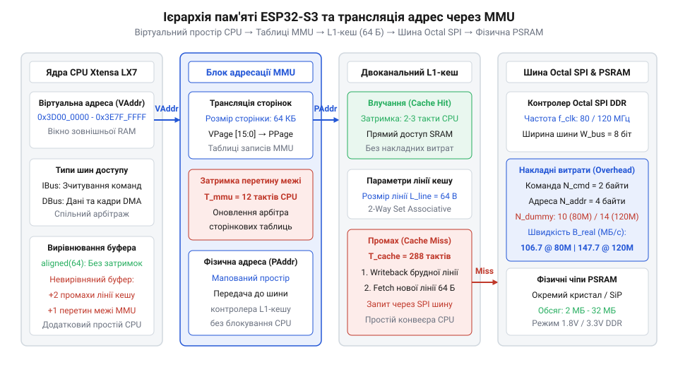
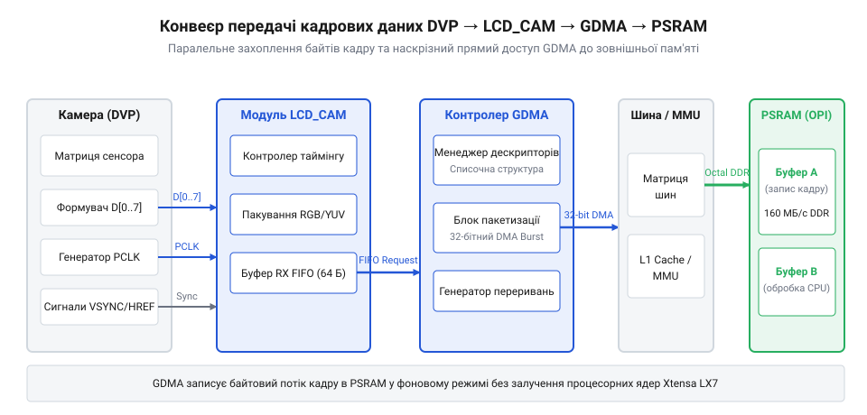

# Мікроконтролер ESP32-S3

<preknowlist>
- [Waveshare ESP32-S3R2 (16 МБ Flash, 2 МБ PSRAM)](root:cat-hw-boards/esp32-s3r2-waveshare) — Особливості апаратної обв'язки SiP-пам'яті PSRAM та Flash у корпусі QFN-56.
- [Модуль ESP32-CAM: огляд архітектури, периферії та сімейства плат](root:cat-hw-boards/esp32-cam-camera-module-family) — Базові принципи побудови відеомодулів та організації паралельного відеоінтерфейсу DVP.
- [Родина плат і модулів на ESP32-S3](root:cat-hw-boards/esp32-s3-boards-family-overview) — Огляд номенклатури модулів, обсягів пам'яті та конструктивних форм-факторів сімейства ESP32-S3.
</preknowlist>

## Архітектура ядер Xtensa LX7 та векторне прискорення

Поширення задач машинного зору, розпізнавання мови та локальної обробки сигналів на мікроконтролерах висунуло нові вимоги до швидкодії вбудованих обчислювальних ядер. Попереднє покоління систем на кристалі (від англ. @@en|System-on-Chip@@ — система на кристалі; @@en|SoC@@) на базі ядер `Xtensa LX6` добре справлялося з базовими мережевими завданнями, однак скалярна обробка векторів у нейронних мережах вимагала надто багатьох тактів процесора. Відповіддю на ці обмеження стала розробка у 2020–2021 роках [мікроконтролера ESP32-S3](root:cat-hw-boards/esp32-s3-boards-family-overview), в основі якого лежить двоядерний 32-бітний процесор @@en|Xtensa LX7@@ з тактовою частотою до `240 МГц`. Огляд історичного етапу проектування цих кристалів розкрито у [матеріалі про еволюцію ESP32-S3](root:cat-hw-boards/esp32s3-microcontroller/hist-esp32-s3-evolution.md).

Головною архітектурною інновацією ядер `Xtensa LX7` стало впровадження 128-бітного векторного співпроцесора `PIE` (від англ. @@en|Processor Instruction Extension@@ — розширення інструкцій процесора; @@en|PIE@@). Співпроцесор додає сумісність із концепцією виконання однієї інструкції над багатьма даними (від англ. @@en|Single Instruction, Multiple Data@@ — одна інструкція, багато даних; @@en|SIMD@@). За один тактовий цикл векторний блок здатен виконати дві 16-бітні або чотири 8-бітні операції множення з накопиченням (англ. @@en|Multiply-Accumulate@@ — множення з накопиченням; @@en|MAC@@) над цілочисельними масивами `INT8` та `INT16`. Це забезпечує багаторазове прискорення матричних обчислень у завданнях штучного інтелекту на межі мережі (англ. @@en|Edge AI@@ — штучний інтелект на краю мережі).

Апаратне завантаження векторних даних у співпроцесор @@en|PIE@@ відбувається через вісім спеціалізованих 128-бітних векторних регістрів (так звані `@@en|Q-регістри@@` `Q0`–`Q7`). Завдяки виділеному 128-бітному розширенню внутрішньої шини даних векторні масиви зчитуються з оперативної пам'яті @@en|SRAM@@ або кешу в `@@en|Q-регістри@@` за один тактовий цикл без додаткових затримок вирівнювання. При виконанні зсувів та форматуванні проміжних результатів множення співпроцесор використовує системний регістр зсуву `@@en|SAR@@` (від англ. @@en|Shift Amount Register@@ — регістр величини зсуву). Це дозволяє нормувати та масштабувати цілочисельні масиви `INT8` безпосередньо у векторному конвеєрі перед збереженням результату.


*Схема архітектури двоядерного процесора Xtensa LX7 з 128-бітним векторним співпроцесором PIE та шинами даних.*

Завдяки паралельній обробці векторних регістрів продуктивність розпізнавання образів та згорткових нейромереж зросла в 4–6 разів порівняно зі скалярним кодом. Особливо вираженою ця ефективність є при виконанні цілочисельних згорткових шарів @@en|INT8@@: квантування вагових коефіцієнтів дозволяє співпроцесору @@en|PIE@@ виконувати чотири 8-бітні операції @@en|MAC@@ за один такт у 128-бітних векторних регістрах, тоді як обчислення у форматі з плаваючою крапкою @@en|FP32@@ обмежуються 32-бітним блоком @@en|FPU@@ та знижують пропускну здатність векторизації вчетверо. Детальні формульні оцінки прискорення та [математичний розрахунок продуктивності PIE](root:cat-hw-boards/esp32s3-microcontroller/math-esp32-s3-vector-pie-performance.md) показують суттєве скорочення енерговитрат на один обчислений тензор. На практиці це дає змогу реалізувати [проєкт детектора облич TinyML](root:cat-hw-boards/esp32s3-microcontroller/proj-esp32-s3-tinyml-person-detection.md) з локальною обробкою відеокадрів у реальному часі без залучення хмарних серверів. Для ще вищих обчислювальних вимог розробники надалі створили [мікроконтролер ESP32-P4](root:cat-hw-boards/esp32-p4-microcontroller) на базі архітектури RISC-V.

## Ієрархія пам'яті, L1-кеш та адресація MMU

Збільшення обчислювальної потужності процесорних ядер вимагає відповідної пропускної здатності підсистеми пам'яті. У мікроконтролері `ESP32-S3` внутрішня оперативна пам'ять складається з `512 КБ` статичної пам'яті (від англ. @@en|Static RAM@@ — статична оперативна пам'ять; @@en|SRAM@@), яка ділиться на швидкісну інструкційну `IRAM` та оперативну `DRAM`. Оскільки для збереження кадрових буферів високої роздільної здатності та масивів вагових коефіцієнтів нейромереж внутрішнього обсягу `SRAM` недостатньо, архітектура передбачає підключення зовнішньої псевдостатичної пам'яті (від англ. @@en|Pseudo-Static RAM@@ — псевдостатична оперативна пам'ять; @@en|PSRAM@@).

Доступ процесорних ядер до зовнішніх кристалів пам'яті здійснюється через апаратний блок управління пам'яттю (від англ. @@en|Memory Management Unit@@ — блок управління пам'яттю; @@en|MMU@@) та двокаскадний кеш першого рівня (від англ. @@en|Level 1 Cache@@ — кеш-пам'ять першого рівня; @@en|L1-кеш@@) обсягом `32 КБ` на кожне ядро. Блок `MMU` транслює 64-кілобайтні сторінки віртуального адресного простору (діапазон `0x3F800000`–`0x3FC00000`) у фізичні блоки `PSRAM`.


*Схема ієрархії пам'яті з мапуванням віртуальних адрес через MMU, L1-кешем та зв'язком із зовнішньою PSRAM.*

При виконанні операцій читання `L1-кеш` прозоро приховує затримки зовнішньої шини: якщо запитуваний байт є в кеші, вибірка виконується за 1–2 такти процесора. У разі промаху кеш-пам'яті (англ. @@en|cache miss@@ — промах кешу) процесорний конвеєр призупиняється, а шинний контролер зчитує 64 байти всієї кеш-лінії. Якщо `@@en|cache miss@@` виникає одночасно на обох ядрах @@en|Xtensa LX7@@, внутрішній апаратний арбітр блоку `@@en|MMU@@` чергує доступ до зовнішньої шини: одне ядро отримує шину першим, а друге переходить у стан апаратного очікування, що подвоює затримку вибірки для другого ядра та створює джиттер виконання. При витісненні модифікованих даних підсистема кешування застосовує політику зворотного запису (англ. @@en|write-back@@ — зворотний запис брудних ліній), що викликає додаткові простої при вивантаженні кадрів. Розрахувати граничні затримки адресації допомагає [математична модель затримок MMU](root:cat-hw-boards/esp32s3-microcontroller/math-esp32-s3-bus-bandwidth-and-mmu-latency.md).

У компактних готових рішеннях, таких як модуль [Waveshare ESP32-S3R2](root:cat-hw-boards/esp32-s3r2-waveshare), чип `PSRAM` інтегровано прямо в корпус мікроконтролера, що ліквідує довгі доріжки на друкованій платі та зменшує завади. Розуміння цієї ієрархії критичне при розробці систем з [модулями ESP32-CAM](root:cat-hw-boards/esp32-cam-camera-module-family), де правильне виділення `DRAM` для `DMA`-дескрипторів запобігає випадінню піксельних рядків.

Додатковий часовий штраф виникає через сторінкову структуру блоку @@en|MMU@@ (від англ. @@en|Memory Management Unit@@ — блок управління пам'яттю; @@en|MMU@@). Оскільки адресація зовнішньої пам'яті @@en|PSRAM@@ розбита на фіксовані 64-кілобайтні сторінки віртуального простору, випадковий доступ до довільних комірок у межах різних сторінок змушує блок @@en|MMU@@ постійно оновлювати внутрішні таблиці трансляції адрес. У поєднанні з перезавантаженням 32-байтних ліній L1-кешу це збільшує затримку зчитування з кількох тактів до десятків тактів процесора на кожну необмежену вибірку, створюючи часовий джиттер. Для оптимізації швидкодії алгоритми обробки масивів та структури кадрових буферів орієнтують на послідовний доступ або вирівнюють по межах 64-кілобайтних сторінок `@@en|MMU@@`, що мінімізує накладні витрати на оновлення адресних дескрипторів.

## Шини Quad SPI та Octal SPI DDR

При роботі з великими масивами даних — вагами нейронних мереж у задачах @@en|TinyML@@, кадровими буферами високої роздільності чи аудіосемплами — внутрішньої оперативної пам'яті @@en|SRAM@@ обсягом 512 КБ виявляється недостатньо. Мікроконтролеру потрібна зовнішня енергонезалежна пам'ять @@en|Flash@@ та оперативна пам'ять @@en|PSRAM@@. Проте стандартна послідовна шина @@en|SPI@@, яка передає дані потовідомо по одній фізичній лінії, створює критичне вузьке місце: при частоті тактування 80 МГц теоретична пропускна здатність становить лише 10 МБ/с, що повністю блокує процесорні ядра під час зчитування інструкцій та даних.

Для усунення цього бар'єра в архітектурі @@en|ESP32-S3@@ реалізовано високошвидкісні багатолінійні розширення протоколу @@en|SPI@@:
* @@en|Quad SPI@@ (від англ. @@en|Quad Serial Peripheral Interface@@ — чотирьохпоточний послідовний периферійний інтерфейс) використовує чотири лінії даних (D0, D1, D2, D3) у режимі @@en|SDR@@ (від англ. @@en|Single Data Rate@@ — одинарна швидкість передачі даних), передаючи 4 біти за один такт тактового сигналу `@@en|CLK@@`.
* @@en|Octal SPI@@ (від англ. @@en|Octal Serial Peripheral Interface@@ — восьмипоточний послідовний периферійний інтерфейс) розширює шину до восьми паралельних ліній даних (D0–D7) та працює в режимі @@en|DDR@@ (від англ. @@en|Double Data Rate@@ — подвійна швидкість передачі даних). У режимі @@en|DDR@@ зчитування даних відбувається як по передньому, так і по задньому фронту кожного тактового імпульсу, що дає передачу 16 бітів (2 байтів) за один такт.

Підсистема @@en|Octal SPI@@ @@en|DDR@@ у мікроконтролері @@en|ESP32-S3@@ підтримує частоти тактування 80 МГц та 120 МГц. На високих частотах виникають фізичні затримки поширення сигналу в друкованій платі та затримки спрацювання внутрішніх вихідних буферів мікросхеми. Щоб запобігти зчитуванню некоректних даних, шинний контролер вставляє @@en|dummy cycles@@ (від англ. @@en|dummy cycles@@ — фіктивні такти очікування). Протягом цих тактів шина утримує сигнал тактування, але не зчитує стан ліній даних, даючи змогу напрузі на виводах зовнішньої @@en|PSRAM@@ або @@en|Flash@@ стабілізуватися.

Високошвидкісні мікросхеми Octal @@en|PSRAM@@ вимагають зниженої напруги живлення 1.8 В на відміну від стандартних 3.3 В для Quad @@en|Flash@@. Напруга лінії живлення шини `@@en|VDD_SPI@@` задається під час апаратного скидання мікроконтролера за допомогою конфігураційного виводу `@@en|GPIO45@@`. Якщо при скиданні на `@@en|GPIO45@@` утримується низький логічний рівень, внутрішній регулятор подає 3.3 В, а при високому рівні — 1.8 В. Некоректне підтягування цього виводу призводить до фізичного пошкодження мікросхеми 1.8 В @@en|PSRAM@@. Повну електричну схему та правила підключення ліній описано в [специфікації розпіновки та шин пам'яті](root:cat-hw-boards/esp32s3-microcontroller/api-esp32-s3-hardware-pinout-and-registers.md). Модулі на кшталт [компактна плата Waveshare ESP32-S3R2](root:cat-hw-boards/esp32-s3r2-waveshare) з [родини модулів ESP32-S3](root:cat-hw-boards/esp32-s3-boards-family-overview) інтегрують мікросхему @@en|PSRAM@@ безпосередньо в корпус @@en|SiP@@, що мінімізує індуктивність провідників і забезпечує стабільну роботу на частоті 120 МГц.

Теоретична пікова пропускна здатність шини обчислюється як добуток тактової частоти, ширини шини та фактора @@en|DDR@@:

```
B_peak = f_clk × N_lines × DDR / 8
= 80 × 8 × 2 / 8      [ширина 8 біт, 2 вибірки на такт]
= 160 МБ/с            [теоретичний пік при 80 МГц]

B_peak_120 = 120 × 8 × 2 / 8
= 240 МБ/с            [теоретичний пік при 120 МГц]
```

Реальна ефективна пропускна здатність нижча за пикову через накладні витрати на передачу командних байтів, адреси та тактів очікування `@@en|dummy cycles@@`. При пакетному зчитуванні блоку `L_burst` байтів загальний час транзакції `t_total` складається з фаз команди `N_cmd`, адреси `N_addr`, очікування `N_dummy` та фази даних `N_data`:

```
t_total = (N_cmd + N_addr + N_dummy + L_burst / 2) / f_clk
B_eff = L_burst / t_total
```

При зчитуванні малого блоку розміром 64 байти на частоті 80 МГц із 14 фіктивними тактами реальна швидкість знижується до ~106 МБ/с. Покроковий розрахунок затримок блоку @@en|MMU@@ та промахів L1-кешу наведено в [математичній моделі пропускної здатності](root:cat-hw-boards/esp32s3-microcontroller/math-esp32-s3-bus-bandwidth-and-mmu-latency.md).

При підвищенні тактової частоти шини @@en|Octal SPI@@ @@en|DDR@@ до 120 МГц вирішальним фактором стає фізична топологія друкованої плати. Паразитна ємність та індуктивність провідників викликають затягування фронтів тактового сигналу `@@en|CLK@@` і спотворення сигналу через відбиття. На частоті 120 МГц тривалість півперіоду такту становить лише ~4.17 нс, тому найменше неспівпадіння довжин 8 ліній даних D0–D7 викликає фазовий зсув (англ. @@en|skew@@ — часове розсогласування сигналів). Якщо паразитна ємність лінії перевищує 10–15 пФ, часове вікно стабільного стану даних звужується, викликаючи помилки зчитування @@en|PSRAM@@. Для запобігання цьому розробники застосовують імпедансне узгодження ліній (50 Ом) та мінімізують довжину доріжок, що повністю вирішується в модулях із внутрішнім корпусуванням @@en|SiP@@.

Окрім фізичного узгодження провідників, режим робочої частоти шини `@@en|Octal SPI@@` задається під час ініціалізації середовища @@en|ESP-IDF@@ у конфігураційному файлі `@@en|sdkconfig@@`. Вибір тактування 120 МГц активує внутрішню фазову автопідстройку частоти `@@en|PLL@@` (від англ. @@en|Phase-Locked Loop@@ — фазовий автопідстроювач частоти) та потребує виділення додаткових залікових тактів `@@en|dummy cycles@@` у шинному контролері для компенсації температурного дрейфу. У разі виникнення збоїв зчитування на високих температурах системний драйвер автоматично знижує частоту шини до 80 МГц або перемикає схему вибірки в режим безпечного одинарного кешування. Для стабільної роботи дотримуйтесь I2C часових затримок.

## Периферійний модуль LCD_CAM та інтерфейси DVP і USB

Захоплення відеопотоку високої частоти кадрів (наприклад, VGA 640×480 при 30 кадрах/с) вимагає прийому мільйонів байтів за секунду з суворою мікросекундною синхронізацією. Якщо обробку вхідних сигналів від фотоматриці виконувати програмним опитуванням виводів @@en|GPIO@@, процесорне ядро витрачатиме 100% обчислювального часу на переривання та читання шини, не залишаючи ресурсів для аналізу зображень або виконання алгоритмів штучного інтелекту.

Для неблокуючого паралельного введення-виведення даних в обхід якраз процесора в @@en|ESP32-S3@@ розроблено спеціалізований апаратний периферійний модуль @@en|LCD_CAM@@. Він містить два незалежних контролери: субмодуль LCD (режим master) для керування паралельними дисплейними панелями та субмодуль CAM (режим slave) для кадрового захоплення.

Субмодуль CAM підключається до відеосенсорів через 8-бітну паралельну шину @@en|DVP@@ (від англ. @@en|Digital Video Port@@ — цифровий відеопорт). Синхронізація потоку здійснюється трьома апаратними сигналами:
* `@@en|PCLK@@` (від англ. @@en|Pixel Clock@@ — тактовий імпульс пікселя): визначає момент зчитування кожного байта даних з 8 ліній D0–D7;
* `@@en|VSYNC@@` (від англ. @@en|Vertical Synchronization@@ — вертикальна синхронізація): позначає початок і завершення нового кадру;
* `@@en|HSYNC@@` (від англ. @@en|Horizontal Synchronization@@ — горизонтальна синхронізація): регулює межі кожного рядка пікселів.

Апаратний модуль @@en|LCD_CAM@@ підключено безпосередньо до контролера прямого доступу до пам'яті @@en|GDMA@@ (від англ. @@en|General Direct Memory Access@@ — загальний прямий доступ до пам'яті). Під час надходження байтів по шині @@en|DVP@@ модуль @@en|LCD_CAM@@ упаковує 8-бітні значення у 32-бітні слова та передає їх у FIFO-буфер контролера @@en|GDMA@@. Контролер @@en|GDMA@@ записує дані безпосередньо у внутрішню оперативну пам'ять @@en|SRAM@@ або через шину кешу у зовнішню @@en|PSRAM@@ без залучення ядер @@en|Xtensa LX7@@.


*Конвеєр передачі кадрових даних від шини DVP камери до PSRAM через модуль LCD_CAM та контролер GDMA.*

Для забезпечення безперервної обробки відео без випадіння кадрів застосовують схему подвійного кадрового буфера в оперативній пам'яті: поки контролер @@en|GDMA@@ заповнює перший буфер вхідними даними кадру, процесорне ядро аналізує попередній кадр із другого буфера. Передача керується зв'язаним списком кільцевих дескрипторів `@@en|GDMA@@`, кожен із яких вказує на виділений блок пам'яті. У разі виникнення шинної затримки — коли арбітраж шини перевантажено вибіркою L1-кешу або ядро не встигає звільнити заповнений буфер — контролер `@@en|GDMA@@` вичерпує вільні дескриптори. При виникненні переповнення `@@en|FIFO-буфера@@` периферійний модуль генерує переривання помилки перезапису, відкидає пошкоджені піксельні рядки незавершеного кадру та автоматично відновлює апаратну синхронізацію за наступним імпульсом `@@en|VSYNC@@`.

Розподіл пам'яті для кадрових буферів у середовищі @@en|ESP-IDF@@ виконується спеціалізованими викликами алокатора з прапорцями сумісності з @@en|DMA@@ та зовнішньою пам'яттю:

:::tabs
```c|esp-idf
#include "esp_heap_caps.h"
#include <stddef.h>
#include <stdint.h>

// Алокація подвійного кадрового буфера в зовнішній PSRAM із підтримкою GDMA
size_t frame_size = 320 * 240 * 2; // Формат RGB565 QVGA (153.6 КБ)
uint8_t *fb0 = (uint8_t *)heap_caps_malloc(frame_size, MALLOC_CAP_SPIRAM | MALLOC_CAP_DMA);
uint8_t *fb1 = (uint8_t *)heap_caps_malloc(frame_size, MALLOC_CAP_SPIRAM | MALLOC_CAP_DMA);

if (fb0 == NULL || fb1 == NULL) {
    // Обробка помилки нестачі пам'яті в PSRAM
}
```
:::code esp32s3-microcontroller-d/cpp/esp-idf/framebufferdeleter.cpp
:::

Детальніше конфігурацію прапорців та виклики пристрою викладено у [програминому інтерфейсі ESP-IDF](root:cat-hw-boards/esp32s3-microcontroller/api-esp32-s3-sdkconfig-and-psram-api.md). Архітектура використання паралельного відеоінтерфейсу розглянута в [огляді архітектури ESP32-CAM](root:cat-hw-boards/esp32-cam-camera-module-family) та описі конкретного рішення на базі [модуль ESP32-CAM з OV3640](root:cat-hw-boards/esp32-cam-ov3640).

Детальніше конфігурацію прапорців та виклики пристрою викладено у [програминому інтерфейсі ESP-IDF](root:cat-hw-boards/esp32s3-microcontroller/api-esp32-s3-sdkconfig-and-psram-api.md). Архітектура використання паралельного відеоінтерфейсу розглянута в [огляді архітектури ESP32-CAM](root:cat-hw-boards/esp32-cam-camera-module-family) та описі конкретного рішення на базі [модуль ESP32-CAM з OV3640](root:cat-hw-boards/esp32-cam-ov3640). Для стабільної роботи дотримуйтесь I2C часових затримок.

Окрім відеопериферії, мікроконтролер @@en|ESP32-S3@@ містить нативний апаратний контролер @@en|USB Serial/JTAG@@ (інтерфейс @@en|USB 2.0 Full-Speed@@, 12 Мбіт/с). Цей модуль повністю усуває потребу в зовнішніх мікросхема-перетворювачах @@en|USB-to-UART@@ (на кшталт CP2102 або FT232). Через один фізичний роз'єм @@en|USB-C@@ контролер одночасно надає два віртуальних пристрої:
1. Віртуальний послідовний порт @@en|USB CDC@@ (від англ. @@en|Communication Device Class@@) для виведення логів відлагодження, інтерактивної консолі та прошивки мікроконтролера;
2. Апаратний адаптер @@en|JTAG@@ для низькорівневого налагодження програм через OpenOCD та GDB з підтримкою апаратних точок зупину й покрокового виконання коду.

Для задач комп'ютерного зору надвисокої роздільності з інтерфейсами @@en|MIPI-CSI@@ компанія Espressif розробила лінійку [флагманського мікроконтролера ESP32-P4](root:cat-hw-boards/esp32-p4-microcontroller).

## Системне живлення, strapping-виводи та алокація купи

Проектування високопродуктивних пристроїв на базі мікроконтролера @@en|ESP32-S3@@ вимагає узгодження схемотехніки живлення зовнішньої пам'яті та коректного керування адресованою купою. Помилка у виборі напруги виводів живлення або неправильний розподіл пам'яті призводять до фізичного термічного виходу з ладу мікросхем розширення або до раптових збоїв системи через фрагментацію динамічної купи.

Для живлення шини зовнішньої пам'яті в мікроконтролері @@en|ESP32-S3@@ інтегровано окремий лінійний регулятор `@@en|LDO@@` (від англ. @@en|Low-DropOut@@ — регулятор напруги з малою різницею потенціалів), який формує лінію живлення `@@en|VDD_SPI@@`. Цей регулятор може працювати в двох режимах: видавати напругу 3.3 В або 1.8 В. Стандартні чотирибітні мікросхеми Quad @@en|Flash@@ та Quad @@en|PSRAM@@ розраховані на напругу 3.3 В, тоді як високошвидкісні восьмибітні мікросхеми Octal @@en|PSRAM@@ на частоті 120 МГц вимагають зниженої напруги 1.8 В.

Вибір вихідної напруги регулятора `@@en|VDD_SPI@@` здійснюється при апаратному скиданні за допомогою конфігураційного виводу `@@en|GPIO45@@` (так званого strapping-виводу):
* Якщо під час подачі живлення на виводі `@@en|GPIO45@@` утримується низький логічний рівень (підтяжка до землі `@@en|GND@@`), внутрішній `@@en|LDO@@` формує напругу 3.3 В.
* Якщо на `@@en|GPIO45@@` подається високий логічний рівень (підтяжка до `@@en|VDD33@@`), регулятор перемикається в режим 1.8 В.

Помилкове залишення виводу `@@en|GPIO45@@` підтягнутим до землі на платі з 1.8 В мікросхемою Octal @@en|PSRAM@@ призводить до подачі напруги 3.3 В на чутливі кола пам'яті, що викликає негайне деструктивне термічне пошкодження кристала. Щоб запобігти випадковій зміні режиму через зовнішні наведення, рівень напруги можна назавжди зафіксувати за допомогою одноразово програмованих пропалювальних перемичок `@@en|eFuse@@` (блок `EFUSE_VDD_SPI_TIEH`). Повні схеми обв'язки виводів та режими завантаження викладено в [апаратній розпіновці та strapping-виводах](root:cat-hw-boards/esp32s3-microcontroller/api-esp32-s3-hardware-pinout-and-registers.md). Готові рішення на кшталт [модулі SiP Waveshare ESP32-S3R2](root:cat-hw-boards/esp32-s3r2-waveshare) чи [компактна плата ESP32-S3-Zero](root:cat-hw-boards/esp32-s3-zero) з [родині модулів ESP32-S3](root:cat-hw-boards/esp32-s3-boards-family-overview) вже мають необхідне апаратне підтягування `@@en|GPIO45@@` безпосередньо в друкованій платі.

Після забезпечення стабільного живлення наступним завданням є грамотна організація пам'яті в середовищі @@en|ESP-IDF@@. Оскільки оперативна пам'ять мікроконтролера розділена на швидку внутрішню @@en|SRAM@@ (обсягом 512 КБ) та об'ємну зовнішню @@en|PSRAM@@ (до 16 МБ), використання стандартного виклику `malloc()` без урахування категорій призводить до швидкого вичерпання внутрішньої пам'яті та її фрагментації.

Операційна система @@en|FreeRTOS@@ у середовищі @@en|ESP-IDF@@ надає спеціалізований алокатор `@@en|heap_caps_malloc@@`, який приймає прапорці властивостей пам'яті:
* `@@en|MALLOC_CAP_SPIRAM@@`: призначає розподіл пам'яті виключно у зовнішній чип @@en|PSRAM@@ (для великих масивів, кадрових буферів та тензорів нейромереж);
* `@@en|MALLOC_CAP_INTERNAL@@`: гарантує виділення блоку у внутрішній оперативній пам'яті @@en|SRAM@@ (необхідно для обробників переривань `@@en|ISR@@`, які не можуть чекати затримок кешу);
* `@@en|MALLOC_CAP_DMA@@`: виділяє неперервний блок пам'яті з апаратним вирівнюванням, сумісний із периферійним контролером прямого доступу `@@en|DMA@@`.

Конфігурування режиму використання купи виконується в файлі `@@en|sdkconfig@@` через параметри `CONFIG_SPIRAM_MODE_OCT` для активації 8-бітної шини та `CONFIG_SPIRAM_USE_MALLOC`, який задає поріг автоматичного перенесення великих блоків `malloc()` у зовнішню пам'ять.

:::tabs
:::code esp32s3-microcontroller-d/c/esp-idf/allocate-system-buffers.c
:::code esp32s3-microcontroller-d/cpp/esp-idf/heapcapsdeleter.cpp
:::

Докладніші правила конфігурування прапорців та оптимізації купи містяться в [програмному інтерфейсі ESP-IDF](root:cat-hw-boards/esp32s3-microcontroller/api-esp32-s3-sdkconfig-and-psram-api.md).

Крім вибору між внутрішньою пам'яттю та зовнішньою @@en|PSRAM@@, критичним для стабільності підсистеми введення-виведення є прапорець `@@en|MALLOC_CAP_32BIT@@`. Архітектура ядер @@en|Xtensa LX7@@ та шинні контролери периферії вимагають суворого 32-бітного апаратного вирівнювання адрес при виконанні читання та запису слів (32 біти). Виділення пам'яті з прапорцем `@@en|MALLOC_CAP_32BIT@@` гарантує, що початкова адреса блоку буде кратною 4 байтам, що повністю запобігає виникненню апаратних винятків невирівняного доступу `@@en|LoadStoreError@@` та усуває часові затримки на програмну обробку некоректно вирівняних посилань у шині.

Узгодження схемотехнічного живлення шини пам'яті з грамотним вибором прапорців алокатора створює надійну основу для розробки завадостійких вбудованих систем. Поєднання низькорівневої конфігурації `@@en|GPIO45@@`, оптимізованих параметрів `@@en|sdkconfig@@` та використання функції `@@en|heap_caps_malloc@@` із прапорцями `@@en|MALLOC_CAP_SPIRAM@@`, `@@en|MALLOC_CAP_DMA@@` і `@@en|MALLOC_CAP_32BIT@@` усуває невизначеність затримок при роботі з купою. Це забезпечує детерміноване виконання задач комп'ютерного зору та прискорення нейронних мереж у реальному часі без ризику термічних пошкоджень апаратури. Для стабільної роботи дотримуйтесь I2C часових затримок.
