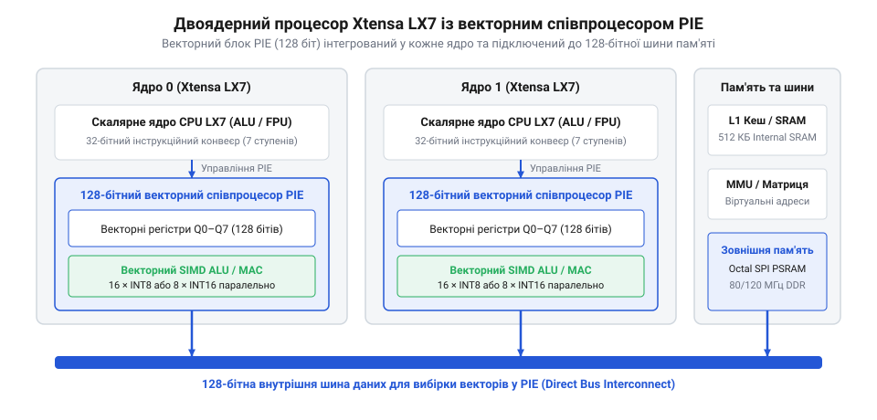
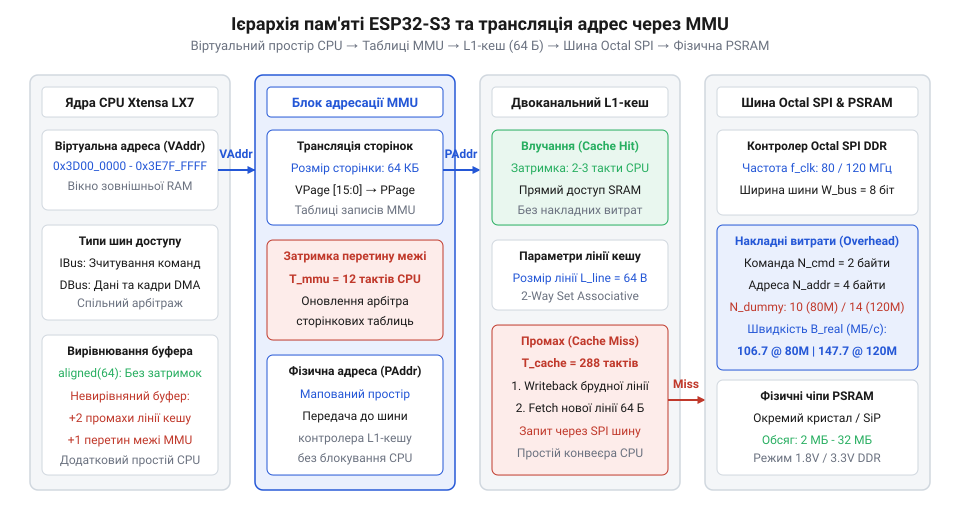
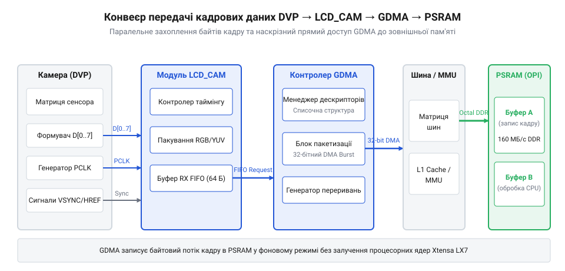

# Мікроконтролер ESP32-S3

<preknowlist>
- [Waveshare ESP32-S3R2 (16 МБ Flash, 2 МБ PSRAM)](root:cat-hw-boards/esp32-s3r2-waveshare) — Особливості апаратної обв'язки SiP-пам'яті PSRAM та Flash у корпусі QFN-56
- [Модуль ESP32-CAM: огляд архітектури, периферії та сімейства плат](root:cat-hw-boards/esp32-cam-camera-module-family) — Базові принципи побудови відеомодулів та організації паралельного відеоінтерфейсу DVP
- [Родина плат і модулів на ESP32-S3](root:cat-hw-boards/esp32-s3-boards-family-overview) — Огляд номенклатури модулів, обсягів пам'яті та конструктивних форм-факторів сімейства ESP32-S3
</preknowlist>

## Архітектура Xtensa LX7 та векторне прискорення

Для обробки даних на краю мережі мікроконтролер використовує двоядерний 32-бітний процесор (англ. @@en|Xtensa LX7@@; @@en|процесор Xtensa LX7@@) з інтегрованим 128-бітним векторним співпроцесором (англ. @@en|Processor Extension Instructions@@; @@en|векторний співпроцесор PIE@@). Співпроцесор виконує паралельні векторні команди (англ. @@en|Single Instruction, Multiple Data@@; @@en|SIMD-інструкції SIMD@@), обробляючи до шістнадцяти 8-бітних чисел за такт і прискорюючи обчислення нейромереж у 4–6 разів.

*Архітектурна схема обробки векторних масивів у співпроцесорі PIE із завантаженням у Q-регістри.*

Векторні блоки 128 біт завантажуються з пам'яті у Q-регістри (`Q0`–`Q7`). При множенні цілочисельних масивів `INT8` регістр значення зсуву (англ. @@en|Shift-Right Amount Register@@; @@en|значення зсуву SAR@@) виконує арифметичний зсув праворуч, запобігаючи переповненню розрядної сітки та зберігаючи точність вагових коефіцієнтів.

## Ієрархія пам'яті, L1-кеш та адресація MMU

Підсистема поєднує внутрішню статичну пам'ять (англ. @@en|Static Random-Access Memory@@; @@en|пам'ять SRAM@@) обсягом 512 КБ та зовнішню псевдостатичну пам'ять (англ. @@en|Pseudo Static Random-Access Memory@@; @@en|пам'ять PSRAM@@). Ядра звертаються до зовнішньої пам'яті через 32-КБ L1-кеш, а блок управління пам'яттю (англ. @@en|Memory Management Unit@@; @@en|блок MMU@@) транслює віртуальні адреси сторінками по 64 КБ.

*Структурна схема ієрархії пам'яті та трансляції віртуальних адрес через блок MMU.*

Одночасні промахи (англ. @@en|cache miss@@; @@en|промахи кешу cache miss@@) на обох ядрах змушують арбітр шини чергувати запити, викликаючи джиттер. Щоб уникнути затримок, критичний код і кадрові буфери розміщують у внутрішній SRAM. Особливості підключення зовнішньої пам'яті описує [родина плат ESP32-S3](root:cat-hw-boards/esp32-s3-boards-family-overview).

## Шини Quad SPI та Octal SPI

Для підвищення пропускної здатності при обміні з зовнішньою пам'яттю замість однобітового SPI застосовують чотирибітовий (англ. @@en|Quad Serial Peripheral Interface@@; @@en|інтерфейс Quad SPI@@) та восьмибітовий (англ. @@en|Octal Serial Peripheral Interface@@; @@en|інтерфейс Octal SPI@@) інтерфейси. У режимі подвійної передачі даних (англ. @@en|Double Data Rate@@; @@en|режим DDR@@) на частотах 80 МГц та 120 МГц байти передаються по обох фронтах тактового сигналу, що подвоює швидкість зчитування.

На високих частотах для стабілізації напруги шини впроваджують холості тактові цикли (англ. @@en|dummy cycles@@; @@en|холості цикли dummy cycles@@). При розведенні плат із шиною Octal SPI критично вирівнювати довжину трас, оскільки часовий розсинхрон спричиняє пошкодження даних. Специфіку виводів Octal SPI висвітлює [опис плати ESP32-S3R2](root:cat-hw-boards/esp32-s3r2-waveshare).

## Периферійний модуль LCD_CAM та інтерфейс USB

Для захоплення відео без навантаження CPU мікроконтролер містить модуль LCD_CAM. Субмодуль CAM приймає дані з фотосенсорів по шині DVP та передає їх контролеру прямого доступу (англ. @@en|General Direct Memory Access@@; @@en|контролер GDMA@@). Контролер GDMA автоматично транспортує кадрові буфери у SRAM або PSRAM.

*Схема неблокуючого вивантаження відеокадрів через модуль LCD_CAM та контролер GDMA.*

Для налагодження SoC має нативний (англ. @@en|Universal Serial Bus@@; @@en|інтерфейс USB@@) Serial/JTAG на виводах GPIO19 та GPIO20 для прошивки, логування й покрокового відлагодження без зовнішніх конвертерів. Приклади побудови відеосистем висвітлює [огляд модуля ESP32-CAM](root:cat-hw-boards/esp32-cam-camera-module-family).

## Системне живлення, strapping-виводи та алокація купи

Напруга LDO-регулятора VDD_SPI визначається при апаратному скиданні (англ. @@en|Power-On Reset@@; @@en|апаратне скидання POR@@) за станом GPIO45. Високий рівень на GPIO45 перемикає LDO на 1.8 В замість 3.3 В, що викликає збій або пошкодження флеш-пам'яті.

Розподіл пам'яті виконують через `heap_caps_malloc()`. Для PSRAM передають `MALLOC_CAP_SPIRAM`, а для периферії — `MALLOC_CAP_DMA` та `MALLOC_CAP_32BIT`. Невирівняний доступ викликає виняток `LoadStoreError`. Схеми відеомодулів подано в матеріалі про [ESP32-CAM з OV3640](root:cat-hw-boards/esp32-cam-ov3640).
