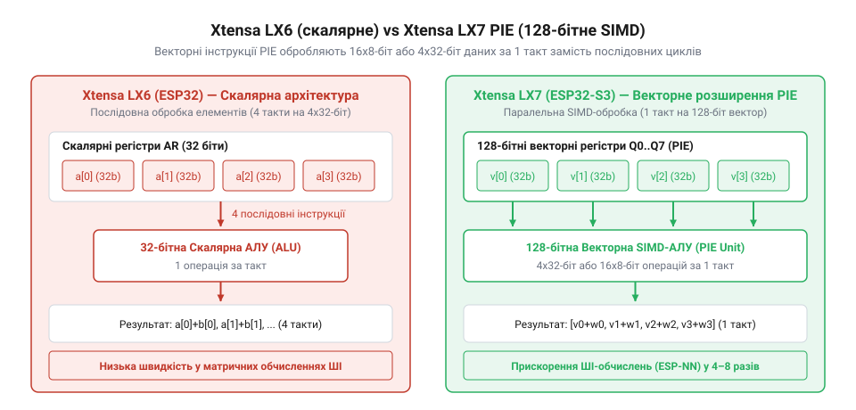
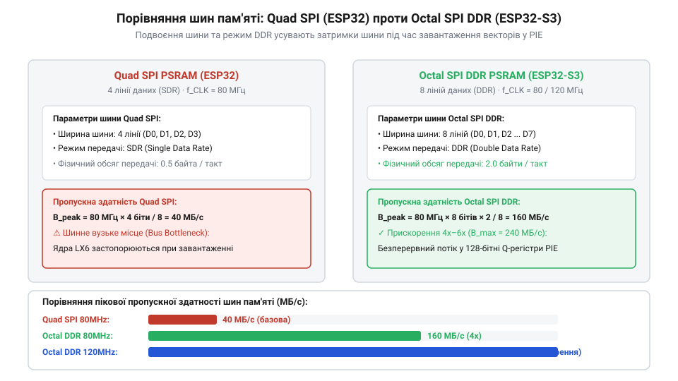

# Еволюція чипів ESP32-S3 та виникнення векторного розширення PIE

<preknowlist>
- [Родина плат і модулів на ESP32-S3](root:cat-hw-boards/esp32-s3-boards-family-overview) — Читач має розуміти базовий склад та апаратні характеристики лінійки чипів і модулів ESP32-S3.
- [Модуль ESP32-CAM: огляд архітектури, периферії та сімейства плат](root:cat-hw-boards/esp32-cam-camera-module-family) — Читач має знати обчислювальні обмеження першого покоління ESP32 під час роботи з відеопотоком та камерою OV2640.
</preknowlist>

## Обмеження першого ESP32 у матричних обчисленнях

У вересні 2016 року компанія @@en|Espressif Systems@@ випустила на ринок мікроконтролер класичної серії ESP32 на базі двох 32-бітних ядрах @@en|Xtensa LX6@@. Чип здобув колосальну популярність у сфері бездротової автоматизації завдяки інтеграції інтерфейсів Wi-Fi та Bluetooth. Проте у 2018–2019 роках, із бурхливим розвитком концепції кінцевих штучних обчислень @@en|Edge AI (edge AI)|обчислення штучного інтелекту на кінцевих пристроях@@, розробники зіткнулися з жорсткими апаратними бар'єрами першого покоління. Спроби реалізувати розпізнавання облич або локальних голосових команд на популярних платах на кшталт [ESP32-CAM (OV2640 + microSD)](root:cat-hw-boards/esp32-cam) з [Модуль ESP32-CAM: огляд архітектури, периферії та сімейства плат](root:cat-hw-boards/esp32-cam-camera-module-family) виявили принципове вузьке місце обчислювального ядра.

Процесор Xtensa LX6 був скалярним і виконував лише одну арифметичну операцію множення з накопиченням @@en|MAC (Multiply-Accumulated)|операція множення з накопиченням@@ за один тактовий імпульс. Для обробки матричних двовимірних згорткових нейромереж це вимагало мільйонів послідовних циклів. Другим критичним чинником стала пропускна здатність зовнішньої пам'яті: підключення через 4-бітну шину @@en|Quad SPI (Quad Peripheral Interface)|чотириразовий послідовний інтерфейс@@ обмежувало швидкість зчитування кадрових буферів на рівні 30–40 МБ/с. Обмежений обсяг внутрішньої оперативної пам'яті змушував розміщувати кадрові буфери розміром понад 150 КБ у зовнішній PSRAM. Через невеликий обсяг 32-кілобайтного кешу L1 даних (англ. @@en|L1 cache|кеш першого рівня@@) обробка великого кадру спричиняла постійне витіснення рядків пам'яті. Кожен промах кешу L1 (англ. @@en|L1 cache miss|промах кешу L1@@) призводив до кількісних накладних витрат у 30–40 тактових затримок очікування шини на перезавантаження 32-байтного рядка. При обробці навіть найпростішої фільтраційної маски масиву 3×3 скалярний процесор змушений був на кожен піксель послідовно вибирати 9 вагових коефіцієнтів та 9 піксельних значень сусідам. Через транзакційний оверхед шини пам'яті, де кожне некешоване витіснення вимагало передачі адресних та командних фаз, виконання 9 операцій @@en|MAC@@ розтягувалося на десятки тактових затримок очікування. В результаті понад 70% тактових імпульсів ядро процесора простоювало у заблокованому стані, а інференс навіть найпростіших моделей займав понад декілька секунд на один кадр.

## Перехід на Xtensa LX7 та розширення PIE

У відповідь на обчислювальний голод інженери Espressif Systems у 2020 році розпочали проектування принципово нового кристала. Замість інтеграції громіздкого та енергозатратного окремого нейромережевого прискорювача NPU, команда вирішила модернізувати саме процесорне ядро. Основним обчислювальним вузлом нового чипа став двоядерний 32-бітний процесор Xtensa LX7 із тактовою частотою 240 МГц. Головною апаратною інновацією стала інтеграція фірмового векторного розширення команд @@en|PIE (Processor Instruction Extensions)|розширення команд процесора@@.

*Архітектура двоядерного процесора Xtensa LX7 з 128-бітними векторними регістрами PIE та блоком SIMD.*

Архітектура PIE додала до ядра вісім 128-бітних векторних регістрів та спеціалізований арифметико-логічний блок. Це дозволило реалізувати принципи @@en|SIMD (Single Instruction, Multiple Data)|одна команда — багатьом даним@@, завдяки яким одна інструкція може одночасно обробляти вісім 16-бітних або шістнадцять 8-бітних цілочисельних значень за один такт. Для швидкого обчислення вагових коефіцієнтів нейромереж апаратний блок оптимізовано під 16-бітні числа з фіксованою точкою @@en|fixed-point|фіксована точка@@. При паралельному множенні двох 16-бітних значень проміжні добутки подвоюють розрядність до 32 біт, що під час послідовного сумування у згорткових операціях створює ризик переповнення. Для розв'язання цієї проблеми в апаратний конвеєр інтегровано спеціалізований 128-бітний векторний накопичувач @@en|vector accumulator|векторний накопичувач@@. Він безпосередньо акумулює розширені добутки з усіх паралельних каналів, виключаючи математичний циклічний розрив завдяки апаратній арифметиці з насиченням (англ. *saturation arithmetic*, @@en|saturation arithmetic@@): при досягненні граничного значення накопичувач автоматично фіксує результат на максимумі діапазону замість переповнення та спотворення даних. Одночасно апаратна логіка виконує вирівнювальний зсув (англ. *alignment shift*, @@en|alignment shift@@) та нормування 128-бітного масиву акумуляції через регістри зсуву за один робочий такт перед вивантаженням у пам'ять. У задачах матричного множення, швидкого перетворення Фур'є та згортки нейромереж прискорення обчислень зросло у 3–4 рази порівняно з Xtensa LX6 без збільшення тактової частоти чи енергоспоживання.

## Впровадження Octal SPI та інтеграція S3

Офіційний анонс чипа ESP32-S3 відбувся у грудні 2020 року, а масове постачання на ринок розпочалося на початку 2021 року. Проте висока продуктивність векторного прискорювача PIE вимагала відповідної швидкості подачі даних. Щоб позбутися затримок при зчитуванні вагових коефіцієнтів нейромереж та кадрових буферів високої роздільної здатності, інженери відмовилися від застарілої шини Quad SPI на користь 8-бітного інтерфейсу @@en|Octal SPI (Octal Peripheral Interface)|вісімковий послідовний периферійний інтерфейс@@ у режимі подвійної швидкості DDR.

*Порівняння пропускної здатності та ширини шини між 4-бітною Quad SPI та 8-бітною Octal SPI PSRAM.*

Використання 8 ліній даних у поєднанні з роботою за двома фронтами тактового сигналу підвищило пропускну здатність зовнішньої псевдостатичної пам'яті PSRAM до 160 МБ/с. Однак на високій тактовій частоті 120 МГц робота у двофронтовому режимі створювала ризик розфазування сигналу через температурні коливання та часові зсуви на провідниках друкованої плати. Для забезпечення стабільності зчитування інженери впровадили виділений допоміжний сигнал стробування даних @@en|DQS (Data Strobe)|сигнал стробування даних@@. Під час передачі мікросхема пам'яті генерує DQS одночасно із батами даних, виступаючи для контролера відлунням тактового імпульсу та чітко фіксуючи безпечні вікна вибірки кожного біта. Для компенсації температурного дрейфу напівпровідників контролер OPI PSRAM здійснює апаратне фазове калібрування (англ. *phase calibration*, @@en|phase calibration@@) за допомогою керованих ліній затримки (англ. *delay line calibration*, @@en|delay line calibration@@) в блоці IO MUX. Контролер під час ініціалізації та регулярних перекалібрувань підлаштовує кванти затримки стробу DQS, розміщуючи фронт вибірки строго по центру строб-вікна даних у всьому діапазоні температур від -40°C до +85°C. Поєднання векторних інструкцій PIE та високошвидкісного інтерфейсу Octal SPI перетворило чип ESP32-S3 та розробницькі плати, такі як [Waveshare ESP32-S3R2 (16 МБ Flash, 2 МБ PSRAM)](root:cat-hw-boards/esp32-s3r2-waveshare), на повноцінну стандартну платформу для систем крайніх обчислень Edge AI, потокового відео та розпізнавання мови, зафіксувавши новий рівень апаратної продуктивності у родині [Родина плат і модулів на ESP32-S3](root:cat-hw-boards/esp32-s3-boards-family-overview).

## Розвінчання міфів про NPU та S2

Швидке поширення [популярної плати ESP32-S3](root:cat-hw-boards/esp32-s3-boards-family-overview) серед спільноти інженерів породило низку стійких технологічних міфів щодо її внутрішньої архітектури. Найбільш розповсюдженою оманою є твердження про наявність у складі чипа окремого дискретного нейропроцесора @@en|NPU@@ (англ. *Neural Processing Unit*, від латинського *neuralis* — жильний, нервовий, @@en|NPU@@). У дійсності компанія Espressif відмовилася від виділеного сопроцесора на користь гнучкості: векторне прискорення вбудовано безпосередньо в конвеєр загального призначення ядер Xtensa LX7 через розширення `PIE`. Таке рішення дозволило зберегти мінімальну площу кремнієвого кристала та забезпечило повну програмованість векторних операцій через стандартні компіляторні макроси C/C++, у той час як фіксовані кристали NPU вимагають жорстко зафіксованих форматів вагових коефіцієнтів. Порівняно з програмною бібліотекою @@en|ESP-DSP@@, яка надає готові високорівневі процедури обробки сигналів, нативні макроси компілятора @@en|GCC@@ (від англ. @@en|GNU Compiler Collection@@) — вбудовані функції-інтринсіки (англ. *intrinsic*, від латинського *intrinsecus* — внутрішній, @@en|intrinsic@@) на кшталт `EE.VLD.128.IP` для завантаження 128 бітів даних з автоінкрементом вказівника та `EE.VADDS.S8` для паралельного додавання восьмибітних векторів — відкривають прямий доступ до 128-бітних векторних регістрів `Q0`–`Q7` без затримок виклику функцій, дозволяючи розробнику конструювати власні векторні ядра під довільні топології нейромереж.

Другим міфом є гіпотеза про передчасну відмову від одноядерної серії ESP32-S2 через її нібито «невдалість». Історично випущений у 2019 році чип ESP32-S2 виступив необхідним еволюційним містком. На ньому інженери вперше випробували ядро Xtensa LX7, апаратні блоки криптографії та нативний контролер USB OTG. Набутий досвід дозволив у 2020 році поєднати обчислювальну потужність двох ядер LX7, векторний блок `PIE`, контролер Bluetooth 5 LE та інтерфейс Octal SPI в остаточній архітектурі ESP32-S3.

## Місце ESP32-S3 у ландшафті Edge AI

Поява чипа ESP32-S3 та розширення `PIE` стала рубежем, який демократизував застосування алгоритмів машинного навчання у дешевих автономних пристроях. Висока ефективність векторного оброблення цифрових сигналів @@en|DSP (Digital Signal Processor)|цифровий процесор обробки сигналів@@ у поєднанні з 8-бітною пам'яттю PSRAM дозволила реалізувати локальний аналіз відеопотоку та розпізнавання голосових команд без звернення до хмарних серверів. Компактні розробницькі модулі, такі як [ESP32-S3-Zero (Type-C, 4 МБ)](root:cat-hw-boards/esp32-s3-zero), [Waveshare ESP32-S3-Pico](root:cat-hw-boards/esp32-s3-pico) та [ESP32-S3 SuperMini](root:cat-hw-boards/esp32-s3-supermini), довели можливість побудови складних систем комп'ютерного зору при мінімальній вартості комплектуючих.

У сучасному ландшафті вбудованих систем компанія Espressif активно переходить на відкриту архітектуру @@en|RISC-V@@ (англ. *Reduced Instruction Set Computer V*, від англ. *reduced* — скорочений, *instruction* — вказівка, @@en|RISC-V@@), представлену в бездротових чипах для мереж Wi-Fi 6 на прикладі [плат Waveshare ESP32-C6-Zero](root:cat-hw-boards/esp32-c6-zero) та [WeAct ESP32-C6-Mini](root:cat-hw-boards/esp32-c6-mini). Важливим хронологічним етапом зрілості архітектури S3 стала інтеграція наприкінці 2021 року апаратно-оптимізованих ядер бібліотеки @@en|TensorFlow Lite for Microcontrollers@@, у яких оператори згортки та матричного множення були переписані під інструкції `PIE`, що прискорило виконання інференсу в 4–6 разів проти скалярного коду. Попри вихід новіших високопродуктивних серій, таких як ESP32-P4 з двома ядрами RISC-V, апаратним кодеком H.264 та розширеним блоком матричних інструкцій @@en|Matrix Extension@@, що виконує двовимірні матричні множення нативно за меншу кількість тактів порівняно зі 128-бітними лінійними інструкціями `PIE`, чип ESP32-S3 залишається еталонним рішенням у [лінійці плат ESP32-S3](root:cat-hw-boards/esp32-s3-boards-family-overview) для задач локального штучного інтелекту завдяки збалансованому поєднанню ціни, наявності Bluetooth LE та зрілої програмної екосистеми.
