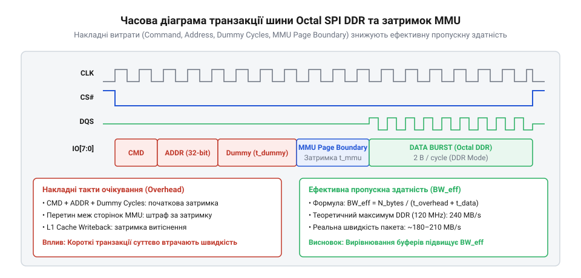

# Математична модель пропускної здатності шини Octal SPI та затримок MMU

<preknowlist>
- [Модуль ESP32-CAM: огляд архітектури, периферії та сімейства плат](root:cat-hw-boards/esp32-cam-camera-module-family) — принципи організації кадрових буферів відеопотоку у зовнішній пам'яті
- [Родина плат і модулів на ESP32-S3](root:cat-hw-boards/esp32-s3-boards-family-overview) — специфіка підключення PSRAM через шину Octal SPI
- [Waveshare ESP32-S3R2 (16 МБ Flash, 2 МБ PSRAM)](root:cat-hw-boards/esp32-s3r2-waveshare) — практичні параметри SiP-пам'яті Octal SPI DDR на 80 МГц
</preknowlist>

## Обмеження продуктивності зовнішньої пам'яті Octal SPI

При розробці високонавантажених обчислювальних систем у вбудованих пристроях теоретична частота тактування шини оперативної пам'яті створює оману щодо доступної обчислювальної швидкості. За паспортом 8-бітна шина @@en|Octal SPI@@ (від англ. @@en|Octal Serial Peripheral Interface@@) у режимі @@en|Double Data Rate@@ (@@en|DDR@@ — передача двох бітів за один тактовий імпульс) на частоті `f_clk = 80` МГц декларує пікову пропускну здатність 160 МБ/с, а на частоті `120` МГц — 240 МБ/с.

Проте при потоковому захопленні зображень високої роздільності, якими оперує [модуль ESP32-CAM](root:cat-hw-boards/esp32-cam-camera-module-family), або виконанні нелінійних операцій сверточних мереж реальна частота кадрів опускається значно нижче розрахункових меж. Причина полягає у фізичних накладних витратах: розширення шини з чотирьох ліній @@en|Quad SPI@@ (від англ. @@en|Quad Serial Peripheral Interface@@) до восьми ліній @@en|Octal SPI@@ теоретично подвоює ширину каналу, але не дає пропорційного 8-разового прискорення передачі. Кожна транзакція змушена витрачати фіксовані такти на командно-адресний заголовок, витримувати фази очікування синхронізації (англ. @@en|dummy cycles@@), переносити витіснені лінії з L1-кешу та долати затримки сторінкової адресації блоку керування пам'яттю @@en|MMU@@ (від англ. @@en|Memory Management Unit@@). Окрім цього, під час прямого доступу до пам'яті (англ. @@en|Direct Memory Access@@, @@en|DMA@@) при передачі кадрових буферів виникають додаткові апаратні паузи, спричинені циклічним оновленням осередків динамічної пам'яті (англ. @@en|DRAM refresh cycle@@) всередині псевдостатичної ОЗУ: кристал змушений періодично призупиняти зовнішній обмін на час перезарядки конденсаторів матриці, заморожуючи шину на кілька десятків тактів. Оскільки ці стартові накладні фази та періодичні паузи регенерації мають сталу тривалість незалежно від кількості ліній даних, при коротких пакетах вибірки вагових коефіцієнтів частка корисного передавання знижується, і 8 ліній шини випереджають 4 лінії лише частково. Без побудови комплексної математичної моделі цих апаратних затримок неможливо спроєктувати стабільний обмін даними для [родини плат ESP32-S3](root:cat-hw-boards/esp32-s3-boards-family-overview).

На практиці цей обчислювальний розрив проявляється під час прямого транзиту даних від сенсора камери до зовнішньої псевдостатичної пам'яті. У разі хаотичного читання елементів масиву або виникнення невирівняних транзакцій насунуті апаратні простої вичерпують часовий бюджет між зафіксованими імпульсами кадрів. Контролер прямого доступу до пам'яті не встигає звільнити вхідний кільцевий буфер до приходу наступних рядків зображення, що призводить до систематичного випадання кадрів та критичних збоїв у платах на зразок [Waveshare ESP32-S3R2 (16 МБ Flash, 2 МБ PSRAM)](root:cat-hw-boards/esp32-s3r2-waveshare). Точний розрахунок тривалості кожної фази обміну є єдиним способом заздалегідь визначити допустимий розмір пакетів та обрати оптимальний режим тактування без ризику апаратних перевищень затримок.

## Математична модель шини Octal SPI DDR

Для обчислення ефективної пропускної здатності `B_real` (у мегабайтах за секунду, МБ/с) розіб'ємо сеанс обміну даними обсягом `N_bytes` байт на тактові складові.

Загальне число тактів транзакції `N_total` складається з постійних накладних тактів заголовка `N_overhead` та активних тактів передачі даних `N_payload`:

```
N_payload
= (N_bytes × 8) ÷ (W_bus × M_mode)    [число тактів для передачі даних]
```

Для 8-бітної шини `W_bus = 8` у режимі DDR `M_mode = 2`, що спрощує формулу до `N_payload = N_bytes ÷ 2`. Накладні такти `N_overhead` включають команду `N_cmd = 2` байти, адресу `N_addr = 4` байти та фіксовані такти синхронізації `N_dummy` (10 тактів для 80 МГц та 14 тактів для 120 МГц):

```
N_overhead
= N_cmd + N_addr + N_dummy                          [сума накладних тактів заголовка]
```


*Часова діаграма транзакції Octal SPI DDR та затримок адресації MMU.*

Тривалість транзакції `T_trans` у мікросекундах (мкс) при частоті `f_clk` (МГц):

```
T_trans
= (N_overhead + N_payload) ÷ f_clk                  [тривалість транзакції в мкс]
```

Звідси ефективна пропускна здатність `B_real` виражається як:

```
B_real
= N_bytes ÷ T_trans                                 [підстановка обсягу та часу]
= (N_bytes × f_clk) ÷ (N_overhead + N_payload)      [підсумкова алгебраїчна формула]
```

Порівняємо передачу одного 64-байтового блоку (розмір лінії кешу) на частоті 80 МГц та 120 МГц на платі [Waveshare ESP32-S3R2](root:cat-hw-boards/esp32-s3r2-waveshare). Зростання частки накладних витрат при 120 МГц зумовлене потребою у тривалішій фазі очікування: збільшення `N_dummy` з 10 до 14 тактів необхідне для апаратного фазового підлаштування стробу даних @@en|DQS@@ (від англ. @@en|Data Strobe@@) за допомогою ліній затримки схеми @@en|DLL@@ (від англ. @@en|Delay-Locked Loop@@), яка зсуває фронт вибірки на 90 градусів у центр очка сигнальної діаграми для забезпечення стабільності зчитування на високій частоті. Аналіз залежності реальної швидкості `B_real` від розміру транзакції `N_bytes` показує стрімке зростання ефективності при збільшенні блоку від 16 до 4096 байтів: для 16 байтів швидкість становить лише 53.33 МБ/с (80 МГц) та 68.57 МБ/с (120 МГц), при 32 байтах — 80.00 МБ/с та 106.67 МБ/с, для 64 байтів (лінія кешу) — 106.67 МБ/с та 147.69 МБ/с, при 128 байтах — 128.00 МБ/с та 182.86 МБ/с, для 256 байтів — 142.22 МБ/с та 207.57 МБ/с, при 512 байтах — 150.59 МБ/с та 222.61 МБ/с, для 1024 байтів — 155.15 МБ/с та 231.00 МБ/с, а при 4096 байтах досягає 158.76 МБ/с та 237.68 МБ/с (відповідно 99.2% та 99.0% від теоретичного максимуму шини). Порівняльна таблиця результатів показує, що для малих блоків (16–64 байти) накладні такти заголовка `N_overhead` домінують у загальному часі транзакції, знижуючи відносну ефективність до 28–66%, тоді як при збільшенні розміру пачки до 4096 байтів апаратний оверхед амортизується, наближаючи пропускну здатність шини @@en|Octal SPI@@ до фізичної межі.

Обчислення для 80 МГц (`N_dummy = 10`):

```
N_payload
= 64 ÷ 2
= 32                                                [тактивно передані байти в DDR]

N_overhead
= 2 + 4 + 10
= 16                                                [накладні такти шини]

B_real_80
= (64 × 80) ÷ (16 + 32)
= 5120 ÷ 48
= 106.667                                           [ефективна швидкість у МБ/с]
```

Обчислення для 120 МГц (`N_dummy = 14`):

```
N_overhead
= 2 + 4 + 14
= 20                                                [накладні такти при 120 МГц]

B_real_120
= (64 × 120) ÷ (20 + 32)
= 7680 ÷ 52
= 147.692                                           [ефективна швидкість у МБ/с]
```

При теоретичному максимумі 240 МБ/с питома ефективність впала до 61.54% через зростання `N_dummy` до 14 тактів.

## Модель затримок L1-кешу та MMU

Доступ до зовнішньої PSRAM з боку процесорних ядер у ESP32-S3 проходить через двоканальний L1-кеш із розміром лінії `L_line = 64` байти та блок трансляції адресації MMU з розміром сторінки `S_page = 64` КБ (65536 байтів).

При промаху кешу (англ. @@en|cache miss@@) та витісненні модифікованої ("брудної") лінії виникає сумарний часовий штраф, який складається з тривалості зворотного запису модифікованих даних у PSRAM `T_writeback` та тривалості зчитування нової 64-байтової лінії `T_fetch`. У рівнянні для обчислення затримки ці часові інтервали виражаються тривалістю відповідних шинних транзакцій `T_trans_write = T_writeback` та `T_trans_read = T_fetch` у мікросекундах. Загальна затримка кешу `T_cache` у тактах процесора при робочій частоті `f_cpu = 240` МГц становить:

```
T_cache
= (T_trans_write + T_trans_read) × f_cpu            [переведення часу обміну в такти CPU]
```

При Octal SPI DDR 80 МГц тривалість зчитування та запису однієї лінії `T_trans = 0.6` мкс:

```
T_cache
= (0.6 + 0.6) × 240
= 288                                               [штрафні такти CPU на витіснення]
```

Коли операція обміну даними перетинає межу 64-кілобайтової сторінки MMU, конвеєр трансляції віртуальних адрес у фізичні викликає додаткову затримку `T_mmu = 12` тактів процесора на оновлення арбітра сторінкових таблиць.

При хаотичному довільному доступі до масиву обсягом `S_buffer` загальне число промахів дорівнює `N_miss = S_buffer ÷ 64`, а число перетинів меж сторінок MMU дорівнює `N_mmu = S_buffer ÷ 65536`. Сумарні часові втрати простою процесора `T_stall` (у тактах):

```
T_stall
= N_miss × T_cache + N_mmu × T_mmu                  [сума штрафів кешу та MMU]
```

## Оптимізація вирівнювання та розмірів буферів

Для мінімізації штрафних тактів при обробці відеопотоків або масивів датчиків слід застосовувати математично обґрунтоване вирівнювання пам'яті.

Якщо кадровий буфер розміром `S_buf` не вирівняний по межі 64 байтів, перший і останній блоки кадру перетинають межі двох сусідніх ліній кешу, викликаючи 2 додаткові затримки `T_cache = 288` тактів. Якщо буфер перетинає межу 64 КБ сторінки MMU, виникає додатковий простій `T_mmu = 12` тактів.

Застосування директиви вирівнювання `__attribute__((aligned(64)))` та виділення розмірів буферів кратними 64 байтам гарантує, що `N_miss` є мінімально можливим, а прямий доступ DMA протікає без блокувань процесора.

Розрахуємо реальну частоту кадрів `FPS_effective` для кадру QVGA (153600 байтів) з урахуванням вирівнювання. У знаменнику формули обчислення часу `T_dma` використовується числове значення `106667000`, яке є результатом переведення розрахованої вище ефективної пропускної здатності шини `B_real_80` з мегабайтів на секунду (106.667 МБ/с) безпосередньо у байти за секунду (106.667 × 10⁶ Б/с):

```
T_dma
= 153600 ÷ (106667000)
= 0.00144                                           [час передачі кадру DMA в секундах]

FPS_effective
= 1 ÷ 0.00144
= 694.4                                             [граничний FPS при оптимальному вирівнюванні]
```

Такий розрахунок підтверджує, що правильне вирівнювання кадрових буферів дозволяє досягти максимальної продуктивності на пристроях серії [ESP32-S3 SuperMini](root:cat-hw-boards/esp32-s3-supermini).
