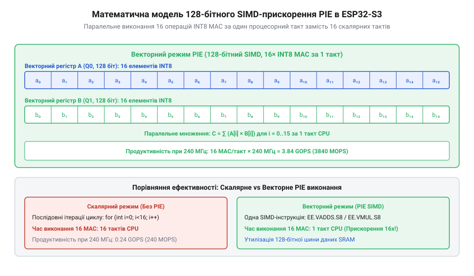

# Математичний розрахунок продуктивності векторного розширення PIE для обчислень TinyML

<preknowlist>
- [Родина плат і модулів на ESP32-S3](root:cat-hw-boards/esp32-s3-boards-family-overview) — Читач має знати базову тактову частоту ядра 240 МГц та структуру внутрішньої SRAM ESP32-S3.
- [Waveshare ESP32-S3R2 (16 МБ Flash, 2 МБ PSRAM)](root:cat-hw-boards/esp32-s3r2-waveshare) — Читач має орієнтуватися у пропускній здатності шини Octal SPI PSRAM при вибірці масивів вагових коефіцієнтів нейромережі.
</preknowlist>

## Скалярне обчислювальне вузьке місце TinyML

Обробка нейронних мереж на мікроконтролерах у концепції @@en|TinyML@@ (з англ. tiny — крихітний, machine learning — машинне навчання) впирається в обчислювальну складність згорткових та повнозв'язних шарів. Основною арифметичною операцією інференсу є @@en|Multiply-Accumulate@@ (з англ. multiply — множити, accumulate — накопичувати; скорочено MAC), що обчислює добуток вхідного сигналу на ваговий коефіцієнт і додає результат до акумулятора.

У скалярній архітектурі ядра процесора кожна така операція виконується послідовно. Для одного елемента обчислювального циклу мікроконтролер має зчитати інструкцію, завантажити значення аргументу з пам'яті @@en|Static RAM@@, завантажити ваговий коефіцієнт, виконати арифметичне множення, додати результат до суматора та оновити лічильник циклу. Підсумкова тактність `C_mac = 5` складається з п'яти послідовних фаз: один такт іде на вибірку інструкції, по одному такту займають окремі інструкції завантаження операнда та вагового коефіцієнта з пам'яті SRAM, один такт витрачається на арифметичний розрахунок @@en|Multiply-Accumulate@@, і ще один такт іде на накладні витрати циклу (перевірку умови та зсув лічильника). На процесорних ядрах Xtensa LX6 та LX7 у скалярному режимі ця послідовність не може бути паралелізована, через що виконання одного розрахунку MAC разом із накладними витратами циклу стабільно займає приблизно `C_mac = 5` процесорних тактів.

Якщо згортковий шар нейромережі потребує виконання `N = 10⁶` операцій MAC для обробки одного кадру, загальна кількість тактів `T_scalar` при скалярному обчисленні становить:

T_scalar = N · C_mac
= 10⁶ · 5      [підстановка кількості операцій та витрат на такт]
= 5 · 10⁶ тактів

При тактовій частоті процесорного ядра `f_cpu = 240 · 10⁶` Гц (240 МГц) затримка обчислення `t_scalar` дорівнює:

t_scalar = T_scalar ÷ f_cpu
= (5 · 10⁶) ÷ (240 · 10⁶)      [ділення кількості тактів на частоту ядра]
≈ 0.02083 секунди

Затримка у 20.83 мілісекунди лише на один обчислювальний шар є критичною для систем реального часу. Під час розробки модулів відеонагляду на базі [архітектури ESP32-CAM](root:cat-hw-boards/esp32-cam-camera-module-family) така скалярна швидкодія створює вузьке місце, яке не дозволяє досягти високої частоти обробки кадрів.

## Математична модель SIMD у PIE

Для подолання обчислювального бар'єра в чипі ESP32-S3 реалізовано векторне розширення інструкцій @@en|Processor Instruction Extensions@@ (з англ. processor — процесор, instruction — інструкція, extension — розширення; скорочено PIE). Воно додає 128-бітні векторні регістри та командні інструкції типу @@en|Single Instruction, Multiple Data@@ (з англ. single — єдиний, instruction — інструкція, multiple — декілька, data — дані; скорочено SIMD).

При використанні квантованого 8-бітного формату цілих чисел `INT8` (8-бітні числа зі знаком) в один 128-бітний регістр пакується `K` обчислювальних елементів. Для порівняння, при переході на 16-бітний формат `INT16` чи `FP16` кількість елементів у регістрі становить лише `K_16 = 128 ÷ 16 = 8`, що зменшує векторну швидкодію вдвічі та подвоює кількість необхідних процесорних тактів. Для 8-бітного формату `INT8` кількість пакованих елементів `K` є максимальною:

K = 128 ÷ 8
= 16 елементів

Векторна інструкція PIE виконує множення та накопичення для шістнадцяти пар елементів за один процесорний такт. 

_Розбиття 128-бітного регістра PIE на шістнадцять 8-бітних елементів INT8 та паралельне виконання MAC-операцій._

Ідеальна кількість тактів `T_vector_ideal` для обробки того самого масиву з `N = 10⁶` операцій скорочується пропорційно коефіцієнту паралелізму `K`:

T_vector_ideal = N ÷ K
= 10⁶ ÷ 16      [ділення на кількість елементів у векторі]
= 62500 тактів

Теоретичний коефіцієнт прискорення @@en|Speedup@@ без урахування затримок пам'яті визначається відношенням тактності:

Speedup_theoretical = T_scalar ÷ T_vector_ideal
= (N · C_mac) ÷ (N ÷ 16)      [скасування N у чисельнику та знаменнику]
= 16 · C_mac
= 16 · 5 = 80

Оскільки кожна операція MAC складається з двох арифметичних дій (одне множення та одне додавання), теоретична продуктивність ядра в операціях за секунду @@en|MOPS@@ при частоті 240 МГц досягає:

MOPS_theoretical = 2 · K · f_cpu ÷ 10⁶
= 2 · 16 · (240 · 10⁶) ÷ 10⁶      [обчислення мільйонів операцій на секунду]
= 7680 MOPS

## Накладні витрати вирівнювання даних пам'яті

На практиці теоретичне вісімдесятиразове прискорення не досягається через накладні витрати вибірки даних із пам'яті @@en|Static RAM@@. 128-бітні векторні інструкції завантаження вимагають суворої вирівняності адрес у пам'яті по межі 16 байтів. Якщо масив даних не вирівняно, процесор витрачає додаткові такти `C_align` на зсув та збирання регістрів.

Крім того, під час зчитування вагових коефіцієнтів із зовнішньої пам'яті на платах на кшталт [Waveshare ESP32-S3R2](root:cat-hw-boards/esp32-s3r2-waveshare) чи інших моделей [серії ESP32-S3](root:cat-hw-boards/esp32-s3-boards-family-overview) пропускна здатність шини @@en|Octal SPI@@ обмежує швидкість подачі векторів до обчислювального ядра. Коли вагові масиви нейромережі не вміщаються у внутрішній @@en|SRAM@@ і зберігаються у зовнішній псевдостатичній пам'яті @@en|OPI PSRAM@@, кожне промахування кешу (англ. @@en|Cache Miss@@, від фр. @@en|cacher@@ — ховати та англ. @@en|miss@@ — промах) змушує контролер вибірки завантажувати 32-байтовий рядок кешу через 8-бітну шину на частоті 80 МГц DDR. При частоті ядра 240 МГц така затримка підкачування додає штрафний інтервал `C_miss ≈ 12...16` тактів на кожен невирівняний векторний блок, через що ефективна затримка завантаження `C_load` зростає з 1 до `C_load + C_miss`, знижуючи підсумковий реальний коефіцієнт прискорення `Speedup_real` у кілька разів.

Реальна кількість тактів `C_vector_real` на обробку одного 16-елементного вектора складається з такту виконання інструкції `C_pie = 1`, такту завантаження з внутрішньої пам'яті `C_load = 1` та усередненого штрафу невирівняності `C_align = 1`:

C_vector_real = C_pie + C_load + C_align
= 1 + 1 + 1      [додавання складових тактів векторного циклу]
= 3 такти на 16 MAC

Скоригована реальна кількість тактів `T_vector_real` для `N = 10⁶` операцій становить:

T_vector_real = (N ÷ 16) · C_vector_real
= (10⁶ ÷ 16) · 3      [множення кількості векторних блоків на реальну тактність]
= 62500 · 3 = 187500 тактів

Реальний коефіцієнт прискорення з урахуванням накладних витрат дорівнює:

Speedup_real = T_scalar ÷ T_vector_real
= (5 · 10⁶) ÷ 187500      [ділення скалярних тактів на реальні векторні]
≈ 26.67

Фактична продуктивність `MOPS_real` для одного ядра за цих умов становить:

MOPS_real = (2 · N) ÷ (T_vector_real ÷ f_cpu) ÷ 10⁶
= (2 · 10⁶) ÷ (187500 ÷ (240 · 10⁶)) ÷ 10⁶      [переведення тактів у час і обчислення швидкодії]
= 2 · 10⁶ ÷ 0.00078125 ÷ 10⁶
= 2560 MOPS

## Розрахунок FPS для моделей зору

Розглянемо практичну задачу обчислення інференсу компактної нейромережі комп'ютерного зору (наприклад, згорткової мережі розпізнавання облич), яка потребує `M = 50 · 10⁶` операцій MAC на один кадр. Зазначена модель виконується на двоядерному мікроконтролері [ESP32-S3 SuperMini](root:cat-hw-boards/esp32-s3-supermini) або [Waveshare ESP32-S3-Pico](root:cat-hw-boards/esp32-s3-pico), де обчислювальне навантаження рівномірно розподіляється між двома ядрами Xtensa LX7 на частоті 240 МГц.

Кількість тактів на один кадр для одного ядра `T_frame_single` при векторній обробці PIE становить:

T_frame_single = (M ÷ 16) · C_vector_real
= (50 · 10⁶ ÷ 16) · 3      [обчислення векторних тактів для 50 мільйонів MAC]
= 3125000 · 3 = 9375000 тактів

При паралельному виконанні на двох ядрах загальна тактність кадру `T_frame_dual` зменшується вдвічі:

T_frame_dual = T_frame_single ÷ 2
= 9375000 ÷ 2      [розподіл обчислень на 2 ядра]
= 4687500 тактів

Час обробки одного кадру `t_frame` дорівнює:

t_frame = T_frame_dual ÷ f_cpu
= 4687500 ÷ (240 · 10⁶)      [ділення сумарних тактів на частоту процесора]
= 0.01953125 секунди

Гранична частота кадрів @@en|FPS@@ (з англ. frames per second — кадрів на секунду) обчислюється як обернена величина до часу кадру:

FPS_max = 1 ÷ t_frame
= 1 ÷ 0.01953125      [обчислення кількості кадрів на секунду]
= 51.2 кадрів/с

Таким чином, використання векторного розширення PIE та формат даних `INT8` забезпечує продуктивність понад 50 кадрів на секунду для моделей середньої складності, що робить чип ESP32-S3 повноцінною платформою для задач @@en|TinyML@@ у реальному часі.
