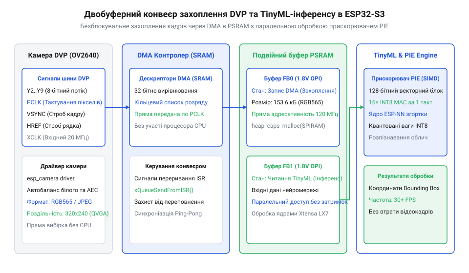
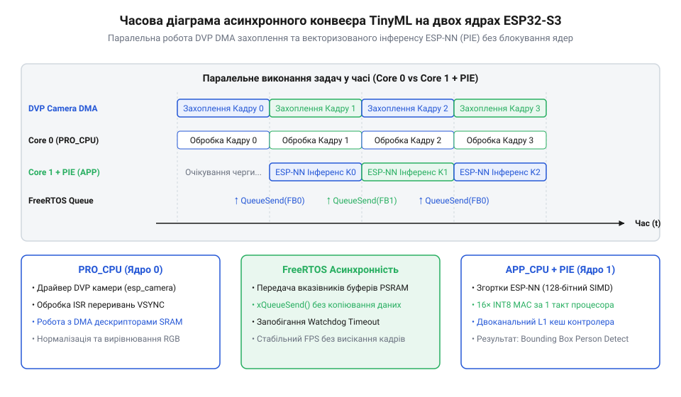

# Проєкт автономного детектора облич TinyML з векторизацією PIE

<preknowlist>
- [Родина плат і модулів на ESP32-S3](root:cat-hw-boards/esp32-s3-boards-family-overview) — розуміння архітектури ядра ESP32-S3, розміщення пам'яті PSRAM та векторного прискорювача PIE
- [Модуль ESP32-CAM: огляд архітектури, периферії та сімейства плат](root:cat-hw-boards/esp32-cam-camera-module-family) — принципи роботи паралельної шини камери DVP та організації кадрових буферів
</preknowlist>

## Вимоги до локального інференсу TinyML

Застосування традиційних централізованих архітектур для аналізу відеопотоків у реальному часі створює критичні проблеми в роботі автономних систем. Передавання нестиснених або навіть стиснених відеокадрів із локальної камера на віддалений хмарний сервер вимагає постійного й високоефективного мережевого з'єднання. У реальних умовах це призводить до високих затримок (від сотень мілісекунд до кількох секунд), значного споживання енергії бездротовими модулями, ризиків витоку конфіденційних біометричних даних та повної втрати працездатності пристрою при збоях зв'язку. Для автономного виявлення та розпізнавання облич потрібне виконання обчислень безпосередньо на крайньому пристрої.

Розглянемо витоки апаратної проблеми обробки відеоданих на мікроконтролерах. Кадр із матриці камери помірної роздільної здатності @@en|QVGA@@ (320 × 240 пікселів) у кольоровому форматі @@en|RGB565@@ займає в пам'яті 153.6 КБ даних. Якщо система повинна працювати з частотою 30 кадрів на секунду (@@en|FPS@@ (англ. *Frames Per Second*, від *frame* — кадр, *per* — за, *second* — секунда)), обсяг вхідного потоку перевищує 4.6 мегабайта на секунду.

Традиційні мікроконтролери спотикаються об два основні бар'єри:
1. Обмеження внутрішньої оперативної пам'яті: внутрішня статична пам'ять @@en|SRAM@@ (англ. *Static Random-Access Memory*, від *static* — статичний, *random-access* — довільного доступу, *memory* — пам'ять) мікроконтролера @@en|ESP32-S3@@ становить лише 512 КБ. Вона одночасно обслуговує стек операційної системи, буфери бездротових протоколів та робочу купу. Розміщення кількох кадрових буферів розміром понад 150 КБ повністю вичерпує вільну @@en|SRAM@@, унеможливлюючи виділення пам'яті під вагові коефіцієнти та тензорні арени нейромережі.
2. Продуктивність скалярного обчислювального ядра: виконання операцій 2D-згортки в згорткових нейромережах зводиться до мільйонів послідовних операцій множення з накопиченням. Стандартне скалярне ядро @@en|CPU@@ (англ. *Central Processing Unit*, від *central* — центральний, *processing* — обробний, *unit* — пристрій) виконує ці операції поодинці в циклі. Це призводить до затримки інференсу в 300–800 мілісекунд на один кадр, зменшуючи швидкість обробки до 1–3 @@en|FPS@@.

Вирішення цієї двоїстої проблеми досягається поєднанням двох апаратних компонентів системи на кристалі @@en|ESP32-S3@@. Зовнішня псевдостатична оперативна пам'ять @@en|PSRAM@@ (англ. *Pseudo Static Random-Access Memory*, від *pseudo* — псевдо, *static* — статичний, *random-access* — довільного доступу, *memory* — пам'ять) обсягом до 16 мегабайтів забезпечує необхідну ємність для зберігання подвійних кадрових буферів та проміжних тензорів. Водночас апаратний векторний прискорювач @@en|PIE@@ (англ. *Processor Instruction Extensions*, від *processor* — процесор, *instruction* — інструкція, *extension* — розширення) розширює систему інструкцій ядра Xtensa LX7 128-бітними регістрами. Це дозволяє паралельно обробляти декілька байтових елементів за один тактовий сигнал у концепції @@en|TinyML@@ (англ. *Tiny Machine Learning*, від *tiny* — крихітний, *machine* — машина, *learning* — навчання).

Під час проектування локальних систем на базі [родини плат ESP32-S3](root:cat-hw-boards/esp32-s3-boards-family-overview) важливо враховувати архітектурні деталі вибірки даних. Для детальнішого розбору математичних засад стиснення нейромережевих моделей дивіться [методи INT8 квантування TinyML](root:sf-ml/model-quantization), де пояснюється математика конвертації вагових коефіцієнтів.

## Архітектура DVP та буферизація в PSRAM

Спрямування відеопотоку від фотосенсора камери до оперативної пам'яті вимагає чіткої схемотехнічної організації паралельного шинного інтерфейсу. Камера підключається до мікроконтролера через цифровий відеопорт @@en|DVP@@ (англ. *Digital Video Port*, від *digital* — цифровий, *video* — відео, *port* — порт). Паралельна шина містить 8 ліній даних (`D0`–`D7`), тактовий сигнал пікселів @@en|PCLK@@ (англ. *Pixel Clock*, від *pixel* — піксель, *clock* — тактовий сигнал), сигнал горизонтального рядка @@en|HREF@@ (англ. *Horizontal Reference*, від *horizontal* — горизонтальний, *reference* — опорний сигнал) та сигнал вертикальної синхронізації кадру @@en|VSYNC@@ (англ. *Vertical Synchronization*, від *vertical* — вертикальний, *synchronization* — синхронізація). Сконфігуроване master-тактування сенсора забезпечує лінія @@en|XCLK@@ (англ. *External Clock*, від *external* — зовнішній, *clock* — тактовий сигнал), а первинне налаштування регістрів матриці здійснюється по двохпровідній шині @@en|SCCB@@ (англ. *Serial Camera Control Bus*, від *serial* — послідовний, *camera* — камера, *control* — керування, *bus* — шина).

При прямому програмному зчитуванні даних ядром @@en|CPU@@ виникає пастка розриву кадрів (артефакти розриву зображення). Оскільки тактова частота @@en|PCLK@@ досягає 10–20 мегагерц, будь-яке переривання операційної системи під час зчитування байта призводить до пропуску пікселів, зсуву рядків і спотворення кадру. Для усунення залучення @@en|CPU@@ до процесу зчитування використовується периферійний контролер прямого доступу до пам'яті @@en|DMA@@ (англ. *Direct Memory Access*, від *direct* — прямий, *memory* — пам'ять, *access* — доступ) або його розширена версія @@en|GDMA@@ (англ. *General Direct Memory Access*, від *general* — загальний, *direct* — прямий, *memory* — пам'ять, *access* — доступ). Контролер @@en|GDMA@@ самостійно захоплює байти з шини `D0`–`D7` за кожним імпульсом @@en|PCLK@@ і записує їх у кольоровому форматі @@en|RGB565@@ безпосередньо у виділений буфер пам'яті.

Але однобуферна організація створює стан гонитви даних: якщо ядро нейромережі читає кадр із буфера в момент, коли @@en|GDMA@@ перезаписує його новими пікселями наступного кадру, алгоритм виявлення облич отримує спотворений гібридний кадр. Вирішенням є механізм подвійної буферизації у зовнішній пам'яті @@en|PSRAM@@ (`fb_count = 2`, `CAMERA_FB_IN_PSRAM`).


_*Схема двобуферного захоплення кадрів камери по шині DVP у зовнішню пам'ять PSRAM та трансляції через контролер DMA._*

Як показано на схемі, коли контролер @@en|GDMA@@ заповнює Буфер 0 даними поточного кадру по шині @@en|DVP@@, ядро інференсу читає стабільні дані з Буфера 1. По завершенню кадру за імпульсом @@en|VSYNC@@ контролер переривань миттєво перемикає покажчик @@en|GDMA@@ на Буфер 1, а звільнений Буфер 0 передається на обробку нейромережі.

Подібна схемотехніка паралельного підключення використовується в [модулях серії ESP32-CAM](root:cat-hw-boards/esp32-cam-camera-module-family), де правильне трасування сигналів @@en|PCLK@@ і @@en|DVP@@ визначає завадостійкість передачі.

Для конфігурування драйвера камери `esp32-camera` в середовищі `ESP-IDF` задається структура `camera_config_t`. Нижче наведено ініціалізацію кадрових буферів у пам'яті @@en|PSRAM@@ мовами C та C++:

:::tabs
@tab C
:::code proj-esp32-s3-tinyml-person-detection/c/esp-idf/camera_nn_pipeline.c 47-88

@tab C++
:::code proj-esp32-s3-tinyml-person-detection/cpp/main/camera_stream.hpp 22-66
:::

## Векторизація квантованих шарів у ESP-NN

Отримання високої продуктивності нейромережевого інференсу на крайніх пристроях вимагає оптимізації як обсягу даних, так і виконання арифметичних операцій. Звичайні нейронні мережі використовують 32-бітні числа з плаваючою комою (FP32), що вимагає значних обсягів пам'яті та складних обчислювачів. У концепції @@en|TinyML@@ застосовують 8-бітне цілочисельне квантування @@en|INT8@@. При квантуванні дійсні значення вагових коефіцієнтів та активацій масштабуються у діапазон від -128 до 127 із відповідним коефіцієнтом масштабування та зсувом нульової точки. Це зменшує обсяг пам'яті під вагові коефіцієнти в 4 рази.

Апаратне прискорення 8-бітних згорткових шарів на @@en|ESP32-S3@@ забезпечується співпроцесором @@en|PIE@@. Прискорювач містить 128-бітні векторизовані регістри, що дозволяють завантажувати до 16 8-бітних чисел за одну операцію читання з пам'яті та виконувати паралельні операції множення з накопиченням у форматі @@en|SIMD@@ (англ. *Single Instruction, Multiple Data*, від *single* — єдиний, *instruction* — інструкція, *multiple* — множинний, *data* — дані).

Оптимізована бібліотека нейромережевих обчислень @@en|ESP-NN@@ реалізує спеціалізовані функції 2D-згортки, такі як `esp_nn_conv_s8`. На відміну від стандартних скалярних циклів, векторизований алгоритм розпаковує масиви ваг у пам'яті такими блоками, щоб 128-бітний регістр @@en|PIE@@ одночасно множив 16 каналів вхідного тензора на відповідні ваги за один тактовий цикл. Це забезпечує підвищення продуктивності обчислення згорткових шарів у 3-4 рази порівняно зі стандартним кодом @@en|CPU@@.

Однак вибірка даних векторними інструкціями @@en|PIE@@ накладає суворе апаратне обмеження: усі масиви вхідних даних, вихідних активацій, вагових коефіцієнтів та зсувів у пам'яті @@en|PSRAM@@ повинні мати 32-бітне (або 128-бітне) вирівнювання адрес. Виділення пам'яті здійснюється викликом `heap_caps_malloc` із прапорами `MALLOC_CAP_SPIRAM | MALLOC_CAP_32BIT`. Нехтування прапором `MALLOC_CAP_32BIT` призводить до апаратних винятків порушення вирівнювання або істотного зниження швидкодії через додаткові цикли вирівнювання шини.

Для забезпечення неблокуючої роботи відеопотоку та нейромережевого детектора застосовується двоядерна архітектура операційної системи @@en|FreeRTOS@@:
- Ядро 0 (`PRO_CPU`): виконує задачу захоплення кадрів `camera_capture_task`, яка отримує кадрові буфери від контролера @@en|GDMA@@ і надсилає їх у потокобезпечну чергу @@en|FreeRTOS@@ (`xQueueCreate`).
- Ядро 1 (`APP_CPU`): виконує задачу векторизованого інференсу `nn_inference_task`, яка вилучає кадр із черги, виконує нормування пікселів у формат @@en|INT8@@, викликає векторизовані шари `esp_nn_conv_s8` прискорювача @@en|PIE@@ і повертає буфер у драйвер камери функцією `esp_camera_fb_return`.


_*Часова діаграма асинхронного конвеєра FreeRTOS із векторизацією обчислень у бібліотеці ESP-NN на двох ядрах CPU._*

На часовій діаграмі чітко видно паралелізм: поки Задача 1 на Ядрі 1 обчислює нейромережеві шари з використанням векторизації @@en|PIE@@, Задача 0 на Ядрі 0 підготовлює наступний кадр від камери без будь-яких затримок чи пропущених кадрів.

Для практичної реалізації подібних систем підходять компактні плати, такі як [модуль ESP32-S3 SuperMini](root:cat-hw-boards/esp32-s3-supermini) або [плата Waveshare ESP32-S3R2](root:cat-hw-boards/esp32-s3r2-waveshare), що забезпечують необхідну конфігурацію двоядерного процесора та Octal @@en|PSRAM@@.

Нижче наведено програмний код C та C++ для створення задач @@en|FreeRTOS@@, виділення вирівняної пам'яті @@en|PSRAM@@ та виконання векторизованого інференсу @@en|ESP-NN@@ з обгортками @@en|RAII@@ (англ. *Resource Acquisition Is Initialization*, від *resource* — ресурс, *acquisition* — отримання, *is* — це, *initialization* — ініціалізація):

:::tabs
@tab C
:::code proj-esp32-s3-tinyml-person-detection/c/esp-idf/camera_nn_pipeline.c 120-224

@tab C++ (Single File)
:::code proj-esp32-s3-tinyml-person-detection/c/cpp/esp-idf/camera_nn_pipeline.cpp 203-271

@tab C++ (Modular OOP)
:::code proj-esp32-s3-tinyml-person-detection/cpp/main/frame_buffer_queue.hpp 13-100
:::code proj-esp32-s3-tinyml-person-detection/cpp/main/tinyml_pipeline.hpp 20-82
:::code proj-esp32-s3-tinyml-person-detection/cpp/main/main.cpp 33-83
:::

## Асинхронний конвеєр обробки у FreeRTOS

Спроба виконати захоплення кадру з фотоматриці та його нейромережевий аналіз в одному послідовному циклі миттєво створює вузьке місце обробки. Поки векторний прискорювач @@en|PIE@@ обчислює згорткові шари моделі @@en|TinyML@@, потік виконання блокується, а апаратний контролер камери пропускає синхроімпульси @@en|VSYNC@@. У результаті кадрові буфери переповнюються, а реальна частота кадрів падає у кілька разів відносно можливостей сенсора.

Для усунення блокувань розробляють асинхронний конвеєр на базі операційної системи реального часу @@en|FreeRTOS@@. Обчислювальне навантаження розділяють між двома незалежними ядрами [мікроконтролерів родини ESP32-S3](root:cat-hw-boards/esp32-s3-boards-family-overview). Перше ядро (@@en|PRO_CPU@@) обслуговує периферію камери та фонову трансляцію даних через контролер @@en|DMA@@, а друге ядро (@@en|APP_CPU@@) виділяється виключно під векторизовані обчислення бібліотеки @@en|ESP-NN@@.

Зв'язуючою ланкою між ядрами слугує потокобезпечна черга @@en|FreeRTOS@@. Щоб уникнути важкого копіювання великих масивів пікселів у зовнішній пам'яті @@en|PSRAM@@, через чергу передаються лише легкі вказівники на кадрові буфери `camera_fb_t`. Задача захоплення на ядрі 0 отримує готовий кадр від драйвера та відправляє його дескриптор у чергу. Задача інференсу на ядрі 1 вичитує вказівник із черги, виконує матричні операції інструкціями @@en|SIMD@@ і обов'язково повертає буфер назад у драйвер камери.


*Схема передачі вказівників кадрових буферів між ядром PRO_CPU та ядром APP_CPU через потокобезпечну чергу FreeRTOS.*

Критичним аспектом конвеєра є керування життєвим циклом буферів. Апаратний драйвер [модулів серії ESP32-CAM](root:cat-hw-boards/esp32-cam-camera-module-family) оперує обмеженим пулом кадрових буферів у пам'яті @@en|PSRAM@@. Якщо задача інференсу затримується або втрачає вказівник без виклику `esp_camera_fb_return()`, пул буферів виснажується, що призводить до повної зупинки захоплення. Для запобігання витокам ресурсів у мові C++ застосовують паттерн @@en|RAII@@, обгортаючи вказівник у спеціальний клас guard, деструктор якого автоматично повертає кадр драйверу при виході з області видимості.

:::tabs
@tab c|esp-idf
:::code proj-esp32-s3-tinyml-person-detection/c/esp-idf/camera_nn_pipeline.c 90-117
:::code proj-esp32-s3-tinyml-person-detection/c/esp-idf/camera_nn_pipeline.c 120-143
@tab cpp|esp-idf
:::code proj-esp32-s3-tinyml-person-detection/cpp/main/frame_buffer_queue.hpp 60-95
:::code proj-esp32-s3-tinyml-person-detection/c/cpp/esp-idf/camera_nn_pipeline.cpp 238-258
:::

Жорстка прив'язка задач до ядер за допомогою функції `xTaskCreatePinnedToCore` усуває накладні витрати на [міжядерну міграцію контексту FreeRTOS](root:sf-tasks/freertos-task-pinning). Завдяки цьому ядро 0 не відволікається на обчислення вагових коефіцієнтів, а ядро 1 працездатне на повній тактовій частоті 240 МГц без переривань від шини @@en|DVP@@.

## Оптимізація та аналіз продуктивності детектора

Після побудови асинхронного конвеєра виникає завдання оптимізації питомої затримки (@@en|latency@@, від лат. *latens* — прихований) обробки кадрів. Загальний час від моменту фіксації фотонів матрицею до отримання вектора ймовірностей складається з трьох послідовних етапів:

```
t_total = t_dma + t_queue + t_infer
```

Де `t_dma` — час фонового заповнення буфера через інтерфейс @@en|DVP@@, `t_queue` — час очікування в черзі @@en|FreeRTOS@@, а `t_infer` — тривалість виконання векторизованого інференсу на прискорювачі @@en|PIE@@. Для точного профілювання (@@en|profiling@@, від фр. *profil* — обрис) кожної ланки використовують виклики високоефективного [системного таймера esp_timer](root:sf-devices/esp-timer-profiling).

Основним джерелом апаратного прискорення є 128-бітні інструкції @@en|SIMD@@ прискорювача @@en|PIE@@. Однак ефективність векторизованого виконання залежить від вирівнювання даних у пам'яті. Якщо масиви входів, виходів та вагових коефіцієнтів розміщені у зовнішній [пам'яті Octal PSRAM](root:cat-hw-boards/esp32-s3r2-waveshare) без дотримання 32-бітного вирівнювання, процесор змушений виконувати додаткові шинні цикли виправлення зсуву. Застосування функції `heap_caps_malloc` із прапором `MALLOC_CAP_32BIT` гарантує вирівнювання адрес за межею 4 байтів, що забезпечує максимальну пропускну здатність шини шифрування та прямого доступу.


*Часова діаграма паралельного виконання задач захоплення кадру та векторизованого інференсу на двох ядрах із позначенням точок вимірювання затримок.*

Другим фактором оптимізації є запобігання накопиченню застарілих кадрів. Якщо час нейромережевого інференсу перевищує період зчитування кадру, стандартна черга накопичує застарілі зображення, збільшуючи видиму затримку системи. Налаштування драйвера камери в режим `CAMERA_GRAB_LATEST` або неблокуючий скид кадру при переповненні черги дозволяє інференсу завжди отримувати найновіший кадр без затримок у буфері.

:::tabs
@tab cpp|esp-idf
:::code proj-esp32-s3-tinyml-person-detection/cpp/main/tinyml_pipeline.hpp 48-75
:::code proj-esp32-s3-tinyml-person-detection/cpp/main/main.cpp 74-81
:::

Підсумкова продуктивність конвеєра (@@en|throughput@@) визначається найповільнішим етапом. При паралельній роботі ядер, коли час захоплення `t_dma = 20` мс, а час векторизованої згортки `t_infer = 45` мс, пропускна здатність системи обчислюється за формулою:

```
FPS = 1000 / max(t_dma, t_infer)
    = 1000 / 45                  [підстановка тривалості інференсу]
    ≈ 22.2                       [кадрів на секунду]
```

Таким чином, оптимізований конвеєр на @@en|ESP32-S3@@ впевнено долає поріг у 15 кадрів на секунду (@@en|FPS@@), забезпечуючи стабільну роботу системи локального штучного інтелекту реального часу з мінімальним споживанням динамічної пам'яті @@en|SRAM@@.
