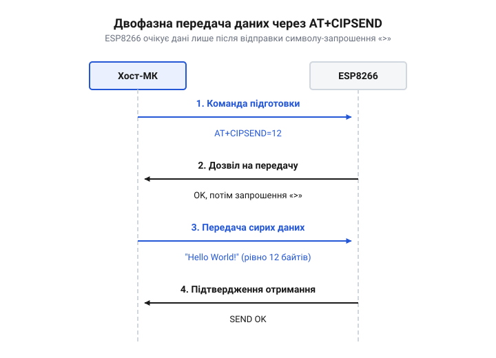

# Програмний довідник команд AT+CIPSEND та режимів відправлення даних в AT-прошивці ESP8266

<preknowlist>
- [Огляд базового командного інтерфейсу ESP-AT](root:cat-hw-boards/esp-at-command-set-overview) — загальний синтаксис AT-команд, поняття відповідей та помилок
- [Мережеві сокети TCP/UDP на модулі ESP-01](root:cat-hw-boards/esp01-tcp-udp-sockets) — концепції сокетів, типів з'єднань та різниця між одиночним і мультиплексним режимами
</preknowlist>

## Відправлення даних через AT-команди

Мікроконтролер спілкується з модулем ESP8266 через послідовний інтерфейс UART, надсилаючи текстові команди і отримуючи відповіді. Коли [мережеві сокети TCP/UDP](root:cat-hw-boards/esp01-tcp-udp-sockets) вже відкрито, виникає проблема: як відрізнити дані, які потрібно передати в мережу, від нових AT-команд для самого модуля. Якщо мікроконтролер просто почне надсилати корисне навантаження в UART, ESP8266 спробує розпізнати його як чергову директиву, що неминуче призведе до помилки синтаксису і втрати даних.

Щоб розв'язати цю проблему, прошивка Espressif AT використовує механізм явного перемикання контексту за допомогою команди `AT+CIPSEND`. Ця команда повідомляє модулю, що наступні байти є корисними даними для відправлення, а не керуючими інструкціями. Відправлення завжди відбувається у два етапи. Спочатку мікроконтролер надсилає команду `AT+CIPSEND` із вказанням кількості байтів, які він збирається передати. ESP8266 аналізує запит, резервує необхідний обсяг в апаратних буферах і, якщо готовий до прийому, надсилає у відповідь спеціальний символ-запрошення `>`.

Цей етап очікування запрошення називають @@en|рукостисканням (handshake)@@. Лише після отримання `>` мікроконтролер має право передавати самі дані. Оскільки запрошення може затриматися або не прийти зовсім через зайнятість модуля чи розрив з'єднання, хост-система не повинна чекати вічно: вона має реалізувати програмний таймаут, після вичерпання якого слід перервати очікування і повторити команду. Отримавши заявлену кількість байтів після успішного рукостискання, ESP8266 автоматично повертається в командний режим і відправляє зібраний блок у мережу. Такий блоковий підхід гарантує, що модуль не сплутає вміст пакетів із командами, але вимагає від хост-системи чіткого дотримання послідовності обміну та контролю часу очікування.

## Одиночний та мультиплексний режими (TCP/UDP)

Синтаксис виклику команди `AT+CIPSEND` залежить від того, як саме налаштовано мережевий стек: для одного з'єднання чи для кількох одночасно. За замовчуванням ESP8266 працює в одиночному режимі, де може існувати лише один активний сокет. У цьому випадку команді потрібно передати лише один параметр — довжину блоку даних у байтах:

```text
AT+CIPSEND=<length>
```

Наприклад, `AT+CIPSEND=15` повідомляє, що мікроконтролер збирається передати 15 байтів. Важливо пам'ятати про апаратне обмеження: максимальний розмір одного блоку даних для команди `AT+CIPSEND` становить 2048 байтів. Це зумовлено розміром внутрішніх буферів [мережевого стека lwIP](root:cat-hw-boards/lwip-architecture-esp8266). Якщо потрібно надіслати більше, хост-система мусить самостійно розбити повідомлення на частини і викликати команду для кожної з них окремо.

Коли модуль працює в мультиплексному режимі (після команди `AT+CIPMUX=1`), він може підтримувати до п'яти паралельних з'єднань одночасно. Оскільки сокетів тепер кілька, модулю потрібно знати, якому саме клієнту чи серверу призначені дані. Тому синтаксис розширюється ідентифікатором з'єднання `link_id`, який модуль видав під час відкриття сокета. Хоча мережевих з'єднань багато, послідовний інтерфейс для спілкування з хостом єдиний. Це означає, що під час відправлення на один із сокетів — від моменту виклику команди до фінального статусу `SEND OK` — обмін із модулем повністю блокується. Інші з'єднання при цьому не розриваються і продовжують мовчки приймати мережеві пакети у внутрішні буфери, проте хост не отримає сповіщень про вхідні дані (через [асинхронні кадри `+IPD`](root:cat-hw-boards/esp8266-at-ipd-parser)) і не зможе надіслати жодної іншої команди, доки поточна передача не звільнить інтерфейс:

```text
AT+CIPSEND=<link_id>,<length>
```

Виклик `AT+CIPSEND=2,128` означатиме намір відправити 128 байтів через з'єднання з номером 2. Інші правила залишаються незмінними: після цієї команди мікроконтролер так само повинен дочекатися символу `>` перед надсиланням самих 128 байтів.

## Передача даних по UDP з вказанням адресата

Робота з протоколом UDP має свою специфіку: це протокол без встановлення з'єднання, тому сокет не прив'язаний жорстко до одного отримувача так, як у випадку з TCP. Хоча під час створення UDP-сокета мікроконтролер вказує цільову IP-адресу та порт за замовчуванням, він може відправити пакет і на іншу адресу без перевідкриття з'єднання. Для цього прошивка надає розширений варіант команди `AT+CIPSEND`, який дозволяє передати параметри адресата прямо під час відправлення.

Для одиночного режиму синтаксис виглядає так:

```text
AT+CIPSEND=<length>,<remote_IP>,<remote_port>
```

Для мультиплексного режиму, відповідно, додається ідентифікатор:

```text
AT+CIPSEND=<link_id>,<length>,<remote_IP>,<remote_port>
```

Наприклад, команда `AT+CIPSEND=0,45,"192.168.1.100",8080` надішле 45 байтів даних через сокет 0 на вказану IP-адресу та порт, ігноруючи ті координати, з якими цей сокет створювався. Це зручно для реалізації серверів, які отримують запити від багатьох датчиків і мають відповідати кожному з них на його унікальну адресу.

Ця форма команди працює виключно для UDP-з'єднань. Якщо спробувати застосувати її до TCP-сокета, модуль поверне помилку синтаксису, оскільки TCP вимагає попереднього встановлення сеансу.

## Рукостискання та обробка відповідей ESP8266

Надійність передачі даних залежить від того, наскільки коректно керуючий мікроконтролер обробляє відповіді ESP8266 на кожному етапі. Процес обміну завжди є діалогом, де хост не може діяти наосліп. 

Коли мікроконтролер надсилає `AT+CIPSEND`, ESP8266 відповідає статусом `OK` та символом запрошення `>`.


*Діаграма показує етапи ініціалізації відправлення, очікування запрошення, передачу байтів та підтвердження завершення.*

Якщо мікроконтролер почне надсилати дані до появи `>`, вони перемішаються в UART-буферах з відповіддю модуля або будуть відкинуті, оскільки ESP8266 ще не перемкнувся в режим прийому сирих байтів. Тому алгоритм на стороні хоста повинен блокуватися або переходити в стан очікування саме цього символу.

Після того, як хост надіслав заявлену кількість байтів, модуль аналізує результат. Якщо дані успішно передані в мережевий стек (для UDP) або підтверджені отримувачем (для TCP), ESP8266 повертає рядок `SEND OK`. Це означає, що транзакція завершена, і мікроконтролер може переходити до наступних дій.

Проте можуть виникати й позаштатні ситуації, які хост зобов'язаний розпізнавати:
- `ERROR` у відповідь на саму команду свідчить про хибний синтаксис, спробу запису в закритий сокет або перевищення ліміту у 2048 байтів. - `SEND FAIL` з'являється після передачі даних, якщо модулю не вдалося відправити їх у мережу (наприклад, зникло Wi-Fi з'єднання або віддалений вузол розірвав TCP-сесію). - Відповідь `busy s...` означає, що попереднє відправлення ще триває, і модуль не готовий прийняти нову порцію даних. У цьому разі хост має зачекати і повторити спробу пізніше.

Лише за умови повної обробки цих статусів обмін даними поверх [базового командного інтерфейсу](root:cat-hw-boards/esp-at-command-set-overview) стає надійним.

## Режим наскрізної передачі (Passthrough)

Блоковий режим зручний для надсилання окремих повідомлень, але для безперервного потоку даних (наприклад, передачі аудіо чи трансляції телеметрії) постійний виклик `AT+CIPSEND` та очікування запрошення створюють великі накладні витрати. Щоб передавати дані максимально швидко і прозоро, ESP8266 підтримує @@en|режим наскрізної передачі (passthrough mode)@@.

У цьому режимі модуль з'єднує послідовний порт напряму з мережевим сокетом: усе, що надходить у UART, негайно упаковується в мережеві пакети і відправляється, а все отримане з мережі — виводиться в UART. Мікроконтролеру більше не потрібно формувати AT-команди для кожного блоку.

Перехід у наскрізний режим можливий лише за умов:
1. Робота відбувається в одиночному режимі (`AT+CIPMUX=0`).
2. Встановлено прозорий режим передачі конфігураційною командою `AT+CIPMODE=1`.

Після цього подається команда початку відправлення без вказання довжини: `AT+CIPSEND`. Отримавши запрошення `>`, мікроконтролер може просто писати дані в UART безперервним потоком. Модуль самостійно нарізатиме їх на мережеві пакети.

Щоб вийти з наскрізного режиму і повернути ESP8266 до сприйняття AT-команд, мікроконтролер має надіслати @@en|escape-послідовність (escape sequence)@@ — три символи `+++` поспіль, без символів переведення рядка `\r\n` у кінці. Після цього потрібно зробити паузу щонайменше в 1 секунду, щоб модуль відрізнив цю послідовність від випадкових байтів у потоці корисних даних. Лише отримавши відповідь про повернення в командний стан, хост може знову керувати модулем за допомогою звичайних AT-директив.