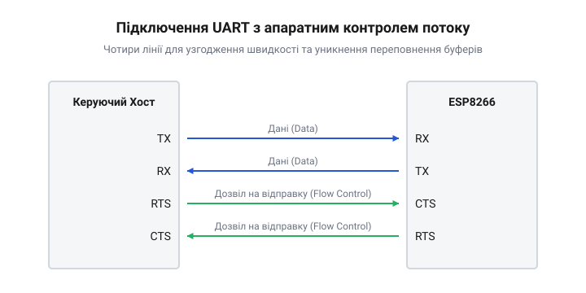
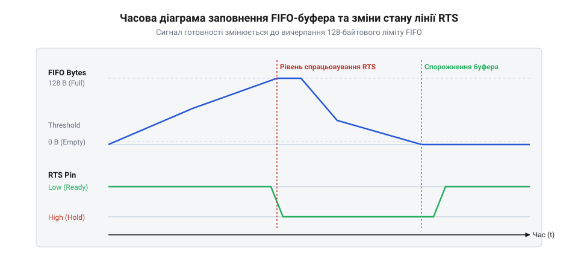

# Апаратний довідник UART-інтерфейсу ESP8266 для двофазного обміну: лінії, буфери та часові межі

<preknowlist>
- [Апаратні FIFO-буфери інтерфейсу UART в ESP8266](root:cat-hw-boards/esp8266-uart-hardware-fifo) — концепція апаратних буферів UART, їхній розмір (128 байт) та роль у тимчасовому зберіганні даних.
- [Огляд базового командного інтерфейсу ESP-AT](root:cat-hw-boards/esp-at-command-set-overview) — загальне розуміння, що модуль керується текстовими командами по UART і має фазу інтенсивної передачі даних.
</preknowlist>

## Проблема переповнення при передачі

Модуль ESP8266 часто використовують як міст між керуючим мікроконтролером та Wi-Fi мережею, спілкуючись із ним через UART. Хост відправляє текстові команди, а модуль їх виконує. Усе працює добре, доки обсяг даних малий. Але коли хост починає інтенсивну передачу даних по Wi-Fi, наприклад, командою CIPSEND, просте двопровідне підключення (лише RX та TX) швидко виявляє свою слабкість: байти починають губитися.

Суть проблеми полягає в архітектурі обробки даних і різниці пріоритетів. Керуючий мікроконтролер безперервно відправляє байти на високій швидкості, заповнюючи 128-байтовий апаратний вхідний буфер UART. За звичайних умов ядро ESP8266 одразу вичитує їх у програмні буфери мережевого стека, формуючи дані для відправки. Проте в момент передачі по Wi-Fi процесор перемикається на формування радіопакетів, шифрування та очікування вільного ефіру. Переривання від радіомодуля мають вищий пріоритет, тому обслуговування порту UART відкладається. Крім того, програмні буфери тримають підготовлені дані доти, доки не отримають підтвердження про їх доставку від маршрутизатора, і тимчасово не можуть приймати нові порції. У результаті зчитування з UART зупиняється, але керуючий мікроконтролер цього не знає і продовжує передачу. Апаратний буфер миттєво переповнюється, і всі наступні байти відкидаються ще на вході, руйнуючи цілісність повідомлення.

## Апаратний контроль потоку RTS/CTS

Щоб запобігти втраті байтів, керуючий хост повинен знати, коли ESP8266 не встигає обробляти дані, і призупиняти передачу. Під час масованої відправки через Wi-Fi модуль не завжди здатен миттєво звільняти свій приймальний буфер. Якщо хост продовжуватиме безперервно слати дані, буфер переповниться, і частина повідомлення буде безповоротно втрачена. Для розв'язання цієї проблеми UART оснащено механізмом апаратного контролю потоку, який додає дві сигнальні лінії: @@en|RTS@@ (Request To Send) та @@en|CTS@@ (Clear To Send). Замість того, щоб сліпо передавати дані, пристрої використовують ці лінії для узгодження готовності на фізичному рівні.

*Схема підключення показує, як лінія RTS одного пристрою з'єднується з лінією CTS іншого, утворюючи перехресний контроль потоку між ESP8266 та хостом.*

Лінія RTS ESP8266 підключається до лінії CTS керуючого мікроконтролера, а RTS мікроконтролера — до CTS ESP8266. За замовчуванням контроль потоку в ESP8266 вимкнений, і його необхідно явно активувати відповідною конфігураційною командою [базового командного інтерфейсу ESP-AT](root:cat-hw-boards/esp-at-command-set-overview) на етапі ініціалізації. Лише після цього модуль почне керувати станом лінії RTS і зважати на CTS.

Коли ESP8266 налаштований і готовий приймати дані, він утримує свою лінію RTS у низькому логічному рівні. Хост бачить цей рівень на своєму вході CTS і вільно передає байти. Коли ж вхідний буфер ESP8266 заповнюється до критичної межі, модуль автоматично підіймає рівень на лінії RTS до високого. Межа спрацьовування налаштовується із запасом на затримку, щоб [апаратні FIFO-буфери](root:cat-hw-boards/esp8266-uart-hardware-fifo) не переповнилися байтами, які вже летять по лінії. Високий рівень RTS є сигналом хосту негайно зупинити передачу. Як тільки ESP8266 обробляє частину даних і звільняє місце, він знову опускає RTS, і хост продовжує відправку з того місця, де зупинився.

Для надійної роботи керуючий мікроконтролер має правильно реагувати на зміну стану своєї лінії CTS. Найкращим підходом є використання вбудованого в UART хоста механізму, який на апаратному рівні блокує регістр передачі. Якщо такої периферії немає, зміну CTS слід відстежувати зовнішнім перериванням, у обробнику якого програма миттєво зупиняє відправку. Покладатися виключно на програмне опитування (@@en|полінг@@) лінії CTS у головному циклі небезпечно. Затримка між зміною рівня та реакцією коду на високих швидкостях обміну може тривати довше, ніж час передачі кількох байтів. Якщо ці байти надійдуть до ESP8266 після підняття RTS і вичерпають залишений запас буфера, вони будуть втрачені ще до того, як мікроконтролер усвідомить потребу зупинитися.

## Обмеження FIFO-буферів і таймінги

Апаратний контроль потоку спирається на внутрішні [апаратні FIFO-буфери інтерфейсу UART в ESP8266](root:cat-hw-boards/esp8266-uart-hardware-fifo). Кожен з них, і приймальний, і передавальний, має жорстко обмежений об'єм у 128 байт. Це означає, що система не може чекати до останнього байта, перш ніж дати сигнал на зупинку.

*Діаграма демонструє, як рівень RTS підіймається при досягненні порогу заповнення буфера, залишаючи резервні байти для тих даних, що вже перебувають у процесі передачі.*

Щоб уникнути переповнення, поріг спрацьовування лінії RTS встановлюють не на 128 байт, а нижче, наприклад, на 112 байт. Коли кількість непрочитаних байтів у буфері досягає цього порогу, ESP8266 підіймає RTS. Хост не може зупинити передачу миттєво: сигнал RTS має дійти до мікроконтролера, той має обробити переривання або завершити апаратний зсув поточного байта, і, можливо, ще один байт уже перебуває в лінії на момент зупинки. Резерв у кілька десятків байтів (від порогу до 128) гарантує, що всі ці "запізнілі" байти спокійно помістяться у FIFO-буфері, не викликавши переповнення. Правильне налаштування цього порогу та врахування таймінгів є критичним на високих швидкостях UART, де затримка в мілісекунду означає десятки переданих байтів.

## Узгодження логічних рівнів напруги

Фізичні лінії UART передають логічні нулі та одиниці через рівні напруги. ESP8266 працює виключно з логікою 3.3 В, і його входи не розраховані на вищі напруги. Багато популярних керуючих мікроконтролерів, такі як класичні плати Arduino, працюють з логікою 5 В. Якщо підключити 5-вольтовий вихід TX хоста безпосередньо до 3.3-вольтового входу RX модуля ESP8266, висока напруга може пробити вхідний каскад мікросхеми, що призведе до незворотного пошкодження модуля.

Для надійного зв'язку між пристроями з різними напругами живлення необхідно використовувати схеми узгодження логічних рівнів. Найпростіший спосіб узгодити передачу від 5 В хоста до 3.3 В ESP8266 — використати резистивний дільник напруги на лінії RX модуля. Він знижує 5-вольтовий сигнал до безпечних 3.3 В. У зворотний бік, від виходу TX ESP8266 (3.3 В) до входу RX 5-вольтового хоста, дільник не потрібен: більшість 5-вольтових мікроконтролерів надійно сприймають 3.3 В як логічну одиницю. Для ліній апаратного контролю потоку застосовується те саме правило: сигнал RTS від хоста (5 В) до CTS модуля (3.3 В) потребує дільника, а сигнал від RTS модуля до CTS хоста — ні. Більш надійним рішенням є використання спеціалізованих мікросхем-перетворювачів рівнів на базі польових транзисторів, які забезпечують швидке перемикання і двонаправлену роботу без спотворення форми сигналу на високих швидкостях.

## Компенсація пікових струмів споживання

Стабільність роботи UART-інтерфейсу залежить не лише від логічних сигналів, а й від якості живлення ESP8266. З увімкненим Wi-Fi у стані простою модуль споживає близько 70 мА. Проте, коли починається інтенсивна передача даних, внутрішній радіопередавач періодично вмикається на повну потужність. У ці моменти струм споживання модуля може миттєво стрибати до 400–500 мА. 

Якщо джерело живлення не здатне швидко віддати такий струм, або якщо провідники від стабілізатора до модуля занадто довгі й тонкі, на виводах живлення ESP8266 виникає просадка напруги. Ці короткочасні провали порушують роботу внутрішніх кіл мікроконтролера, що може призвести до спотворення логічних рівнів на лініях UART, появи сміттєвих байтів, або навіть до повного перезавантаження модуля під час інтенсивного обміну. Щоб компенсувати ці пікові струми, безпосередньо біля виводів живлення VCC і GND модуля необхідно встановлювати танталовий або керамічний конденсатор великої ємності (зазвичай від 100 до 470 мкФ) у парі з високочастотним керамічним конденсатором на 0.1 мкФ. Конденсатори відіграють роль локального резервуара енергії, віддаючи струм у моменти пікового споживання радіотракту і згладжуючи напругу, що гарантує безперебійну роботу як самого ядра, так і UART-інтерфейсу.